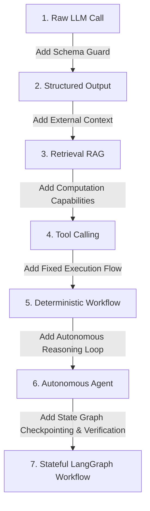

# AI Systems Architecture & First Principles: TenderPulse AI

## 1. Architectural Philosophy: The Separation of Intelligence & Authority

In accordance with **AGENTS.md**:

> **"Deterministic code owns authorization, calculations, validation, and critical state transitions. LLMs are not the source of truth for critical business state."**

In Indian public procurement (e.g. GeM, CPPP, State PWDs, NHAI, Indian Railways), a single error in bid submission (such as providing a ₹50 stamp paper instead of ₹100, or citing an expired ISO certification) results in **immediate procedural disqualification**. Bid securities (EMDs) worth lakhs of rupees can be forfeited, and companies can face blacklisting.

Therefore, our architecture treats Artificial Intelligence as an **untrusted, advisory text intelligence engine** that operates strictly behind deterministic software guards.

---

## 2. AI Foundations: From Mathematical Primitives to Production Systems

### 2.1 Large Language Models (LLMs)

- **First Principles**: An LLM (e.g., Anthropic Claude 3.5 Sonnet, OpenAI GPT-4o) is mathematically a **probabilistic auto-regressive next-token predictor**:
  $$P(w_t \mid w_1, w_2, \dots, w_{t-1})$$
- **The Reality**: The model does not "understand" procurement law, possess consciousness, or hold a database of facts. It assigns conditional probabilities to strings of subword tokens based on statistical patterns learned during pre-training.
- **Domain Strengths**: Parsing dense, archaic, bureaucratic Indian administrative English (e.g., translating a 4-paragraph clause across GCC and SCC into core actionable criteria).
- **Domain Weaknesses**:
  - Deterministic calculations (subtractions, interest calculations, currency conversions).
  - Reliable citations without external grounding.
  - Consistent adherence to business rules unless constrained by grammar or code.

---

### 2.2 Tokens and Context Windows

- **Tokens**: Text is not fed to neural networks as characters or words, but as discrete integer IDs generated by a byte-pair encoding (BPE) tokenizer (e.g., `cl100k_base` or Anthropic's BPE). On average, 1,000 English words correspond to approximately 1,333 tokens.
- **Context Windows**: The maximum sequence length ($N$ tokens) a Transformer attention mechanism can process in a single forward pass (e.g., 128k or 200k tokens).
- **The "Lost in the Middle" Phenomenon**: While modern models advertise 200k+ token windows, Transformer self-attention is not uniform. Critical clauses buried in the middle of a 150-page prompt exhibit lower recall than text at the beginning or end of the context window.
- **Economics & Latency**: Processing an entire 250-page tender (180,000 tokens) on every query incurs unacceptable latency (30–60s) and costs ($1.50–$3.00 per query).

---

### 2.3 System, User, and Tool Messages (Role Framing)

Modern chat completion APIs structure interaction into discrete roles:

1. **System Message**: Establishes immutable behavioral constraints, persona, and output rules. Sets the baseline instructions before user data is evaluated.
2. **User Message**: Contains untrusted input or requests originating from the user or document chunks.
3. **Assistant Message**: The generation produced by the model (content or tool call requests).
4. **Tool Message**: The deterministic output of an executed function returned to the model as external truth.

---

### 2.4 Structured Output (Constrained Decoding)

- **The Problem**: Natural language completions ("Here are the requirements: 1. ₹100 stamp paper...") cannot be reliably parsed by backend services or stored in relational databases. Regex patterns break on minor syntactic phrasing variations.
- **The Mechanism**: **Grammar-Constrained Decoding**. During token generation, the inference engine applies a strict schema mask:
  - If the schema mandates a numeric JSON property (`"stampPaperDenominationInr": integer`), all token IDs that do not represent numeric digits are set to probability $0$ ($P = 0$).
- **In TenderPulse AI**: Used to force the LLM to output strictly validated Pydantic/JSON schemas representing `ComplianceItem`, `ExecutionRules`, and `Provenance`.

---

### 2.5 Hallucinations

- **The Root Cause**: Hallucination is not a bug; it is the natural consequence of probabilistic next-token generation. When the probability distribution is broad, the model samples tokens that are syntactically plausible but factually fabricated.
- **Types of Hallucinations in Tender Analysis**:
  1. _Invented Clauses_: Generating a non-existent turnover requirement because similar tenders usually contain one.
  2. _Citation Drift_: Correctly identifying an EMD requirement but citing Page 42 when it actually appeared on Page 84.
  3. _Numeric Drift_: Reading "INR 50,00,000" and reporting "INR 5,00,000".
- **Grounding Defense**: Zero ungrounded claims. Every extracted compliance item must carry a verbatim string quote that is deterministically verified against the source PDF page text by Python code before persistence.

---

### 2.6 Embeddings

- **First Principles**: An embedding model (e.g., `text-embedding-3-large`, `voyage-large-2`) maps a text string into a fixed-dimensional dense vector space ($\mathbb{R}^D$, typically $D = 1536$ or $D = 3072$):
  $$f: \text{string} \to \mathbb{R}^D$$
- **Semantic Topology**: Words and concepts with similar meanings cluster together in this vector space. "EMD Guarantee" and "Bid Security Earnest Money" produce vectors with high cosine similarity, even though they share no common keywords.
- **Limitation**: Embeddings capture semantic gist, but perform poorly at exact identifier lookup (e.g., finding tender number `"NHAI/DEL/2026/04"` is better handled by exact lexical search or PostgreSQL full-text search `tsvector`).

---

### 2.7 Vector Search & ANN Indexing

- **Exact Search**: Comparing a query vector against millions of document vectors via $O(N)$ dot-product or cosine distance is too slow for real-time applications.
- **Approximate Nearest Neighbors (ANN)**: Algorithms like **HNSW** (Hierarchical Navigable Small World) or **IVFFlat** trade minor recall precision for sub-millisecond $O(\log N)$ vector search.
- **In PostgreSQL**: Implemented via the `pgvector` extension with HNSW indexes:
  ```sql
  CREATE INDEX idx_chunks_embedding ON document_chunks
  USING hnsw (embedding vector_cosine_ops);
  ```

---

### 2.8 Retrieval-Augmented Generation (RAG)

- **The Architecture**:
  $$\text{Query} \xrightarrow{\text{Embed}} \text{Vector} \xrightarrow{\text{pgvector}} \text{Top-K Chunks} \xrightarrow{\text{Augment Prompt}} \text{LLM Reasoning}$$
- **Chunking Strategy**: Slicing 250-page tenders into semantically meaningful passages (500–1000 tokens) with 10% overlap to preserve clause boundaries.
- **Metadata Filtering**: Ensuring vector queries strictly enforce tenant and document isolation:
  ```sql
  WHERE organization_id = :tenantId AND document_id = ANY(:allowedIds)
  ```

---

### 2.9 Tool Calling (Function Calling)

- **The Handshake Protocol**:
  1. Application defines tool specifications (JSON Schema) and provides them to the LLM.
  2. The LLM evaluates user prompt + context and decides it needs an external capability.
  3. The LLM pauses generation and outputs a structured `tool_call` request:
     `{ "name": "calculate_financial_shortfall", "arguments": { "required": 50000000, "actual": 42000000 } }`
  4. Application intercepts the tool call, executes verified deterministic code, and returns the result in a `tool` message.
  5. The LLM resumes generation incorporating the verified tool output.

---

### 2.10 AI Workflow vs. Autonomous Agent

| Dimension            | AI Workflow (Orchestrated Graph)                                                                            | Autonomous Agent (Self-Directed Loop)                                                                       |
| :------------------- | :---------------------------------------------------------------------------------------------------------- | :---------------------------------------------------------------------------------------------------------- |
| **Control Flow**     | **Deterministic & Fixed**: Code dictates the sequence of steps, tool executions, and conditional branching. | **Probabilistic & Dynamic**: The LLM decides what step to take next, which tools to call, and when to stop. |
| **Predictability**   | **Extremely high**: State transitions are bounded and repeatable.                                           | **Low**: Susceptible to infinite loops, unintended tool executions, and non-deterministic paths.            |
| **Cost & Latency**   | **Bounded**: Exact number of LLM calls is known or strictly capped.                                         | **Unbounded**: Can invoke tools 20 times if it gets confused.                                               |
| **TenderPulse Role** | **Core Architecture**: Extraction, validation, and review follow strict workflows.                          | **Rejected for Core State**: Procurement compliance cannot risk unconstrained autonomy.                     |

---

### 2.11 Stateless vs. Stateful AI

- **Stateless AI**: Single-shot HTTP REST calls (`POST /v1/chat/completions`). The model retains zero memory between calls; every interaction must re-transmit full context.
- **Stateful AI**: Multi-step graph execution where state is persisted across transitions. If step 4 fails or needs human review, the workflow pauses, persists its state to a database checkpoint, and resumes later without re-running steps 1 through 3.

---

### 2.12 Deterministic Code vs. Model Reasoning: The Hard Boundary

| Concern                           | Owner              | Rationale                                                        |
| :-------------------------------- | :----------------- | :--------------------------------------------------------------- |
| **Tenant Isolation & Security**   | Deterministic Code | LLMs cannot enforce authorization boundaries.                    |
| **Arithmetic & Calculations**     | Deterministic Code | LLMs fail at reliable arithmetic; code is 100% exact.            |
| **Verdict Computation (PASS/FAIL/MISSING/REVIEW)** | Deterministic Code | Verdicts must be reproducible and legally defensible; a model cannot be cited in a dispute (ADR 0019/0021). |
| **Unstructured Text Parsing**     | Model Reasoning    | Code cannot anticipate every bureaucratic clause syntax.         |
| **Quote & Citation Verification** | Deterministic Code | Exact substring verification guarantees zero hallucination.      |
| **Explanation Narrative**         | Model Reasoning (guarded) | Prose is where LLMs excel — but it explains a *determined* result and is citation-verified (§5). |
| **Database State Mutations**      | Deterministic Code | Relational constraints and ACID transactions govern persistence. |
| **Final Compliance Decision**     | Human              | Override is permission-gated, reasoned, and audited (ADR 0021). |

---

## 3. The 7-Stage Architectural Progression



---

### Stage 1: The Raw LLM Call

- **What it does**: Direct prompt $\rightarrow$ model $\rightarrow$ markdown text output.
- **When to use**: Creative writing, open-ended ideation, conversational summaries.
- **When NOT to use**: **Any enterprise application.** Raw prose cannot be saved to SQL, breaks backend code, and provides zero validation guarantees.

---

### Stage 2: Structured Output

- **What it does**: Enforces JSON Schema compliance on token generation via grammar-constrained decoding.
- **When to use**: Data extraction into structured DTOs where the source text is already small enough to fit in prompt context.
- **When NOT to use**:
  - When the document exceeds the context window (requires retrieval).
  - When the output requires external arithmetic verification (model can still generate valid JSON with fabricated numbers).

---

### Stage 3: Retrieval-Augmented Generation (RAG)

- **What it does**: Chunks long documents, embeds passages, performs vector similarity search, and injects relevant chunks into prompt context.
- **When to use**: Large document collections (250-page tenders, manuals, policy archives) where the question targets specific localized sections.
- **When NOT to use**:
  - Small documents that fit entirely inside context with low cost (Direct context stuffing is superior to vector search for < 15 pages).
  - Tasks requiring global aggregation (e.g., "Sum the values across all 40 annexures"). Standard RAG retrieves top-5 chunks and misses 35 annexures.

---

### Stage 4: Tool Calling (Function Calling)

- **What it does**: Gives the model the ability to request execution of external functions (calculators, scrapers, database queries).
- **When to use**: When the task requires exact calculations, external API data, or deterministic validation checks.
- **When NOT to use**:
  - When the next action is completely predetermined (do not ask the LLM if it wants to run a validator; just run the validator in code!).
  - Giving models open-ended, dangerous tools (e.g. unrestricted `run_sql_query` or `shell_exec`).

---

### Stage 5: Deterministic Workflow (Code Pipeline / DAG)

- **What it does**: Hardcoded sequential code flow: Step A $\rightarrow$ Step B $\rightarrow$ Step C.
- **When to use**: Standard predictable business logic (e.g. upload file $\rightarrow$ verify checksum $\rightarrow$ queue job).
- **When NOT to use**: Complex problem-solving where the number of attempts or refinement steps cannot be hardcoded in a simple linear pipeline.

---

### Stage 6: Autonomous Agent (ReAct Loop)

- **What it does**: A while-loop where the LLM decides its own sequence: Thought $\rightarrow$ Action (Tool) $\rightarrow$ Observation $\rightarrow$ Repeat until model decides it is done.
- **When to use**: Unbounded exploratory research, open-ended coding assistants, interactive triage.
- **When NOT to use**: **Core business workflows and compliance extraction.** Autonomous agents get stuck in loops, rack up unexpected cloud bills, exhibit non-deterministic behavior, and cannot guarantee SLA execution times.

---

### Stage 7: Stateful LangGraph Workflow (TenderPulse AI Production Engine)

- **What it does**: A cyclic, directed state graph combining the predictability of workflows with the reasoning of LLMs:
  - Strongly typed state object (`TypedDict` / Pydantic).
  - Deterministic Python verification nodes.
  - Controlled cyclic loops (retry up to $N$ times if citation check fails).
  - Durable checkpointing to PostgreSQL (`PostgresSaver`).
  - Human-in-the-loop pause, inspection, and resume capabilities.
- **When to use**: Complex, mission-critical multi-step AI business processes (e.g., legal compliance verification, contract audit).
- **When NOT to use**: Simple CRUD endpoints, single-prompt summarization tasks, or purely linear pipelines where zero feedback loops exist.

---

## 4. LangGraph Systems Architecture: From Primitives to Production

### 4.1 LangChain vs. LangGraph: The Shift from Linear Chains to State Machines

```
LangChain Expression Language (LCEL):
Input ──► [Prompt Template] ──► [LLM Call] ──► [Output Parser] ──► Output (One-way DAG)

LangGraph State Machine:
               ┌────────────────────────┐
               │ Node 1: Extract Items  │
               └───────────┬────────────┘
                           │
                           ▼
               ┌────────────────────────┐
 ┌────────────>│ Node 2: Verify Citation│
 │             └───────────┬────────────┘
 │                         │
[Failed Citation]          ├──[All Valid]──────► [Node 3: Persist to DB]
 │                         │
 └─[Targeted Retry Node]◄──┴──[Ambiguous]──────► [Node 4: Human Review Interrupt]
```

- **LangChain Core Limitation**: Designed for linear Directed Acyclic Graphs (DAGs). If Step B fails (e.g., hallucinated page citation), it cannot loop back with feedback. If the worker crashes mid-stream, progress is lost.
- **LangGraph Advantage**: Treats multi-step AI as a cyclic state machine with durable PostgreSQL checkpoints, conditional routing, and human-in-the-loop interrupts.

### 4.2 The 13 Core LangGraph Primitives

1. **State**: Strongly typed data structure flowing through the graph, updated via immutable dictionaries or reducers (`operator.add`).
2. **Nodes**: Python functions performing either LLM reasoning or deterministic verification: $f: S \to \Delta S$.
3. **Edges**: Deterministic transitions connecting Node A directly to Node B.
4. **Conditional Edges**: Dynamic routing functions that inspect state and choose the next node.
5. **Tools**: Narrow, validated external capabilities called by nodes under strict security guards.
6. **Checkpoints**: Point-in-time snapshots of state and channel values saved at node boundaries.
7. **Persistence**: Database engine (`PostgresSaver`) storing checkpoints durably to disk.
8. **Retries**: Both transient API retries (backoff on 429/503) and graph-level semantic feedback retries.
9. **Interrupts**: Native pause mechanism suspending execution before or after specific nodes (`interrupt_before`).
10. **Human Approval**: Suspending graph execution for human review, merging manager input into state upon resume.
11. **Resumability**: Reloading graph state from a checkpoint via `thread_id` without re-running earlier nodes.
12. **Time-Travel**: Loading historical checkpoints to inspect exact prompts and outputs for auditability.
13. **Subgraphs**: Nesting independent graphs as nodes inside a parent graph for modular domain isolation.

### 4.3 Comparison of the 5 AI Execution Paradigms

| Dimension          | 1. Plain Function  | 2. Chain (LCEL) | 3. Deterministic Flow | 4. Autonomous Agent        | 5. LangGraph Workflow |
| :----------------- | :----------------- | :-------------- | :-------------------- | :------------------------- | :-------------------- |
| **Control Flow**   | Linear / Branching | Linear DAG      | Fixed DAG             | Dynamic ReAct Loop         | Cyclic State Machine  |
| **Intelligence**   | Deterministic Code | Single Prompt   | None                  | LLM Governs Flow           | Guarded LLM Reasoning |
| **State Memory**   | Stack variables    | Ephemeral       | Database rows         | In-context history         | Typed Checkpoints     |
| **Persistence**    | None               | None            | Database              | Ephemeral                  | Native ACID DB        |
| **Cycles/Loops**   | Standard loops     | None            | None                  | Unbounded & Risky          | Bounded & Guarded     |
| **Human-in-Loop**  | Blocking / Polling | Impossible      | Async queues          | Difficult                  | Native Pause / Resume |
| **Predictability** | 100% Deterministic | Medium          | 100% Deterministic    | Low (Susceptible to drift) | Extremely High        |

#### When NOT to Use Each:

- **Plain Function**: Do NOT use when parsing messy, ambiguous natural language text.
- **Chain (LCEL)**: Do NOT use for multi-page documents requiring citation verification and error recovery.
- **Deterministic Flow**: Do NOT use when the sequence of reasoning steps cannot be hardcoded in advance.
- **Autonomous Agent**: Do NOT use for compliance or financial state where unconstrained autonomy is a liability.
- **LangGraph Workflow**: Do NOT use for basic CRUD operations or simple, single-prompt transformations.

### 4.4 Tenant-Scoped Graph Execution

Every LangGraph invocation carries an immutable `SecurityContext`:

- `tenant_id`, `user_id`, `workflow_run_id`, `allowed_document_ids`, `allowed_source_ids`.

How isolation is enforced across subsystems:

1. **Graph State**: The `SecurityContext` is frozen in state and passed to all nodes.
2. **Checkpoints**: Thread IDs are prefixed by tenant ID: `f"tenant_{tenant_id}:bid_{bid_id}:run_{run_id}"`. Checkpointer SQL queries enforce `WHERE organization_id = :tenant_id`.
3. **Tools & Retrieval**: Tools validate that queried `document_id` exists in `state["security_context"].allowed_document_ids`. Vectors are pre-filtered with `WHERE organization_id = :tenant_id`.
4. **Caches**: Shared semantic caches across tenants are strictly prohibited.

---

## 5. The AI Explanation Layer: Evidence-Based Compliance (ADR 0021)

The Evidence & Compliance Engine answers *"For this tender requirement, what evidence does the company have?"* with a five-stage pipeline: **retrieval → matching → deterministic validation → AI explanation → human decision** (`docs/DOMAIN.md` Part F). The AI participates in exactly **one** stage — explanation — and is structurally prevented from participating in the decision.

### 5.1 The Contract: No Verdict in the Schema

The explanation node receives the **deterministic result bundle** (criterion results, evidence references, conflict records, verbatim quotes) for requirements the caller is authorized to see — never raw documents, never company data beyond authorized scope.

```python
class ExplanationClaim(BaseModel):
    result_id: str            # cites a CriterionResult / EvidenceRef id
    statement: str            # prose restatement, no new facts

class Explanation(BaseModel):
    claims: list[ExplanationClaim]
    narrative: str
    model_id: str
    model_version: str
    # NOTE: deliberately NO verdict, NO amount, NO PASS/FAIL field.
    # The AI physically cannot express an assessment (ADR 0019 contract boundary).
```

**Why:** the blast radius of a hallucination is confined to prose quality. A hallucinated explanation is a documentation bug; it can never flip a verdict, because no code path reads a verdict from the model output.

### 5.2 Explanation Grounding Verification

A deterministic verifier checks every `claim.result_id` against the result bundle:

1. The cited result must exist in the bundle (no invented results).
2. Any number/date/amount in `statement` must match the cited result's value (no numeric drift).
3. The narrative may **rephrase and connect** ("the average across four years is ₹10.05 Cr, margin ₹5 L") but may not assert facts absent from the bundle.

Failure → bounded retry (≤2) → **deterministic template renderer** produces the narrative from the same bundle. The assessment is never blocked on prose: if the model is down, the verdict and evidence stand, and the explanation degrades gracefully.

### 5.3 What the Model May See (Security Boundary)

- **In scope:** the result bundle for authorized requirements — already-extracted facts and verbatim quotes, tenant-scoped by `SecurityContext` (§4.4), profile-version-pinned.
- **Out of scope:** raw PDFs, other tenants' data, live (unpinned) profile state, and any field the caller's RBAC does not grant. Retrieval and tenant filtering happen **before** the AI boundary (ADR 0011/0013) — the model is never the access-control layer.
- **Ambiguous clauses:** the model may propose *interpretations* of an ambiguous requirement, but they are labelled advisory candidates for human review — never verdicts. The engine marks the requirement REVIEW_REQUIRED; the human decides.

### 5.4 Why Explanation Is a Separate Stage (Not Merged With Validation)

| Merged design ("AI assesses and explains") | Separated design (ADR 0021) |
|:------------------------------------------|:----------------------------|
| Verdict untestable, unreproducible | Verdict is a pure function — property + mutation tested |
| Hallucination can create false PASS | Hallucination confined to prose; citation-verified |
| Company financials enter prompts | Only the result bundle enters the AI boundary |
| "Why PASS?" = "the model said so" | "Why PASS?" = documents, pages, arithmetic, policy |

### 5.5 Evaluation & Regression

The `apps/ai` scorecard framework extends to the explanation layer:

- **Faithfulness**: fraction of narrative claims whose citations exist and match the bundle (target 1.0).
- **Citation accuracy**: zero claims citing non-existent results (zero-tolerance invariant).
- **Verdict parity**: explanation run 10× on the same bundle must never change the assessment state.
- **Adversarial suite**: result bundles containing deliberate conflicts, expired certificates, and missing dates must produce explanations that *report* the conflict — never resolve it.

*Stop point reached: design only, per PROMPT 7. No code implemented.*
