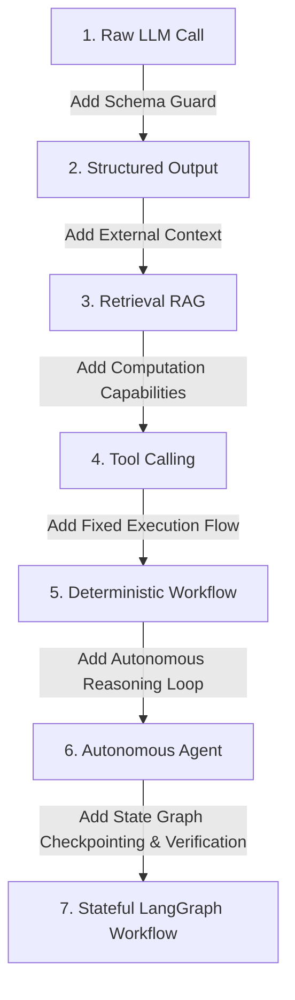

# AI Systems Architecture & First Principles: TenderPulse AI

## 1. Architectural Philosophy: The Separation of Intelligence & Authority

In accordance with **AGENTS.md**:

> **"Deterministic code owns authorization, calculations, validation, and critical state transitions. LLMs are not the source of truth for critical business state."**

In Indian public procurement (e.g. GeM, CPPP, State PWDs, NHAI, Indian Railways), a single error in bid submission (such as providing a ₹50 stamp paper instead of ₹100, or citing an expired ISO certification) results in **immediate procedural disqualification**. Bid securities (EMDs) worth lakhs of rupees can be forfeited, and companies can face blacklisting.

Therefore, our architecture treats Artificial Intelligence as an **untrusted, advisory text intelligence engine** that operates strictly behind deterministic software guards.

---

## 2. AI Foundations: From Mathematical Primitives to Production Systems

### 2.1 Large Language Models (LLMs)

- **First Principles**: An LLM (e.g., Anthropic Claude 3.5 Sonnet, OpenAI GPT-4o) is mathematically a **probabilistic auto-regressive next-token predictor**:
  $$P(w_t \mid w_1, w_2, \dots, w_{t-1})$$
- **The Reality**: The model does not "understand" procurement law, possess consciousness, or hold a database of facts. It assigns conditional probabilities to strings of subword tokens based on statistical patterns learned during pre-training.
- **Domain Strengths**: Parsing dense, archaic, bureaucratic Indian administrative English (e.g., translating a 4-paragraph clause across GCC and SCC into core actionable criteria).
- **Domain Weaknesses**:
  - Deterministic calculations (subtractions, interest calculations, currency conversions).
  - Reliable citations without external grounding.
  - Consistent adherence to business rules unless constrained by grammar or code.

---

### 2.2 Tokens and Context Windows

- **Tokens**: Text is not fed to neural networks as characters or words, but as discrete integer IDs generated by a byte-pair encoding (BPE) tokenizer (e.g., `cl100k_base` or Anthropic's BPE). On average, 1,000 English words correspond to approximately 1,333 tokens.
- **Context Windows**: The maximum sequence length ($N$ tokens) a Transformer attention mechanism can process in a single forward pass (e.g., 128k or 200k tokens).
- **The "Lost in the Middle" Phenomenon**: While modern models advertise 200k+ token windows, Transformer self-attention is not uniform. Critical clauses buried in the middle of a 150-page prompt exhibit lower recall than text at the beginning or end of the context window.
- **Economics & Latency**: Processing an entire 250-page tender (180,000 tokens) on every query incurs unacceptable latency (30–60s) and costs ($1.50–$3.00 per query).

---

### 2.3 System, User, and Tool Messages (Role Framing)

Modern chat completion APIs structure interaction into discrete roles:

1. **System Message**: Establishes immutable behavioral constraints, persona, and output rules. Sets the baseline instructions before user data is evaluated.
2. **User Message**: Contains untrusted input or requests originating from the user or document chunks.
3. **Assistant Message**: The generation produced by the model (content or tool call requests).
4. **Tool Message**: The deterministic output of an executed function returned to the model as external truth.

---

### 2.4 Structured Output (Constrained Decoding)

- **The Problem**: Natural language completions ("Here are the requirements: 1. ₹100 stamp paper...") cannot be reliably parsed by backend services or stored in relational databases. Regex patterns break on minor syntactic phrasing variations.
- **The Mechanism**: **Grammar-Constrained Decoding**. During token generation, the inference engine applies a strict schema mask:
  - If the schema mandates a numeric JSON property (`"stampPaperDenominationInr": integer`), all token IDs that do not represent numeric digits are set to probability $0$ ($P = 0$).
- **In TenderPulse AI**: Used to force the LLM to output strictly validated Pydantic/JSON schemas representing `ComplianceItem`, `ExecutionRules`, and `Provenance`.

---

### 2.5 Hallucinations

- **The Root Cause**: Hallucination is not a bug; it is the natural consequence of probabilistic next-token generation. When the probability distribution is broad, the model samples tokens that are syntactically plausible but factually fabricated.
- **Types of Hallucinations in Tender Analysis**:
  1. _Invented Clauses_: Generating a non-existent turnover requirement because similar tenders usually contain one.
  2. _Citation Drift_: Correctly identifying an EMD requirement but citing Page 42 when it actually appeared on Page 84.
  3. _Numeric Drift_: Reading "INR 50,00,000" and reporting "INR 5,00,000".
- **Grounding Defense**: Zero ungrounded claims. Every extracted compliance item must carry a verbatim string quote that is deterministically verified against the source PDF page text by Python code before persistence.

---

### 2.6 Embeddings

- **First Principles**: An embedding model (e.g., `text-embedding-3-large`, `voyage-large-2`) maps a text string into a fixed-dimensional dense vector space ($\mathbb{R}^D$, typically $D = 1536$ or $D = 3072$):
  $$f: \text{string} \to \mathbb{R}^D$$
- **Semantic Topology**: Words and concepts with similar meanings cluster together in this vector space. "EMD Guarantee" and "Bid Security Earnest Money" produce vectors with high cosine similarity, even though they share no common keywords.
- **Limitation**: Embeddings capture semantic gist, but perform poorly at exact identifier lookup (e.g., finding tender number `"NHAI/DEL/2026/04"` is better handled by exact lexical search or PostgreSQL full-text search `tsvector`).

---

### 2.7 Vector Search & ANN Indexing

- **Exact Search**: Comparing a query vector against millions of document vectors via $O(N)$ dot-product or cosine distance is too slow for real-time applications.
- **Approximate Nearest Neighbors (ANN)**: Algorithms like **HNSW** (Hierarchical Navigable Small World) or **IVFFlat** trade minor recall precision for sub-millisecond $O(\log N)$ vector search.
- **In PostgreSQL**: Implemented via the `pgvector` extension with HNSW indexes:
  ```sql
  CREATE INDEX idx_chunks_embedding ON document_chunks
  USING hnsw (embedding vector_cosine_ops);
  ```

---

### 2.8 Retrieval-Augmented Generation (RAG)

- **The Architecture**:
  $$\text{Query} \xrightarrow{\text{Embed}} \text{Vector} \xrightarrow{\text{pgvector}} \text{Top-K Chunks} \xrightarrow{\text{Augment Prompt}} \text{LLM Reasoning}$$
- **Chunking Strategy**: Slicing 250-page tenders into semantically meaningful passages (500–1000 tokens) with 10% overlap to preserve clause boundaries.
- **Metadata Filtering**: Ensuring vector queries strictly enforce tenant and document isolation:
  ```sql
  WHERE organization_id = :tenantId AND document_id = ANY(:allowedIds)
  ```

---

### 2.9 Tool Calling (Function Calling)

- **The Handshake Protocol**:
  1. Application defines tool specifications (JSON Schema) and provides them to the LLM.
  2. The LLM evaluates user prompt + context and decides it needs an external capability.
  3. The LLM pauses generation and outputs a structured `tool_call` request:
     `{ "name": "calculate_financial_shortfall", "arguments": { "required": 50000000, "actual": 42000000 } }`
  4. Application intercepts the tool call, executes verified deterministic code, and returns the result in a `tool` message.
  5. The LLM resumes generation incorporating the verified tool output.

---

### 2.10 AI Workflow vs. Autonomous Agent

| Dimension            | AI Workflow (Orchestrated Graph)                                                                            | Autonomous Agent (Self-Directed Loop)                                                                       |
| :------------------- | :---------------------------------------------------------------------------------------------------------- | :---------------------------------------------------------------------------------------------------------- |
| **Control Flow**     | **Deterministic & Fixed**: Code dictates the sequence of steps, tool executions, and conditional branching. | **Probabilistic & Dynamic**: The LLM decides what step to take next, which tools to call, and when to stop. |
| **Predictability**   | **Extremely high**: State transitions are bounded and repeatable.                                           | **Low**: Susceptible to infinite loops, unintended tool executions, and non-deterministic paths.            |
| **Cost & Latency**   | **Bounded**: Exact number of LLM calls is known or strictly capped.                                         | **Unbounded**: Can invoke tools 20 times if it gets confused.                                               |
| **TenderPulse Role** | **Core Architecture**: Extraction, validation, and review follow strict workflows.                          | **Rejected for Core State**: Procurement compliance cannot risk unconstrained autonomy.                     |

---

### 2.11 Stateless vs. Stateful AI

- **Stateless AI**: Single-shot HTTP REST calls (`POST /v1/chat/completions`). The model retains zero memory between calls; every interaction must re-transmit full context.
- **Stateful AI**: Multi-step graph execution where state is persisted across transitions. If step 4 fails or needs human review, the workflow pauses, persists its state to a database checkpoint, and resumes later without re-running steps 1 through 3.

---

### 2.12 Deterministic Code vs. Model Reasoning: The Hard Boundary

| Concern                           | Owner              | Rationale                                                        |
| :-------------------------------- | :----------------- | :--------------------------------------------------------------- |
| **Tenant Isolation & Security**   | Deterministic Code | LLMs cannot enforce authorization boundaries.                    |
| **Arithmetic & Calculations**     | Deterministic Code | LLMs fail at reliable arithmetic; code is 100% exact.            |
| **Verdict Computation (PASS/FAIL/MISSING/REVIEW)** | Deterministic Code | Verdicts must be reproducible and legally defensible; a model cannot be cited in a dispute (ADR 0019/0021). |
| **Unstructured Text Parsing**     | Model Reasoning    | Code cannot anticipate every bureaucratic clause syntax.         |
| **Quote & Citation Verification** | Deterministic Code | Exact substring verification guarantees zero hallucination.      |
| **Explanation Narrative**         | Model Reasoning (guarded) | Prose is where LLMs excel — but it explains a *determined* result and is citation-verified (§5). |
| **Database State Mutations**      | Deterministic Code | Relational constraints and ACID transactions govern persistence. |
| **Final Compliance Decision**     | Human              | Override is permission-gated, reasoned, and audited (ADR 0021). |

---

## 3. The 7-Stage Architectural Progression



---

### Stage 1: The Raw LLM Call

- **What it does**: Direct prompt $\rightarrow$ model $\rightarrow$ markdown text output.
- **When to use**: Creative writing, open-ended ideation, conversational summaries.
- **When NOT to use**: **Any enterprise application.** Raw prose cannot be saved to SQL, breaks backend code, and provides zero validation guarantees.

---

### Stage 2: Structured Output

- **What it does**: Enforces JSON Schema compliance on token generation via grammar-constrained decoding.
- **When to use**: Data extraction into structured DTOs where the source text is already small enough to fit in prompt context.
- **When NOT to use**:
  - When the document exceeds the context window (requires retrieval).
  - When the output requires external arithmetic verification (model can still generate valid JSON with fabricated numbers).

---

### Stage 3: Retrieval-Augmented Generation (RAG)

- **What it does**: Chunks long documents, embeds passages, performs vector similarity search, and injects relevant chunks into prompt context.
- **When to use**: Large document collections (250-page tenders, manuals, policy archives) where the question targets specific localized sections.
- **When NOT to use**:
  - Small documents that fit entirely inside context with low cost (Direct context stuffing is superior to vector search for < 15 pages).
  - Tasks requiring global aggregation (e.g., "Sum the values across all 40 annexures"). Standard RAG retrieves top-5 chunks and misses 35 annexures.

---

### Stage 4: Tool Calling (Function Calling)

- **What it does**: Gives the model the ability to request execution of external functions (calculators, scrapers, database queries).
- **When to use**: When the task requires exact calculations, external API data, or deterministic validation checks.
- **When NOT to use**:
  - When the next action is completely predetermined (do not ask the LLM if it wants to run a validator; just run the validator in code!).
  - Giving models open-ended, dangerous tools (e.g. unrestricted `run_sql_query` or `shell_exec`).

---

### Stage 5: Deterministic Workflow (Code Pipeline / DAG)

- **What it does**: Hardcoded sequential code flow: Step A $\rightarrow$ Step B $\rightarrow$ Step C.
- **When to use**: Standard predictable business logic (e.g. upload file $\rightarrow$ verify checksum $\rightarrow$ queue job).
- **When NOT to use**: Complex problem-solving where the number of attempts or refinement steps cannot be hardcoded in a simple linear pipeline.

---

### Stage 6: Autonomous Agent (ReAct Loop)

- **What it does**: A while-loop where the LLM decides its own sequence: Thought $\rightarrow$ Action (Tool) $\rightarrow$ Observation $\rightarrow$ Repeat until model decides it is done.
- **When to use**: Unbounded exploratory research, open-ended coding assistants, interactive triage.
- **When NOT to use**: **Core business workflows and compliance extraction.** Autonomous agents get stuck in loops, rack up unexpected cloud bills, exhibit non-deterministic behavior, and cannot guarantee SLA execution times.

---

### Stage 7: Stateful LangGraph Workflow (TenderPulse AI Production Engine)

- **What it does**: A cyclic, directed state graph combining the predictability of workflows with the reasoning of LLMs:
  - Strongly typed state object (`TypedDict` / Pydantic).
  - Deterministic Python verification nodes.
  - Controlled cyclic loops (retry up to $N$ times if citation check fails).
  - Durable checkpointing to PostgreSQL (`PostgresSaver`).
  - Human-in-the-loop pause, inspection, and resume capabilities.
- **When to use**: Complex, mission-critical multi-step AI business processes (e.g., legal compliance verification, contract audit).
- **When NOT to use**: Simple CRUD endpoints, single-prompt summarization tasks, or purely linear pipelines where zero feedback loops exist.

---

## 4. LangGraph Systems Architecture: From Primitives to Production

### 4.1 LangChain vs. LangGraph: The Shift from Linear Chains to State Machines

```
LangChain Expression Language (LCEL):
Input ──► [Prompt Template] ──► [LLM Call] ──► [Output Parser] ──► Output (One-way DAG)

LangGraph State Machine:
               ┌────────────────────────┐
               │ Node 1: Extract Items  │
               └───────────┬────────────┘
                           │
                           ▼
               ┌────────────────────────┐
 ┌────────────>│ Node 2: Verify Citation│
 │             └───────────┬────────────┘
 │                         │
[Failed Citation]          ├──[All Valid]──────► [Node 3: Persist to DB]
 │                         │
 └─[Targeted Retry Node]◄──┴──[Ambiguous]──────► [Node 4: Human Review Interrupt]
```

- **LangChain Core Limitation**: Designed for linear Directed Acyclic Graphs (DAGs). If Step B fails (e.g., hallucinated page citation), it cannot loop back with feedback. If the worker crashes mid-stream, progress is lost.
- **LangGraph Advantage**: Treats multi-step AI as a cyclic state machine with durable PostgreSQL checkpoints, conditional routing, and human-in-the-loop interrupts.

### 4.2 The 13 Core LangGraph Primitives

1. **State**: Strongly typed data structure flowing through the graph, updated via immutable dictionaries or reducers (`operator.add`).
2. **Nodes**: Python functions performing either LLM reasoning or deterministic verification: $f: S \to \Delta S$.
3. **Edges**: Deterministic transitions connecting Node A directly to Node B.
4. **Conditional Edges**: Dynamic routing functions that inspect state and choose the next node.
5. **Tools**: Narrow, validated external capabilities called by nodes under strict security guards.
6. **Checkpoints**: Point-in-time snapshots of state and channel values saved at node boundaries.
7. **Persistence**: Database engine (`PostgresSaver`) storing checkpoints durably to disk.
8. **Retries**: Both transient API retries (backoff on 429/503) and graph-level semantic feedback retries.
9. **Interrupts**: Native pause mechanism suspending execution before or after specific nodes (`interrupt_before`).
10. **Human Approval**: Suspending graph execution for human review, merging manager input into state upon resume.
11. **Resumability**: Reloading graph state from a checkpoint via `thread_id` without re-running earlier nodes.
12. **Time-Travel**: Loading historical checkpoints to inspect exact prompts and outputs for auditability.
13. **Subgraphs**: Nesting independent graphs as nodes inside a parent graph for modular domain isolation.

### 4.3 Comparison of the 5 AI Execution Paradigms

| Dimension          | 1. Plain Function  | 2. Chain (LCEL) | 3. Deterministic Flow | 4. Autonomous Agent        | 5. LangGraph Workflow |
| :----------------- | :----------------- | :-------------- | :-------------------- | :------------------------- | :-------------------- |
| **Control Flow**   | Linear / Branching | Linear DAG      | Fixed DAG             | Dynamic ReAct Loop         | Cyclic State Machine  |
| **Intelligence**   | Deterministic Code | Single Prompt   | None                  | LLM Governs Flow           | Guarded LLM Reasoning |
| **State Memory**   | Stack variables    | Ephemeral       | Database rows         | In-context history         | Typed Checkpoints     |
| **Persistence**    | None               | None            | Database              | Ephemeral                  | Native ACID DB        |
| **Cycles/Loops**   | Standard loops     | None            | None                  | Unbounded & Risky          | Bounded & Guarded     |
| **Human-in-Loop**  | Blocking / Polling | Impossible      | Async queues          | Difficult                  | Native Pause / Resume |
| **Predictability** | 100% Deterministic | Medium          | 100% Deterministic    | Low (Susceptible to drift) | Extremely High        |

#### When NOT to Use Each:

- **Plain Function**: Do NOT use when parsing messy, ambiguous natural language text.
- **Chain (LCEL)**: Do NOT use for multi-page documents requiring citation verification and error recovery.
- **Deterministic Flow**: Do NOT use when the sequence of reasoning steps cannot be hardcoded in advance.
- **Autonomous Agent**: Do NOT use for compliance or financial state where unconstrained autonomy is a liability.
- **LangGraph Workflow**: Do NOT use for basic CRUD operations or simple, single-prompt transformations.

### 4.4 Tenant-Scoped Graph Execution

Every LangGraph invocation carries an immutable `SecurityContext`:

- `tenant_id`, `user_id`, `workflow_run_id`, `allowed_document_ids`, `allowed_source_ids`.

How isolation is enforced across subsystems:

1. **Graph State**: The `SecurityContext` is frozen in state and passed to all nodes.
2. **Checkpoints**: Thread IDs are prefixed by tenant ID: `f"tenant_{tenant_id}:bid_{bid_id}:run_{run_id}"`. Checkpointer SQL queries enforce `WHERE organization_id = :tenant_id`.
3. **Tools & Retrieval**: Tools validate that queried `document_id` exists in `state["security_context"].allowed_document_ids`. Vectors are pre-filtered with `WHERE organization_id = :tenant_id`.
4. **Caches**: Shared semantic caches across tenants are strictly prohibited.

---

## 5. The AI Explanation Layer: Evidence-Based Compliance (ADR 0021)

The Evidence & Compliance Engine answers *"For this tender requirement, what evidence does the company have?"* with a five-stage pipeline: **retrieval → matching → deterministic validation → AI explanation → human decision** (`docs/DOMAIN.md` Part F). The AI participates in exactly **one** stage — explanation — and is structurally prevented from participating in the decision.

### 5.1 The Contract: No Verdict in the Schema

The explanation node receives the **deterministic result bundle** (criterion results, evidence references, conflict records, verbatim quotes) for requirements the caller is authorized to see — never raw documents, never company data beyond authorized scope.

```python
class ExplanationClaim(BaseModel):
    result_id: str            # cites a CriterionResult / EvidenceRef id
    statement: str            # prose restatement, no new facts

class Explanation(BaseModel):
    claims: list[ExplanationClaim]
    narrative: str
    model_id: str
    model_version: str
    # NOTE: deliberately NO verdict, NO amount, NO PASS/FAIL field.
    # The AI physically cannot express an assessment (ADR 0019 contract boundary).
```

**Why:** the blast radius of a hallucination is confined to prose quality. A hallucinated explanation is a documentation bug; it can never flip a verdict, because no code path reads a verdict from the model output.

### 5.2 Explanation Grounding Verification

A deterministic verifier checks every `claim.result_id` against the result bundle:

1. The cited result must exist in the bundle (no invented results).
2. Any number/date/amount in `statement` must match the cited result's value (no numeric drift).
3. The narrative may **rephrase and connect** ("the average across four years is ₹10.05 Cr, margin ₹5 L") but may not assert facts absent from the bundle.

Failure → bounded retry (≤2) → **deterministic template renderer** produces the narrative from the same bundle. The assessment is never blocked on prose: if the model is down, the verdict and evidence stand, and the explanation degrades gracefully.

### 5.3 What the Model May See (Security Boundary)

- **In scope:** the result bundle for authorized requirements — already-extracted facts and verbatim quotes, tenant-scoped by `SecurityContext` (§4.4), profile-version-pinned.
- **Out of scope:** raw PDFs, other tenants' data, live (unpinned) profile state, and any field the caller's RBAC does not grant. Retrieval and tenant filtering happen **before** the AI boundary (ADR 0011/0013) — the model is never the access-control layer.
- **Ambiguous clauses:** the model may propose *interpretations* of an ambiguous requirement, but they are labelled advisory candidates for human review — never verdicts. The engine marks the requirement REVIEW_REQUIRED; the human decides.

### 5.4 Why Explanation Is a Separate Stage (Not Merged With Validation)

| Merged design ("AI assesses and explains") | Separated design (ADR 0021) |
|:------------------------------------------|:----------------------------|
| Verdict untestable, unreproducible | Verdict is a pure function — property + mutation tested |
| Hallucination can create false PASS | Hallucination confined to prose; citation-verified |
| Company financials enter prompts | Only the result bundle enters the AI boundary |
| "Why PASS?" = "the model said so" | "Why PASS?" = documents, pages, arithmetic, policy |

### 5.5 Evaluation & Regression

The `apps/ai` scorecard framework extends to the explanation layer:

- **Faithfulness**: fraction of narrative claims whose citations exist and match the bundle (target 1.0).
- **Citation accuracy**: zero claims citing non-existent results (zero-tolerance invariant).
- **Verdict parity**: explanation run 10× on the same bundle must never change the assessment state.
- **Adversarial suite**: result bundles containing deliberate conflicts, expired certificates, and missing dates must produce explanations that *report* the conflict — never resolve it.

---

## 6. What Actually Needs LangGraph (Critical Determination)

LangGraph is in the stack because it solves three specific problems — **cyclic feedback, durable mid-run resumption, and human-in-the-loop inside reasoning**. It is not a general workflow engine, and the product's 8-step tender workflow is deliberately **not** one LangGraph graph.

### 6.1 The Determination

| Product Step | Substrate | Justification |
|:-------------|:----------|:--------------|
| Load Tender Context | Plain service (NestJS worker) | DB reads only; no model, no cycle, no pause |
| Extract Requirements | **LangGraph** | LLM → deterministic verification → feedback retry cycle → escalation |
| Retrieve Company Evidence | Plain deterministic service | ADR 0019/0021: deterministic, tenant-scoped, pinned-profile retrieval |
| Analyze Match | Pure functions | ADR 0019 EligibilityEngine — no state, no AI |
| Deterministic Validation | Pure functions | Expiry/tier/conflict policies are total functions |
| Risk Analysis | Split: extraction sub-graph + pure evaluation | Only text understanding needs the model |
| Human Review | **LangGraph** (conditional) | `interrupt()`/`Command(resume=...)` when in-flight state must survive a multi-day wait or the human edit re-enters model reasoning; otherwise plain async `ReviewTask` + `PATCH` API |
| Final Assessment | Deterministic rollup | ADR 0021: engine-computed; explanation is one guarded call |

**The rule:** if a step has no model, no cycle, and no mid-run human pause, LangGraph adds checkpoint serialization, harness complexity, and blast radius with zero benefit. A plain service or SQS-driven `WorkflowRun` (ADR 0018) is the default; LangGraph is the exception.

### 6.2 Why Not One Giant 8-Step Graph

1. **Tenant isolation is structural, not stylistic.** Matching and validation consume company financials. Those must run in the NestJS worker — putting them in the AI service's graph would push tenant data through the AI boundary, violating ADR 0011/0013/0019/0021.
2. **Cost.** Every graph step is checkpoint-serialized. Checkpointing a DB read is pure overhead.
3. **Testability.** Pure functions unit-test in milliseconds; graph nodes need a graph harness.
4. **Blast radius.** A routing bug in a monolithic graph can loop or stall all 8 steps; layered substrates contain failures.
5. **Predictability.** Deterministic steps have no business being adjacent to probabilistic execution.

### 6.3 The First LangGraph Workflow (Conceptual)

**TenderRequirementExtractionWorkflow** — one graph per (BidCase, TenderDocument), triggered by the SQS ingestion job. Full concept, node-by-node teaching, and the real implementation pointers are in `docs/learning/langgraph.md` §7.2–7.3. Summary:

- **State:** `ComplianceWorkflowState` — frozen `security_context`, document coordinates, raw page text, retrieved chunks, extracted candidates, verified items (append-reducer), unverified items, retry counter, error feedback, accumulated audit events.
- **Nodes:** `scoped_retrieval` → `model_extraction` → `deterministic_verification` → conditional router → (`persistence` | `targeted_refine` → cycle | `escalate_human_review` → `human_review`) → `persistence` → END.
- **Branching:** `route_verification_outcome` — pure function of state; the model never chooses the next node.
- **Retries:** semantic cycle bounded at `retry_count < 2`; transient 429/503 backoff inside the LLM client.
- **Human interruption:** dynamic `interrupt(payload)` with unverified items + failure reasons; resume via `Command(resume=HumanReviewActionPayload)`; tenant mismatch raises `CrossTenantReviewException`.
- **Persistence:** `PostgresSaver` checkpoints (thread_id = `tenant_{id}:bid_{id}:run_{id}`) + business persistence via the API sink → `BulkIngestComplianceUseCase` → PostgreSQL.
- **Failure handling:** per-document isolation, bounded retries, escalation-not-crash, outer `WorkflowRun` + DLQ owns whole-run retries, honest zero-extraction.

### 6.4 Security Implications

- The graph's first node already operates on tenant-scoped chunks (`document_id ∈ allowed_document_ids`); the model only ever sees wrapped, sanitized, in-scope data.
- `interrupt()` payloads are reference-only (ids, counts, failure reasons) — never raw document dumps.
- Checkpoints are tenant-partitioned by `thread_id` construction and RLS-enforced at the database.
- Resume decisions are re-validated against the workflow's own `security_context` — a resumed `Command` cannot cross tenants.

---

## 7. The First Real AI Agent: Tender Requirement Intelligence Agent (PROMPT 12)

The `TenderRequirementAgent` is the platform's first production-grade AI agent (`apps/ai/src/tenderpulse_ai/agent/`). It solves a concrete, high-stakes product bottleneck: Indian public procurement tenders (NIT, RFP, GCC, SCC) are hundreds of dense pages containing critical eligibility rules, financial covenants, submission formats, and statutory declarations buried in complex legal prose.

**Status: implemented (smallest useful version).** Exposed at `POST /api/v1/agent/analyze-requirements` (internal-service-key protected, `apps/ai/src/tenderpulse_ai/main.py`). 17 agent tests, 44 total in `apps/ai`, all passing; ruff clean. The default model function is a deterministic adapter over the existing regex extractor, so the agent runs end-to-end in tests, CI, and local dev without a live LLM; production injects a structured-output model with the same `(system_prompt, user_prompt) -> list[RequirementCandidate]` signature.

### 7.1 Agent Mission & Responsibilities

The agent's sole job is **intelligence extraction, structuring, and ambiguity detection**:
1. **Analyze tender content**: ingests page-level text within an authorized, tenant-scoped boundary.
2. **Identify requirements**: extracts mandatory and informational procurement stipulations.
3. **Classify them**: maps clauses to the canonical 8-domain taxonomy (`FINANCIAL`, `TECHNICAL`, `LEGAL`, `STATUTORY`, `COMMERCIAL`, `COMMERCIAL_RISK`, `EXECUTION`, `ANNEXURE_DECLARATION`).
4. **Normalize them**: standardizes requirements into structured `CriterionProps` (type, operator, threshold, unit, lookback window) and `ExecutionRulesProps` (stamp paper, denomination, notarization, signatory rank, UDIN).
5. **Identify ambiguity**: detects vague quantifiers, missing thresholds, missing validity dates, numeric contradictions, and missing signatory authorities.
6. **Provide source citations**: enforces strict provenance with exact-substring verbatim quotes, page numbers, and clause references.
7. **Return structured output**: returns strongly typed, validated `AgentOutput` bundles with zero hallucinated or ungrounded requirements.

---

### 7.2 What the Agent Is NOT (Architectural Trust Boundaries)

In strict accordance with the Zero-Trust AI Architecture (ADR 0011, 0013, 0019, 0021):

| Forbidden Capability | Architectural Enforcement |
|:---------------------|:--------------------------|
| **Authorize access** | The agent never makes authorization decisions. Permissions are verified upfront by NestJS guards; the agent receives a read-only `SecurityContext`. |
| **Query arbitrary data** | The agent has zero general-purpose query tools. It can only call `ScopedRetrievalTool`, which strictly enforces `allowed_document_ids` and `tenant_id` at the tool boundary. |
| **Make irreversible decisions** | The agent cannot disqualify tenders, reject bids, or grant approvals. It extracts structured intelligence for human review and the deterministic `EligibilityEngine`. |
| **Access unrestricted infrastructure** | No shell, no raw database connections, no arbitrary HTTP/network egress, and no direct filesystem access. |
| **Decide tenant permissions** | Multi-tenancy is enforced by the database and security context. The LLM is never prompted to evaluate who belongs to what tenant. |

---

### 7.3 End-to-End Pipeline & Stage Contracts

```
[Input Request: AgentInput]
       │
       ▼
1. Security Context Validation  (Assert purpose == COMPLIANCE_EXTRACTION & doc ∈ allowed_document_ids)
       │
       ▼
2. Scoped Retrieval             (ScopedRetrievalTool: tenant-isolated, document-whitelisted, rate-limited)
       │
       ▼
3. Prompt Construction          (XML-encapsulated untrusted data, SecretSanitizer scrubbing)
       │
       ▼
4. Model Invocation             (Structured output; transient 429/503 retry with linear backoff)
       │
       ▼
5. Deterministic Validation     (Exact-substring grounding verification against raw page text)
       │
      ┌┴─────────────────────────────┐
 [Failures & passes < max_refinement] [All pass OR max refinement reached]
      ▼                              ▼
 6. Targeted Semantic Refinement  7. Ambiguity Detection (Deterministic regex heuristics)
 (Cycle back to model with exact     │
  grounding feedback; max 1 pass)    ▼
                                  8. Output Assembly (Status: COMPLETED / COMPLETED_WITH_AMBIGUITY / COMPLETED_EMPTY / FAILED)
                                     │
                                     ▼
                                  9. Persistence Sink (Optional injected callback; agent does not write DB directly)
```

---

### 7.4 Detailed Specification

#### 1. Tools
- **`ScopedRetrievalTool`**: read-only, tenant-isolated vector/chunk retrieval. Rejects cross-tenant queries and unwhitelisted document IDs; enforces per-run rate limits (`ToolRateLimitExceededException`).
- **`PageTextTool`**: read-only source text retrieval by `(tenant_id, document_id, page_number)` for deterministic grounding verification.
- **`PersistenceSinkFn`** (Optional): injected callback (`AgentOutput -> Awaitable[None]`). The agent prepares data; storage belongs to the application layer.

#### 2. Inputs (`AgentInput`)
- `security_context: SecurityContext`: immutable caller context (`tenant_id`, `user_id`, `workflow_run_id`, `allowed_document_ids`, `purpose`).
- `bid_id: str`: aggregate root identifier.
- `document_id: str`: tender document identifier (must be in `allowed_document_ids`).
- `file_name: str`: human-readable source filename.
- `pages: list[AgentPageInput]`: list of `(page_number, text)` pairs to analyze.

#### 3. Outputs (`AgentOutput`)
- `bid_id`, `document_id`: traceability identifiers.
- `status: AgentStatus`: `COMPLETED` | `COMPLETED_WITH_AMBIGUITY` | `COMPLETED_EMPTY` | `FAILED`.
- `requirements: list[RequirementCandidate]`: strictly verified and grounded requirements.
- `unverified: list[RejectedCandidate]`: candidate requirements that failed grounding or category normalization, with specific rejection reasons (never persisted as truth).
- `ambiguities: list[AmbiguityFlag]`: detected ambiguities with clause quotes and classification.
- `stats: AgentStats`: counters for pages analyzed, chunks retrieved, model calls, refinement passes, verified vs. rejected counts.
- `audit_events: list[dict[str, Any]]`: append-only reference log (no verbatim tenant text).
- `error: str | None`: error message if status is `FAILED`.

#### 4. State & Deduplication
- Ephemeral in-memory execution state during `analyze()`.
- Grounded candidates deduplicated across refinement passes via composite tuple key: `(category, title, verbatim_quote)`.
- Stats tracking model calls, passes, and verification outcomes.

#### 5. Failure Modes & Resilience
- **Model Timeout (`AgentModelTimeoutException`)**: hard 30-second budget per invocation. Timeouts are *not* retried to avoid burning upstream deadlines; returns `FAILED` status.
- **Model Provider Unavailable (`AgentModelUnavailableException`)**: transient 429/503 errors retried up to `model_attempts` (default 2) with linear backoff (0.5s * attempt).
- **Grounding Hallucination**: model returns quote not in raw page text. Sent back once via targeted refinement feedback. If it fails again, candidate is moved to `unverified` and excluded from `requirements`.
- **Unknown Category**: rejected immediately without guessing; recorded in `unverified`.
- **Security Scope Violation**: raises `UnauthorizedDocumentAccessException` immediately (never caught or masked as a pipeline error).
- **Tool Rate Limit**: raises `ToolRateLimitExceededException` to protect infrastructure.

#### 6. Timeouts & Token Limits
- `model_timeout_seconds`: 30.0s hard timeout per LLM request.
- `model_attempts`: 2 maximum attempts for transient provider failures.
- `max_refinement_passes`: 1 bounded feedback cycle (prevents infinite reasoning loops).
- `token_budget_chars`: 24,000 characters maximum per prompt chunk bundle.

#### 7. Audit Events
Events are **strictly reference-only** (ADR 0013). Never include raw document quotes, tender amounts, or secret keys:
- `AGENT_INVOCATION_STARTED`: document ID, page count, bid ID.
- `CHUNKS_RETRIEVED`: chunk count.
- `SECRET_SCRUBBED`: alert that an API key or token was neutralized in the prompt.
- `VALIDATION_COMPLETED`: counts of extracted, verified, and rejected candidates.
- `AMBIGUITY_DETECTED`: count and list of ambiguity types found.
- `AGENT_COMPLETED`: final completion status.
- `AGENT_FAILED`: execution failure and sanitized error message.

#### 8. Security Controls
- **Zero-Trust Input**: all document text is wrapped in `<untrusted_document_data>` XML tags.
- **Secret Sanitizer**: regex scrubber strips AWS keys, JWTs, and private keys before dispatching prompt to model.
- **Exact-Substring Grounding**: every candidate requirement's `verbatim_quote` must exist verbatim in the source page text (`verify_grounding`).
- **Deterministic Ambiguity Engine**: ambiguities are detected via static regex heuristics (`scan_ambiguities`), never subjective model self-assessment.

---

### 7.5 Implementation: KEEP / ADAPT / REPLACE / NEW

- **KEEP**:
  - `SecurityContext` (`tenderpulse_ai.security.context`) — immutable security principal.
  - `SecretSanitizer` (`tenderpulse_ai.security.sanitizer`) — prompt leak protection.
  - `ScopedRetrievalTool`, `PageTextTool` (`tenderpulse_ai.tools`) — boundary-enforcing tools.
  - `ProvenanceProps`, `ExecutionRulesProps` (`tenderpulse_ai.domain.models`) — standard schema.
- **ADAPT**:
  - `default_tender_extractor` (`tenderpulse_ai.pipeline`) — adapted as `default_requirement_model` fallback, allowing full test and CI execution without live LLM API keys.
- **REPLACE**:
  - None. The existing regex extractor is retained (as the fallback above); the agent wraps it in the deterministic trust envelope rather than discarding working functionality.
- **NEW**:
  - `TenderRequirementAgent` (`tenderpulse_ai.agent.agent`) — the core bounded intelligence agent.
  - Agent Schemas (`tenderpulse_ai.agent.schemas`) — `AgentInput`, `AgentOutput`, `RequirementCandidate`, `RejectedCandidate`, `AmbiguityFlag`, `AmbiguityType`, `AgentStats`, `AgentStatus`.
  - Deterministic Validation (`tenderpulse_ai.agent.validation`) — `normalize_category`, `verify_grounding`.
  - Deterministic Ambiguity Detector (`tenderpulse_ai.agent.ambiguity`) — `scan_ambiguities` with 6 deterministic heuristic patterns.
  - Test Suite (`apps/ai/tests/test_tender_requirement_agent.py`) — 17 unit and security tests covering happy path, ambiguity detection, grounding rejection, bounded refinement, security barriers, failure timeouts, transient retries, audit safety, and sink persistence.

---

### 7.6 Engineering Decisions (Deep-Dive)

- **WHY an agent instead of a raw LLM prompt?**
  A raw LLM call is non-deterministic, hallucinates clauses, fabricates thresholds, and ignores category schemas. The `TenderRequirementAgent` wraps the probabilistic model inside a deterministic trust envelope: validation, grounding verification, ambiguity scanning, secret scrubbing, and bounded refinement.
- **WHAT is the agent's core contract?**
  Input: `AgentInput` with `SecurityContext` + raw tender pages.
  Output: `AgentOutput` containing only verified requirements, rejected candidates, detected ambiguities, reference-only audit events, and run statistics.
- **HOW is grounding guaranteed?**
  `verify_grounding` performs whitespace-normalized exact substring matching against the source page text. If the model modifies even a single digit or word in the quote, the requirement is rejected.
- **WHY NOT an autonomous ReAct loop?**
  Autonomous agents with open-ended tool loops (`Thought -> Action -> Observation`) exhibit non-deterministic runtimes, spiraling API costs, infinite loops, and potential tool injection vulnerabilities. A structured workflow with a maximum of 1 bounded refinement pass provides 99% of the self-correction capability with 100% deterministic cost and latency bounds.
- **TRADE-OFFS**:
  - *Exact substring grounding* may reject minor formatting variations (e.g. hyphenation across lines), but guarantees zero hallucinated clauses enter the enterprise knowledge base.
  - *Bounded refinement (1 pass)* caps maximum latency at 2 model calls rather than continuing until perfection. Unverified items are reported honestly in `unverified`.
- **FAILURE MODES**:
  - Upstream provider outage: transient retries (2 attempts) -> fail-fast to `AgentStatus.FAILED` with audit trail.
  - Prompt injection attempt in tender PDF: neutralized by XML data boundary and read-only tools.
  - Grounding failure: candidate quarantined to `unverified`, never stored as valid requirement.
- **SECURITY IMPLICATIONS**:
  The agent cannot access other tenants' documents because `ScopedRetrievalTool` validates `tenant_id` and `document_id` against the `SecurityContext` that the application layer resolves from the authenticated caller (the agent itself never evaluates identity). Audit events are strictly reference-only and contain zero customer data.

---

## 8. Bid / No-Bid Decision Workflow & Agent (PROMPT 13)

The `BidDecisionAgent` (`apps/ai/src/tenderpulse_ai/decision/`) answers the pivotal commercial question:
> **"Should my company pursue this tender?"**

Instead of building a non-transparent "prediction" or statistical classifier that guesses win probability, the system strictly separates **deterministic mathematical eligibility**, **AI-assisted interpretation**, **commercial risk analysis**, and **human authority**.

```
                         [BidDecisionRequest]
                                   │
                                   ▼
        1. Security Context Validation (tenant isolation, purpose guard)
                                   │
                                   ▼
   ┌─────────────────────────────────────────────────────────────────┐
   │             2. DETERMINISTIC ELIGIBILITY EVALUATOR              │
   │    Pure functions, worst-state-wins, zero hallucination:        │
   │    • Debarment / Statutory   • Financial Turnover               │
   │    • Past Experience (7 yr)  • Geographic Fit (Region)          │
   │    • Certifications (Expiry) • OEM Authorizations (MAF)         │
   │    • Key Personnel / Staff   • Equipment & Machinery            │
   │    • Mandatory Securities    • Execution Rules (Stamp/Notary)   │
   └───────────────────────────────┬─────────────────────────────────┘
                                   │
                                   ▼
   ┌─────────────────────────────────────────────────────────────────┐
   │                  3. COMMERCIAL RISK ANALYZER                    │
   │    • Timeline pressure (Days to deadline: ≤3d Critical, ≤7d High)│
   │    • Capital lock-in (EMD ~2% of estimated value)               │
   │    • Onerous Liquidated Damages & Penalty clauses               │
   └───────────────────────────────┬─────────────────────────────────┘
                                   │
                                   ▼
   ┌─────────────────────────────────────────────────────────────────┐
   │               4. AI-ASSISTED INTERPRETATION LAYER               │
   │    • Synthesize reasons to pursue and reasons not to pursue     │
   │    • Contextualize ambiguous clauses and uncertain areas        │
   │    • INVARIANT: Model CANNOT alter the deterministic verdict    │
   └───────────────────────────────┬─────────────────────────────────┘
                                   │
                                   ▼
   ┌─────────────────────────────────────────────────────────────────┐
   │                   5. HUMAN JUDGMENT BOUNDARY                    │
   │    • Emits AI_PROPOSED recommendation (readiness score: 0.0-1.0)│
   │    • Full dual-provenance evidence citations                    │
   │    • Mandatory human confirmation (Bid Manager sign-off)        │
   └─────────────────────────────────────────────────────────────────┘
```

---

### 8.1 The Four Separated Concerns

| Concern | Substrate | Invariant & Responsibility |
|:---|:---|:---|
| **1. Deterministic Eligibility** | Pure Python functions ([evaluator.py](file:///Users/belikesaurabh/main/TenderAi/apps/ai/src/tenderpulse_ai/decision/evaluator.py)) | Compares facts against criteria. Any `HARD_ELIGIBILITY` shortfall $\rightarrow$ `NO_GO`. Any `SUBMISSION_MANDATORY` gap $\rightarrow$ `CONDITIONAL_GO`. Zero model judgment. |
| **2. AI Interpretation** | Guarded model synthesis ([agent.py](file:///Users/belikesaurabh/main/TenderAi/apps/ai/src/tenderpulse_ai/decision/agent.py)) | Explains nuances, summarizes strengths, maps ambiguous tender clauses. **The LLM cannot alter the computed verdict.** |
| **3. Risk Analysis** | Commercial rule engine ([risks.py](file:///Users/belikesaurabh/main/TenderAi/apps/ai/src/tenderpulse_ai/decision/risks.py)) | Analyzes working capital lock-in (EMD), liquidated damages caps, and tight execution/submission schedules. |
| **4. Human Judgment** | Human gate (`ReviewTask` / `ConfirmBidDecisionUseCase`) | The system outputs state `AI_PROPOSED`. Human bid manager retains legal and commercial sign-off authority (`CONFIRMED` or `OVERRIDDEN`). |

---

### 8.2 The Nine Evaluated Factors

1. **Eligibility & Statutory**: Checks for active debarment or blacklisting across Central/State procurement portals (`is_blacklisted`). Active debarment generates an immediate hard disqualifier. Validates GSTIN, PAN, and UDYAM registrations.
2. **Financial Turnover**: Compares company's verified financial turnover records (`turnover_records`) against the tender's threshold in ₹ Crores. Computes exact shortfalls (`delta`) with CA UDIN verification references.
3. **Past Project Experience**: Scans completed projects within the standard 7-year lookback window from the bid submission date. Verifies contract value, completion dates, and work-type tags.
4. **Geographic Capability**: Tests whether the project location state is in the company's registered operational footprint (`operating_regions`). If absent, surfaces an acquisition gap item for local consortium/partnering.
5. **Certifications**: Tests presence of mandatory standards (ISO 9001, ISO 14001, CMMI) and validates that the certificate expiry date is on or after the **bid submission deadline** (point-in-time validity).
6. **OEM Authorization**: Validates manufacturer authorization forms (MAF) for specified equipment lines, checking active validity through the submission deadline.
7. **Key Personnel / Staffing**: Evaluates deployment of qualified technical personnel (Project Managers, Safety Officers, Resident Engineers) meeting minimum experience years.
8. **Equipment & Machinery**: Evaluates plant and machinery inventory (batching plants, transit mixers, cranes), checking ownership/lease status and quantities.
9. **Other Mandatory Requirements**: Flags mandatory EMD guarantees, stamp paper denomination requirements (e.g. ₹100), notarization rules, and declarations.

---

### 8.3 Structured Output Contract

The `BidDecisionResponse` decomposes recommendations into actionable categories:
- **`reasons_to_pursue`**: Verified competitive advantages (e.g. turnover comfortably exceeds threshold, strong 7-year track record in same state, active ISO 9001 certificate).
- **`reasons_not_to_pursue`**: Disqualifiers, financial shortfalls, or high commercial risks.
- **`missing_information`**: Structured `GapItem` list (missing machinery records, unverified certificates) with suggested remediation actions and deadlines.
- **`hard_disqualifiers`**: Concrete non-compliances that prevent participation (e.g. turnover below minimum, expired mandatory certificate, active debarment).
- **`uncertain_areas`**: Propagated ambiguity flags from `TenderRequirementAgent` (vague quantifiers, missing dates, numeric contradictions).
- **`evidence_citations`**: Dual-provenance links connecting tender clause coordinates (document ID, page, clause reference, verbatim quote) to company capability evidence document IDs.

---

### 8.4 Engineering Decisions (Deep-Dive)

- **WHY NOT a machine learning win-probability prediction model?**
  A machine learning model predicting "78% chance of winning" is dangerous and unexplainable in public procurement. It hallucinates eligibility, cannot explain *why* a contractor is disqualified, cannot read CA certificates, and gives false confidence. Contractors lose EMD deposits on binary eligibility defects, not statistical probabilities.
- **HOW is auditability guaranteed?**
  Every claim carries dual provenance: the tender requirement clause citation is paired with the company's capability entry ID and evidence document ID.
- **TRADE-OFFS**:
  Strict point-in-time certificate validity rejects certificates expiring even 1 day before the tender deadline. While strict, this reflects Indian procurement reality where tenders reject bids with near-expiry documents at technical opening.
- **FAILURE MODES**:
  - Missing company records $\rightarrow$ Surfaces as `missing_information` / `GapItem`, driving profile completion rather than an opaque failure.
  - Model offline $\rightarrow$ Deterministic engine generates full recommendation and reasons via template fallback with zero interruption.
- **SECURITY IMPLICATIONS**:
  The decision engine operates on pinned, immutable company profile versions (`profile_version_id`) and verified security contexts. Corporate secrets and proprietary financials are never emitted to audit logs.

---

## 9. Human-in-the-Loop (HITL) as a First-Class Business Capability (PROMPT 15)

In high-stakes enterprise procurement, AI recommendations without a governed human verification loop introduce catastrophic legal and commercial risk. The AI system is explicitly empowered to output **`REVIEW_REQUIRED`** rather than guessing or making unjustified assumptions.

### 9.1 The Six AI Review Triggers

| Trigger Code | Cause | Concrete Procurement Example |
| :--- | :--- | :--- |
| **`AMBIGUOUS_REQUIREMENT`** | Vague quantifiers or missing thresholds | *"Bidder must demonstrate substantial experience in elevated viaduct construction"* (no km or ₹ threshold stated). |
| **`CONFLICTING_EVIDENCE`** | Contradictory documents or data sets | Company profile contains two disparate CA certificates for FY24 turnover (₹80 Cr vs ₹45 Cr). |
| **`UNCLEAR_ELIGIBILITY`** | Borderline score without hard disqualifiers | Readiness score lands in the 0.50–0.70 ambiguity window; partial evidence exists for non-critical criteria. |
| **`INSUFFICIENT_CONFIDENCE`** | AI extraction confidence score < 0.75 | Poor OCR scan or paraphrased clause results in confidence score of 0.62 for a mandatory bank guarantee rule. |
| **`POSSIBLE_DISQUALIFICATION`** | Critical commercial risk or potential debarment | Clause stipulates 15% uncapped Liquidated Damages or debarment alert requires human legal clarification. |
| **`CONTRADICTORY_DOCUMENTS`** | Mismatching dates or corrigendum conflicts | Tender submission deadline is dated in the past or conflicts with technical corrigendum dates. |

---

### 9.2 The Nine Architectural Pillars of Human Review

```
[ AI Output / Agent Pipeline ]
         │
         │  verdict == REVIEW_REQUIRED
         ▼
[ Review Task Created ] (Version 1, Evidence Package, SLA Deadline, Role Assignment)
         │
         ├─── Reviewer Claims Task (Optimistic Concurrency Control: v1 -> v2)
         ├─── Reviewer Adds Notes / Comments (Collaborative Threading: v2 -> v3)
         ├─── Reviewer Escalates Task (Target Role Reassigned: v3 -> v4)
         │
         ▼
[ Human Decision Submitted ]
   ├─► CONFIRM  (Agrees with AI recommendation / resolves review deferral)
   └─► OVERRIDE (Reverses AI verdict; MANDATES audit-grade justification ≥ 10 chars)
         │
         ▼
[ Immutable Audit Trail Recorded ] (HUMAN_DECISION_APPLIED, Reviewer ID, Role, Justification)
         │
         ▼
[ Workflow Continuation ] (LangGraph Command(resume=...) or DecisionState.CONFIRMED / OVERRIDDEN)
```

1. **Reviewer Roles & RBAC**:
   - `BID_MANAGER`: Operational triage and checklist management.
   - `LEGAL_COUNSEL`: Evaluates statutory debarment, blacklist status, stamp paper validity, and contract indemnity liabilities.
   - `FINANCIAL_CONTROLLER`: Evaluates turnover shortfalls, Working Capital lock-in, and EMD bank guarantees.
   - `TECHNICAL_LEAD`: Evaluates technical experience classification, OEM authorizations, and equipment specs.
   - `BID_DIRECTOR`: Executive authority capable of signing off high commercial risks and overriding AI/deterministic NO-GO verdicts.

2. **Review Lifecycle States**:
   `PENDING` $\rightarrow$ `IN_REVIEW` $\rightarrow$ (`ESCALATED` $\mid$ `REASSIGNED`) $\rightarrow$ `COMPLETED` $\mid$ `EXPIRED` $\mid$ `CANCELLED`.

3. **Optimistic Concurrency Control (OCC)**:
   Every `HumanReviewTask` carries an integer `version` initialized to 1. All mutating operations (`claim`, `comment`, `reassign`, `escalate`, `submit_review`) require an `expected_version`. If a concurrent reviewer modified the task in the background, a `ReviewConcurrencyConflictException` (HTTP 409) is raised, preventing lost update anomalies.

4. **Comments & Collaborative Threading**:
   Reviewers can append `ReviewComment` records with author ID, role, timestamp, tagged clause, and text without closing the task, maintaining a complete deliberation history.

5. **Evidence Visibility Package**:
   The reviewer is presented with a complete side-by-side evidence package:
   - Verbatim tender clause quote with document ID, page number, and clause reference.
   - Corresponding company profile fact (turnover record, CA certificate UDIN, experience entry).
   - Concrete ambiguity flag or conflict note.

6. **Distinguishability: Human Decision vs AI Recommendation**:
   The system never blurs who decided what:
   - `original_ai_verdict` and `ai_recommendation` are preserved immutably.
   - `is_override`: Explicit boolean flag.
   - If `is_override == True`, an `override_justification` of at least 10 characters is **strictly enforced** by schema validation. Silent reversals are architecturally impossible.

7. **Audit Events**:
   Immutable audit records capture every transition (`HUMAN_REVIEW_TASK_CREATED`, `HUMAN_REVIEW_TASK_CLAIMED`, `HUMAN_REVIEW_COMMENT_ADDED`, `HUMAN_REVIEW_TASK_ESCALATED`, `HUMAN_DECISION_APPLIED`) with timestamp, tenant ID, user ID, role, version, and rationale.

8. **Reassignment & Escalation**:
   Allows shifting workload to an equivalent reviewer within the same tenant or formally escalating to `LEGAL_COUNSEL` or `BID_DIRECTOR` with automated reason capture.

9. **SLA & Deadline Handling**:
   Tender submission deadlines are hard cutoffs. The workflow calculates `sla_deadline` (e.g. 24 hours prior to submission deadline) and classifies urgency (`CRITICAL`, `HIGH`, `MEDIUM`, `LOW`). If current time surpasses the deadline, the task automatically transitions to `EXPIRED` and blocks standard resolution.


