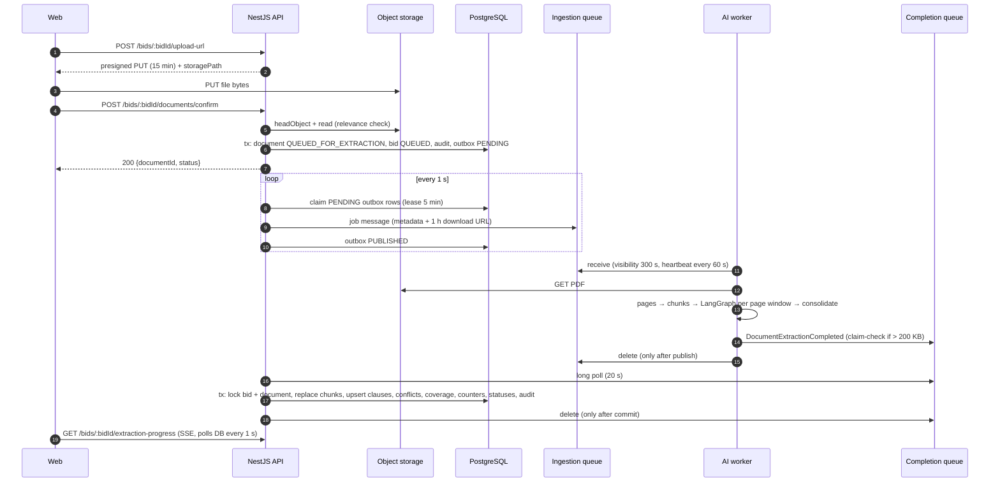

# Architecture

TenderPulse AI reads Indian public-procurement tenders (NIT/RFP/GCC/SCC packages, often 50–500 pages). It extracts every bidder obligation with a verbatim quote, and helps a bid team review those obligations and act on them.

This document explains how the system is built and how a document moves through it. The extraction pipeline inside the AI worker is covered in depth in [AI_PIPELINE.md](AI_PIPELINE.md); the HTTP surface in [API.md](API.md); the schema in [DATABASE.md](DATABASE.md); security in [SECURITY.md](SECURITY.md); infrastructure in [DEPLOYMENT.md](DEPLOYMENT.md).

Contents:

1. Principles
2. System context
3. Services and code layout
4. Inside the API: request lifecycle
5. Document processing, end to end
6. Status lifecycles
7. Identity and idempotency
8. Adapters and configuration
9. Failure handling
10. Other flows
11. Web application
12. Observability
13. Known limitations

---

## 1. Principles

These rules shape every design decision below. They are recorded in [ADR 0001](adr/0001-two-tier-service-boundary.md), [ADR 0010](adr/0010-provenance-value-object-immutability.md) and [AGENTS.md](../AGENTS.md).

| Principle                                      | What it means in practice                                                                                                                                                     |
| ---------------------------------------------- | ----------------------------------------------------------------------------------------------------------------------------------------------------------------------------- |
| **Single writer**                              | Only the NestJS API writes to PostgreSQL. The AI worker is a compute service: it receives a job and emits an event, and never connects to the database.                       |
| **Authority stays in deterministic code**      | Authentication, tenant scoping, permissions, verdicts and money calculations are code. The model only proposes text, which code validates.                                    |
| **Tenant comes from the token**                | The organization is taken from the verified JWT and re-derived from PostgreSQL rows. It is never taken from a request body, a queue message or a model answer.                |
| **No invented values**                         | Every clause carries an exact quote from the tender. A value the tender does not state is `null` all the way to the UI. A failed page is reported as failed, never filled in. |
| **Durable hand-offs**                          | Every step between services survives a crash: a transactional outbox, at-least-once queues, publish-before-ack, persist-before-ack, and idempotent writes keyed by location.  |
| **Bytes never pass through the API or queues** | Files go browser → object storage → worker by presigned URL. Messages carry only metadata.                                                                                    |

## 2. System context

```
                               ┌──────────────────────────────┐
                               │  React SPA (apps/web, :5173) │
                               └───────┬───────────────┬──────┘
             REST + SSE over fetch     │               │  presigned PUT (upload)
             (Authorization: Bearer)   │               ▼
                               ┌───────▼──────┐   ┌─────────────────────────┐
                               │  NestJS API  │──►│ Object storage          │
                               │ (apps/api,   │   │ S3 / GCS / in-memory    │
                               │  :3000)      │   │ tenants/{org}/...       │
                               └─┬───┬────▲───┘   └──────▲───────────▲──────┘
           single writer         │   │    │              │ presigned │ claim-check
           ┌─────────────────────┘   │    │              │ GET       │ PUT (>200 KB)
           ▼                         │    │              │           │
 ┌──────────────────┐   ingestion    │    │ completion   │           │
 │ PostgreSQL 16    │   queue (SQS)  ▼    │ queue (SQS)  │           │
 │ (Drizzle ORM)    │          ┌──────────┴───────────────┴───────────┴──┐
 └──────────────────┘          │  FastAPI AI worker (apps/ai, :8000)     │
                               │  PDF → pages → chunks → LangGraph per   │
                               │  page window → validation → event       │
                               └────────────────────┬────────────────────┘
                                                    │ HTTPS (OpenAI-compatible)
                                                    ▼
                                  Cerebras · Groq · Gemini · SambaNova (· OpenRouter)
```

The API also calls the worker synchronously over HTTP, with `X-Internal-Service-Key`, for three features: bid decisions, company evidence extraction and tender chat (§10).

## 3. Services and code layout

| Service                 | Stack                                                                                   | Owns                                                                                                                                                   | Never does                                |
| ----------------------- | --------------------------------------------------------------------------------------- | ------------------------------------------------------------------------------------------------------------------------------------------------------ | ----------------------------------------- |
| `apps/api`              | NestJS 12, TypeScript, Drizzle ORM, node-postgres                                       | Authentication, tenancy, RBAC, every PostgreSQL write, presigned URLs, outbox publishing, completion persistence, SSE progress, notifications, billing | Run model inference                       |
| `apps/ai`               | Python 3.14, FastAPI, LangGraph, Pydantic v2, pypdfium2/pdfplumber/Tesseract, fastembed | PDF text, chunking, retrieval, LLM calls, output validation, completion events; the bid-decision, evidence and chat engines                            | Write to PostgreSQL, decide authorization |
| `apps/web`              | React 18, Vite, Tailwind, Radix, React Router 7                                         | Screens and view state                                                                                                                                 | Hold business rules                       |
| `packages/shared-types` | TypeScript                                                                              | The AI→API→UI contract: `src/clause.ts`, `src/events.ts`, `schema/extraction-completed.schema.json`                                                    | —                                         |
| `packages/ui`           | React                                                                                   | Shared components and design tokens                                                                                                                    | —                                         |

### 3.1 API modules (`apps/api/src/modules`)

Each feature is a Nest module. Controllers stay thin, SQL lives in `*.repository.ts` (writes) and `*.queries.ts` (reads), and mapping is done in mapper classes. Use cases sit in `application/`, and entities and value objects in `domain/`.

| Module                                                                         | Responsibility                                                                                                                                    | Key classes                                                                                                                                                                                          |
| ------------------------------------------------------------------------------ | ------------------------------------------------------------------------------------------------------------------------------------------------- | ---------------------------------------------------------------------------------------------------------------------------------------------------------------------------------------------------- |
| `auth`                                                                         | Register, login, refresh rotation, logout                                                                                                         | `AuthService`, `AuthRepository`                                                                                                                                                                      |
| `bids`                                                                         | Bid CRUD, bid state machine, upload URLs, bid decision, deadlines, amendments, readiness                                                          | `CreateBidUseCase`, `GenerateUploadUrlUseCase`, `ConfirmDocumentUploadUseCase`, `GetBidDecisionUseCase`, `AiDecisionClient`, `BidStatus`, `tender-deadlines.calculator`, `tender-amendments.service` |
| `documents`                                                                    | Upload confirmation, outbox, reprocess, download URLs, page text, SSE progress, completion persistence                                            | `DocumentsService`, `DocumentsRepository`, `DocumentProcessingRuntime`, `DocumentCompletionService`, `TenderDocumentRelevanceValidator`, `CompletionWebhookController`                               |
| `compliance`                                                                   | Clause workspace (list, review, bulk review), conflicts, coverage, summary; legacy checklist items                                                | `ClausesService`, `ClausesRepository`, `clause-model.ts` (location key, quote check), `ReviewComplianceItemUseCase`, `compliance-item.mapper`                                                        |
| `companies`, `company-profile`                                                 | Companies, versioned capability profile, onboarding preferences, expiring certificates                                                            | `CompaniesService`, `CompanyProfileService`                                                                                                                                                          |
| `company-verification`                                                         | Evidence upload and import, AI evidence extraction, GSTIN/MCA/Udyam/DigiLocker checks (mock adapters locally)                                     | `CompanyEvidenceService`, `AiEvidenceExtractor`, `EvidenceVerificationService`, `*RegistryAdapter`                                                                                                   |
| `chat`                                                                         | Tender chat conversations, proxied to the worker                                                                                                  | `ChatService`                                                                                                                                                                                        |
| `dashboard`, `notifications`, `audit`, `settings`, `teams`, `users`, `billing` | Metrics; in-app notifications and the deadline scan; audit trail; workspace settings; members and invites; account; plans, usage and entitlements | `NotificationsService`, `AuditService`, `EntitlementService`                                                                                                                                         |

Cross-cutting code lives in `apps/api/src/common`:

- `database/`: client, schema, migrator.
- `security/`: guards, tenant context, `TokenService`.
- `events/`: in-process `IEventBus`.
- `logging/`: `StructuredLogger`, `HttpLoggingInterceptor`, `LogSanitizer`, rotating file stream.
- `errors/`: `HttpError` subclasses.
- `filters/`: `AllExceptionsFilter`.

Infrastructure adapters live in `apps/api/src/infrastructure/{queue,storage}`.

### 3.2 AI worker packages (`apps/ai/src/tenderpulse_ai`)

| Package                                                        | Responsibility                                                                                                                                                                                                                                                                                 |
| -------------------------------------------------------------- | ---------------------------------------------------------------------------------------------------------------------------------------------------------------------------------------------------------------------------------------------------------------------------------------------- |
| `main.py`                                                      | FastAPI app, internal-key dependency, endpoints, lifespan that starts the queue consumer                                                                                                                                                                                                       |
| `extraction/`                                                  | `orchestrator.py` (the document pipeline), `contracts.py` (DTOs), `clause_references.py`, `deduplication.py` (merge + contradictions), `metrics.py`, `okf_compiler.py`. `pipeline.py` at the package root is a thin backward-compatible facade                                                 |
| `workflow/`                                                    | The extraction LangGraph: `graph.py`, `nodes.py`, `state.py`                                                                                                                                                                                                                                   |
| `domain/`                                                      | `pdf_resolver.py` + `pdf_layout.py` (page text), `docling_parser.py` (blocks), `structure_builder.py` (clause tree), `tender_chunker.py`, `candidate_detector.py`, `context_assembler.py`, `validator.py`, `requirement_attributes.py`, `evidence_extractor.py`, `cross_reference_resolver.py` |
| `agent/`                                                       | `validation.py`: the deterministic trust boundary (category taxonomy, grounding, fragments)                                                                                                                                                                                                    |
| `infrastructure/`                                              | `llm/` (multi-provider client, record/replay), `embeddings/` (fastembed), `queue/` (SQS/Pub/Sub consumer, worker, completion publishers)                                                                                                                                                       |
| `tools/`                                                       | `retrieval.py` (tenant-scoped BM25 + dense + RRF), `page_text.py`, `network_guard.py`                                                                                                                                                                                                          |
| `security/`                                                    | `SecurityContext`, `SecretSanitizer` (scrubbing, untrusted-data tags)                                                                                                                                                                                                                          |
| `decision/`, `chat/`, `corrigendum/`, `review/`, `evaluation/` | Bid decision engine, tender chat, amendment diffing, human-review models, benchmark                                                                                                                                                                                                            |

## 4. Inside the API: request lifecycle

Startup (`main.ts`):

1. `.env` is loaded natively.
2. The Nest app is created with the structured logger and shutdown hooks. Shutdown hooks let the PostgreSQL pool close on SIGTERM.
3. `HttpLoggingInterceptor` is registered globally.
4. CORS is configured (see [SECURITY.md](SECURITY.md) §6).
5. `AllExceptionsFilter` is registered.
6. The JSON body limit is set to 1 MB.

`DatabaseModule` then runs pending migrations under an advisory lock, optionally seeds demo data (`SEED_DEMO_DATA`), and `DocumentProcessingRuntime` starts its two loops (§5.3, §5.7).

Every request passes through, in order:

| Step | Component                                 | Effect                                                                                                                                                                                                      |
| ---- | ----------------------------------------- | ----------------------------------------------------------------------------------------------------------------------------------------------------------------------------------------------------------- |
| 1    | `HttpLoggingInterceptor`                  | Reads or creates `X-Trace-Id` / `X-Correlation-Id` / `X-Request-Id`, echoes them on the response, logs method, path, status and latency                                                                     |
| 2    | `JwtAuthGuard` (global `APP_GUARD`)       | Verifies the HS256 access token from `Authorization: Bearer` or the `tp_access_token` cookie, unless the route is `@Public()`. Attaches the claims to `request.user`                                        |
| 3    | `RolesGuard` (global `APP_GUARD`)         | Checks the route's `@RequirePermission(...)` against the role's permission set                                                                                                                              |
| 4    | `TenantContextInterceptor` (global)       | Runs the handler inside `TenantContextHolder` (`AsyncLocalStorage`) with the verified organization, user and role. Repositories read the tenant from here                                                   |
| 5    | Controller → service → repository/queries | Business logic; every query filters by `organization_id`                                                                                                                                                    |
| 6    | `AllExceptionsFilter`                     | Maps `HttpError` subclasses (`NotFoundError` 404, `ConflictError` 409, `BadRequestError` 400, `UnauthorizedError` 401, `ForbiddenError` 403, `UnprocessableError` 422) and Nest exceptions to `{ message }` |

Domain events (`BidProjectCreatedEvent`, `TenderDocumentUploadedEvent`, `ComplianceIngestionCompletedEvent`, `ComplianceItemReviewedEvent`) go through the in-process `InMemoryEventBus`. Nothing leaves the process; EventBridge remains deferred ([ADR 0012](adr/0012-domain-events-and-eventbridge.md)).

## 5. Document processing, end to end



### 5.1 Upload URL

`POST /bids/:bidId/upload-url` (`GenerateUploadUrlUseCase`) works as follows:

- It creates a server-side document id.
- It sanitizes the file name, replacing anything outside `[a-zA-Z0-9._-]` with `_`.
- It derives the key `tenants/{organizationId}/bids/{bidId}/{documentId}/{fileName}`.
- It returns a presigned PUT URL that is valid for **15 minutes**.

With mock storage, the URL points at the API's own `PUT /mock-upload/...` route. The browser uploads the bytes directly, so they never pass through the API process.

### 5.2 Confirmation

`POST /bids/:bidId/documents/confirm` (`DocumentsService`) works as follows:

1. **Checks the object exists and is non-empty** with `IStorageService.headObject`. If it is missing, nothing is written.
2. **Checks relevance.** `TenderDocumentRelevanceValidator` reads the file and compares it with the bid: tender or NIT reference number, tendering authority, title keyword overlap, state, and generic tender markers (NIT, RFP, ITB, GCC…). An unrelated document is rejected with HTTP 400 before it costs any extraction.
3. **Presigns a download URL valid for 1 hour.** It goes into the job, so the worker can fetch the file without storage credentials.
4. **Builds the job message** (`IngestionJobMessage`):

   ```json
   {
     "jobId": "job-<docId>",
     "organizationId": "org_…",
     "companyId": "…",
     "bidId": "bid-…",
     "documentId": "doc-…",
     "workflowRunId": "run-<docId>",
     "correlationId": "corr-<docId>",
     "storageReference": "tenants/org_…/bids/bid-…/doc-…/file.pdf",
     "downloadUrl": "https://…presigned…",
     "documentType": "TENDER_NOTICE",
     "fileName": "file.pdf",
     "timestamp": "2026-10-27T08:00:00.000Z"
   }
   ```

5. **Writes everything in one transaction** (`confirmDocumentUploadWithOutbox`):
   - inserts the `tender_documents` row (`QUEUED_FOR_EXTRACTION`);
   - sets the bid to `QUEUED`;
   - writes a `DOCUMENT_UPLOADED` audit log;
   - inserts the `document_processing_outbox` row `outbox-<docId>` (`PENDING`, payload = the job).

   A document id that already belongs to another tenant or bid is a 409 conflict.

### 5.3 Outbox publisher

`DocumentProcessingRuntime.runOutboxPublisher` runs in every API instance:

- **Every 1 s** it reads up to **10** outbox rows that are either `PENDING` and due (`next_attempt_at` ≤ now), or `PUBLISHING` with a lease (`locked_at`) older than **5 minutes**. The second case covers an instance that crashed mid-publish.
- **It claims each row** with a conditional update to `PUBLISHING` plus `locked_at = now`, so only one API instance publishes a given row.
- **It enqueues the payload** on the ingestion queue, marks the row `PUBLISHED`, and moves the document from `QUEUED_FOR_EXTRACTION` to `PROCESSING`.
- **On a publish error** it puts the row back to `PENDING`, records the attempt and the error, and sets `next_attempt_at` to now + `min(5 s × 2^(attempts−1), 300 s)`: 5, 10, 20, 40… seconds, capped at 5 minutes.

This loop is independent of the completion consumer. A new upload is published within about a second, even while the consumer is waiting in a 20 s long poll.

### 5.4 Worker: consuming the job

The FastAPI lifespan starts `DocumentQueueConsumerWorker` unless `INGESTION_QUEUE_PROVIDER` is `none`. For each message, the worker does the following:

1. **Starts a heartbeat** that extends the message's visibility every `QUEUE_HEARTBEAT_INTERVAL_SECONDS` (60 s; the visibility timeout is 300 s), so a long extraction is not handed to another worker.
2. **Builds an immutable `SecurityContext`** from the job: tenant, company, workflow run, and the allowed document and source ids.
3. **Resolves the PDF.** It uses the presigned `downloadUrl` (downloads are capped at 150 MB), or a local path for samples, or presigns from `AWS_S3_BUCKET` itself.
4. **Runs `ProductionExtractionPipeline.execute`** ([AI_PIPELINE.md](AI_PIPELINE.md)).
5. **Builds `DocumentExtractionCompleted`** with status `COMPLETED`, plus items, chunks, conflicts and coverage, and publishes it.
6. **Deletes the job only after the publish succeeded.** If the publisher reports failure, the job is left in the queue and comes back after the visibility timeout.

If processing throws, the job is not deleted, so it is retried. On the **3rd receive** the worker instead:

- moves the job to the DLQ;
- publishes a `FAILED` completion carrying the error, so the API marks the document failed rather than leaving it queued forever;
- deletes the job.

### 5.5 The completion event

`DocumentExtractionCompletedEvent` (`packages/shared-types/src/events.ts`, JSON schema in `schema/extraction-completed.schema.json`):

| Field                                                         | Content                                                                                                                                                                               |
| ------------------------------------------------------------- | ------------------------------------------------------------------------------------------------------------------------------------------------------------------------------------- |
| `jobId`, `organizationId`, `companyId`, `bidId`, `documentId` | Identity, copied from the job                                                                                                                                                         |
| `status`                                                      | `COMPLETED` or `FAILED` (plus legacy values)                                                                                                                                          |
| `items[]`                                                     | Clauses: category, title, description, provenance (page, clause reference, verbatim quote, source block), `itemKey`, `docOrder`, supporting pages, attributes, execution rules, flags |
| `chunks[]`                                                    | The document's chunks with page, section, clause reference, bounding box, metadata and embedding. They are persisted for the source viewer and server-side quote checks               |
| `conflicts[]`                                                 | `{conflictKey, topic, attribute, values[{display, itemKey, quote, page, clauseRef}], aiPrecedenceNote}`                                                                               |
| `coverage`                                                    | `{documentId, pageCount, failedPages[{page, reason}], status: COMPLETE \| PARTIAL}`                                                                                                   |
| `error`                                                       | The reason, for `FAILED`                                                                                                                                                              |
| `workflowRunId`, `traceId`, `correlationId`, `timestamp`      | Tracing                                                                                                                                                                               |

### 5.6 Claim-check for large events

An SQS message is capped at 256 KB, and a 99-page tender's event (about 210 clauses plus all chunks) is far larger. `AwsSqsCompletionPublisher` therefore works like this:

- **Small events (≤ 200 KB)** are sent inline.
- **Larger events** are written to `tenants/<org>/bids/<bid>/<doc>/completion-events/<job>.json` in `AWS_S3_BUCKET`. The queue message carries only the identity fields plus `payloadStorageReference`.

On the API side, `resolveCompletionPayload` loads a claim-checked event under three conditions:

- the reference is under `tenants/<the envelope's organizationId>/`;
- the object exists;
- `jobId`, `organizationId`, `bidId` and `documentId` inside the stored event equal the envelope's.

After a successful commit the object is deleted. A failure to delete is logged and harmless.

### 5.7 Completion consumer

`runCompletionConsumer` waits for one message at a time with a **20 s SQS long poll**, using an `AbortSignal` so shutdown does not wait out the poll. While it handles a message it renews the message's visibility (300 s) **every 60 s**.

| Situation                                         | Behaviour                                                                                                  |
| ------------------------------------------------- | ---------------------------------------------------------------------------------------------------------- |
| Claim-check cannot be loaded                      | Not acked; SQS redelivers after the visibility timeout and eventually dead-letters it                      |
| Missing `documentId` / `bidId` / `organizationId` | Document marked `FAILED` (if identifiable), message moved to the completion DLQ and deleted                |
| `status = FAILED`                                 | Document marked `FAILED` with the worker's error; dropped if the document no longer exists for that tenant |
| Persistence error, attempt < 3                    | Visibility set to `min(30 s × 2^(attempt−1), 300 s)` for a backed-off retry                                |
| Persistence error, attempt 3                      | Document marked `FAILED` with the reason, message moved to the DLQ and deleted                             |
| Success                                           | Message deleted after commit, then the claim-check object deleted                                          |

### 5.8 Persistence transaction

`DocumentCompletionService.processExtractionCompleted` first validates every item:

- category and title are present;
- the page is an integer of 1 or more;
- the quote is not empty;
- a stamp-paper requirement has a positive denomination.

`DocumentsRepository.completeExtraction` then runs one transaction:

1. **Locks** the bid and the document (`SELECT … FOR UPDATE`), each filtered by organization; the document is also filtered by bid. If either is missing, the event is dropped. Tenant ownership is re-derived here, never trusted from the event.
2. **Chunks:** deletes the document's previous chunks and inserts the new ones in batches.
3. **Clauses**, one row per location:
   - computes `itemKey = locationKey(document, page, quote)` and `id = clauseId(org, bid, itemKey)`;
   - re-checks the quote against the stored page text (the page, its supporting pages and the next page), giving `quote_check` = `EXACT`, `NORMALISED`, `NOT_FOUND` or `NO_PAGE_TEXT`;
   - **existing row:** refreshes only the AI fields and keeps the review;
   - **new row:** inserts it as `UNREVIEWED`, `fulfilment_status NOT_STARTED`;
   - the same location twice in one payload is written once.
4. **Stale clauses:** the document's clauses that the new extraction no longer contains are deleted only if they are still `UNREVIEWED`. Anything a person touched is kept.
5. **Conflicts:** upserted by `conflictId`, each value linked to the clause that states it. Unresolved conflicts that disappeared are deleted; resolved ones are kept.
6. **Coverage:** upserted per document.
7. **Counters:** the bid's `total_requirements`, `flagged_requirements` (`NEEDS_REVIEW` or `FAIL`) and `approved_requirements` (`CONFIRMED` or `CORRECTED`) are recomputed over all of its clauses.
8. **Statuses:** the document becomes `COMPLETED`. When every document of the bid is `COMPLETED` or `FAILED`, the bid becomes `REVIEW_READY`.
9. **Audit:** writes `AI_INGESTION_COMPLETED` with job, run, correlation ids and item count.

### 5.9 Progress (SSE)

`GET /bids/:bidId/extraction-progress` (also `/progress` and `/documents/stream`) holds a `text/event-stream` open.

- **Every 1 s** it reads the bid and document statuses and sends `{step, progress, message}`:
  - `PARSING_PAGES` while queued;
  - `EXTRACTING_COMPLIANCE` while processing;
  - `COMPLETED` (sent as `REVIEW_READY`) or `FAILED` at the end, after which it closes.
- **The stream stays open until every document is finished**, up to 15 minutes (900 polls).
- **The web client** reads it with `fetch` and the Bearer header (`apps/web/src/api/sse.ts`), because `EventSource` cannot send headers and tokens must not go into URLs.

### 5.10 Reprocessing

`POST /bids/:bidId/documents/:docId/reprocess` works as follows:

- It refuses with 409 if the document is already queued or processing.
- It checks that the object still exists.
- It mints a fresh `jobId`, `workflowRunId` and `correlationId`.
- In one transaction (`queueReprocessing`) it sets the document to `QUEUED_FOR_EXTRACTION` and the bid to `QUEUED`, and writes a new outbox row and an audit log.

From there the flow is §5.3 onwards. Because persistence is keyed by location, reviewed clauses survive reprocessing.

## 6. Status lifecycles

**Tender document** (`tender_documents.status`): `QUEUED_FOR_EXTRACTION` at confirm and reprocess, `PROCESSING` once the outbox publisher hands the job to the worker, then `COMPLETED` or `FAILED` on completion. `UPLOADED` is the column default for rows created outside the confirm flow.

**Bid** (`BidStatus` value object; transitions enforced in the domain):

| From                      | Allowed next                                                      |
| ------------------------- | ----------------------------------------------------------------- |
| `DRAFT`                   | `QUEUED`, `PROCESSING`, `ANALYZING`                               |
| `QUEUED`                  | `PROCESSING`, `ANALYZING`, `FAILED`                               |
| `PROCESSING`, `ANALYZING` | `REVIEW_READY`, `FAILED`                                          |
| `REVIEW_READY`            | `FINALIZED`, `SUBMITTED`, `QUEUED` (revised package), `ANALYZING` |
| `FAILED`                  | `QUEUED`, `ANALYZING`, `PROCESSING` (retry)                       |
| `FINALIZED`               | `SUBMITTED`, `ARCHIVED`                                           |
| `SUBMITTED`               | `ARCHIVED`                                                        |

In the document flow the bid goes `QUEUED` → `REVIEW_READY` (§5.8). `bids.version` provides optimistic locking ([ADR 0009](adr/0009-bid-state-machine-and-optimistic-locking.md)).

**Outbox row:** `PENDING` → `PUBLISHING` (claimed, leased 5 min) → `PUBLISHED`. A failed publish returns to `PENDING` with `attempts`, `last_error` and a backed-off `next_attempt_at`.

**Clause review** (`compliance_items.review_status`): `UNREVIEWED` → `NEEDS_REVIEW` / `CONFIRMED` / `CORRECTED` / `NOT_A_REQUIREMENT`. Fulfilment is tracked separately: `NOT_STARTED` → `IN_PROGRESS` → `EVIDENCE_ATTACHED` → `DONE`, or `AT_RISK` / `NOT_APPLICABLE`. Status is never derived from category or a model score.

**Conflict:** `UNRESOLVED` → `ACCEPTED_VALUE` / `RESOLVED_BY_CORRIGENDUM` / …, with who resolved it and when.

## 7. Identity and idempotency

Every queue in the system delivers at least once, so every write must be safe to repeat. Identity is derived from content and location, never from titles or counters (`apps/api/src/modules/compliance/application/clause-model.ts`):

| Id           | Formula                                                                                                           | Why                                                                                                                                                                                         |
| ------------ | ----------------------------------------------------------------------------------------------------------------- | ------------------------------------------------------------------------------------------------------------------------------------------------------------------------------------------- |
| `itemKey`    | `cl_` + sha256(`documentId\|page\|normalized quote`)[0:24]                                                        | The clause is _where the tender says it_. Two clauses titled "Performance Security" in the ITB and in the SCC stay separate; a re-extraction that rewords the title still hits the same row |
| clause `id`  | `cl-` + sha256(`org:bid:itemKey`)[0:40]                                                                           | Stable per tenant and bid, so the review survives reprocessing                                                                                                                              |
| `conflictId` | `cf-` + sha256(`org:bid:conflictKey`)[0:40], where `conflictKey` hashes document, topic and the sorted `itemKey`s | The same contradiction maps to the same record across runs                                                                                                                                  |
| outbox id    | `outbox-<docId>`                                                                                                  | One pending publish per confirmation                                                                                                                                                        |

Redelivering a completion therefore produces the same rows, a redelivered job produces the same event content, and a crash between commit and ack only causes a harmless replay.

## 8. Adapters and configuration

| Port                                        | Adapters                                                                     | Selected by                                                                                                                                                                                                                                                    |
| ------------------------------------------- | ---------------------------------------------------------------------------- | -------------------------------------------------------------------------------------------------------------------------------------------------------------------------------------------------------------------------------------------------------------- |
| Ingestion queue (`INGESTION_QUEUE_TOKEN`)   | `AwsSqsJobQueue`, `GcpPubSubJobQueue`, `MockSqsJobQueue`                     | API: `AWS_SQS_INGESTION_QUEUE_URL` (+ `AWS_SQS_DLQ_URL`), else the `GCP_PUBSUB_*` settings, else mock (production refuses mock). Worker: `INGESTION_QUEUE_PROVIDER` + `AWS_INGESTION_QUEUE_URL`. `QUEUE_PROVIDER=mock` / `ALLOW_MOCK_SERVICES=true` force mock |
| Completion queue (`COMPLETION_QUEUE_TOKEN`) | SQS, Pub/Sub, mock; worker also `http` callback                              | `AWS_SQS_COMPLETION_QUEUE_URL` (+ `AWS_SQS_COMPLETION_DLQ_URL`); worker `COMPLETION_QUEUE_PROVIDER`                                                                                                                                                            |
| Object storage (`STORAGE_TOKEN`)            | `AwsS3StorageService`, `GcsStorageService`, `MockStorageService` (in memory) | `AWS_S3_BUCKET` or `S3_BUCKET_NAME` (S3); else `STORAGE_BUCKET_NAME` or `GCS_BUCKET_NAME` (GCS); else mock. `STORAGE_PROVIDER=mock` forces mock; `S3_ENDPOINT` / `SQS_ENDPOINT` point at LocalStack                                                            |
| Database                                    | node-postgres pool, PGlite                                                   | `DATABASE_URL` (required at runtime); `PGLITE_DATA_DIR` in tests                                                                                                                                                                                               |
| Embeddings                                  | fastembed `BAAI/bge-small-en-v1.5`, none                                     | `EMBEDDING_PROVIDER`, `EMBEDDING_MODEL`                                                                                                                                                                                                                        |
| LLMs                                        | OpenAI-compatible client over five providers                                 | Provider keys; see [AI_PIPELINE.md](AI_PIPELINE.md) §5                                                                                                                                                                                                         |

Mock queues keep messages inside one process. The API's mock and the worker's mock are different processes, so with mock queues no job ever reaches the worker. Local extraction therefore uses real dev SQS queues ([DEVELOPMENT.md](DEVELOPMENT.md) §4). With mock storage the job's download URL points at the API's `/mock-download` route, but claim-checked completions cannot be shared, so long tenders need a real bucket.

## 9. Failure handling

| Failure                                | Where it is caught         | Outcome                                                                                                              |
| -------------------------------------- | -------------------------- | -------------------------------------------------------------------------------------------------------------------- |
| Object missing or empty at confirm     | `headObject`               | 4xx, no rows written                                                                                                 |
| Unrelated document uploaded            | Relevance validator        | 400 with the reason, no extraction cost                                                                              |
| Ingestion queue unavailable            | Outbox publisher           | Row stays retryable; backoff 5 s → 300 s                                                                             |
| Worker crashes mid-job                 | Visibility timeout (300 s) | Job reappears and is retried                                                                                         |
| Extraction fails for some page windows | Orchestrator               | Those pages listed in `coverage.failedPages`; neighbouring clauses flagged `NEAR_FAILED_PAGE`; the rest is delivered |
| Extraction fails for every window      | Orchestrator raises        | Job retried; on the 3rd receive it is moved to the DLQ and a `FAILED` completion is published                        |
| Completion publish fails               | Worker                     | Job not acked, so it is retried                                                                                      |
| Completion persistence fails           | Completion consumer        | Backed-off redelivery; on the 3rd attempt the document is marked `FAILED` and the message goes to the DLQ            |
| Event larger than SQS allows           | Publisher                  | Claim-check through S3                                                                                               |
| Duplicate delivery                     | Location-keyed upserts     | Same rows, no duplicates                                                                                             |
| All LLM providers rate-limited         | LLM client                 | Waits up to 180 s for the soonest endpoint, then fails that window                                                   |

## 10. Other flows

| Flow                       | Path                                                                                                                                                    | Notes                                                                                                                                                                                                                                                                             |
| -------------------------- | ------------------------------------------------------------------------------------------------------------------------------------------------------- | --------------------------------------------------------------------------------------------------------------------------------------------------------------------------------------------------------------------------------------------------------------------------------- |
| **Bid decision**           | Web → `POST /bids/:id/bid-decision` → `AiDecisionClient` → worker `POST /api/v1/agent/bid-decision` (timeout `AI_DECISION_TIMEOUT_MS`)                  | The LangGraph decision engine evaluates eligibility deterministically, using only thresholds the tender states. An unreachable engine is a 503, never a local substitute. The model writes only the explanatory memo. The result is stored in `bid_decisions` per profile version |
| **Evidence extraction**    | `POST /companies/:companyId/evidence/:evidenceId/extract` → `AiEvidenceExtractor` → worker `POST /api/v1/evidence/extract` (`AI_EXTRACTION_TIMEOUT_MS`) | Certificates and financials yield attributes, each with its verbatim quote; chunks are stored in `company_evidence_chunks`                                                                                                                                                        |
| **Registry verification**  | `POST /companies/:companyId/verification/{gstin,mca,udyam}`, DigiLocker OAuth                                                                           | Ports with live and mock adapters (`*_PROVIDER=mock` locally). Every status change is recorded in `evidence_verification_history`                                                                                                                                                 |
| **Tender chat**            | `POST /chat/messages` → worker `POST /api/v1/chat/query`                                                                                                | Chat graph: intent routing → tool calling → query rewrite → citations → uncertainty check → answer. The tools only see the caller's tenant, company and bid                                                                                                                       |
| **Amendments**             | `GET /bids/:id/amendments`, `/tenders/amendments`                                                                                                       | The worker's corrigendum diff engine compares original and amended clauses (dates, turnover, debarment, experience, OEM, consortium)                                                                                                                                              |
| **Deadline notifications** | `POST /notifications/trigger-scan`                                                                                                                      | Creates notifications for active bids with a submission deadline within 7 days. It is triggered, not scheduled                                                                                                                                                                    |
| **Billing**                | `/billing/*`                                                                                                                                            | Plan catalogue and usage records behind a billing port with a mock adapter; `EntitlementService` enforces plan limits                                                                                                                                                             |

## 11. Web application

`apps/web/src`:

- **`pages/`**: one component per route, for example `/bids/:id`, `/bids/:id/clauses`, `/bids/:id/conflicts`, `/bids/:id/checklist`, `/bids/:id/audit`, `/company-profile` and `/onboarding`.
- **`api/`**: one module per backend area, plus `client.ts` and `sse.ts`.
- **`hooks/`**: `useApi`, which aborts stale requests, plus `useSSE` and `usePermission`.
- **`context/`**: the company and theme contexts.
- **`components/`**: grouped by feature.

**API client (`api/client.ts`).**

- It keeps the access token in memory and the refresh token in `localStorage` (see the known gap in SECURITY.md).
- It injects `Authorization: Bearer`.
- On a 401 it performs a single silent refresh, then retries the request.
- It never sends a tenant id, role or document scope; the API derives them.

**Clause workspace** (`/bids/:id/clauses`, `pages/ClauseWorkspacePage.tsx`, `components/clauses/`) is the only place clauses are reviewed:

- **View state lives in the URL** (`workspaceState.ts`): saved view, facets, search, group-by (section, task, stage, review, document), selection and density. A view can therefore be shared and survives a reload.
- **The list is virtualised** with fixed row heights (`ClauseList.tsx`).
- **The source viewer shows the clause on its page** (`SourceViewer.tsx`).
- **Confirming needs the source viewed**, unless the clause is a clean spot-check.
- **Clauses in an unresolved conflict** are resolved on `/bids/:id/conflicts`.
- **Status chips always carry text**, never colour alone.

## 12. Observability

- **Structured JSON logs.** Both services log JSON to the console and to rotated files under `logs/` ([ADR 0027](adr/0027-dual-sink-rotated-structured-logging.md)). The settings are `LOG_LEVEL`, `LOG_DIR`, `LOG_TO_FILE`, `LOG_MAX_BYTES` and `LOG_MAX_FILES` in the API, and `LOG_LEVEL_CONSOLE` / `LOG_LEVEL_FILE` in the worker. `LogSanitizer` (API) and `SecretSanitizer` (worker) redact secrets before anything is written.
- **One correlation id per document run.** It travels from the confirm request (`corr-<docId>`, or a fresh id per reprocess) into the job, every LangGraph node, every LLM call and the completion. `grep corr-<id> logs/ai.log` shows one document's whole run.
- **Named events.** Examples: `outbox.message.published`, `queue.completion_event.received`, `queue.completion_event.persisted`, `langgraph.node.started` / `completed` (with duration and counts), `llm.request.started` / `completed` (provider, model, prompt and completion tokens), `llm.request.rate_limited`, `llm.request.waiting_for_rate_limit`.
- **Audit trail.** The `audit_logs` table records `DOCUMENT_UPLOADED`, `AI_INGESTION_COMPLETED`, reviews and other domain actions per bid.

## 13. Known limitations

| Limitation                                                   | Effect                                                                       |
| ------------------------------------------------------------ | ---------------------------------------------------------------------------- |
| The deadline scan is triggered by an endpoint, not scheduled | Notifications appear only when something calls `/notifications/trigger-scan` |
| An unhandled error's message is returned to the client       | `AllExceptionsFilter` sends `exception.message` for unexpected errors        |
| Mock queues cannot reach the worker                          | Local extraction needs the dev SQS queues                                    |

Security and infrastructure gaps are tracked in [SECURITY.md](SECURITY.md) §7 and [DEPLOYMENT.md](DEPLOYMENT.md) §5.
