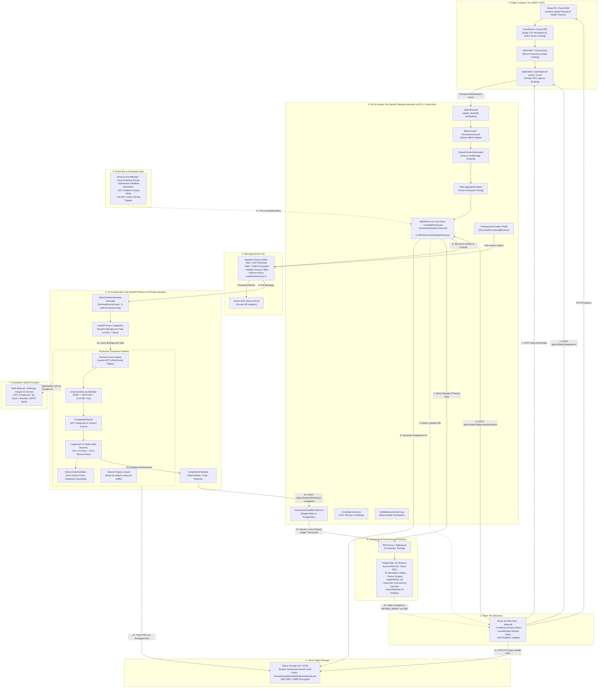

# High-Level Design (HLD): TenderPulse AI System Architecture

## 1. Executive Summary & Core Architectural Tenets

**TenderPulse AI** is an enterprise-grade Tender Intelligence and Bid Readiness SaaS platform engineered for Indian MSMEs, EPC contractors, and infrastructure conglomerates bidding on public procurement portals (GeM, CPPP, State PWDs, NHAI, Indian Railways, MoRTH).

In government procurement, procedural disqualification is unforgiving: an improperly formatted ₹100 stamp paper, an omitted Power of Attorney, or an expired ISO certificate results in immediate bid rejection and forfeiture of Earnest Money Deposits (EMDs) worth lakhs or crores of rupees.

To deliver legal defensibility, high availability, and bulletproof security, the architecture is guided by six foundational tenets:

1. **Two-Tier Service Boundary (ADR 0001)**: A NestJS TypeScript modular monolith acts as the transactional, authentication, and state authority, while a specialized Python FastAPI worker acts as the document extraction and AI orchestration engine.
2. **Deterministic Sovereignty over AI (ADR 0019 / AGENTS.md)**: Deterministic code owns authorization, arithmetic, state transitions, and database writes. Large Language Models (LLMs) operate strictly behind software boundaries as advisory text extractors.
3. **Decoupled Asynchronous Event Choreography (Design B / ADR 0018 / ADR 0022)**: Heavy PDF parsing and AI reasoning (30s–180s) are fully decoupled from HTTP lifecycles via message queues and asynchronous completion events.
4. **The Single-Writer Principle**: The Python AI worker is a pure computation and event-publishing node. It possesses zero direct database write credentials. The NestJS `DocumentCompletionService` is the sole atomic writer committing extraction results to PostgreSQL.
5. **Zero-Trust Multi-Tenant Isolation**: Tenant scoping is enforced end-to-end: at the network layer, in storage prefixes, via Node.js `AsyncLocalStorage` in the API, through `SecurityContext` in the AI worker, and with denormalized `organization_id` columns across all database tables.
6. **Cloud-Provider Agnostic Abstractions (ADR 0014)**: Core application logic interacts exclusively with generic ports (`ObjectStorage`, `MessageQueue`, `EventPublisher`, `DocumentRepository`). Infrastructure adapters implement these for AWS (S3, SQS, Bedrock) and GCP (Cloud Storage, Pub/Sub, Cloud Run) without vendor leakage.

---

## 2. End-to-End System Architecture

The following diagram illustrates the complete end-to-end request, storage, asynchronous queueing, AI processing, and persistence flow across the system:



---

## 3. Authentication & Role-Based Access Control (RBAC)

The security model implements RFC 7519 compliant JSON Web Tokens (JWT) with defense against XSS, token tampering, and privilege escalation:

### 3.1 Token Lifecycle & Storage Architecture

- **In-Memory Access Token**: The browser keeps the signed access token exclusively in JavaScript memory (`client.ts`). It is **never** written to `localStorage` or `sessionStorage`, completely immunizing the session against token extraction via Cross-Site Scripting (XSS).
- **LocalStorage Refresh Token**: A high-entropy cryptographic refresh token is stored in `localStorage` solely to maintain sessions across browser reloads.
- **Silent 401 Interception**: The frontend API client automatically intercepts HTTP 401 Unauthorized responses, halts concurrent outbound requests, exchanges the refresh token via `POST /api/v1/auth/refresh`, updates the in-memory access token, and transparently retries the failed request.

### 3.2 NestJS Guard Pipeline

Every incoming HTTP request traverses a strictly ordered guard chain:

```
Request ──> [JwtAuthGuard] ──> [RolesGuard] ──> [TenantContextInterceptor] ──> Controller Handler
```

1. **`JwtAuthGuard`**:
   - Verifies the HMAC-SHA256 signature using the server's cryptographic secret.
   - Rejects expired, forged, or wrong-type tokens (e.g. attempting to use a refresh token as an access token).
   - Exempts endpoints explicitly decorated with `@Public()` (e.g., login, registration, pricing).
   - Supports Server-Sent Events (SSE) authentication via `?token=` query parameters where browser `EventSource` cannot set custom Authorization headers.
2. **`RolesGuard`**:
   - Checks atomic permissions declared via `@RequirePermission(Permission.XYZ)`.
   - Four hierarchical roles are supported:
     - `ADMIN`: Full tenant administrative privileges (user management, billing, bids, deletion).
     - `BID_MANAGER`: Full management of bids, document uploads, and compliance checklists.
     - `REVIEWER`: Read access to bids and ability to review/approve compliance items.
     - `VIEWER`: Strictly read-only access.
3. **`InternalServiceGuard`**:
   - Protects inter-service communication between the Python AI worker and NestJS (e.g., `POST /api/v1/internal/extraction-completed`).
   - Validates the `X-Internal-Service-Key` HTTP header using timing-attack-safe string comparison (`secrets.compare_digest` in Python and constant-time comparison in Node.js).

---

## 4. Multi-Tenant Isolation Architecture

Multi-tenancy is enforced through **Defense-in-Depth** across four architectural layers:

```
┌────────────────────────────────────────────────────────────────────────┐
│                        DEFENSE-IN-DEPTH TENANCY                        │
├───────────────────┬────────────────────────────────────────────────────┤
│ Layer             │ Enforcement Mechanism                              │
├───────────────────┼────────────────────────────────────────────────────┤
│ 1. Client / Wire  │ Zero tenant IDs in request bodies; derived from JWT │
│ 2. API Threading  │ Fiber-safe AsyncLocalStorage (TenantContextHolder) │
│ 3. Storage Vault  │ Prefix-isolated object keys: tenants/{orgId}/...   │
│ 4. AI Worker      │ SecurityContext scoping & Anti-IDOR whitelist      │
│ 5. Database       │ Denormalized organization_id & composite indexing  │
└───────────────────┴────────────────────────────────────────────────────┘
```

1. **Zero Client Tenant Transmission**: The frontend **never** sends `tenant_id` or `organization_id` in request bodies or query parameters. The backend extracts `organizationId` directly from the cryptographically verified JWT payload.
2. **Fiber-Safe Request Context**: `TenantContextInterceptor` wraps the request execution lifecycle using Node.js `AsyncLocalStorage` (`TenantContextHolder.run(...)`). Downstream services, repositories, and domain events automatically resolve the current tenant without passing tenant IDs through method parameters.
3. **Storage Partitioning**: All uploaded tender packages and company evidence documents are partitioned in object storage by tenant: `tenants/{organizationId}/bids/{bidId}/raw/{documentId}.pdf`. Presigned URLs are scoped to these exact keys.
4. **AI Worker Authorization (`SecurityContext`)**: Every queue message and AI extraction request carries an explicit `SecurityContext` containing `tenant_id`, `allowed_document_ids`, and `allowed_source_ids`. The internal tools (`ScopedRetrievalTool`, `PageTextTool`) reject any data access request outside the whitelisted document scope with an `UnauthorizedDocumentAccessException`.
5. **Database Partition Locality**: Every single tenant-owned table in PostgreSQL includes `organization_id TEXT NOT NULL`. All repository queries append `where(eq(schema.table.organizationId, orgId))` to guarantee cross-tenant isolation.

---

## 5. Asynchronous Processing & Event Choreography (Design B)

The document extraction and compliance generation workflow is engineered as an **asynchronous event-driven choreography** adhering strictly to the **Single-Writer Principle**:

### 5.1 The Workflow Progression

1. **Direct-to-Storage Upload Handshake**:
   - The user selects a 50MB tender PDF in the React SPA.
   - The SPA requests an upload authorization via `POST /api/v1/bids/:id/upload-url`.
   - NestJS verifies user permissions and bid ownership, generates an S3/GCS Presigned PUT URL (valid for 15 minutes), and returns it to the browser.
   - The browser streams the PDF binary directly to Cloud Object Storage via HTTP PUT, bypassing API server memory.
2. **Confirmation & Queue Dispatch**:
   - The browser calls `POST /api/v1/bids/:id/documents/confirm`.
   - NestJS verifies file existence via storage metadata, records a `tender_documents` row with status `UPLOADED`, and inserts a message into `document_processing_outbox`.
   - The job is dispatched to the ingestion queue (`IJobQueue` via AWS SQS or GCP Pub/Sub).
3. **Worker Dispatch-and-ACK**:
   - The worker runtime claims the queue message and forwards it to the FastAPI worker endpoint `POST /api/v1/worker/process-message` with `async_mode: true`.
   - FastAPI validates the payload, spawns an asynchronous background task (`asyncio.create_task`), and returns HTTP 200 with status `ACCEPTED` in under 20ms.
   - The queue consumer acknowledges and deletes the queue message immediately (<100ms), avoiding long-running visibility timeout contention.
4. **Background AI Extraction & Verification**:
   - The background worker executes the `ProductionExtractionPipeline`:
     - **Hoisted Document Precomputation**: Parses the complete document AST once (`DoclingParserEngine`), builds `DocumentStructureTree` (`DocumentStructureBuilder`), and runs `CandidateDetector` and `ContextAssembler` at the document level. This eliminates redundant $O(N^2)$ PDF re-parsing during parallel page processing.
     - **High-Recall Candidate Scoring & Context Fusion (ADR 0028)**: Fuses physical `DoclingBlock` text with semantic `SectionNode` lineage paths across 20+ procurement categories. Normalized priority scoring ($0.0 - 1.0$) separates passages into Tier-1 `PRIMARY` candidates and Tier-2 `unselected` passages while stripping cross-page repeating boilerplate ($\ge 3$ pages).
     - **LangGraph 11-Node Extraction Graph**:
       - Extracts structured items from Tier-1 candidates.
       - Runs Node 5B (`rescue_pass`) to sweep Tier-2 unselected passages in compact batches to catch un-keyworded or split clauses.
       - Executes pure Python exact-substring grounding against raw page text (`DeterministicValidator`).
       - Refined confidence routing: loops to `targeted_refine` strictly when `len(unverified) > 0 and retry < 2`; routes directly to human review when verification is complete without wasting LLM calls.
5. **Event Publication & Single-Writer Persistence**:
   - Upon pipeline completion, the worker publishes a `DocumentExtractionCompletedEvent` via `CompletionPublisher`:
     - Dispatches to the dedicated Completion Queue (`COMPLETION_QUEUE_TOKEN` via SQS or Pub/Sub) or HTTP internal webhook.
   - NestJS `DocumentCompletionService` executes the **Single-Writer Principle**:
     - Begins an atomic PostgreSQL transaction.
     - Acquires pessimistic row locks (`.for('update')`) on the bid and document records.
     - Validates extraction invariants (verbatim quotes, execution rules, page numbers).
     - Performs rule fusion and deduplication against existing items.
     - Inserts verified items into `compliance_items`.
     - Updates `tender_documents.status = 'COMPLETED'`.
     - Updates `bids` requirement counts and transitions bid status to `REVIEW_READY`.
     - Records an immutable `audit_logs` entry.
     - Commits the transaction.

### 5.2 Dedicated Two-Queue Architecture (`IJobQueue`)

To eliminate message multiplexing, prevent premature visibility expiration, and ensure clean decoupled flow, the system provisions two independent queues:

1. **Ingestion Queue (`INGESTION_QUEUE_TOKEN`)**:
   - **Producer**: NestJS Outbox Poller (`DocumentProcessingRuntime`).
   - **Consumer**: Python AI Worker (`DocumentQueueConsumerWorker`).
   - **Payload**: `IngestionJobMessage` (metadata, tenant context, storage path).
   - **Adapters**: `AwsSqsJobQueue` (`AWS_INGESTION_QUEUE_URL`) or `GcpPubSubJobQueue` (`GCP_INGESTION_SUBSCRIPTION`).
2. **Completion Queue (`COMPLETION_QUEUE_TOKEN`)**:
   - **Producer**: Python AI Worker (`CompletionPublisher`).
   - **Consumer**: NestJS Completion Poller (`DocumentProcessingRuntime`).
   - **Payload**: `DocumentExtractionCompletedEvent` (extracted items, provenance, confidence).
   - **Adapters**: `AwsSqsJobQueue` (`COMPLETION_QUEUE_URL`) or `GcpPubSubJobQueue` (`COMPLETION_PUBSUB_TOPIC`).

Both AWS and GCP adapters provide feature parity: heartbeat visibility extension (SQS `ChangeMessageVisibility` and Pub/Sub `modifyAckDeadline`), dead-letter queue routing, and KMS/CMEK encryption.

---

## 6. External AI & Model Integrations

TenderPulse AI integrates with external foundation models through strict software boundaries:

1. **Foundation Model Provider (AWS Bedrock)**:
   - Utilizes Anthropic Claude 3.5 Sonnet hosted in `ap-south-1` (Mumbai) for enterprise compliance with Indian data sovereignty (DPDP Act 2023).
   - Zero Data Retention: Model inputs and outputs are not retained or used for foundation model training.
   - Accessed privately via AWS VPC PrivateLink endpoints with zero traversal over the public internet.
2. **Structured Output (Constrained Decoding)**:
   - LLMs generate structured JSON matching strict Pydantic schemas (`CandidateComplianceItem`, `ExecutionRulesProps`, `ProvenanceProps`).
   - Free-form natural language completions are rejected.
3. **Docling Parser Engine**:
   - Hybrid PDF processing combining PyMuPDF text extraction with Docling layout analysis.
   - Preserves tables, bulleted lists, hierarchical clause structures, and page coordinates.
4. **Network Egress Guard**:
   - Python `NetworkEgressGuard` enforces a deny-by-default policy on all outbound connections.
   - Models and workers are physically blocked from reaching arbitrary internet URLs, eliminating server-side request forgery (SSRF) and data exfiltration.
5. **Secret Sanitizer & Prompt Injection Neutralizer**:
   - Scrubbing regex filters strip AWS credentials, database URLs, JWTs, and Indian PII (PAN, GSTIN, Aadhaar) before text reaches prompts or logs.
   - Document text is isolated inside `<untrusted_document_content>` tags, neutralizing indirect prompt injection attacks.

---

## 7. Storage Architecture

Binary document storage is decoupled from application servers via the `IStorageService` port:

- **Provider-Agnostic Port**:
  - `generatePresignedUploadUrl(key, contentType, expiresInSeconds)`
  - `generatePresignedDownloadUrl(key, expiresInSeconds)`
  - `verifyFileExists(key)`
  - `deleteFile(key)`
- **Concrete Adapters**:
  - `AwsS3StorageService`: Generates AWS SigV4 presigned URLs with SSE-KMS encryption.
  - `GcsStorageService`: Generates Google Cloud V4 signed URLs with Customer-Managed Encryption Keys (CMEK).
  - `MockStorageService`: Simulates uploads in local memory and test environments.
- **Key Strategy**: All storage keys follow a deterministic, tenant-partitioned pattern:
  `tenants/{organizationId}/bids/{bidId}/raw/{documentId}.pdf`

---

## 8. Complete API Inventory

### 8.1 NestJS REST & SSE Endpoints

| Method   | Route                                       | Auth / Guard                        | Responsibility                                           |
| :------- | :------------------------------------------ | :---------------------------------- | :------------------------------------------------------- |
| `POST`   | `/api/v1/auth/login`                        | `@Public()`                         | Authenticate user, return access token and refresh token |
| `POST`   | `/api/v1/auth/refresh`                      | `@Public()`                         | Exchange refresh token for a new access token            |
| `POST`   | `/api/v1/auth/logout`                       | `JwtAuthGuard`                      | Clear active session tokens                              |
| `GET`    | `/api/v1/bids`                              | `JwtAuthGuard`, `bids:read`         | List paginated bids for the authenticated tenant         |
| `POST`   | `/api/v1/bids`                              | `JwtAuthGuard`, `bids:create`       | Register a new tender bid project                        |
| `GET`    | `/api/v1/bids/:id`                          | `JwtAuthGuard`, `bids:read`         | Get detailed bid metadata, counts, and status            |
| `DELETE` | `/api/v1/bids/:id`                          | `JwtAuthGuard`, `bids:delete`       | Two-phase cascade delete of bid and documents            |
| `POST`   | `/api/v1/bids/:id/upload-url`               | `JwtAuthGuard`, `bids:create`       | Generate direct-to-storage presigned upload URL          |
| `POST`   | `/api/v1/bids/:id/documents/confirm`        | `JwtAuthGuard`, `bids:create`       | Confirm file upload, record document, enqueue extraction |
| `GET`    | `/api/v1/bids/:id/compliance-items`         | `JwtAuthGuard`, `bids:read`         | Fetch extracted compliance requirements                  |
| `PATCH`  | `/api/v1/bids/:id/compliance-items/:itemId` | `JwtAuthGuard`, `compliance:review` | Review compliance item (OCC update with notes)           |
| `GET`    | `/api/v1/bids/:id/decision`                 | `JwtAuthGuard`, `bids:read`         | Fetch deterministic eligibility decision                 |
| `POST`   | `/api/v1/bids/:id/decision/evaluate`        | `JwtAuthGuard`, `bids:create`       | Trigger deterministic bid/no-bid evaluation              |
| `GET`    | `/api/v1/bids/:id/stream`                   | `JwtAuthGuard` (`?token=`)          | Server-Sent Events (SSE) stream for job status updates   |
| `POST`   | `/api/v1/internal/extraction-completed`     | `InternalServiceGuard`              | Webhook endpoint receiving worker completion events      |

### 8.2 FastAPI Internal AI Worker Endpoints

| Method | Route                                | Auth / Guard          | Responsibility                                       |
| :----- | :----------------------------------- | :-------------------- | :--------------------------------------------------- |
| `GET`  | `/health`                            | Open                  | Health check and worker version verification         |
| `POST` | `/api/v1/worker/process-message`     | `verify_internal_key` | Queue-consumer entrypoint for async extraction jobs  |
| `POST` | `/api/v1/extract`                    | `verify_internal_key` | Synchronous document extraction pipeline             |
| `POST` | `/api/v1/agent/analyze-requirements` | `verify_internal_key` | Scoped requirement intelligence agent                |
| `POST` | `/api/v1/agent/bid-decision`         | `verify_internal_key` | Pure deterministic bid/no-bid eligibility evaluation |

---

## 9. Failure Modes, Retries & Resilience

The distributed architecture anticipates failures across network, worker, model, and database boundaries:

1. **Aborted Direct Client Uploads**:
   - If a user closes the browser during a 50MB PDF upload, the presigned URL expires after 15 minutes.
   - S3 Lifecycle policies automatically purge incomplete multipart uploads after 24 hours.
   - The database remains untouched because `confirmDocumentUpload` is never invoked.
2. **Queue Visibility Timeouts & Poison Pills**:
   - The SQS ingestion queue has a `visibility_timeout` of 300 seconds.
   - In Design B, workers ACK and delete the queue message in under 100ms after dispatching the asynchronous task, eliminating visibility timeout expiration during 3-minute PDF extractions.
   - If a malformed PDF repeatedly crashes the worker process, AWS SQS redrive routes the job to the Dead-Letter Queue (DLQ) after 3 failed attempts (`maxReceiveCount = 3`).
3. **LangGraph Semantic Feedback Loop**:
   - If the deterministic validator detects a missing verbatim citation on a page, execution loops back to Node 5 (`targeted_refine`) with error feedback in state.
   - If extraction fails after 2 retries, the item is automatically escalated to `human_review` with `human_review_required = true` rather than aborting the job.
4. **Dropped Completion Events**:
   - If a bid or document was deleted by the user while background extraction was running, `DocumentCompletionService` detects the missing parent row and gracefully drops the event with `{ status: 'DROPPED', processed: false }` and HTTP 200, preventing poison-pill retries.
5. **Optimistic Concurrency Conflicts (HTTP 409)**:
   - When a user modifies a compliance item, the update query requires `WHERE id = :id AND version = :expectedVersion`.
   - If another user or worker modified the row concurrently, zero rows are affected and NestJS throws a `ConflictException` (HTTP 409), instructing the client to refresh.

---

## 10. Logging, Observability & Telemetry

Both NestJS and FastAPI services implement a **Unified Canonical JSON Logging Schema** for centralized log aggregation (CloudWatch, OpenSearch, Datadog):

```json
{
  "timestamp": "2026-10-07T21:45:00.123Z",
  "level": "INFO",
  "service": "api",
  "environment": "production",
  "event": "compliance.items.persisted",
  "message": "Persisted 24 compliance items for doc doc_9921 (bid: bid_4401)",
  "trace_id": "trc_8f1a92e47b01c34a",
  "request_id": "req_1728345900123",
  "correlation_id": "cor_991823712",
  "tenant_id": "org_acme_infra_001",
  "user_id": "usr_bid_mgr_01",
  "tender_id": "bid_4401",
  "document_id": "doc_9921",
  "duration_ms": 42.5,
  "metadata": {
    "persisted_count": 24,
    "status": "COMPLETED"
  }
}
```

- **Trace ID Propagation**: `X-Trace-Id` and `X-Correlation-Id` headers propagate across HTTP requests, message queue payloads, FastAPI background tasks, and completion webhooks.
- **Context Holders**: Managed via Node.js `AsyncLocalStorage` (`LoggingContextHolder`) and Python `contextvars` (`scoped_logging_context`).
- **Zero Secrets / Zero PII Leakage**: Precompiled sanitizers (`LogSanitizer.ts` and `sanitizer.py`) redact AWS access keys, JWTs, database passwords, presigned URL signatures, and Indian PII (PAN, GSTIN, Aadhaar) prior to output formatting.

### 10.1 Dual-Sink Rotated Structured Logging (ADR 0027)

To eliminate unmonitored disk filling and log duplication during high-frequency ingestion:
- **Dual-Sink Architecture**: Implemented in [`RotatingLogStream.ts`](file:///Users/belikesaurabh/main/TenderAi/apps/api/src/common/logging/RotatingLogStream.ts). Emits newline-delimited canonical JSON synchronously to `stdout` for container log shippers (FluentBit / CloudWatch Agent) while simultaneously managing an on-disk stream sink with automatic rotation (10MB max file size, 5 archive retention) for local audit capture.
- **Zero Double-Encoding**: Interceptors format canonical payloads once, preventing nested double-serialization of log metadata.

### 10.2 Frontend Request Coalescing & Polling Backoff

In high-concurrency client interfaces:
- **In-Flight GET Coalescing**: React 18 concurrent renders and sibling component mounting (`client.ts`) utilize an in-memory active promise map (`inFlightGetRequests`) to coalesce duplicate GET requests (`/notifications`, `/bids/:id`, `/compliance-items`) arriving within 2–15ms into a single network round-trip.
- **Decoupled Polling Intervals**: Fallback polling backed off to 10s intervals, relying primarily on real-time Server-Sent Events (`ExtractionProgress.onComplete`) for instant completion state transitions.
