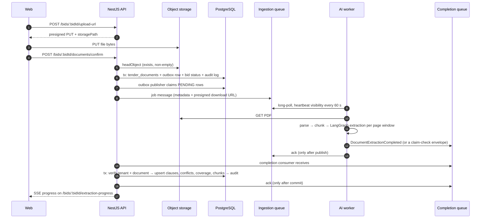

# Architecture

TenderPulse AI reads Indian public-procurement tenders (NIT/RFP, often 50–500 pages), extracts every bidder obligation with a verbatim quote, and helps a bid team review and act on them. This document covers how the system is put together. The extraction pipeline itself is in [AI_PIPELINE.md](AI_PIPELINE.md), the HTTP surface in [API.md](API.md), and the schema in [DATABASE.md](DATABASE.md).

## 1. Services

```
 React SPA (apps/web, Vite :5173)
        │  REST + SSE (Bearer JWT)            presigned PUT/GET
        ▼                                           │
 NestJS API (apps/api, :3000) ────────────────► Object storage (S3 / GCS / in-memory mock)
   • auth, tenancy, RBAC                            ▲
   • single writer to PostgreSQL                    │ presigned GET
   • transactional outbox                           │
        │ ingestion queue (SQS / Pub/Sub)           │
        ▼                                           │
 FastAPI AI worker (apps/ai, :8000) ────────────────┘
   • Docling parsing, chunking, retrieval
   • LangGraph extraction workflow (LLM-only)
        │ completion queue (SQS / Pub/Sub; claim-check to S3 above 200 KB)
        ▼
 NestJS completion consumer ──► PostgreSQL 16 (Drizzle ORM)
```

| Service                                      | Responsibility                                                                                                                               | Never does                                |
| -------------------------------------------- | -------------------------------------------------------------------------------------------------------------------------------------------- | ----------------------------------------- |
| `apps/api` (NestJS 12, TypeScript)           | Authentication, tenant scoping, permissions, every PostgreSQL write, presigned URLs, outbox publishing, completion persistence, SSE progress | Run model inference                       |
| `apps/ai` (FastAPI, Python 3.14, LangGraph)  | Parse PDFs, chunk, retrieve, call LLMs, validate output, publish results; bid-decision, evidence extraction and chat endpoints               | Write to PostgreSQL, decide authorization |
| `apps/web` (React 18, Vite, Tailwind, Radix) | Bids, clause workspace, conflicts, checklist, company profile, audit history                                                                 | Hold business rules                       |
| `packages/shared-types`                      | The AI→API→UI clause contract (`src/clause.ts`, `schema/extraction-completed.schema.json`) and DTOs                                          | —                                         |
| `packages/ui`                                | Shared React components and tokens                                                                                                           | —                                         |

The service boundary is fixed by [ADR 0001](adr/0001-two-tier-service-boundary.md): the AI worker is a pure compute service that receives a job and emits an event. Tenant ownership is always re-derived from PostgreSQL by the API, never trusted from the worker or the model.

## 2. Code layout

**API (`apps/api/src`)**

- `modules/<feature>/` — one Nest module per feature: `auth`, `bids`, `documents`, `compliance`, `companies`, `company-profile`, `company-verification`, `chat`, `dashboard`, `notifications`, `settings`, `teams`, `users`, `billing`, `audit`. Controllers stay thin; SQL lives in `*.repository.ts` / `*.queries.ts`; mapping in mapper classes.
- `common/database/` — node-postgres client (PGlite in tests), Drizzle schema, versioned migrator.
- `common/security/` — `JwtAuthGuard`, `RolesGuard` + `@RequirePermission`, `TenantContextInterceptor`, `InternalServiceGuard`, `TokenService`.
- `common/events/` — `IEventBus` with an in-memory implementation for domain events (`BidProjectCreatedEvent`, `TenderDocumentUploadedEvent`, `ComplianceIngestionCompletedEvent`, `ComplianceItemReviewedEvent`).
- `infrastructure/queue`, `infrastructure/storage` — ports (`IJobQueue`, `IStorageService`) with AWS, GCP and mock adapters.

**AI worker (`apps/ai/src/tenderpulse_ai`)**

- `extraction/` — `orchestrator.py` (page windows, bounded concurrency, dedup, OKF), `contracts.py`, `clause_references.py`, `deduplication.py`, `metrics.py`, `okf_compiler.py`. `pipeline.py` is a thin backward-compatible facade.
- `workflow/` — the LangGraph graph (`graph.py`), nodes (`nodes.py`), state.
- `domain/` — Docling parser, structure builder, 3-tier chunker, candidate detector, context assembler, validator, requirement attributes, evidence extractor.
- `tools/` — tenant-scoped retrieval (BM25 + dense), page text, network egress guard.
- `infrastructure/llm/` — the OpenAI-compatible multi-provider client and record/replay; `infrastructure/embeddings/` — local fastembed embedder; `infrastructure/queue/` — ingestion consumer and completion publishers.
- `security/` — `SecurityContext`, secret/Aadhaar scrubbing, untrusted-data tags.
- `decision/`, `chat/`, `corrigendum/`, `review/`, `evaluation/` — bid decision engine, tender chat, amendment diffing, human review, benchmark.

## 3. Document processing flow



**Key properties**

- **Bytes never pass through queues or the API.** Uploads go straight to storage with a presigned URL; storage keys are `tenants/{organizationId}/bids/{bidId}/{documentId}/{fileName}`.
- **Transactional outbox.** The document row and its `document_processing_outbox` row commit together, so a crash cannot lose a job. `DocumentProcessingRuntime` runs two independent loops: the outbox publisher, and the completion consumer (a 20 s long poll that is aborted on shutdown), so neither waits behind the other.
- **Two queues, one direction each.** The API only produces to the ingestion queue and only consumes the completion queue; the worker does the opposite. Each queue has its own DLQ.
- **Publish-before-ack, persist-before-ack.** The worker acks the job only after its completion event is published; the API acks the completion only after its transaction commits. Redelivery is safe because persistence is idempotent (below).
- **Claim-check for large results.** SQS caps messages at 256 KB. A completion event above 200 KB is written to `tenants/<org>/bids/<bid>/<doc>/completion-events/<job>.json` and the message carries only `payloadStorageReference`. The API checks the tenant prefix and that the stored event's ids match the envelope, persists it, then deletes the object.
- **Idempotent persistence by location.** A clause's identity is its location `(document, page, quote)` (`item_key`), never its title. Re-extraction refreshes the AI fields of an existing clause and keeps its human review; clauses that disappear are deleted only if nobody reviewed them.
- **Coverage is explicit.** Pages the model could not process are listed in `extraction_coverage.failed_pages` (`status` `COMPLETE` / `PARTIAL`); the UI shows them instead of implying a clean result.

## 4. Adapters and configuration

| Port             | Adapters                                         | Selected by                                                                                                       |
| ---------------- | ------------------------------------------------ | ----------------------------------------------------------------------------------------------------------------- |
| Ingestion queue  | AWS SQS, GCP Pub/Sub, in-memory mock             | `AWS_SQS_INGESTION_QUEUE_URL` (API) / `AWS_INGESTION_QUEUE_URL` (worker); Pub/Sub settings; `QUEUE_PROVIDER=mock` |
| Completion queue | AWS SQS, GCP Pub/Sub, HTTP callback, mock        | `AWS_SQS_COMPLETION_QUEUE_URL`; `COMPLETION_QUEUE_PROVIDER` (worker)                                              |
| Object storage   | AWS S3, GCS, in-memory mock                      | `AWS_S3_BUCKET` (or `S3_BUCKET_NAME`, `STORAGE_BUCKET_NAME`) / `GCS_BUCKET_NAME`; `STORAGE_PROVIDER=mock`         |
| Database         | node-postgres (runtime), PGlite (tests only)     | `DATABASE_URL` (required at runtime); `PGLITE_DATA_DIR` in tests                                                  |
| Embeddings       | local fastembed (`BAAI/bge-small-en-v1.5`), none | `EMBEDDING_PROVIDER`                                                                                              |

With mock storage the job carries a download URL served by the API's own `/api/v1/mock-download/...` route. With mock queues nothing reaches the worker, so local extraction uses real (dev) SQS queues — see [DEVELOPMENT.md](DEVELOPMENT.md).

## 5. Failure handling

| Failure                                    | Behaviour                                                                                                                                      |
| ------------------------------------------ | ---------------------------------------------------------------------------------------------------------------------------------------------- |
| Object missing at confirm                  | `headObject` fails, no document row is written                                                                                                 |
| Queue unavailable when publishing          | Outbox row stays `PENDING` and is retried with backoff                                                                                         |
| Worker crash mid-extraction                | Visibility timeout expires; another receive picks the job up                                                                                   |
| Every LLM provider fails for a page window | The window is listed in `failed_pages` and escalated to review; if every window fails the job fails and is retried, then published as `FAILED` |
| Completion transaction fails               | Message is not acked and is redelivered; after `maxReceiveCount` it moves to the completion DLQ                                                |
| Oversized completion event                 | Claim-check (above)                                                                                                                            |

## 6. Observability

Both services write structured JSON logs to the console and to rotated files under `logs/` (`LOG_*` settings, [ADR 0027](adr/0027-dual-sink-rotated-structured-logging.md)). A correlation id travels from the upload request through the job, every LangGraph node and every LLM call to the completion, so `grep corr-<id> logs/ai.log` shows one document's whole run, including provider, model, tokens and 429s per call.
