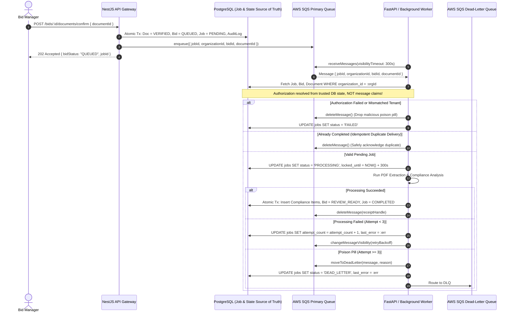

# Asynchronous Job Architecture & Resilience: TenderPulse AI

## 1. Architectural Philosophy: Decoupled Asynchronous Processing

In accordance with **ADR 0003 (SQS Asynchronous Pipeline)** and **AGENTS.md**:
Extracting and analyzing a 200+ page Indian government tender package (NIT, RFP, GCC, SCC, BOQ) requires 60 to 180 seconds of compute:

- Optical Character Recognition (OCR) for scanned annexures.
- PyMuPDF text and table layout extraction.
- Cyclic LangGraph multi-agent compliance verification.

### Synchronous vs. Asynchronous Processing: The Production Reality

| Concern                              | Synchronous Processing (HTTP Request/Response)                                                                        | Asynchronous Processing (SQS + Decoupled Worker)                                                                     |
| :----------------------------------- | :-------------------------------------------------------------------------------------------------------------------- | :------------------------------------------------------------------------------------------------------------------- |
| **HTTP Gateway Timeouts**            | Reverse proxies (Cloudflare, Nginx, AWS ALB) terminate requests after 30s–60s with `504 Gateway Timeout`.             | Client receives `202 Accepted` in < 200ms with a `jobId`. Processing runs unconstrained in the background.           |
| **Resource Starvation**              | Synchronous compute blocks web server threads and event loops, degrading API response times for standard user logins. | Workloads execute on dedicated, compute-optimized worker instances (e.g. AWS ECS/Fargate) isolated from API servers. |
| **Traffic Smoothing & Buffering**    | Traffic spikes (e.g., 50 contractors uploading tenders 2 hours before a GeM portal deadline) cause server crashes.    | SQS acts as an elastic buffer; workers process messages at a controlled, sustainable rate.                           |
| **Crash Recovery & Fault Tolerance** | If a worker process crashes on page 98, the HTTP request fails completely, wasting all prior work.                    | Message remains in queue, visibility timeout expires, and a healthy worker retries automatically.                    |

---

## 2. Core Distributed Queue Concepts

### 2.1 At-Least-Once Delivery

Distributed message queues like AWS SQS guarantee that every message is delivered **at least once**.

- **Why Duplicates Occur**: SQS stores messages across multiple redundant storage nodes. When a consumer acknowledges and deletes a message, network latency or server partitions can prevent the deletion from propagating to all replica nodes before another consumer queries the queue.
- **The Non-Negotiable Rule**: **Every worker processing step must be idempotent.** Duplicate deliveries must never corrupt business state or create duplicate compliance entries.

### 2.2 Visibility Timeout & Worker Leases

When a worker receives a message from SQS:

1. SQS does **not** delete the message.
2. SQS starts a **Visibility Timeout clock** (e.g. 300 seconds). During this window, the message is hidden from all other workers.
3. **If processing succeeds**: The worker calls `sqs.deleteMessage(receiptHandle)`, permanently removing it.
4. **If the worker crashes or times out**: The worker never deletes the message. When the visibility timeout expires, SQS makes the message visible again so another healthy worker can pick it up.

### 2.3 Retries & Exponential Backoff

When a worker encounters a transient error (e.g., external LLM rate limiting or temporary network glitch):

- The worker changes the message visibility timeout using exponential backoff with jitter:
  $$\text{Timeout} = \min(\text{InitialTimeout} \times 2^{\text{attempt}}, \text{MaxTimeout}) + \text{jitter}$$
- This gives downstream dependencies time to recover without overwhelming them with retry storms.

### 2.4 Dead-Letter Queues (DLQ) & Poison Pills

A **poison pill** is a malformed or corrupted document (e.g., an unparseable PDF binary) that causes the worker parser to crash every single time it is processed.

- Without a DLQ, the worker would crash, the visibility timeout would expire, another worker would pick it up, crash again, and loop infinitely—consuming compute and filling logs.
- **DLQ Policy**: SQS tracks `ApproximateReceiveCount`. If a message fails `maxReceiveCount` times (e.g., 3 attempts), SQS automatically reroutes it to a dedicated **Dead-Letter Queue (DLQ)**.
- The platform alerts on DLQ arrival, transitions the job state to `DEAD_LETTER`, and records the error for human inspection.

---

## 3. The End-to-End Pipeline



---

## 4. Security: Resolving Authorization from Trusted Backend State

A critical vulnerability in distributed architectures is trusting the queue message payload.

- **The Attack Scenario**: A rogue actor or compromised client injects a forged message into SQS:
  ```json
  {
    "organizationId": "attacker-org-id",
    "documentId": "victim-org-secret-document-id"
  }
  ```
  If the worker naively executes `fetchDocument(documentId)` and uses `attacker-org-id`, the attacker extracts the victim's confidential bid!
- **The Zero-Trust Defense Rule**:
  1. The message payload contains **only reference identifiers**: `jobId`, `organizationId`, `bidId`, `documentId`.
  2. The worker **never trusts** the payload's claims.
  3. The worker loads the `IngestionJob` from PostgreSQL using `WHERE id = :jobId AND organization_id = :organizationId`.
  4. The worker loads the `TenderDocument` and verifies `doc.organizationId === job.organizationId` AND `doc.bidId === job.bidId`.
  5. If any tenant or resource ownership mismatch is detected, processing is aborted immediately and logged as a security alert.

---

## 5. Idempotency & Duplicate Delivery Handling

To guarantee idempotency when SQS delivers the same message twice:

1. **The Job State Machine**:
   - `PENDING` $\rightarrow$ `PROCESSING` $\rightarrow$ `COMPLETED` / `FAILED` / `DEAD_LETTER`.
2. **Deterministic Unique Key**:
   - Each ingestion task is identified by an immutable `jobId` generated during the upload confirmation handshake.
3. **Atomic State Claim**:
   - When a worker picks up a message, it conditionally claims the job:
     ```sql
     UPDATE ingestion_jobs
     SET status = 'PROCESSING',
         locked_until = NOW() + INTERVAL '300 seconds',
         attempt_count = attempt_count + 1
     WHERE id = :jobId
       AND organization_id = :orgId
       AND status IN ('PENDING', 'PROCESSING')
       AND (locked_until IS NULL OR locked_until < NOW());
     ```
4. **Handling Completed Duplicates**:
   - If the job is already in `COMPLETED` status:
     The worker logs: _"Job already completed; acknowledging duplicate SQS message."_
     The worker calls `deleteMessage` immediately and exits without reprocessing.
