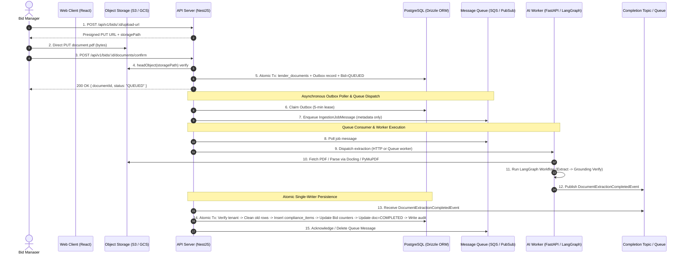

# Asynchronous Document Ingestion & Compliance Persistence Architecture (Design B)

## 1. Executive Summary & Architectural Overview

TenderPulse uses a **decoupled, two-tier asynchronous architecture** for tender document ingestion and AI-driven compliance extraction, conforming to **Design B (Asynchronous Event Choreography)**.

In Indian public procurement, tender documents typically span 50 to 500+ pages of dense, multi-schedule legal conditions. Synchronous HTTP extraction causes reverse proxy timeouts (HTTP 504), Node.js event-loop starvation, and complete loss of progress on transient network or model failures.

To solve this, TenderPulse separates responsibilities across two services using cloud-agnostic ports and adapters:
- **Application & Ingestion Tier (`apps/api` - NestJS / TypeScript)**: Manages authenticated client uploads, enforces multi-tenant boundaries, writes durable outbox records, polls message queues, and serves as the **exclusive, atomic single-writer to PostgreSQL**.
- **AI Extraction & Intelligence Worker Tier (`apps/ai` - FastAPI / Python)**: Executes heavy PDF layout parsing (Docling / PyMuPDF), linguistic candidate filtering, and stateful LangGraph agentic extraction workflows, publishing asynchronous completion events back to the message broker upon finishing.



---

## 2. Ingestion & Outbox Stage (NestJS)

### 2.1 Direct-to-Storage Upload Handshake
1. The client requests a presigned upload URL via `POST /api/v1/bids/:id/upload-url`.
2. The API derives a tenant-isolated storage path: `tenants/{organizationId}/bids/{bidId}/{documentId}/{fileName}`.
3. The client uploads raw PDF bytes directly to object storage via HTTP PUT. Raw document bytes never traverse the API process memory.

### 2.2 Upload Confirmation & Transactional Outbox
1. The client confirms the upload via `POST /api/v1/bids/:id/documents/confirm`.
2. The server verifies physical object presence and non-zero size via `IStorageService.headObject(storagePath)`.
3. An atomic PostgreSQL transaction performs four operations:
   - Inserts the `tender_documents` row (`status = 'PENDING'`).
   - Updates `bids.status = 'QUEUED'`.
   - Inserts an audit event `DOCUMENT_UPLOADED`.
   - Inserts an outbox record into `document_processing_outbox`.

### 2.3 Outbox Record Schema
```typescript
{
  id: string; // UUID
  organizationId: string;
  companyId: string;
  bidId: string;
  documentId: string;
  payload: IngestionJobMessage;
  status: 'PENDING' | 'CLAIMED' | 'PUBLISHED' | 'FAILED';
  leaseExpiresAt?: Date;
  retryCount: number;
  lastError?: string;
  createdAt: Date;
}
```

---

## 3. Queue Dispatch & Consumer Runtime (NestJS)

### 3.1 Outbox Poller & Durable Handoff
`DocumentProcessingRuntime` runs in the API application and handles durable handoff:
- Queries `document_processing_outbox` for `PENDING` records or expired leases (`leaseExpiresAt < NOW()`).
- Claims records using optimistic concurrency (`UPDATE ... WHERE status = 'PENDING'`).
- Dispatches the payload to the configured `IJobQueue`.
- Marks the outbox row as `PUBLISHED`.

### 3.2 Cloud-Agnostic Queue Port (`IJobQueue`)
The queue abstraction is strictly cloud-agnostic:
- **AWS SQS Adapter (`AwsSqsJobQueue`)**: Used when `AWS_SQS_QUEUE_URL` is set.
- **GCP Pub/Sub Adapter (`GcpPubSubJobQueue`)**: Used when `GCP_PUBSUB_TOPIC` and `GCP_PUBSUB_SUBSCRIPTION` are set.
- **In-Memory Mock Adapter (`MockSqsJobQueue`)**: Used for local development and unit tests.

### 3.3 Message Payload Contract (`IngestionJobMessage`)
The message carries metadata only; raw PDF bytes are never placed in message queues:
```json
{
  "jobId": "job-550e8400-e29b-41d4-a716-446655440000",
  "organizationId": "org-tenant-alpha",
  "companyId": "comp-12345",
  "bidId": "bid-98765",
  "documentId": "doc-54321",
  "workflowRunId": "wf-112233",
  "correlationId": "corr-445566",
  "storageReference": "tenants/org-tenant-alpha/bids/bid-98765/doc-54321/nit_volume_1.pdf",
  "documentType": "TENDER_NOTICE",
  "fileName": "nit_volume_1.pdf",
  "timestamp": "2026-10-08T02:00:00.000Z"
}
```

---

## 4. AI Worker & Extraction Pipeline (FastAPI)

### 4.1 Worker Ingestion & Security Guard
The AI worker exposes `POST /api/v1/extract` and `POST /api/v1/worker/process-message`:
- **Mutual Authentication**: Validated via `X-Internal-Service-Key` header against `INTERNAL_SERVICE_KEY`.
- **Security Context**: Tenant and company context are passed directly in the verified request, establishing an immutable `SecurityContext`.

### 4.2 Document Parsing
1. **Docling Document Converter (`DoclingDocumentParser`)**: Uses native Docling layout analysis to extract sections, tables, headers, and hierarchical reading order.
2. **Text Normalization Fallback (`PyMuPDF / pdf_resolver`)**: In environments where native Docling libraries are absent, PyMuPDF streams pages and normalizes layout markers.
3. **Table of Contents (TOC) Filtering**: Pages with high TOC density (>50%) lacking operative deontic modals are automatically excluded to preserve token budget.

### 4.3 Stateful LangGraph Extraction Workflow
The pipeline executes a multi-node LangGraph state machine:
1. **Candidate Detector Node**: Regex and linguistic scanning for deontic modals (`shall`, `must`, `required to`), financial covenants (EMD, PBG), and submission rules.
2. **LLM Extraction Node**: Invokes OpenRouter LLM (Claude 3.5 Sonnet / GPT-4o) using structured Pydantic output schemas.
3. **Deterministic Grounding & Quote Verifier Node**: Verifies that every extracted verbatim quote actually exists character-for-character within the source page text. Discrepancies apply confidence penalties.
4. **Human Review Router Node**:
   - Confidence score $\ge 0.95$: `AUTO_ACCEPT`
   - Confidence score $0.80 - 0.94$: `REVIEWER_VERIFICATION`
   - Confidence score $< 0.80$: `MANDATORY_HUMAN_REVIEW`

---

## 5. Asynchronous Completion Event Dispatch (FastAPI)

Upon workflow completion, the AI worker publishes a `DocumentExtractionCompletedEvent` via `CompletionPublisher`:

### 5.1 Event Contract Schema
```json
{
  "eventId": "evt-778899",
  "eventType": "DocumentExtractionCompleted",
  "documentId": "doc-54321",
  "bidId": "bid-98765",
  "organizationId": "org-tenant-alpha",
  "companyId": "comp-12345",
  "status": "SUCCESS",
  "extractedCount": 18,
  "extractedItems": [
    {
      "title": "Earnest Money Deposit (EMD)",
      "category": "FINANCIAL",
      "description": "Bidder shall submit an Earnest Money Deposit of INR 50,00,000 in the form of Bank Guarantee.",
      "executionRules": {
        "isMandatory": true,
        "penalties": "Forfeiture of bid security",
        "gracePeriodDays": 0
      },
      "provenance": {
        "documentId": "doc-54321",
        "documentName": "nit_volume_1.pdf",
        "pageNumber": 14,
        "clauseReference": "Clause 4.2.1",
        "verbatimQuote": "The Bidder shall furnish, as part of its Bid, a Bid Security amounting to INR 50,00,000...",
        "confidenceScore": 0.98
      },
      "isVerified": true,
      "confidenceScore": 0.98
    }
  ],
  "workflowRunId": "wf-112233",
  "traceId": "trace-998877",
  "correlationId": "corr-445566",
  "timestamp": "2026-10-08T02:05:00.000Z"
}
```

### 5.2 Completion Publisher Adapters
- **GCP Pub/Sub (`GcpPubSubCompletionPublisher`)**: Publishes to configured topic.
- **AWS SQS (`AwsSqsCompletionPublisher`)**: Sends message to configured completion queue.
- **Mock Publisher (`MockCompletionPublisher`)**: Records events in memory during test execution.

---

## 6. Atomic Single-Writer PostgreSQL Persistence (NestJS)

To maintain absolute data integrity and prevent race conditions, **the AI worker never writes directly to PostgreSQL**. NestJS `DocumentCompletionService` acts as the **exclusive single writer**.

### 6.1 Database Schema (`compliance_items`)
```sql
CREATE TABLE compliance_items (
    id UUID PRIMARY KEY DEFAULT gen_random_uuid(),
    organization_id UUID NOT NULL REFERENCES organizations(id),
    company_id UUID REFERENCES companies(id),
    bid_id UUID NOT NULL REFERENCES bids(id) ON DELETE CASCADE,
    title TEXT NOT NULL,
    description TEXT NOT NULL,
    category VARCHAR(50) NOT NULL,
    status VARCHAR(50) NOT NULL DEFAULT 'EXTRACTED',
    human_review_required BOOLEAN NOT NULL DEFAULT FALSE,
    execution_rules JSONB DEFAULT '{}'::jsonb,
    provenance JSONB NOT NULL DEFAULT '{}'::jsonb,
    workflow_run_id VARCHAR(100),
    correlation_id VARCHAR(100),
    created_at TIMESTAMPTZ NOT NULL DEFAULT NOW(),
    updated_at TIMESTAMPTZ NOT NULL DEFAULT NOW()
);
```

### 6.2 Transactional Persistence Flow
When `DocumentCompletionService.handleExtractionCompleted(event)` receives the event:

1. **Authorization & Tenant Re-Derivation**:
   - Re-queries `bids` and `tender_documents` from PostgreSQL using `organization_id`.
   - If `bid.organization_id !== event.organizationId` or `doc.bid_id !== event.bidId`, aborts immediately with `ForbiddenException`.
2. **PostgreSQL Transaction Acquisition**:
   - Acquires row-level locks on `bids` and `tender_documents`.
3. **Idempotent Document Clean-up**:
   - Deletes any existing `compliance_items` associated with `event.documentId` in `provenance->>'documentId'`. This ensures safe retries and prevents duplicate entries.
4. **Deterministic Batch Insert**:
   - Generates deterministic UUIDs (`UUIDv5` based on `bidId + documentId + clauseReference + index`).
   - Inserts all extracted items in a single SQL `INSERT INTO compliance_items VALUES (...)` batch.
5. **Bid Status & Counters Recalculation**:
   - Computes total requirements count and high-risk requirement counts.
   - Updates `bids.status = 'IN_PROGRESS'` (or `'ACTIVE'`).
   - Updates `tender_documents.status = 'COMPLETED'`.
6. **Audit Trail Recording**:
   - Inserts an `audit_logs` record with event `AI_INGESTION_COMPLETED`.
7. **Queue Message Acknowledgment**:
   - The queue message is deleted/acknowledged **only after the PostgreSQL transaction successfully commits**.

---

## 7. Reliability, Retries & Dead Letter Queues (DLQ)

### 7.1 Distributed Delivery & Idempotency
- **At-Least-Once Delivery Guarantee**: Distributed brokers (AWS SQS, GCP Pub/Sub) guarantee that every message is delivered at least once. Duplicate deliveries occur during network partitions or acknowledgment latency.
- **Strict Idempotency**: All consumers and database persisters are idempotent. Existing document extraction items are purged within the database transaction prior to inserting newly extracted items with deterministic UUIDs.

### 7.2 Visibility Timeout, Heartbeats & Exponential Backoff
- **Visibility Timeout (Leases)**: When a worker receives a message, the broker starts a visibility timeout clock (default: 300 seconds). During this window, the message is hidden from peer workers.
- **Heartbeat Renewal**: For long-running extractions, `DocumentProcessingRuntime` periodically renews visibility via a background heartbeat interval (`changeMessageVisibility`).
- **Exponential Backoff with Jitter**: Transient errors (e.g. rate limits or brief network partitions) trigger exponential retry backoff:
  $$\text{Timeout} = \min(\text{InitialTimeout} \times 2^{\text{attempt}}, \text{MaxTimeout}) + \text{jitter}$$

### 7.3 Dead Letter Queues (DLQ) & Poison Pill Mitigation
- **Poison Pills**: Malformed or unparseable payloads (corrupted binaries or malformed schemas) fail every processing attempt.
- **Max Receive Limit**: If a message fails `maxReceiveCount` times (default: 3 attempts), the message broker routes it directly to a dedicated Dead-Letter Queue (DLQ).
- **Terminal State**: NestJS transitions the document state to `DEAD_LETTER`, records `last_processing_error`, and emits a critical operational alert without infinitely looping.

### 7.4 Failure Matrix & Recovery Mechanisms

| Failure Scenario | Recovery Mechanism |
|---|---|
| **Storage unavailable during confirmation** | `headObject` fails before database write; returns HTTP 400/404; no orphaned DB row. |
| **Outbox publication failure** | Outbox record remains `PENDING`; retry poller picks it up with exponential backoff. |
| **AI Worker process crash during extraction** | Visibility timeout expires on message queue; message is redelivered to available worker. |
| **Persistence transaction rollback** | Queue message remains unacknowledged; will be retried up to `maxReceiveCount`. |
| **Exceeded max retries (Poison message)** | Queue provider routes message to configured Dead Letter Queue (`AWS_SQS_DLQ_URL` / `GCP_PUBSUB_DLQ_TOPIC`). |
| **Replay / Redelivery** | Safe and idempotent: document rows are cleaned up inside the transaction before re-inserting new items with deterministic IDs. |

---

## 8. Summary of Architectural Decisions & Invariants

1. **Cloud-Provider Agnostic**: All queues, object storage, and event publishers use ports and adapters. Swapping AWS and GCP requires zero business logic changes.
2. **Never Trust the LLM for Authorization**: Tenant isolation and ownership are verified from trusted PostgreSQL rows, never from LLM outputs or untrusted client headers.
3. **Single Writer Principle**: Only the NestJS API writes to PostgreSQL. The AI worker is a pure computational service that receives inputs and emits events.
4. **Persist-Before-Ack**: A message is acknowledged if and only if its persistent side effects have successfully committed to the database.
