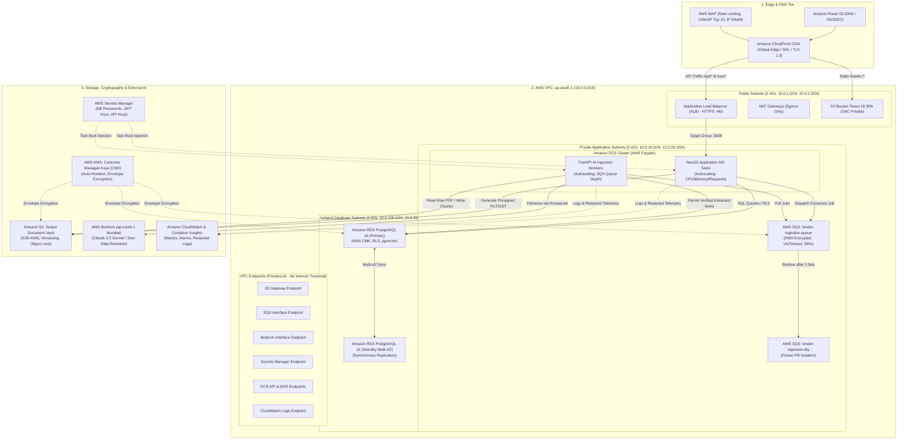

# AWS Cloud Architecture & Infrastructure Blueprint: TenderPulse AI

## 1. Executive Summary & Design Principles

This document defines the production cloud architecture for **TenderPulse AI** on Amazon Web Services (AWS) in the **`ap-south-1` (Mumbai)** region.

In alignment with **AGENTS.md** and **ADR 0001 through ADR 0012**, our cloud infrastructure is designed on six non-negotiable principles:

1. **Deterministic Sovereign Boundary**: Deterministic code (NestJS + PostgreSQL) is the sole transactional source of truth. AI inference (AWS Bedrock + LangGraph) is an advisory component operating strictly behind authorized, tenant-scoped software boundaries.
2. **Zero-Trust Network Isolation**: Compute containers and database clusters reside in private and isolated VPC subnets with zero direct public internet ingress. Communication with AWS services (S3, SQS, Bedrock, Secrets Manager) traverses private **VPC Endpoints (PrivateLink)** without crossing the public internet.
3. **Defense-in-Depth Multi-Tenancy**: Tenant isolation is enforced at four distinct layers: Network (VPC/Security Groups), Cryptographic (KMS & Presigned URLs), Application (`AsyncLocalStorage` + RBAC), and Database (Composite Foreign Keys + PostgreSQL RLS).
4. **Resilience & Asynchronous Decoupling**: Heavy document extraction and multi-stage compliance reasoning are fully decoupled from synchronous user HTTP lifecycles via **AWS SQS** with automatic retries, visibility timeouts, and Dead-Letter Queues (DLQ).
5. **Data Residency & Sovereign Compliance**: All tender documents, extracted text, embeddings, and database records remain strictly within the geographical boundary of India (`ap-south-1`), compliant with the **Digital Personal Data Protection (DPDP) Act, 2023** and Public Procurement Orders.
6. **Cost Pragmatism & Operational Simplicity**: We utilize managed serverless container infrastructure (**AWS ECS Fargate**) and avoid premature operational complexity (e.g. self-hosted Kubernetes or unnecessary multi-region active-active databases).

---

## 2. End-to-End AWS Architecture Map



---

## 3. Technology Evaluation Matrix (17 AWS Services)

Every AWS service considered for TenderPulse AI has been evaluated against strict architectural justification criteria:

| AWS Service | Architectural Status | Primary Role in TenderPulse AI |
| :--- | :--- | :--- |
| **Route 53** | **ACCEPTED** | Authoritative DNS, DNSSEC, health-checked failover routing. |
| **CloudFront** | **ACCEPTED** | Edge caching for React SPA, DDoS mitigation, TLS 1.3 termination, S3 OAC. |
| **Amazon S3** | **ACCEPTED** | Durable encrypted blob storage for 10MB–100MB tender PDFs and static SPA bundle. |
| **ALB (Load Balancer)** | **ACCEPTED** | Layer 7 load balancing, SSL termination, path routing, long-lived SSE connections. |
| **API Gateway** | **REJECTED** | 29-second hard timeout breaks Server-Sent Events (SSE) and heavy doc workflows. |
| **NestJS on ECS Fargate** | **ACCEPTED** | Enterprise application boundary, auth/RBAC, bid state machine, Presigned URL signer. |
| **FastAPI on ECS Fargate**| **ACCEPTED** | Python worker for PyMuPDF extraction, OCR, LangGraph orchestration, SQS consumer. |
| **Amazon RDS PostgreSQL** | **ACCEPTED** | Transactional source of truth, multi-tenant RLS, `pgvector`, Multi-AZ ACID storage. |
| **Redis / ElastiCache** | **DEFERRED (Ph 24)** | Deferred to Phase 24 for distributed rate limiting and token revocation denylist. |
| **AWS SQS + DLQ** | **ACCEPTED** | Decoupled asynchronous job queue, worker resilience, automatic retry with DLQ. |
| **AWS EventBridge** | **ACCEPTED** | Decoupled cross-module domain events and scheduled cron jobs (nightly deadline alerts). |
| **Amazon DynamoDB** | **REJECTED** | Lacks relational integrity, composite foreign keys, and RLS needed for tender matrices. |
| **AWS AppSync** | **REJECTED** | Unnecessary complexity; replaced by unidirectional Server-Sent Events (SSE) + REST. |
| **Amazon CloudWatch** | **ACCEPTED** | Centralized container logs, operational metrics, CPU/memory alarms, DLQ alerts. |
| **AWS Secrets Manager** | **ACCEPTED** | Secure credential injection at container boot time with automatic rotation. |
| **AWS KMS** | **ACCEPTED** | Customer Managed Keys (CMK) for envelope encryption at rest across S3, RDS, SQS. |
| **AWS IAM** | **ACCEPTED** | Role-based least-privilege security boundaries (Task Execution vs Task Runtime). |
| **Amazon VPC & Endpoints**| **ACCEPTED** | 3-tier isolated subnet architecture with PrivateLink endpoints for zero-internet traffic. |
| **Amazon ECR** | **ACCEPTED** | Private container image registry with automated vulnerability scanning on push. |

---

## 4. Deep-Dive Service Evaluations (WHY, WHAT, HOW, COST, FAILURES, SECURITY, ALTERNATIVES)

### 4.1 Route 53 (DNS & Traffic Routing)
- **WHY**: High-availability global DNS resolution with millisecond latency, DNSSEC support, and alias records to CloudFront and ALB.
- **WHAT**: Highly available and scalable cloud Domain Name System (DNS) web service.
- **HOW**: Hosts public zone `tenderpulse.ai`. Routes `app.tenderpulse.ai` via Alias record to CloudFront CDN, and `api.tenderpulse.ai` to ALB.
- **COST**: $0.50/hosted zone/month + $0.40 per million queries (approx. **$1–$3/month**).
- **FAILURES**: DNS propagation delays or zone configuration errors. Mitigated with low TTLs (60s) during migrations and Infrastructure-as-Code (Terraform).
- **SECURITY**: DNSSEC enabled to prevent DNS cache poisoning and man-in-the-middle spoofing.
- **ALTERNATIVES**: Cloudflare DNS. Route 53 is preferred for native AWS ACM certificate integration and automated alias record resolution.

### 4.2 CloudFront (Content Delivery Network & Edge Security)
- **WHY**: Delivers the React 18 SPA to Indian procurement users with single-digit millisecond latency via edge locations in Mumbai, Delhi, Chennai, Bangalore, Hyderabad, and Kolkata, while providing L3/L4 DDoS mitigation.
- **WHAT**: Global Content Delivery Network (CDN) with Origin Access Control (OAC).
- **HOW**:
  - Default behavior (`/*`): Serves Vite React assets from private S3 bucket `tenderpulse-web-spa` via S3 OAC.
  - API behavior (`/api/*` and `/sse/*`): Forwards dynamically to ALB with caching completely disabled (`Cache-Control: no-store`) and custom headers.
- **COST**: First 1TB/month free; approx. **$5–$15/month** for production traffic.
- **FAILURES**: Stale edge cache after deployment. Mitigated by Vite content-hashed chunk filenames (`index-t2wCnlBt.js`) and automated cache invalidation in CI/CD.
- **SECURITY**: AWS Shield Standard enabled, AWS WAF rate-limiting web ACL attached, TLS 1.3 enforced, HTTP redirected to HTTPS, direct S3 access blocked via OAC.
- **ALTERNATIVES**: Cloudflare CDN, Fastly.

### 4.3 Amazon S3 (Simple Storage Service)
- **WHY**: Government tenders (NIT, BoQ, Technical Specs, Corrigenda) range from 10MB to 100MB+. Storing large PDF blobs in PostgreSQL degrades database performance and bloats backups.
- **WHAT**: Highly durable (99.999999999%), scalable, encrypted object storage.
- **HOW**:
  - `tenderpulse-web-spa`: Hosts static frontend assets.
  - `tenderpulse-tenant-vault`: Partitioned by tenant: `tenants/{tenantId}/bids/{bidId}/raw/{documentId}.pdf`.
  - Direct browser upload using **S3 Presigned PUT URLs** generated by NestJS after authenticating user and verifying tenant boundary.
- **COST**: $0.023/GB/month for Standard storage. Lifecycle rule transitions archived bids (>180 days) to S3 Glacier Flexible Retrieval ($0.0036/GB/month). Approx. **$10–$25/month**.
- **FAILURES**: S3 503 SlowDown on high request concurrency. Mitigated by partitioning keys with high-entropy document UUIDs. Accidental deletion is prevented by S3 Object Versioning and MFA Delete.
- **SECURITY**: S3 Block Public Access enabled across all buckets. SSE-KMS with Customer Managed Key (`alias/tenderpulse-s3-key`). Bucket policy enforces `aws:SecureTransport: true`.
- **ALTERNATIVES**: Cloudflare R2, MinIO. S3 is preferred for AWS IAM Presigned URL integration and AWS KMS native governance.

### 4.4 Application Load Balancer (ALB) vs API Gateway
- **DECISION**: **ALB ACCEPTED; API Gateway REJECTED**.
- **WHY**:
  1. **Server-Sent Events (SSE)**: Document extraction streams progress over long-lived HTTP connections (60–180 seconds). API Gateway enforces a hard, unalterable **29-second execution timeout**, which abruptly terminates SSE streams and long-running AI extractions. ALB supports configurable idle timeouts up to 4,000 seconds.
  2. **Cost at Scale**: ALB provides predictable fixed baseline pricing ($16/mo) with high request throughput, whereas API Gateway charges $3.50 per million requests + data transfer, becoming expensive with chatty REST polling and streaming.
- **WHAT**: Layer 7 application load balancer inside public subnets.
- **HOW**: Routes incoming HTTPS traffic on port 443 to Target Group 1 (NestJS ECS Fargate containers on port 3000). Health checks target `/api/v1/health`.
- **COST**: ~$16.20/month base + $0.008 per LCU-hour (approx. **$20–$35/month**).
- **FAILURES**: Target group unhealthy. Mitigated by container health checks, graceful shutdown (`SIGTERM` handling), and connection draining (30s).
- **SECURITY**: Security group accepts ingress *only* from CloudFront managed prefix list or AWS WAF. TLS 1.3 negotiated with ACM SSL certificate.
- **ALTERNATIVES**: Nginx on EC2 (undue maintenance/patching overhead), AWS HTTP API Gateway (lacks WAF integration on HTTP API tier, timeout limitations).

### 4.5 NestJS Runtime (Application API on ECS Fargate)
- **WHY**: Governs the deterministic sovereign application boundary: user authentication, multi-tenant isolation, RBAC, tender state machines, S3 presigned URL signing, and audit logging.
- **WHAT**: Containerized Node.js application running on AWS ECS Fargate in private subnets across 2 Availability Zones.
- **HOW**: Container image pulled from Amazon ECR. Auto-scales from 2 to 10 tasks based on CPU utilization (>70%) and ALB request count per target.
- **COST**: 2 tasks × (0.5 vCPU, 1GB RAM) = approx. **$28/month**.
- **FAILURES**: Uncaught JavaScript exceptions or container crash. Mitigated by Fargate automatic task replacement, health check endpoints, and cluster service discovery.
- **SECURITY**: IAM Task Role grants strictly scoped access (`sqs:SendMessage`, `kms:GenerateDataKey`, `s3:PutObject` presigning). No public IP address. Connects to RDS over TLS with credentials injected via Secrets Manager.
- **ALTERNATIVES**: AWS Lambda (cold starts, 15-min timeout, connection exhaustion on PostgreSQL without proxy, incompatible with long-lived SSE connections), AWS EKS (massive operational overhead for a modular monolith).

### 4.6 FastAPI Runtime (AI & Document Intelligence Worker on ECS Fargate)
- **WHY**: Isolates heavy document layout parsing (PyMuPDF, pdfplumber), OCR, and LangGraph multi-step cyclic reasoning in Python, preventing memory spikes from impacting the main web API.
- **WHAT**: Containerized asynchronous Python worker consuming messages from AWS SQS.
- **HOW**:
  - Runs in private subnets with no public ingress.
  - Long-polls AWS SQS `tender-ingestion-queue`.
  - Fetches tender PDF from S3 via VPC Endpoint.
  - Invokes AWS Bedrock Claude 3.5 Sonnet via PrivateLink.
  - Verifies verbatim substring grounding deterministically.
  - Persists validated compliance items directly to PostgreSQL via PgBouncer.
  - Acknowledges and deletes SQS message upon completion.
  - Auto-scales based on SQS `ApproximateNumberOfMessagesVisible`.
- **COST**: 2 tasks × (1 vCPU, 2GB RAM) = approx. **$45/month**.
- **FAILURES**: Worker crash mid-extraction. SQS visibility timeout (300s) expires; message returns to queue and is claimed by another worker. If a malformed PDF crashes worker 3 times, message moves to Dead-Letter Queue (DLQ).
- **SECURITY**: Zero internet ingress. Outbound egress restricted strictly to VPC Endpoints. IAM Task Role restricted to `bedrock:InvokeModel`, `sqs:ReceiveMessage`, `sqs:DeleteMessage`, and S3 read.
- **ALTERNATIVES**: AWS Batch (unnecessary queue orchestration overhead for sub-3-minute jobs), Celery on EC2 (requires managing VMs, Redis broker, and OS patching).

### 4.7 Amazon RDS PostgreSQL 16 (Multi-AZ Database)
- **WHY**: Single transactional source of truth for all structured data (Tenants, Users, Bids, Documents, Compliance Items, Audit Logs) and vector embeddings (`pgvector`).
- **WHAT**: Managed relational database with Multi-AZ automated failover, synchronous replication, and automated backups.
- **HOW**:
  - Deployed in isolated database subnets across 2 AZs (`ap-south-1a`, `ap-south-1b`).
  - Connection pooling managed via PgBouncer / RDS Proxy to prevent connection exhaustion.
  - Automated daily backups + continuous Point-In-Time Recovery (PITR) with 30-day retention window.
- **COST**: `db.t4g.medium` Multi-AZ (2 vCPU, 4GB RAM, 100GB gp3 SSD) = approx. **$75–$95/month**.
- **FAILURES**: Primary database hardware failure triggers automatic Multi-AZ failover in <60 seconds with zero data loss (synchronous commit). Storage auto-scaling expands disk up to 1TB.
- **SECURITY**: KMS CMK encryption at rest (`alias/tenderpulse-rds-key`). SSL/TLS 1.3 enforced (`sslmode=require`). Deployed in isolated subnet with Security Group accepting connections *only* from NestJS and FastAPI ECS security groups on port 5432.
- **ALTERNATIVES**: Self-hosted PostgreSQL on EC2 (excessive operational risk), Amazon Aurora PostgreSQL (justified in future when read traffic requires automatic multi-region read replicas; standard RDS is more cost-effective for MVP/early growth).

### 4.8 Redis / Amazon ElastiCache (Caching & Distributed Locking)
- **DECISION**: **DEFERRED TO PHASE 24**.
- **WHY DEFERRED**: In Phase 23, in-memory rate limiting and PostgreSQL optimistic locking (`version` column) provide complete consistency. Introducing ElastiCache prematurely adds infrastructure cost ($15/mo) without architectural necessity.
- **PLANNED ROLE (Phase 24)**: Distributed rate limiting across ECS tasks, JWT token revocation denylist, and LangGraph checkpoint memory.
- **SECURITY**: Private subnet, transit encryption (TLS), auth token.

### 4.9 AWS SQS (Simple Queue Service) + Dead-Letter Queue (DLQ)
- **WHY**: Eliminates synchronous coupling between API and AI extraction. Guarantees zero dropped jobs during traffic spikes or brief worker restarts.
- **WHAT**: Fully managed, highly scalable distributed message queue.
- **HOW**:
  - `tender-ingestion-queue`: Visibility Timeout = 300 seconds, Message Retention = 4 days, Long Polling = 20 seconds.
  - `tender-ingestion-dlq`: Message Retention = 14 days. SQS Redrive Policy moves message to DLQ after `maxReceiveCount = 3`.
  - Zero-trust payload: `{ organizationId, bidId, documentId }` (no raw PDF binaries or secrets in message payload).
- **COST**: First 1 million requests/month free; $0.40/million requests thereafter (approx. **$0.50/month**).
- **FAILURES**: Poison pill PDF (causes parser panic). Retried twice with exponential backoff; on 3rd failure, isolated in DLQ and triggers CloudWatch Alarm alerting engineering.
- **SECURITY**: Server-side encryption with KMS CMK (`alias/tenderpulse-sqs-key`). Queue policy restricts `SendMessage` to NestJS Task Role and `ReceiveMessage` to FastAPI Task Role.
- **ALTERNATIVES**: RabbitMQ on EC2 (manual clustering/patching), Kafka/MSK (massive cost and complexity overkill for background job processing).

### 4.10 AWS EventBridge (Domain Events & Scheduled Jobs)
- **WHY**: Enables asynchronous decoupling for cross-domain side effects (e.g. audit dispatch, user notifications) and scheduled cron rules (e.g. nightly tender deadline checks).
- **WHAT**: Serverless event bus and scheduler.
- **HOW**: Custom event bus `tenderpulse-domain-events`. NestJS emits reference-only domain events (`BidProjectCreated`, `ComplianceItemReviewed`). EventBridge Scheduler triggers nightly cron tasks.
- **COST**: $1.00 per million events published (approx. **$1/month**).
- **FAILURES**: Event delivery failure. Handled by attaching an SQS DLQ to EventBridge rule targets.
- **SECURITY**: IAM policies enforce strict publication rights. Reference-only payloads prevent leaking sensitive PDF text or credentials into the event bus.
- **ALTERNATIVES**: In-process EventEmitter (lost on container restart), Redis Pub/Sub (lacks durable delivery guarantees).

### 4.11 Amazon DynamoDB
- **DECISION**: **REJECTED (ADR 0004)**.
- **WHY REJECTED**: Government tender compliance workflows demand multi-entity relational integrity (Organizations $\rightarrow$ Users $\rightarrow$ Bids $\rightarrow$ Documents $\rightarrow$ Compliance Items $\rightarrow$ Provenance $\rightarrow$ Audit Logs), ACID transactions, composite foreign keys, and Row-Level Security (RLS). DynamoDB lacks relational joins and complex multi-column filter queries needed for interactive compliance checklists. PostgreSQL handles semi-structured metadata via native `JSONB` without sacrificing relational guarantees.

### 4.12 AWS AppSync / WebSockets
- **DECISION**: **REJECTED (ADR 0005)**.
- **WHY REJECTED**: TenderPulse real-time progress requirements are unidirectional (server broadcasting document extraction progress to the user). Server-Sent Events (SSE) over HTTP/2 provide native browser reconnection, standard Authorization headers, zero additional gateway infrastructure, and zero WebSocket connection state management. AppSync adds GraphQL schema overhead, DynamoDB lock-in, and unnecessary cost.

### 4.13 Amazon CloudWatch & Container Insights
- **WHY**: Comprehensive operational telemetry, centralized container logs, infrastructure metrics, and automated alerts for system errors and security events.
- **WHAT**: Cloud monitoring and observability service.
- **HOW**:
  - AWS ECS Fargate streams container stdout/stderr to CloudWatch Log Groups via `awslogs` driver.
  - Alarms configured for: ALB 5XX rate > 1%, RDS CPU > 80%, SQS DLQ depth > 0, ECS memory utilization > 85%.
  - Metric filters detect authentication failure spikes (potential brute-force).
- **COST**: 5GB free; $0.50/GB log data ingested; $0.10/alarm/month (approx. **$10–$20/month**).
- **FAILURES**: Log ingestion lag. Mitigated by setting 30-day retention on application logs and 365-day retention on immutable audit logs.
- **SECURITY**: CloudWatch Log Groups encrypted with KMS CMK. Application logger strictly redacts PII, JWTs, and raw tender text before writing to stdout.
- **ALTERNATIVES**: Datadog / New Relic (significantly higher cost; native CloudWatch integrates seamlessly with AWS IAM and alarms).

### 4.14 AWS Secrets Manager
- **WHY**: Prevents database passwords, Bedrock configuration, JWT signing keys, and service tokens from being committed to Git or stored in plaintext environment variables.
- **WHAT**: Managed secret storage with fine-grained IAM access control and automatic rotation.
- **HOW**: Secrets stored as JSON: `tenderpulse/production/secrets`. Injected securely into ECS Fargate containers at task launch time via ECS task definition `secrets` block (retrieved directly by AWS Fargate infrastructure without writing secrets to container environment files).
- **COST**: $0.40/secret/month + $0.05 per 10,000 API calls (approx. **$2–$5/month**).
- **FAILURES**: Secrets Manager API rate limiting. Mitigated because secrets are fetched *only once* at container startup, then cached in application memory.
- **SECURITY**: Encrypted with KMS CMK (`alias/tenderpulse-secrets-key`). IAM Task Execution Role is granted `secretsmanager:GetSecretValue` strictly for the application's secret ARN.
- **ALTERNATIVES**: AWS Systems Manager Parameter Store (cheaper, but lacks native automated RDS password rotation).

### 4.15 AWS Key Management Service (KMS)
- **WHY**: Central cryptographic authority providing hardware security module (HSM) backed envelope encryption for data at rest across all AWS services.
- **WHAT**: Managed key generation and cryptographic operation service.
- **HOW**: Dedicated Customer Managed Keys (CMK) created with automatic annual key rotation:
  - `alias/tenderpulse-rds-key` (RDS PostgreSQL encryption)
  - `alias/tenderpulse-s3-key` (Tenant Document Vault encryption)
  - `alias/tenderpulse-sqs-key` (SQS message encryption)
  - `alias/tenderpulse-secrets-key` (Secrets Manager encryption)
  - `alias/tenderpulse-logs-key` (CloudWatch Logs encryption)
- **COST**: $1.00 per CMK/month + $0.03 per 10,000 cryptographic operations (approx. **$6–$10/month**).
- **FAILURES**: Throttling on cryptographic operations. Mitigated by envelope encryption where KMS generates a data encryption key (DEK) and local AWS services perform symmetric AES-256 encryption.
- **SECURITY**: Strict Key Policies separating key administration (DevOps/Terraform) from key usage (ECS Task Roles).
- **ALTERNATIVES**: AWS Managed Keys (`aws/s3`, `aws/rds`). CMKs are required because they provide explicit CloudTrail audit logging, key access revocation, and annual automatic rotation.

### 4.16 AWS Identity and Access Management (IAM)
- **WHY**: Enforces the principle of least privilege across all human and machine identities, ensuring that compromising one service cannot lead to unauthorized lateral movement.
- **WHAT**: Global identity and access authorization service.
- **HOW**: Strict separation between **ECS Task Execution Role** (infrastructure boot permissions) and **ECS Task Role** (application runtime permissions):
  - `TenderPulseApiTaskRole`: Can sign S3 presigned URLs, send messages to SQS, read/write RDS, publish to EventBridge. Cannot access Bedrock directly; cannot delete S3 buckets.
  - `TenderPulseAiWorkerTaskRole`: Can pull from SQS, invoke Bedrock in `ap-south-1`, read raw PDFs from S3, write to RDS. Cannot access Route 53 or publish public URLs.
- **COST**: Free.
- **FAILURES**: Overly restrictive policy causing runtime 403 errors. Verified and tested via automated CI/CD IAM integration tests.
- **SECURITY**: Zero wildcard `*` actions on sensitive resources; all IAM policies reference exact Resource ARNs and condition keys (`aws:PrincipalOrgID`, `aws:SecureTransport`).

### 4.17 Amazon Virtual Private Cloud (VPC) & Network Boundaries
- **WHY**: Provides private network isolation, segmentation into distinct security zones, and ensures zero unauthenticated network paths to database and worker tiers.
- **WHAT**: Dedicated private virtual network in `ap-south-1` (`10.0.0.0/16`).
- **HOW**: 3-tier multi-AZ subnet topology (Public, Private Application, Isolated Database) across 2 Availability Zones (`ap-south-1a`, `ap-south-1b`).
- **COST**: VPC is free; NAT Gateway ($0.045/hr) + VPC Interface Endpoints ($0.01/hr) = approx. **$45–$65/month**.
- **FAILURES**: Single AZ data center outage. Mitigated by Multi-AZ deployment across AZ-a and AZ-b with automatic load balancer failover.
- **SECURITY**: Network ACLs, Security Group chaining, zero public IP on private compute and database instances, VPC Flow Logs enabled for security auditing.

### 4.18 Amazon ECR (Elastic Container Registry)
- **WHY**: Private, high-speed, secure container registry for storing and scanning Docker images for `@tenderpulse/api`, `@tenderpulse/web`, and `apps/ai`.
- **WHAT**: Managed Docker container image registry.
- **HOW**: CI/CD pipeline builds Docker images, runs automated vulnerability scans on push (`SCAN_ON_PUSH`), and tags images with Git commit SHA. ECS Fargate pulls images privately via ECR VPC Endpoints.
- **COST**: $0.10/GB-month storage (approx. **$2–$5/month**).
- **FAILURES**: Image pull failure. Mitigated by regional ECR replication and VPC Endpoints avoiding internet latency.
- **SECURITY**: KMS encrypted repositories, Image Scanning for CVEs, ECR repository policies restricting push access to GitHub Actions CI/CD role.

---

## 5. Security Architecture & Core Concepts

### 5.1 Public vs Private Resource Topology

```
┌─────────────────────────────────────────────────────────────────────────────────────────────┐
│                                     INTERNET                                                │
└───────────────────────────────────────────────┬─────────────────────────────────────────────┘
                                                │ HTTPS / TLS 1.3
                                                ▼
┌─────────────────────────────────────────────────────────────────────────────────────────────┐
│ 1. EDGE TIER (Public)                                                                        │
│    - AWS WAF (Rate Limiting, IP Reputation, SQLi/XSS Shield)                                │
│    - Amazon CloudFront (Global CDN, S3 OAC, DDoS Protection)                                │
│    - Route 53 (Authoritative DNS, DNSSEC)                                                   │
└───────────────────────────────────────────────┬─────────────────────────────────────────────┘
                                                │ Forward /api/*
                                                ▼
┌─────────────────────────────────────────────────────────────────────────────────────────────┐
│ 2. PUBLIC SUBNETS (10.0.1.0/24, 10.0.2.0/24)                                                │
│    - Application Load Balancer (ALB) [Public Ingress on Port 443]                           │
│    - NAT Gateways [Outbound Egress Only]                                                    │
│    - S3 Web Bucket (Private via CloudFront Origin Access Control)                           │
└───────────────────────────────────────────────┬─────────────────────────────────────────────┘
                                                │ Target Group Forward :3000
                                                ▼
┌─────────────────────────────────────────────────────────────────────────────────────────────┐
│ 3. PRIVATE APPLICATION SUBNETS (10.0.10.0/24, 10.0.20.0/24)                                 │
│    - NestJS API Tasks (ECS Fargate) [No Public IP]                                          │
│    - FastAPI AI Ingestion Workers (ECS Fargate) [No Public IP]                              │
│    - AWS SQS Main Queue & Dead-Letter Queue (KMS Encrypted)                                 │
│    - AWS VPC Endpoints (PrivateLink to S3, SQS, Bedrock, Secrets Manager, ECR, CloudWatch)  │
└───────────────────────────────────────────────┬─────────────────────────────────────────────┘
                                                │ Port 5432 (Postgres TLS)
                                                ▼
┌─────────────────────────────────────────────────────────────────────────────────────────────┐
│ 4. ISOLATED DATABASE SUBNETS (10.0.100.0/24, 10.0.200.0/24)                                 │
│    - Amazon RDS PostgreSQL 16 Primary (Multi-AZ Sync to Standby)                           │
│    - ZERO Internet Ingress, ZERO Internet Egress, Accessible ONLY from App Security Group   │
└─────────────────────────────────────────────────────────────────────────────────────────────┘
```

### 5.2 Network Boundaries & Security Group Chaining

Security groups form a strict, chained firewall where each tier accepts traffic **only** from the preceding tier's security group ID:

1. **ALB Security Group (`sg-tenderpulse-alb`)**:
   - Ingress: Port 443 from `0.0.0.0/0` (filtered by CloudFront / AWS WAF).
   - Egress: Port 3000 to `sg-tenderpulse-api`.
2. **API Container Security Group (`sg-tenderpulse-api`)**:
   - Ingress: Port 3000 *only* from `sg-tenderpulse-alb`.
   - Egress: Port 5432 to `sg-tenderpulse-db`, Port 443 to `sg-tenderpulse-vpce`.
3. **AI Worker Security Group (`sg-tenderpulse-worker`)**:
   - Ingress: None (Worker pulls from SQS).
   - Egress: Port 5432 to `sg-tenderpulse-db`, Port 443 to `sg-tenderpulse-vpce`.
4. **Database Security Group (`sg-tenderpulse-db`)**:
   - Ingress: Port 5432 *only* from `sg-tenderpulse-api` and `sg-tenderpulse-worker`.
   - Egress: None.
5. **VPC Endpoints Security Group (`sg-tenderpulse-vpce`)**:
   - Ingress: Port 443 *only* from `sg-tenderpulse-api` and `sg-tenderpulse-worker`.
   - Egress: None.

### 5.3 IAM Least Privilege: Execution Role vs Task Role

In AWS ECS Fargate, every container task utilizes two distinct IAM roles:

```
┌──────────────────────────────────────────────────────────────────────────────────┐
│                             ECS TASK DEFINITION                                  │
├────────────────────────────────────────┬─────────────────────────────────────────┤
│ 1. Task Execution Role (Infrastructure)│ 2. Task Role (Application Runtime)      │
├────────────────────────────────────────┼─────────────────────────────────────────┤
│ Used by AWS Fargate Agent to:          │ Used by Node.js / Python application to:│
│ - Pull container image from Amazon ECR │ - Send / Receive messages on SQS        │
│ - Write container logs to CloudWatch   │ - Sign S3 Presigned URLs via KMS        │
│ - Fetch secrets from Secrets Manager   │ - Invoke AWS Bedrock models             │
│ - Decrypt secrets via KMS              │ - Connect to PostgreSQL                 │
└────────────────────────────────────────┴─────────────────────────────────────────┘
```

#### Exact IAM Task Role Policy for NestJS API (`TenderPulseApiTaskPolicy`):
```json
{
  "Version": "2012-10-17",
  "Statement": [
    {
      "Sid": "AllowSqsJobDispatch",
      "Effect": "Allow",
      "Action": ["sqs:SendMessage", "sqs:GetQueueAttributes"],
      "Resource": "arn:aws:sqs:ap-south-1:*:tenderpulse-ingestion-queue"
    },
    {
      "Sid": "AllowS3PresignedUrlGeneration",
      "Effect": "Allow",
      "Action": ["s3:GetObject", "s3:PutObject"],
      "Resource": "arn:aws:s3:::tenderpulse-tenant-vault/tenants/*"
    },
    {
      "Sid": "AllowKmsSigningForS3",
      "Effect": "Allow",
      "Action": ["kms:Decrypt", "kms:GenerateDataKey"],
      "Resource": "arn:aws:kms:ap-south-1:*:key/alias/tenderpulse-s3-key"
    },
    {
      "Sid": "AllowEventBridgePublish",
      "Effect": "Allow",
      "Action": ["events:PutEvents"],
      "Resource": "arn:aws:events:ap-south-1:*:event-bus/tenderpulse-domain-events"
    }
  ]
}
```

### 5.4 Encryption: At Rest and In Transit

1. **In Transit**:
   - Client to CloudFront: TLS 1.3 / TLS 1.2 with strict cipher suites.
   - CloudFront to ALB: TLS 1.3 over HTTPS with valid ACM certificate.
   - ALB to ECS Fargate: HTTP over private VPC subnets.
   - ECS to RDS: TLS 1.3 enforced via PostgreSQL `sslmode=require`.
   - ECS to AWS Services (S3, SQS, Bedrock): TLS 1.3 over VPC PrivateLink endpoints.
2. **At Rest**:
   - All S3 buckets encrypted with SSE-KMS using Customer Managed Key (CMK).
   - RDS PostgreSQL storage and automated snapshots encrypted with KMS CMK (AES-256).
   - SQS queues encrypted with KMS CMK.
   - CloudWatch Log Groups encrypted with KMS CMK.
   - Secrets Manager secrets encrypted with KMS CMK.

### 5.5 Backup & Disaster Recovery Strategy

| Resource | Backup Mechanism | Recovery Point Objective (RPO) | Recovery Time Objective (RTO) | Retention Policy |
| :--- | :--- | :--- | :--- | :--- |
| **RDS PostgreSQL** | Continuous Point-In-Time Recovery (PITR) + Daily Automated Snapshots | RPO $\le$ 5 minutes | RTO $\le$ 15 minutes | 30 Days |
| **S3 Document Vault** | S3 Object Versioning + Cross-Region Replication (CRR) to `ap-south-2` | RPO $\approx$ 0 (Synchronous write) | RTO $\le$ 5 minutes | Indefinite / Lifecycle rule |
| **Infrastructure** | 100% Declarative Terraform Code in Version Control | RPO = 0 (Git committed) | RTO $\le$ 30 minutes | Git History |
| **Container Images** | Amazon ECR with Immutable Image Tags | RPO = 0 (Registry stored) | RTO $\le$ 5 minutes | 30 recent builds |

---

## 6. Multi-Tenant Isolation Proof in AWS Architecture

TenderPulse AI guarantees that **Tenant A can NEVER access or infer Tenant B's data**. This invariant is proven across all six tiers of the AWS cloud architecture:

```
┌─────────────────────────────────────────────────────────────────────────────────────────────────┐
│                           6-TIER MULTI-TENANT ISOLATION PROOF                                    │
├───────────────────┬───────────────────────────────────┬─────────────────────────────────────────┤
│ Architectural Tier│ Isolation Mechanism               │ Cryptographic / Technical Proof         │
├───────────────────┼───────────────────────────────────┼─────────────────────────────────────────┤
│ 1. S3 Storage     │ Deterministic Key Prefixing       │ Path: tenants/{tenantId}/bids/{bidId}/  │
│                   │ & Scoped Presigned URLs           │ Presigned PUT URL restricted to exact   │
│                   │                                   │ tenant key with 15-minute expiration.   │
├───────────────────┼───────────────────────────────────┼─────────────────────────────────────────┤
│ 2. PostgreSQL DB  │ Row-Level Security (RLS) &        │ Composite primary keys (org_id, id).    │
│                   │ Session Variable Scoping          │ SET LOCAL app.current_tenant_id = $1    │
│                   │                                   │ Postgres engine drops cross-tenant rows.│
├───────────────────┼───────────────────────────────────┼─────────────────────────────────────────┤
│ 3. SQS Messaging  │ Reference-Only Tenant Context     │ SQS messages contain only {tenantId,    │
│                   │ Message Headers                   │ bidId, docId}. Zero cross-tenant data. │
├───────────────────┼───────────────────────────────────┼─────────────────────────────────────────┤
│ 4. AI Worker      │ Immutable SecurityContext DTO     │ Worker verifies tenantId in DB before   │
│                   │ & Hard SQL/pgvector Filtering     │ loading PDF. Hard filter on pgvector:   │
│                   │                                   │ WHERE organization_id = :tenant_id.     │
├───────────────────┼───────────────────────────────────┼─────────────────────────────────────────┤
│ 5. AWS Bedrock    │ Zero Data Retention (ZDR) &       │ Bedrock does not retain customer data,  │
│                   │ No Model Retraining Agreement     │ does not log prompts, and does not train│
│                   │                                   │ base models on tenant inputs.           │
├───────────────────┼───────────────────────────────────┼─────────────────────────────────────────┤
│ 6. Observability  │ Automated Telemetry Redaction     │ Loggers sanitize document bodies, PII,  │
│                   │ & Reference-Only Auditing         │ and authorization tokens. Zero raw text.│
└───────────────────┴───────────────────────────────────┴─────────────────────────────────────────┘
```

---

## 7. Monthly AWS Infrastructure Cost Model (Production MVP)

| Component | AWS Resource Details | Estimated Monthly Cost (USD) |
| :--- | :--- | :--- |
| **Compute: Application API** | 2 × ECS Fargate Tasks (0.5 vCPU, 1GB RAM) in Multi-AZ | $28.00 |
| **Compute: AI Worker** | 2 × ECS Fargate Tasks (1 vCPU, 2GB RAM) in Multi-AZ | $45.00 |
| **Database** | Amazon RDS PostgreSQL 16 Multi-AZ (`db.t4g.medium`, 100GB gp3) | $78.00 |
| **Load Balancing** | Application Load Balancer (ALB) + LCU hours | $22.00 |
| **Networking & Egress** | 1 × NAT Gateway + VPC Interface Endpoints (S3, SQS, Bedrock) | $48.00 |
| **Object Storage** | Amazon S3 (500GB Standard + 1TB Glacier Flexible) | $15.00 |
| **CDN & DNS** | CloudFront (500GB transfer out) + Route 53 (2 Hosted Zones) | $12.00 |
| **Queues & Events** | AWS SQS (5M requests) + EventBridge (1M events) | $3.00 |
| **Security & Secrets** | AWS KMS (5 CMKs) + AWS Secrets Manager (4 secrets) | $7.00 |
| **Observability** | CloudWatch Logs (20GB ingestion) + Alarms | $12.00 |
| **AI Inference** | AWS Bedrock (Claude 3.5 Sonnet token consumption - pay per use) | $50.00 – $150.00 |
| **TOTAL ESTIMATED MONTHLY**| **High-Availability, Multi-AZ, Enterprise Sovereign SaaS** | **~$320.00 – $420.00 / month** |

---

## 8. Summary & Next Steps

This architecture delivers a **production-grade, secure, multi-tenant, SOC2/DPDP-compliant** infrastructure on AWS. 

Proceed to Phase 23 implementation:
1. Initialize Terraform modular structure in `infrastructure/terraform/`.
2. Define VPC, Subnets, Gateways, and Security Groups in `infrastructure/terraform/modules/vpc/`.
3. Define RDS PostgreSQL Multi-AZ and PgBouncer in `infrastructure/terraform/modules/rds/`.
4. Define S3 Vault, SQS Queues, KMS Keys, and IAM Roles in `infrastructure/terraform/modules/storage/` and `infrastructure/terraform/modules/security/`.
5. Define ECS Fargate Cluster, Task Definitions, and ALB in `infrastructure/terraform/modules/ecs/`.
