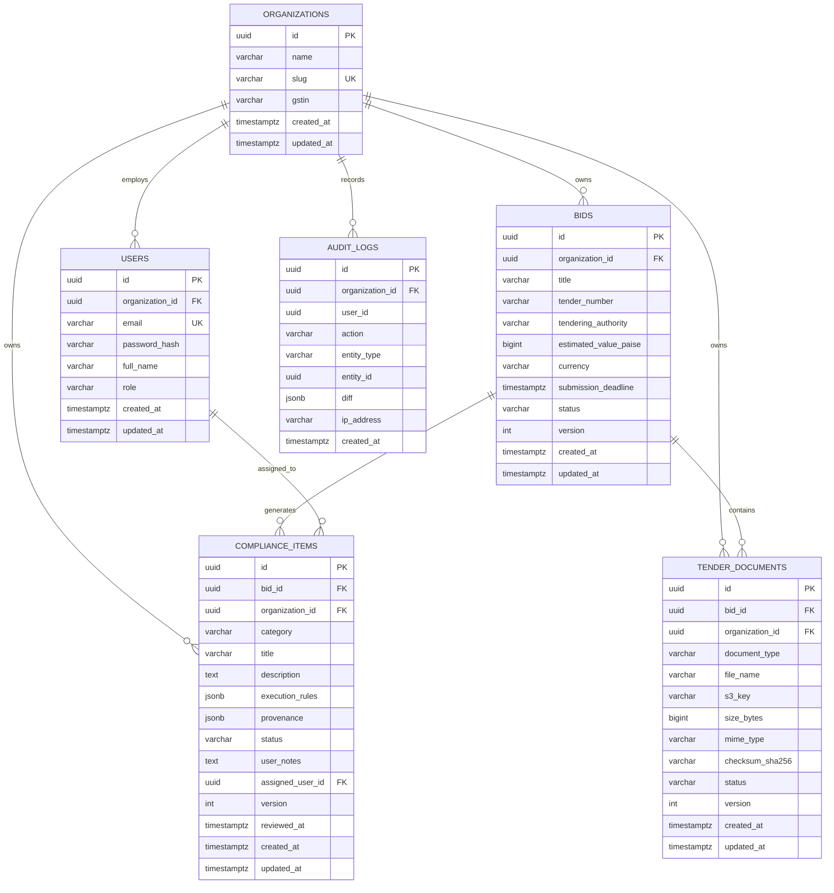
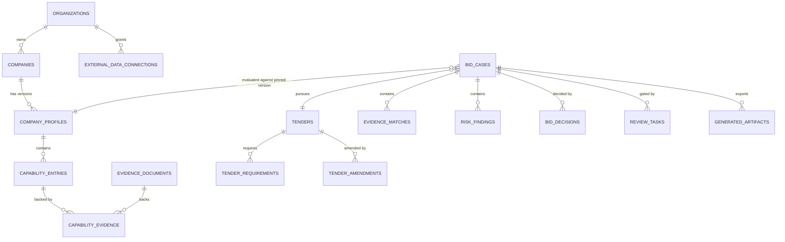

# Database Design & PostgreSQL Data Architecture: TenderPulse AI

## 1. Architectural Philosophy & Principles

In accordance with **ADR 0002 (PostgreSQL over DynamoDB)** and **AGENTS.md**, PostgreSQL 16 is the transactional source of truth for TenderPulse AI.

Public procurement compliance is legally binding and high-stakes:

- A contractor disqualified due to a missing ₹100 stamp paper loses months of bidding effort and forfeits substantial Earnest Money Deposits (EMD).
- Competitor contractors must **never** be able to see each other's tender evaluations, bid pricing, or compliance items.
- Every decision, status change, and user review must be permanently audit-traceable.

Therefore, our database architecture adheres to six non-negotiable principles:

1. **Relational Integrity First**: Enforce foreign keys, check constraints, and uniqueness at the database engine level, not merely in application TypeScript code.
2. **Denormalized Tenant Scoping**: Every tenant-owned table carries `organization_id UUID NOT NULL` as the leading column in composite indexes to guarantee physical index partition locality and zero cross-tenant leakage.
3. **Optimistic Concurrency Control (OCC)**: Every mutable business aggregate carries a `version INT NOT NULL DEFAULT 1` column to prevent lost updates between background AI workers and interactive browser users without taking blocking pessimistic locks.
4. **No Naive Soft Deletions**: Avoid universal `deleted_at` columns that destroy unique constraints, inflate index size, and cause silent data leaks. Use domain-driven status machines (`status = 'ARCHIVED'`) for business entities, and true physical cascade for draft scratchpads.
5. **Short, Pure Database Transactions**: Never hold a PostgreSQL transaction open while executing external network I/O (S3 upload/head, SQS dispatch, or LLM inference).
6. **Defense-in-Depth Tenant Security**: Combine application-level query filters with PostgreSQL **Row-Level Security (RLS)** as a kernel-level backstop against code regressions.

---

## 2. Entity-Relationship & Relational Schema Diagram



---

## 3. Detailed Table Specifications

### 3.1 `organizations` (Tenant Root)

Represents a bidding contractor firm (e.g., "Larsen & Toubro Ltd", "Patel Engineering", or an SME contractor).

| Column       | Type           | Constraints                             | Description                                 |
| :----------- | :------------- | :-------------------------------------- | :------------------------------------------ |
| `id`         | `UUID`         | `PRIMARY KEY DEFAULT gen_random_uuid()` | Immutable tenant ID                         |
| `name`       | `VARCHAR(255)` | `NOT NULL`                              | Registered business name                    |
| `slug`       | `VARCHAR(100)` | `NOT NULL UNIQUE`                       | URL-safe slug for tenant subdomains/routing |
| `gstin`      | `VARCHAR(15)`  | `NULL`                                  | Indian GST Identification Number (15 chars) |
| `created_at` | `TIMESTAMPTZ`  | `NOT NULL DEFAULT NOW()`                | Tenant creation timestamp                   |
| `updated_at` | `TIMESTAMPTZ`  | `NOT NULL DEFAULT NOW()`                | Last update timestamp                       |

### 3.2 `users` (Identity & RBAC)

Represents employees of an organization with defined RBAC roles (`ADMIN`, `BID_MANAGER`, `REVIEWER`, `VIEWER`).

| Column            | Type           | Constraints                                                               | Description                |
| :---------------- | :------------- | :------------------------------------------------------------------------ | :------------------------- |
| `id`              | `UUID`         | `PRIMARY KEY DEFAULT gen_random_uuid()`                                   | Immutable user ID          |
| `organization_id` | `UUID`         | `NOT NULL REFERENCES organizations(id) ON DELETE CASCADE`                 | Tenant isolation key       |
| `email`           | `VARCHAR(255)` | `NOT NULL UNIQUE`                                                         | Login email address        |
| `password_hash`   | `VARCHAR(255)` | `NOT NULL`                                                                | Argon2id password hash     |
| `full_name`       | `VARCHAR(255)` | `NOT NULL`                                                                | User full name             |
| `role`            | `VARCHAR(30)`  | `NOT NULL CHECK (role IN ('ADMIN', 'BID_MANAGER', 'REVIEWER', 'VIEWER'))` | RBAC role                  |
| `created_at`      | `TIMESTAMPTZ`  | `NOT NULL DEFAULT NOW()`                                                  | Account creation timestamp |
| `updated_at`      | `TIMESTAMPTZ`  | `NOT NULL DEFAULT NOW()`                                                  | Last update timestamp      |

### 3.3 `bids` (Bid Project Aggregate Root)

Represents a tender opportunity pursued by an organization.

| Column                  | Type           | Constraints                                                                                                           | Description                                                 |
| :---------------------- | :------------- | :-------------------------------------------------------------------------------------------------------------------- | :---------------------------------------------------------- |
| `id`                    | `UUID`         | `PRIMARY KEY DEFAULT gen_random_uuid()`                                                                               | Aggregate identifier                                        |
| `organization_id`       | `UUID`         | `NOT NULL REFERENCES organizations(id) ON DELETE CASCADE`                                                             | Tenant isolation key                                        |
| `title`                 | `VARCHAR(255)` | `NOT NULL`                                                                                                            | Descriptive title (e.g. "Road Widening NH-48")              |
| `tender_number`         | `VARCHAR(100)` | `NOT NULL`                                                                                                            | Official tender number (e.g. "GEM/2026/B/8912")             |
| `tendering_authority`   | `VARCHAR(255)` | `NOT NULL`                                                                                                            | Publishing authority (CPWD, NHAI, Indian Railways)          |
| `estimated_value_paise` | `BIGINT`       | `NOT NULL CHECK (estimated_value_paise >= 0)`                                                                         | Exact currency in Paise ($1\text{ INR} = 100\text{ Paise}$) |
| `currency`              | `VARCHAR(3)`   | `NOT NULL DEFAULT 'INR'`                                                                                              | ISO 4217 currency code                                      |
| `submission_deadline`   | `TIMESTAMPTZ`  | `NOT NULL`                                                                                                            | Strict deadline for tender submission                       |
| `status`                | `VARCHAR(30)`  | `NOT NULL DEFAULT 'DRAFT' CHECK (status IN ('DRAFT', 'QUEUED', 'PROCESSING', 'REVIEW_READY', 'FINALIZED', 'FAILED'))` | Controlled lifecycle state machine                          |
| `version`               | `INT`          | `NOT NULL DEFAULT 1 CHECK (version >= 1)`                                                                             | Optimistic locking counter                                  |
| `created_at`            | `TIMESTAMPTZ`  | `NOT NULL DEFAULT NOW()`                                                                                              | Ingestion timestamp                                         |
| `updated_at`            | `TIMESTAMPTZ`  | `NOT NULL DEFAULT NOW()`                                                                                              | Last mutation timestamp                                     |

**Unique Constraint**:

- `UNIQUE (organization_id, tender_number)`: An organization cannot register two bids with the identical tender number. Multiple _different_ organizations can independently bid on the same public tender.

### 3.4 `tender_documents` (PDF & Artifact Registry)

Tracks individual files uploaded to AWS S3 belonging to a bid package.

| Column            | Type           | Constraints                                                                                                        | Description                                                        |
| :---------------- | :------------- | :----------------------------------------------------------------------------------------------------------------- | :----------------------------------------------------------------- |
| `id`              | `UUID`         | `PRIMARY KEY DEFAULT gen_random_uuid()`                                                                            | Document ID (used in presigned S3 keys)                            |
| `bid_id`          | `UUID`         | `NOT NULL REFERENCES bids(id) ON DELETE CASCADE`                                                                   | Parent bid                                                         |
| `organization_id` | `UUID`         | `NOT NULL REFERENCES organizations(id) ON DELETE CASCADE`                                                          | Denormalized tenant isolation key                                  |
| `document_type`   | `VARCHAR(50)`  | `NOT NULL CHECK (document_type IN ('NIT', 'RFP', 'TECHNICAL_SPECS', 'GCC', 'SCC', 'BOQ', 'CORRIGENDUM', 'OTHER'))` | Document classification                                            |
| `file_name`       | `VARCHAR(255)` | `NOT NULL`                                                                                                         | Original client file name                                          |
| `s3_key`          | `VARCHAR(512)` | `NOT NULL UNIQUE`                                                                                                  | Exact S3 object key (`tenants/:orgId/bids/:bidId/:docId/file.pdf`) |
| `size_bytes`      | `BIGINT`       | `NOT NULL CHECK (size_bytes > 0)`                                                                                  | File size in bytes                                                 |
| `mime_type`       | `VARCHAR(100)` | `NOT NULL`                                                                                                         | MIME type (`application/pdf`, `application/vnd.ms-excel`)          |
| `checksum_sha256` | `VARCHAR(64)`  | `NOT NULL`                                                                                                         | SHA-256 hash for deduplication & tamper verification               |
| `status`          | `VARCHAR(30)`  | `NOT NULL DEFAULT 'PENDING_UPLOAD' CHECK (status IN ('PENDING_UPLOAD', 'VERIFIED', 'PROCESSED', 'FAILED'))`        | Direct upload lifecycle state                                      |
| `version`         | `INT`          | `NOT NULL DEFAULT 1 CHECK (version >= 1)`                                                                          | Optimistic locking counter                                         |
| `created_at`      | `TIMESTAMPTZ`  | `NOT NULL DEFAULT NOW()`                                                                                           | Upload initialization timestamp                                    |
| `updated_at`      | `TIMESTAMPTZ`  | `NOT NULL DEFAULT NOW()`                                                                                           | Last update timestamp                                              |

**Unique Constraint**:

- `UNIQUE (bid_id, checksum_sha256)`: Prevents uploading duplicate copies of the identical document into the same bid.

### 3.5 `compliance_items` (Extracted Checklist Requirements)

Represents actionable requirements extracted by the AI engine from the tender document package.

| Column             | Type           | Constraints                                                                                                    | Description                                                       |
| :----------------- | :------------- | :------------------------------------------------------------------------------------------------------------- | :---------------------------------------------------------------- |
| `id`               | `UUID`         | `PRIMARY KEY DEFAULT gen_random_uuid()`                                                                        | Item ID                                                           |
| `bid_id`           | `UUID`         | `NOT NULL REFERENCES bids(id) ON DELETE CASCADE`                                                               | Parent bid                                                        |
| `organization_id`  | `UUID`         | `NOT NULL REFERENCES organizations(id) ON DELETE CASCADE`                                                      | Denormalized tenant isolation key                                 |
| `category`         | `VARCHAR(50)`  | `NOT NULL CHECK (category IN ('TECHNICAL', 'FINANCIAL', 'LEGAL', 'EMD_PBG', 'EXPERIENCE', 'FORMAT_ANNEXURE'))` | Requirement category                                              |
| `title`            | `VARCHAR(255)` | `NOT NULL`                                                                                                     | Concise summary of requirement                                    |
| `description`      | `TEXT`         | `NOT NULL`                                                                                                     | Detailed explanation of what must be submitted                    |
| `execution_rules`  | `JSONB`        | `NOT NULL`                                                                                                     | Structured rules (stamp paper value, notary, UDIN, format)        |
| `provenance`       | `JSONB`        | `NOT NULL`                                                                                                     | Exact citation (doc ID, page number, bbox coords, verbatim quote) |
| `status`           | `VARCHAR(20)`  | `NOT NULL DEFAULT 'PENDING' CHECK (status IN ('PENDING', 'READY', 'FLAGGED', 'WAIVED'))`                       | Review state                                                      |
| `user_notes`       | `TEXT`         | `NULL`                                                                                                         | Bid manager comments and resolution notes                         |
| `assigned_user_id` | `UUID`         | `NULL REFERENCES users(id) ON DELETE SET NULL`                                                                 | Assignee responsible for fulfilling item                          |
| `version`          | `INT`          | `NOT NULL DEFAULT 1 CHECK (version >= 1)`                                                                      | Optimistic concurrency counter                                    |
| `reviewed_at`      | `TIMESTAMPTZ`  | `NULL`                                                                                                         | Timestamp when marked READY/WAIVED                                |
| `created_at`       | `TIMESTAMPTZ`  | `NOT NULL DEFAULT NOW()`                                                                                       | AI ingestion timestamp                                            |
| `updated_at`       | `TIMESTAMPTZ`  | `NOT NULL DEFAULT NOW()`                                                                                       | Last update timestamp                                             |

### 3.6 `audit_logs` (Append-Only Compliance Ledger)

Immutable event log recording every state transition, user review, and security event.

| Column            | Type          | Constraints                                                | Description                                                         |
| :---------------- | :------------ | :--------------------------------------------------------- | :------------------------------------------------------------------ |
| `id`              | `UUID`        | `PRIMARY KEY DEFAULT gen_random_uuid()`                    | Unique log event ID                                                 |
| `organization_id` | `UUID`        | `NOT NULL REFERENCES organizations(id) ON DELETE RESTRICT` | Tenant scope (cannot cascade delete audit trail!)                   |
| `user_id`         | `UUID`        | `NOT NULL`                                                 | Actor UUID (or system worker UUID)                                  |
| `action`          | `VARCHAR(50)` | `NOT NULL`                                                 | Action code (`BID_CREATED`, `DOC_VERIFIED`, `ITEM_REVIEWED`)        |
| `entity_type`     | `VARCHAR(50)` | `NOT NULL`                                                 | Target aggregate (`BidProject`, `ComplianceItem`, `TenderDocument`) |
| `entity_id`       | `UUID`        | `NOT NULL`                                                 | Target aggregate ID                                                 |
| `diff`            | `JSONB`       | `NOT NULL`                                                 | Structured `{ before: ..., after: ... }` state payload              |
| `ip_address`      | `VARCHAR(45)` | `NULL`                                                     | IPv4 or IPv6 address of caller                                      |
| `created_at`      | `TIMESTAMPTZ` | `NOT NULL DEFAULT NOW()`                                   | Immutable log creation timestamp                                    |

---

## 4. Indexing Strategy & Performance Justification

Every index in TenderPulse AI exists to serve a documented access pattern. Redundant indexes slow down write operations and consume memory.

| Index Name                       | Table              | Target Columns                                               | Index Type | Query Pattern / Business Justification                                                                                                                                    |
| :------------------------------- | :----------------- | :----------------------------------------------------------- | :--------- | :------------------------------------------------------------------------------------------------------------------------------------------------------------------------ |
| `idx_bids_org_deadline`          | `bids`             | `(organization_id, submission_deadline ASC)`                 | B-Tree     | **Primary Dashboard Query**: "List all active bids for my company ordered by impending deadline." Composite order clusters rows by tenant first, then sorts by timestamp. |
| `idx_bids_org_status`            | `bids`             | `(organization_id, status)`                                  | B-Tree     | **Status Tab Filtering**: Enables instant retrieval when filtering by `REVIEW_READY` or `DRAFT`.                                                                          |
| `idx_docs_bid_org`               | `tender_documents` | `(organization_id, bid_id)`                                  | B-Tree     | **Document List Query**: Fetches all documents associated with a bid inside the tenant's workspace.                                                                       |
| `idx_compliance_bid_category`    | `compliance_items` | `(organization_id, bid_id, category)`                        | B-Tree     | **Tabbed Review Interface**: Users switch between `TECHNICAL`, `FINANCIAL`, `LEGAL`, and `EMD_PBG` tabs in the React UI.                                                  |
| `idx_compliance_bid_status`      | `compliance_items` | `(organization_id, bid_id, status)`                          | B-Tree     | **Disqualification Risk Counter**: Instantly counts unreviewed (`PENDING`) and high-risk (`FLAGGED`) items without full table scan.                                       |
| `idx_compliance_execution_rules` | `compliance_items` | `(execution_rules)`                                          | **GIN**    | **JSONB Rule Search**: Allows querying specific rule criteria across tenders (e.g. `WHERE execution_rules @> '{"requires_stamp_paper": true}'`).                          |
| `idx_audit_org_entity`           | `audit_logs`       | `(organization_id, entity_type, entity_id, created_at DESC)` | B-Tree     | **Item Audit History**: Renders the complete timeline for a specific compliance item or bid in reverse chronological order.                                               |

---

## 5. Critical Invariants & Integrity Constraints

1. **Currency in Paise (Integer Arithmetic)**:
   - Floats (`FLOAT`, `DOUBLE PRECISION`, or `NUMBER` without fixed scale) introduce rounding errors ($0.1 + 0.2 \neq 0.3$).
   - `estimated_value_paise BIGINT` stores amounts as exact integers (e.g., ₹5,00,00,000 = `5000000000` paise).
   - Constrained by `CHECK (estimated_value_paise >= 0)`.
2. **Immutability of Audit Records**:
   - The database permissions for application users revoke `UPDATE` and `DELETE` on `audit_logs`:
     ```sql
     REVOKE UPDATE, DELETE ON audit_logs FROM tenderpulse_app;
     ```
   - Audit logs are strictly append-only.
3. **Denormalized Tenant Isolation on Child Tables**:
   - `tender_documents` and `compliance_items` carry `organization_id` directly, even though they already reference `bid_id`.
   - Prevents multi-table `JOIN` overhead during tenant authorization and enables single-table RLS filtering.
4. **Optimistic Locking Guard**:
   - `version INT NOT NULL DEFAULT 1 CHECK (version >= 1)` on all mutable tables.
   - Any update must supply `WHERE id = :id AND version = :expectedVersion` and execute `version = version + 1`. If affected rows = 0, a concurrent update occurred and the application throws HTTP 409 Conflict.

---

## 6. Soft Deletion: Why It Is Rejected for Most Tables

We explicitly evaluate whether soft deletion (`deleted_at TIMESTAMPTZ`) is appropriate:

### The Naive Pattern: Universal `deleted_at`

Many CRUD applications blindly slap `deleted_at` on every table.

### Why It Fails in Production:

1. **Destroys Unique Constraints**: If `bids` has `UNIQUE (organization_id, tender_number)`, deleting tender `NIT-84` prevents the user from ever re-creating a bid with `NIT-84` unless complex partial indexes (`WHERE deleted_at IS NULL`) are engineered for every constraint.
2. **Query Leakage & Index Bloat**: Every single `SELECT`, `JOIN`, and `COUNT` across the codebase must remember `WHERE deleted_at IS NULL`. Forgetting it once produces inaccurate metrics or exposes "deleted" data.
3. **Foreign Key Incoherence**: If a `bid` is soft-deleted, what happens to its 40 `compliance_items`? Cascading soft deletes requires complex stored procedures or heavy application batching.

### The TenderPulse AI Policy:

- **`bids`**: Lifecycle state-driven. Instead of soft delete, a canceled bid transitions to `ARCHIVED` or `FAILED` via the state machine. If an unsubmitted draft is discarded, a **hard delete with CASCADE** cleanly purges all child documents and extracted compliance items.
- **`compliance_items`**: Tied directly to the parent `bid`. Deleted if and only if the parent bid is hard deleted. Items waived by the user transition to `status = 'WAIVED'` with user notes, preserving the legal audit trail.
- **`audit_logs`**: **Never deleted under any circumstances**.

---

## 7. Concurrency Concerns & Transaction Boundaries

### Concurrency Risk: User Edit vs. AI Worker Callback

```
Time 1: AI Worker extracts item 14: "₹100 Stamp Paper required".
Time 2: User opens item 14 in UI, notes "Stamp paper purchased from vendor", sets status = READY.
Time 3: AI Worker finishes second-pass OCR correction on item 14 and writes back to DB.
```

- **Without OCC**: The AI worker overwrites the user's notes and marks the item back to `PENDING` (Lost Update).
- **With OCC (`version` column)**: The AI worker's update specifies `version = 1`. Since the user updated the row to `version = 2`, the worker's query matches 0 rows. The worker catches the concurrency conflict and gracefully merges or logs the event.

### Transaction Boundary Rules

1. **Single Use Case = Single Transaction**:
   - `BulkIngestComplianceUseCase`:
     ```sql
     BEGIN;
     INSERT INTO compliance_items (...) VALUES (...), (...);
     UPDATE bids SET status = 'REVIEW_READY', version = version + 1 WHERE id = :bidId;
     INSERT INTO audit_logs (...) VALUES (...);
     COMMIT;
     ```
   - If any insert fails, the bid remains in `PROCESSING` and no partial compliance items linger in the database.
2. **Zero External Network Calls Inside Transactions**:
   - Never call `s3.headObject()` or `sqs.sendMessage()` while holding an open PostgreSQL transaction lock.
   - S3 verification happens **before** `BEGIN`, and SQS enqueueing happens **after** `COMMIT`.

---

## 8. Row-Level Security (RLS) Deep Evaluation & Trade-offs

Multi-tenant isolation is the single most critical security requirement of the SaaS.

### Architectural Options:

| Approach                                                             | Implementation                                                                                                                                            | Pros                                                                                                                   | Cons                                                                                                           |
| :------------------------------------------------------------------- | :-------------------------------------------------------------------------------------------------------------------------------------------------------- | :--------------------------------------------------------------------------------------------------------------------- | :------------------------------------------------------------------------------------------------------------- |
| **Option 1: Pure Application-Level Filtering**                       | Every Prisma query includes `where: { organizationId }`.                                                                                                  | Simple, zero DB overhead, works transparently with any connection pooler.                                              | **High Risk**: A single developer omission or raw query bug leaks competitor data.                             |
| **Option 2: Schema-per-Tenant**                                      | Each organization has its own PostgreSQL schema (`org_123.bids`).                                                                                         | Total physical isolation.                                                                                              | Operational nightmare: Migrating 1,000 tenants requires running 1,000 DDL scripts. Connection pool exhaustion. |
| **Option 3: Hybrid Application Scoping + PostgreSQL RLS (Proposed)** | Queries scope by `organization_id` in Prisma, backed by kernel-level RLS policies enforcing `organization_id = current_setting('app.current_tenant_id')`. | **Defense-in-depth**: Even if a query forgets the WHERE clause, the database kernel filters out all cross-tenant rows. | Requires session/transaction variable management with connection poolers.                                      |

### The Connection Pooling Trap (PgBouncer & RLS):

In cloud environments, Node.js connects to PostgreSQL via a pooler (AWS RDS Proxy or PgBouncer in `transaction` pool mode).

- If you run `SET app.current_tenant_id = '...'`, the setting sticks to the physical database connection. When that connection is reused by another tenant's HTTP request, **data crosses tenant boundaries!**
- **The Solution**: Always use `SET LOCAL app.current_tenant_id = :tenant_id` inside an explicit transaction (`BEGIN ... COMMIT`). `SET LOCAL` is automatically cleared by PostgreSQL the millisecond the transaction ends.

### Trade-off Verdict:

We adopt **Option 3 (Hybrid Defense-in-Depth)**:

1. Application services always explicitly pass `organization_id` in repository queries.
2. PostgreSQL tables have RLS enabled with `FORCE ROW LEVEL SECURITY`.
3. Database transactions set `SET LOCAL app.current_tenant_id = :tenantId`.

---
---

# Part B — Target Schema (v2.0 Bidder-Side)

**Status:** design only (PROMPT 5). The v1.0 schema above (§2–§8) is the running system; this Part B is the target schema after the pivot. Migration strategy: **expand-and-contract** — create new tables alongside, backfill, retire `bids`/`compliance_items` last.

## B.1 Entity-Relationship Additions



## B.2 Core New Tables

### B.2.1 `companies` (Legal Entity)

| Column | Type | Constraints | Description |
|:-------|:-----|:------------|:------------|
| `id` | `UUID` | `PK DEFAULT gen_random_uuid()` | Company ID |
| `organization_id` | `UUID` | `NOT NULL REFERENCES organizations(id) ON DELETE CASCADE` | Tenant isolation key |
| `legal_name` | `VARCHAR(255)` | `NOT NULL` | Registered legal name |
| `gstin` / `udyam_id` / `pan` | `VARCHAR` | `NULL` | Statutory identifiers |
| `constitution` | `VARCHAR(30)` | `NULL` | Proprietorship / Partnership / Pvt Ltd / LLP |
| `version` | `INT` | `NOT NULL DEFAULT 1` | OCC counter |
| `created_at` / `updated_at` | `TIMESTAMPTZ` | `NOT NULL DEFAULT NOW()` | Timestamps |

### B.2.2 `company_profiles` (Versioned Aggregate Root)

| Column | Type | Constraints | Description |
|:-------|:-----|:------------|:------------|
| `id` | `UUID` | `PK` | Profile version ID |
| `company_id` / `organization_id` | `UUID` | `NOT NULL REFERENCES …` | Ownership + tenant key |
| `version` | `INT` | `NOT NULL CHECK (version >= 1)` | Monotonic version number |
| `status` | `VARCHAR(10)` | `CHECK (status IN ('DRAFT','ACTIVE','ARCHIVED'))` | Lifecycle |
| `change_summary` | `TEXT` | `NULL` | Human-readable change note |
| `created_by` | `UUID` | `NOT NULL REFERENCES users(id)` | Publisher |
| `created_at` | `TIMESTAMPTZ` | `NOT NULL DEFAULT NOW()` | Publish timestamp |

**Constraints:**
- `UNIQUE (company_id, version)` — version history is immutable.
- `UNIQUE (company_id) WHERE status = 'ACTIVE'` — exactly one ACTIVE version per company (partial unique index).

### B.2.3 `capability_entries` (The Differentiator)

| Column | Type | Constraints | Description |
|:-------|:-----|:------------|:------------|
| `id` | `UUID` | `PK` | Entry ID |
| `profile_id` / `organization_id` | `UUID` | `NOT NULL REFERENCES …` | Owning profile version + tenant |
| `section` | `VARCHAR(30)` | `CHECK (section IN ('REGISTRATION','CERTIFICATION','FINANCIAL','EXPERIENCE','WORK_ORDER','COMPLETION_CERTIFICATE','OEM','STAFF','EQUIPMENT','GEOGRAPHY','PREVIOUS_BID'))` | One of the 11 sections |
| `subtype` | `VARCHAR(50)` | `NOT NULL` | e.g. `ISO_9001`, `UDYAM`, `TURNOVER_FY` |
| `title` | `VARCHAR(255)` | `NOT NULL` | Human label |
| `attributes` | `JSONB` | `NOT NULL` | Typed structured fields, schema-validated per subtype |
| `valid_from` / `valid_to` | `TIMESTAMPTZ` | `NULL` | ValidityWindow (open-ended allowed) |
| `verification_tier` | `VARCHAR(20)` | `CHECK (… IN ('AUTHORITY_VERIFIED','ISSUER_VERIFIED','SELF_ATTESTED','UNVERIFIED'))` | Proof quality |
| `verification_status` | `VARCHAR(15)` | `DEFAULT 'PENDING' CHECK (… IN ('PENDING','VERIFIED','REJECTED','EXPIRED','REVOKED'))` | Lifecycle |
| `verified_by` / `verified_at` / `verification_method` | — | `NULL` | Verification attribution |
| `source` | `JSONB` | `NOT NULL` | `{sourceType, fetchedAt, operatorUserId, consentReference, externalReference}` |
| `created_by` / `created_at` | — | `NOT NULL` | Provenance |

**Indexes:** `(organization_id, profile_id, section)` B-Tree (evaluation read path); `GIN (attributes)` (JSONB attribute queries, e.g. `attributes @> '{"standard":"ISO_9001"}'`); `(organization_id, verification_status, valid_to)` (expiry scan).

### B.2.4 `evidence_documents` (Proof Blobs)

| Column | Type | Constraints | Description |
|:-------|:-----|:------------|:------------|
| `id` | `UUID` | `PK` | Evidence ID (used in storage path) |
| `organization_id` | `UUID` | `NOT NULL REFERENCES organizations(id)` | Tenant key |
| `storage_path` | `VARCHAR(512)` | `NOT NULL UNIQUE` | `tenants/{orgId}/profile/{entryId}/{evidenceId}/{fileName}` |
| `file_name` / `mime_type` / `size_bytes` / `checksum_sha256` | — | `NOT NULL` | Blob metadata (same pattern as `tender_documents`) |
| `document_kind` | `VARCHAR(40)` | `NOT NULL` | CERTIFICATE / LETTER / CERTIFICATE_OF_COMPLETION / … |
| `issuer` / `issue_date` / `valid_from` / `valid_to` | — | `NULL` | Issuance & validity |
| `verification_tier` | `VARCHAR(20)` | as above | Authority/issuer/self-attested |
| `status` | `VARCHAR(15)` | `DEFAULT 'PENDING'` | PENDING / VERIFIED / REJECTED / EXPIRED / REVOKED |
| `source` | `JSONB` | `NOT NULL` | Same source VO as capability entries |
| `uploaded_by` / `created_at` | — | `NOT NULL` | Attribution |

**Unique:** `UNIQUE (organization_id, checksum_sha256)` — dedupe identical uploads per tenant.

### B.2.5 `capability_evidence` (Many-to-Many Join)

| Column | Type | Constraints |
|:-------|:-----|:------------|
| `capability_entry_id` | `UUID` | `NOT NULL REFERENCES capability_entries(id) ON DELETE CASCADE` |
| `evidence_document_id` | `UUID` | `NOT NULL REFERENCES evidence_documents(id) ON DELETE CASCADE` |
| `organization_id` | `UUID` | `NOT NULL` |
| `attached_by` / `attached_at` | — | `NOT NULL` |

**PK:** `(capability_entry_id, evidence_document_id)`.

### B.2.6 `external_data_connections` (OAuth/Consent Integrations)

| Column | Type | Constraints | Description |
|:-------|:-----|:------------|:------------|
| `id` | `UUID` | `PK` | Connection ID |
| `organization_id` | `UUID` | `NOT NULL REFERENCES organizations(id)` | Tenant key |
| `source` | `VARCHAR(20)` | `CHECK (source IN ('DIGILOCKER','ACCOUNT_AGGREGATOR','GSP','MCA_AGGREGATOR'))` | Connector type |
| `status` | `VARCHAR(10)` | `CHECK (status IN ('CONNECTED','EXPIRED','REVOKED'))` | Connection state |
| `scopes` | `JSONB` | `NOT NULL` | Minimally-scoped permissions |
| `encrypted_tokens` | `JSONB` | `NOT NULL` | Encrypted at rest; never logged; never sent to AI |
| `consent_reference` | `VARCHAR(255)` | `NULL` | Consent receipt |
| `last_synced_at` / `revoked_at` | `TIMESTAMPTZ` | `NULL` | Sync/revocation timestamps |

### B.2.7 Pivot Aggregates (compact)

| Table | Key columns | Notes |
|:------|:------------|:------|
| `tenders` | id, organization_id, tender_number UK per tenant, tendering_authority, estimated_value_paise, submission_deadline, status (DISCOVERED→…→CLOSED), version | Replaces `bids`; package metadata |
| `tender_requirements` | id, tender_id, organization_id, category, title, description, execution_rules JSONB, provenance JSONB, status (EXTRACTED→PROPOSED→CONFIRMED→SUPERSEDED), version | Replaces `compliance_items` (extraction side) |
| `tender_amendments` | id, tender_id, organization_id, document_id, published_at, status (PENDING→APPLIED→ASSESSED) | Corrigenda; supersede requirements |
| `bid_cases` | id, tender_id, organization_id, **profile_version_id FK**, status (CREATED→…→READY_TO_SUBMIT→SUBMITTED/ABANDONED), eligibility_verdict JSONB, readiness_score, version | The pursuit; **pinned profile version is mandatory** |
| `evidence_matches` | id, bid_case_id, requirement_id, capability_entry_id (NULL), evidence_document_id (NULL), match_state (MATCHED/PARTIAL/EXPIRED/MISSING/NOT_APPLICABLE), matched_at | Requirement ↔ capability/evidence |
| `risk_findings` | id, bid_case_id, organization_id, category (LD/DLP/PBG/PAYMENT/EMD_AFFORDABILITY…), severity, description, provenance JSONB | Commercial trap register |
| `bid_decisions` | id, bid_case_id, organization_id, verdict (GO/CONDITIONAL_GO/NO_GO), rationale, proposed_by, confirmed_by, confirmed_at, status (AI_PROPOSED→UNDER_REVIEW→CONFIRMED) | Human-confirmed decision |
| `review_tasks` | id, organization_id, subject_type, subject_id, assigned_to, status (OPEN→CLAIMED→RESOLVED/EXPIRED), resolution (APPROVED/REJECTED/EDITED), notes, version | HITL gate; optimistic concurrency |
| `generated_artifacts` | id, bid_case_id, organization_id, artifact_type (PDF/EXCEL), storage_path, generated_by, created_at | Export packs |

## B.3 New Invariants

1. **Profile version pin**: `bid_cases.profile_version_id` is `NOT NULL` — every decision is reproducible against the exact profile state at evaluation time.
2. **One ACTIVE profile**: partial unique index `(company_id) WHERE status = 'ACTIVE'`.
3. **Validity is point-in-time**: matching evaluates `valid_from <= evaluation_date AND (valid_to IS NULL OR valid_to >= evaluation_date)` where evaluation_date is the **bid submission date**, not the query date.
4. **Append-only audit**: `audit_logs` gains new action codes (`PROFILE_VERSION_PUBLISHED`, `CAPABILITY_ADDED`, `EVIDENCE_ATTACHED`, `EVIDENCE_VERIFIED`, `BID_DECISION_CONFIRMED`, …); `REVOKE UPDATE, DELETE` unchanged.
5. **Encrypted connector tokens**: application-layer encryption (envelope encryption with KMS/CMK); the database never stores plaintext OAuth tokens.
6. **All tenant-owned tables**: `organization_id` leading column + RLS `FORCE ROW LEVEL SECURITY` + `SET LOCAL app.current_tenant_id` — identical to v1.0 policy (§8), extended to every new table.

## B.4 Migration Note (Expand-and-Contract)

1. **Expand**: create all Part B tables; dual-write profile/proof data.
2. **Backfill**: `bids` → `tenders`; `compliance_items` → `tender_requirements` (provenance carries over).
3. **Contract**: retire `bids`/`compliance_items` only after bid-case read paths are verified.
4. Zero-downtime: all steps are additive DDL until the final rename; CI deploy stages execute migrations before deploy (existing expand-and-contract policy in `docs/CICD.md`).

---

*Part B status: design only, per PROMPT 5. No schema changes implemented.*
