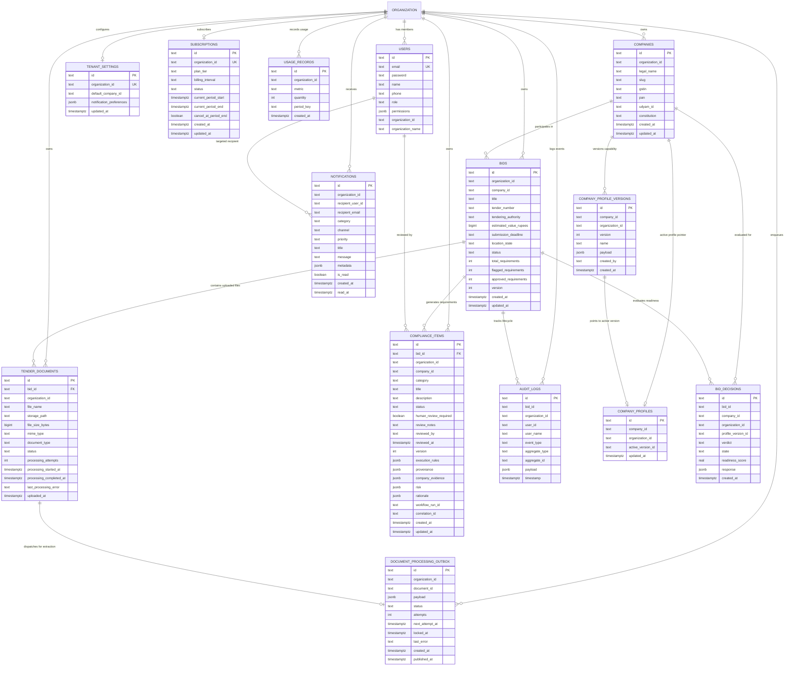
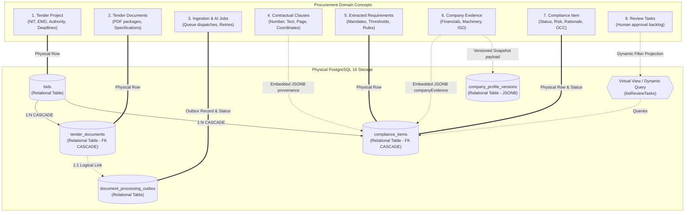

# Database Design & PostgreSQL Data Architecture: TenderPulse AI

## 1. Architectural Philosophy & Principles

In accordance with **ADR 0002 (PostgreSQL over DynamoDB)**, **ADR 0009 (Bid State Machine & Optimistic Locking)**, and **AGENTS.md**, PostgreSQL 16 (a local server in development, Amazon RDS / GCP Cloud SQL in production; in-memory `@electric-sql/pglite` only in automated tests) is the transactional source of truth for TenderPulse AI.

Public procurement compliance is legally binding and high-stakes:

- A contractor disqualified due to a missing ₹100 stamp paper or an expired ISO certificate forfeits Earnest Money Deposits (EMDs) worth lakhs or crores of rupees and loses months of bidding effort.
- Competitor contractors must **never** be able to view each other's tender evaluations, bid pricing, company profiles, or compliance items.
- Every state mutation, reviewer decision, and AI extraction event must be permanently audit-traceable.

Therefore, our database architecture adheres to six non-negotiable principles:

1. **Relational Integrity First**: Enforce foreign keys, cascade rules, and check constraints at the database engine level, not merely in application TypeScript code.
2. **Denormalized Tenant Scoping**: Every tenant-owned table carries `organization_id` as a mandatory column to guarantee physical index partition locality and zero cross-tenant data leakage.
3. **Multi-Company Organizational Hierarchy**: An organization (tenant) can own and manage multiple registered business entities (`companies`), allowing corporate groups to bid through different subsidiaries.
4. **Optimistic Concurrency Control (OCC)**: Every mutable business aggregate carries an integer `version` counter to prevent lost updates between background AI workers and interactive browser users without taking blocking pessimistic locks.
5. **Short, Pure Database Transactions & The Single-Writer Principle**: External network I/O (S3 upload/head, SQS dispatch, or LLM inference) is never executed inside database transaction blocks. In asynchronous pipelines, the NestJS application serves as the sole atomic writer to PostgreSQL.
6. **Defense-in-Depth Tenant Security**: Combine application-level query scoping (`TenantContextHolder` backed by `AsyncLocalStorage`) with database-level composite indexing and optional Row-Level Security (RLS) as a kernel-level backstop against code regressions.

---

## 2. Complete Entity-Relationship (ER) Diagram (Actual Implementation)

The following Mermaid diagram models the **14 actual database tables** defined in [`apps/api/src/common/database/schema.ts`](file:///Users/belikesaurabh/main/TenderAi/apps/api/src/common/database/schema.ts) and initialized via [`database.provider.ts`](file:///Users/belikesaurabh/main/TenderAi/apps/api/src/common/database/database.provider.ts).



---

## 2.1 Domain Concept to Database Entity Mapping & Relationships

The TenderPulse domain model spans 8 fundamental business concepts: **Tenders, Documents, Clauses, Requirements, Evidence, Compliance, Review Tasks, and Jobs**.

The table below and accompanying Mermaid diagram capture how these domain concepts map to the physical PostgreSQL 16 schema, explicitly noting whether a concept is implemented as a standalone relational table, an embedded JSONB document, or a dynamic query projection.



### Detailed Mapping & Relationship Matrix

| Domain Concept   | Physical Implementation in Schema      | Enclosing Entity / Column                                                   | Relationship & Cardinality                                                                           | Implementation Reality & Architectural Rationale                                                                                                                                                                                                                                                                                                                                                           |
| :--------------- | :------------------------------------- | :-------------------------------------------------------------------------- | :--------------------------------------------------------------------------------------------------- | :--------------------------------------------------------------------------------------------------------------------------------------------------------------------------------------------------------------------------------------------------------------------------------------------------------------------------------------------------------------------------------------------------------- |
| **Tenders**      | Dedicated Table                        | `bids`                                                                      | **1 : N** with `tender_documents`<br>**1 : N** with `compliance_items`<br>**N : 1** with `companies` | Represents the central tender workspace. Contains tender title, tender number, tendering authority, EMD/estimated value in rupees, and status rollup (`DRAFT`, `UPLOADED`, `PROCESSING`, `REVIEW_READY`, `SUBMITTED`).                                                                                                                                                                                     |
| **Documents**    | Dedicated Table                        | `tender_documents`                                                          | **N : 1** with `bids` (`ON DELETE CASCADE`)                                                          | Physical files stored in S3/GCS. Tracks upload state, storage key, MIME type, file size, processing attempt counters, and failure logs. Has hard engine-level foreign key to `bids.id`.                                                                                                                                                                                                                    |
| **Clauses**      | Embedded JSONB Value Object            | `compliance_items.provenance`                                               | **1 : 1** inside each requirement (or multiple supporting pages)                                     | **Not a separate relational table.** In legal procurement, isolated clauses are meaningless without requirement context. Stored inside `compliance_items.provenance` containing `clauseReference`, `pageNumber`, `verbatimQuote`, `sourceDocumentId`, and `confidenceScore`. Cross-page clauses are merged into combined references.                                                                       |
| **Requirements** | Dedicated Table                        | `compliance_items`                                                          | **N : 1** with `bids` (`ON DELETE CASCADE`)                                                          | Core unit of compliance. Represents mandatory tender criteria across categories (`TECHNICAL_EXPERIENCE`, `FINANCIAL_CRITERIA`, `ANNEXURE_DECLARATION`, `STATUTORY_REGISTRATION`, `COMMERCIAL_RISK`). Carries procedural execution rules in `execution_rules` JSONB.                                                                                                                                        |
| **Evidence**     | Dual-Sided JSONB Documents             | `compliance_items.company_evidence`<br>& `company_profile_versions.payload` | **M : N** (Logical relationship between requirements and company facts)                              | **Not a separate relational table.** Company capabilities are stored as immutable versioned snapshots (`CompanyProfileSnapshot`) in `company_profile_versions.payload`. Matched evidence citations (e.g. past project references, audited turnover figures) are linked into `compliance_items.company_evidence`. This avoids complex join tables while preserving immutable point-in-time bid evaluations. |
| **Compliance**   | Dedicated Table                        | `compliance_items`                                                          | **N : 1** with `bids`<br>**N : 1** with `companies` (logical)                                        | Unifies requirement definition, company evidence match, risk assessment, and review lifecycle (`PENDING`, `READY`, `FLAGGED`, `WAIVED`). Enforces Optimistic Concurrency Control via `version INT NOT NULL`.                                                                                                                                                                                               |
| **Review Tasks** | Dynamic Query Projection               | Queried dynamically via `ComplianceService.listReviewTasks(bidId)`          | **Virtual Projection** over `compliance_items`                                                       | **Not a separate relational table.** Avoids state synchronization bugs between a "tasks" table and "compliance" table. A review task is defined as any `compliance_items` record where `status IN ('PENDING', 'REVIEW_REQUIRED') OR human_review_required = TRUE`. Evaluated dynamically on request.                                                                                                       |
| **Jobs**         | Dedicated Outbox Table & Status Fields | `document_processing_outbox`<br>& `tender_documents.status`                 | **1 : 1** logical dispatch per document upload                                                       | Asynchronous ingestion jobs are tracked via `document_processing_outbox` (`PENDING`, `PUBLISHING`, `PUBLISHED`) implementing the Transactional Outbox Pattern, alongside state fields (`processing_attempts`, `processing_started_at`, `last_processing_error`) directly on `tender_documents`.                                                                                                            |

---

## 2.2 Foreign Key Architecture: Physical Engine Constraints vs. Logical References

A critical aspect of the TenderPulse database design is distinguishing between **Database Engine Foreign Keys** (enforced by PostgreSQL with cascading rules) and **Logical Application References** (enforced in NestJS application logic with tenant verification):

```
┌──────────────────────────────────────────────────────────────────────────────────────────────┐
│                                 FOREIGN KEY ENFORCEMENT MATRIX                               │
├─────────────────────────┬──────────────────────┬─────────────┬─────────────┬─────────────────┤
│ Origin Table            │ Target Table         │ Key Column  │ Enforcement │ Delete Action   │
├─────────────────────────┼──────────────────────┼─────────────┼─────────────┼─────────────────┤
│ tender_documents        │ bids                 │ bid_id      │ Database PK │ CASCADE         │
│ compliance_items        │ bids                 │ bid_id      │ Database PK │ CASCADE         │
│ bids                    │ companies            │ company_id  │ Application │ Restrict (Code) │
│ company_profiles        │ companies            │ company_id  │ Application │ Restrict (Code) │
│ company_profile_versions│ companies            │ company_id  │ Application │ Restrict (Code) │
│ bid_decisions           │ bids                 │ bid_id      │ Application │ Retain / Audit  │
│ bid_decisions           │ companies            │ company_id  │ Application │ Retain / Audit  │
│ audit_logs              │ bids                 │ bid_id      │ Application │ Retain / Audit  │
│ document_processing_outbox tender_documents    │ document_id │ Application │ Outbox Lifecycle│
│ notifications           │ users                │ recipient_user_id Application Neutralize    │
└─────────────────────────┴──────────────────────┴─────────────┴─────────────┴─────────────────┘
```

### Architectural Rationale for Selective Foreign Keys:

1. **Physical Engine Cascades (`bids` $\to$ `tender_documents`, `compliance_items`)**:
   - When a contractor deletes a draft bid via `DELETE /api/v1/bids/:id`, PostgreSQL immediately cascades the deletion to all associated document rows and compliance items. This eliminates orphan records without requiring multi-step application cleanup queries.
2. **Decoupled Audit Logs & Bid Decisions (`audit_logs`, `bid_decisions`)**:
   - `audit_logs` and `bid_decisions` are **immutable historical audit trails**. They carry string identifiers (`bid_id`, `company_id`, `user_id`) without database FK cascades so that even if a bid is purged, historical compliance audits, regulatory tracking, and AI evaluation logs are never corrupted or deleted by cascade triggers.
3. **Outbox Pattern Decoupling (`document_processing_outbox`)**:
   - The outbox table functions as an ephemeral queue staging area. Keeping `document_id` as a logical reference decouples outbox retry lifecycles from long-running document transactions.

---

## 2.3 Cardinality & Many-to-Many Handling

The schema accommodates all relationship cardinalities required for public procurement:

1. **One-to-One (1:1)**:
   - `ORGANIZATION` $\leftrightarrow$ `TENANT_SETTINGS`: Singleton configuration row per tenant (`organization_id UNIQUE NOT NULL`).
   - `ORGANIZATION` $\leftrightarrow$ `SUBSCRIPTIONS`: One active subscription plan per tenant (`organization_id UNIQUE NOT NULL`).
   - `COMPANIES` $\leftrightarrow$ `COMPANY_PROFILES`: One active profile pointer per registered company (`active_version_id`).
2. **One-to-Many (1:N)**:
   - `ORGANIZATION` $\to$ `USERS`: One organization employs multiple users with distinct RBAC roles.
   - `ORGANIZATION` $\to$ `COMPANIES`: One enterprise tenant manages multiple legal entities and consortium subsidiaries.
   - `COMPANIES` $\to$ `BIDS`: One company bids on multiple government tenders.
   - `COMPANIES` $\to$ `COMPANY_PROFILE_VERSIONS`: An immutable version history of capability profiles per company.
   - `BIDS` $\to$ `TENDER_DOCUMENTS`: A tender bid contains multiple files (NIT, Technical Specs, BoQ, Corrigenda).
   - `BIDS` $\to$ `COMPLIANCE_ITEMS`: A tender yields dozens or hundreds of compliance obligations.
   - `BIDS` $\to$ `BID_DECISIONS`: Multiple evaluation snapshots over time as requirements change or documents update.
   - `BIDS` $\to$ `AUDIT_LOGS`: Append-only event sequence documenting the complete lifecycle of a bid.
3. **Many-to-Many (M:N)**:
   - **Tender Requirements $\leftrightarrow$ Company Evidence**:
     - _The Problem_: A single ISO certificate (Evidence) satisfies both "Quality Certification" and "Environmental Management" (Requirements). Conversely, a major highway requirement requires combining multiple past project completion certificates and audited financial sheets.
     - _How It Is Solved_: Implemented through **dual-sided embedded JSONB references** rather than a separate relational join table:
       - `company_profile_versions.payload` stores the universe of verified company capability facts (`completed_projects`, `certifications`, `machinery`, `financials`).
       - `compliance_items.company_evidence` stores an array of matched evidence references with match rationale and confidence.
       - This preserves point-in-time evaluation snapshots without risk of mutable join table drift.

---

## 3. Comprehensive Table Specifications

### 3.1 `users` (Identity & RBAC)

Represents authenticated employees of an organization with role-based access control.

| Column              | Type    | Constraints       | Description                                                           |
| :------------------ | :------ | :---------------- | :-------------------------------------------------------------------- |
| `id`                | `TEXT`  | `PRIMARY KEY`     | Unique user identifier (e.g., `usr_admin_01`)                         |
| `email`             | `TEXT`  | `UNIQUE NOT NULL` | Login email address                                                   |
| `password`          | `TEXT`  | `NOT NULL`        | Bcrypt hashed password (10 salt rounds)                               |
| `name`              | `TEXT`  | `NOT NULL`        | User full name                                                        |
| `phone`             | `TEXT`  | `NULL`            | Optional contact phone number                                         |
| `role`              | `TEXT`  | `NOT NULL`        | RBAC role: `ADMIN`, `BID_MANAGER`, `REVIEWER`, `VIEWER`               |
| `permissions`       | `JSONB` | `NOT NULL`        | String array of atomic permissions (`bids:read`, `bids:create`, etc.) |
| `organization_id`   | `TEXT`  | `NOT NULL`        | Denormalized tenant isolation key (e.g., `org_acme_infra_001`)        |
| `organization_name` | `TEXT`  | `NOT NULL`        | Cached legal entity name of the organization                          |

### 3.2 `tenant_settings` (Tenant Configuration)

Singleton configuration per tenant governing default operational behavior and notification toggles.

| Column                     | Type          | Constraints              | Description                                                                            |
| :------------------------- | :------------ | :----------------------- | :------------------------------------------------------------------------------------- |
| `id`                       | `TEXT`        | `PRIMARY KEY`            | Record ID                                                                              |
| `organization_id`          | `TEXT`        | `UNIQUE NOT NULL`        | One configuration record per tenant                                                    |
| `default_company_id`       | `TEXT`        | `NULL`                   | Default company selected for bid creation                                              |
| `notification_preferences` | `JSONB`       | `NOT NULL`               | `{ notifyDeadlines, notifyEvidenceExpiry, notifyReviewRequests, notifyHighRiskFlags }` |
| `updated_at`               | `TIMESTAMPTZ` | `NOT NULL DEFAULT NOW()` | Last modification timestamp                                                            |

### 3.3 `companies` (Legal Entity Registry)

Represents a contractor company, subsidiary, or joint-venture partner owned by the tenant.

| Column            | Type          | Constraints              | Description                                                          |
| :---------------- | :------------ | :----------------------- | :------------------------------------------------------------------- |
| `id`              | `TEXT`        | `PRIMARY KEY`            | Company identifier (e.g., `comp_acme_infra`)                         |
| `organization_id` | `TEXT`        | `NOT NULL`               | Owning tenant key                                                    |
| `legal_name`      | `TEXT`        | `NOT NULL`               | Registered business name (e.g., "Acme Infra Projects Pvt Ltd")       |
| `slug`            | `TEXT`        | `NULL`                   | URL slug                                                             |
| `gstin`           | `TEXT`        | `NULL`                   | 15-character Indian Goods & Services Tax Identification Number       |
| `pan`             | `TEXT`        | `NULL`                   | 10-character Permanent Account Number                                |
| `udyam_id`        | `TEXT`        | `NULL`                   | MSME Udyam Registration Number                                       |
| `constitution`    | `TEXT`        | `NULL`                   | `PRIVATE_LIMITED`, `PUBLIC_LIMITED`, `PARTNERSHIP`, `PROPRIETORSHIP` |
| `created_at`      | `TIMESTAMPTZ` | `NOT NULL DEFAULT NOW()` | Registration timestamp                                               |
| `updated_at`      | `TIMESTAMPTZ` | `NOT NULL DEFAULT NOW()` | Last update timestamp                                                |

### 3.4 `bids` (Tender Pursuit Aggregate Root)

The central aggregate representing an active government tender pursuit.

| Column                   | Type          | Constraints                | Description                                                                           |
| :----------------------- | :------------ | :------------------------- | :------------------------------------------------------------------------------------ |
| `id`                     | `TEXT`        | `PRIMARY KEY`              | Bid project ID (e.g., `bid_delhi_highway_001`)                                        |
| `organization_id`        | `TEXT`        | `NOT NULL`                 | Denormalized tenant scoping key                                                       |
| `company_id`             | `TEXT`        | `NOT NULL`                 | Operating company submitting the bid                                                  |
| `title`                  | `TEXT`        | `NOT NULL`                 | Tender title (e.g., "Construction of 4-Lane Highway")                                 |
| `tender_number`          | `TEXT`        | `NOT NULL DEFAULT ''`      | Official tender reference number                                                      |
| `tendering_authority`    | `TEXT`        | `NOT NULL DEFAULT ''`      | Issuing authority (e.g., "NHAI", "CPWD", "Indian Railways")                           |
| `estimated_value_rupees` | `BIGINT`      | `NOT NULL DEFAULT 0`       | Estimated contract value in Indian Rupees                                             |
| `submission_deadline`    | `TEXT`        | `NULL`                     | Submission deadline string or ISO date                                                |
| `location_state`         | `TEXT`        | `NULL`                     | Indian state / union territory of work execution                                      |
| `status`                 | `TEXT`        | `NOT NULL DEFAULT 'DRAFT'` | State machine: `DRAFT`, `QUEUED`, `PROCESSING`, `REVIEW_READY`, `FINALIZED`, `FAILED` |
| `total_requirements`     | `INT`         | `NOT NULL DEFAULT 0`       | Total extracted compliance requirements                                               |
| `flagged_requirements`   | `INT`         | `NOT NULL DEFAULT 0`       | Requirements flagged with high risk or missing criteria                               |
| `approved_requirements`  | `INT`         | `NOT NULL DEFAULT 0`       | Requirements reviewed and accepted by Bid Manager                                     |
| `version`                | `INT`         | `NOT NULL DEFAULT 1`       | Optimistic concurrency control counter                                                |
| `created_at`             | `TIMESTAMPTZ` | `NOT NULL DEFAULT NOW()`   | Creation timestamp                                                                    |
| `updated_at`             | `TIMESTAMPTZ` | `NOT NULL DEFAULT NOW()`   | Last mutation timestamp                                                               |

### 3.5 `tender_documents` (Uploaded Tender Files)

Child entity tracking tender packages (NIT, Technical Specifications, BoQ, Corrigenda) stored in S3 or GCS.

| Column                    | Type          | Constraints                                      | Description                                                                  |
| :------------------------ | :------------ | :----------------------------------------------- | :--------------------------------------------------------------------------- |
| `id`                      | `TEXT`        | `PRIMARY KEY`                                    | Document ID                                                                  |
| `bid_id`                  | `TEXT`        | `NOT NULL REFERENCES bids(id) ON DELETE CASCADE` | Parent bid reference                                                         |
| `organization_id`         | `TEXT`        | `NOT NULL`                                       | Denormalized tenant isolation key                                            |
| `file_name`               | `TEXT`        | `NOT NULL`                                       | Original client file name (e.g., `NIT_Document.pdf`)                         |
| `storage_path`            | `TEXT`        | `NOT NULL`                                       | Object storage key (`tenants/:orgId/bids/:bidId/raw/:docId.pdf`)             |
| `file_size_bytes`         | `BIGINT`      | `NOT NULL`                                       | File byte size                                                               |
| `mime_type`               | `TEXT`        | `NOT NULL`                                       | MIME type (`application/pdf`)                                                |
| `document_type`           | `TEXT`        | `NOT NULL`                                       | Classification: `NIT`, `TECHNICAL_SPECS`, `GCC`, `SCC`, `BOQ`, `CORRIGENDUM` |
| `status`                  | `TEXT`        | `NOT NULL DEFAULT 'UPLOADED'`                    | Status: `UPLOADED`, `QUEUED`, `PROCESSING`, `COMPLETED`, `FAILED`            |
| `processing_attempts`     | `INT`         | `NOT NULL DEFAULT 0`                             | Retry counter for background extraction                                      |
| `processing_started_at`   | `TIMESTAMPTZ` | `NULL`                                           | Timestamp when AI worker claimed the job                                     |
| `processing_completed_at` | `TIMESTAMPTZ` | `NULL`                                           | Timestamp when extraction was persisted                                      |
| `last_processing_error`   | `TEXT`        | `NULL`                                           | Error message if extraction failed                                           |
| `uploaded_at`             | `TIMESTAMPTZ` | `NOT NULL DEFAULT NOW()`                         | Upload confirmation timestamp                                                |

### 3.6 `compliance_items` (Extracted Checklist Requirements)

Actionable compliance clauses extracted from tender documents and evaluated against company evidence.

| Column                  | Type          | Constraints                                      | Description                                                                |
| :---------------------- | :------------ | :----------------------------------------------- | :------------------------------------------------------------------------- |
| `id`                    | `TEXT`        | `PRIMARY KEY`                                    | Deterministic ID generated via SHA-256 hash                                |
| `bid_id`                | `TEXT`        | `NOT NULL REFERENCES bids(id) ON DELETE CASCADE` | Parent bid reference                                                       |
| `organization_id`       | `TEXT`        | `NOT NULL`                                       | Denormalized tenant isolation key                                          |
| `company_id`            | `TEXT`        | `NULL`                                           | Operating company ID                                                       |
| `category`              | `TEXT`        | `NOT NULL`                                       | `TECHNICAL`, `FINANCIAL`, `LEGAL`, `EMD_PBG`, `EXPERIENCE`, `STATUTORY`    |
| `title`                 | `TEXT`        | `NOT NULL`                                       | Concise requirement headline                                               |
| `description`           | `TEXT`        | `NOT NULL`                                       | Full description of the clause                                             |
| `status`                | `TEXT`        | `NOT NULL DEFAULT 'PENDING'`                     | Review state: `PENDING`, `READY`, `FLAGGED`, `WAIVED`                      |
| `human_review_required` | `BOOLEAN`     | `NOT NULL DEFAULT TRUE`                          | Flag raised when confidence < 0.80 or ambiguity exists                     |
| `review_notes`          | `TEXT`        | `NULL`                                           | Comments added by human reviewer                                           |
| `reviewed_by`           | `TEXT`        | `NULL`                                           | User ID of reviewer                                                        |
| `reviewed_at`           | `TIMESTAMPTZ` | `NULL`                                           | Review timestamp                                                           |
| `version`               | `INT`         | `NOT NULL DEFAULT 1`                             | Optimistic concurrency control counter                                     |
| `execution_rules`       | `JSONB`       | `NOT NULL`                                       | Structured execution constraints (stamp paper, notary, UDIN, signing rank) |
| `provenance`            | `JSONB`       | `NOT NULL`                                       | Verbatim quote, source page, clause reference, confidence score            |
| `company_evidence`      | `JSONB`       | `NULL`                                           | Pointers to matching company capability credentials                        |
| `risk`                  | `JSONB`       | `NULL`                                           | Risk severity, financial impact, mitigation advice                         |
| `rationale`             | `JSONB`       | `NULL`                                           | Structured AI reasoning notes explaining the requirement                   |
| `workflow_run_id`       | `TEXT`        | `NULL`                                           | ID of the LangGraph execution run                                          |
| `correlation_id`        | `TEXT`        | `NULL`                                           | Trace/correlation ID for distributed logging                               |
| `created_at`            | `TIMESTAMPTZ` | `NOT NULL DEFAULT NOW()`                         | Extraction timestamp                                                       |
| `updated_at`            | `TIMESTAMPTZ` | `NOT NULL DEFAULT NOW()`                         | Last update timestamp                                                      |

### 3.7 `document_processing_outbox` (Transactional Outbox)

Guarantees reliable asynchronous queue dispatch following the Transactional Outbox pattern.

| Column            | Type          | Constraints                  | Description                                   |
| :---------------- | :------------ | :--------------------------- | :-------------------------------------------- |
| `id`              | `TEXT`        | `PRIMARY KEY`                | Outbox message ID                             |
| `organization_id` | `TEXT`        | `NOT NULL`                   | Tenant key                                    |
| `document_id`     | `TEXT`        | `NOT NULL`                   | Target document ID                            |
| `payload`         | `JSONB`       | `NOT NULL`                   | Serialized `DocumentIngestionCommand` payload |
| `status`          | `TEXT`        | `NOT NULL DEFAULT 'PENDING'` | `PENDING`, `LOCKED`, `PUBLISHED`, `FAILED`    |
| `attempts`        | `INT`         | `NOT NULL DEFAULT 0`         | Publishing attempt counter                    |
| `next_attempt_at` | `TIMESTAMPTZ` | `NOT NULL DEFAULT NOW()`     | Timestamp for next retry with backoff         |
| `locked_at`       | `TIMESTAMPTZ` | `NULL`                       | Timestamp when worker leased the outbox row   |
| `last_error`      | `TEXT`        | `NULL`                       | Publishing failure error detail               |
| `created_at`      | `TIMESTAMPTZ` | `NOT NULL DEFAULT NOW()`     | Transaction commit timestamp                  |
| `published_at`    | `TIMESTAMPTZ` | `NULL`                       | Timestamp when published to SQS / PubSub      |

### 3.8 `audit_logs` (Append-Only Audit Ledger)

Immutable compliance event record documenting every user action, AI persistence, and state transition.

| Column            | Type          | Constraints              | Description                                                         |
| :---------------- | :------------ | :----------------------- | :------------------------------------------------------------------ |
| `id`              | `TEXT`        | `PRIMARY KEY`            | Unique audit event ID                                               |
| `bid_id`          | `TEXT`        | `NOT NULL`               | Target bid reference                                                |
| `organization_id` | `TEXT`        | `NOT NULL`               | Tenant key                                                          |
| `user_id`         | `TEXT`        | `NOT NULL`               | Actor identifier (`usr_...` or system worker)                       |
| `user_name`       | `TEXT`        | `NOT NULL`               | Human-readable actor name                                           |
| `event_type`      | `TEXT`        | `NOT NULL`               | Action code (e.g., `BID_CREATED`, `COMPLIANCE_REVIEWED`)            |
| `aggregate_type`  | `TEXT`        | `NOT NULL`               | Target aggregate (`BidProject`, `ComplianceItem`, `TenderDocument`) |
| `aggregate_id`    | `TEXT`        | `NOT NULL`               | Target aggregate ID                                                 |
| `payload`         | `JSONB`       | `NOT NULL`               | Contextual diff / event metadata                                    |
| `timestamp`       | `TIMESTAMPTZ` | `NOT NULL DEFAULT NOW()` | Event generation timestamp                                          |

### 3.9 `company_profile_versions` (Immutable Capability Snapshots)

Versioned snapshots of company capabilities (turnover, completed projects, certifications, machinery, staffing).

| Column            | Type          | Constraints              | Description                                          |
| :---------------- | :------------ | :----------------------- | :--------------------------------------------------- |
| `id`              | `TEXT`        | `PRIMARY KEY`            | Version snapshot ID (e.g., `cpv_acme_v1`)            |
| `company_id`      | `TEXT`        | `NOT NULL`               | Owning company                                       |
| `organization_id` | `TEXT`        | `NOT NULL`               | Tenant key                                           |
| `version`         | `INT`         | `NOT NULL`               | Monotonically increasing version number (1, 2, 3...) |
| `name`            | `TEXT`        | `NOT NULL`               | Version label (e.g., "FY 2025-26 Audited Profile")   |
| `payload`         | `JSONB`       | `NOT NULL`               | Full structured `CompanyProfileSnapshot` payload     |
| `created_by`      | `TEXT`        | `NOT NULL`               | User ID who published the version                    |
| `created_at`      | `TIMESTAMPTZ` | `NOT NULL DEFAULT NOW()` | Publication timestamp                                |

### 3.10 `company_profiles` (Active Profile Pointer)

Pointer table indicating which capability version is currently active for a company.

| Column              | Type          | Constraints              | Description                                    |
| :------------------ | :------------ | :----------------------- | :--------------------------------------------- |
| `id`                | `TEXT`        | `PRIMARY KEY`            | Record ID                                      |
| `company_id`        | `TEXT`        | `NOT NULL`               | Company identifier                             |
| `organization_id`   | `TEXT`        | `NOT NULL`               | Tenant key                                     |
| `active_version_id` | `TEXT`        | `NOT NULL`               | Points to active `company_profile_versions.id` |
| `updated_at`        | `TIMESTAMPTZ` | `NOT NULL DEFAULT NOW()` | Last update timestamp                          |

### 3.11 `bid_decisions` (Deterministic Eligibility Outcomes)

Persisted bid/no-bid decisions produced by the deterministic eligibility evaluation engine.

| Column               | Type          | Constraints              | Description                                                          |
| :------------------- | :------------ | :----------------------- | :------------------------------------------------------------------- |
| `id`                 | `TEXT`        | `PRIMARY KEY`            | Decision ID                                                          |
| `bid_id`             | `TEXT`        | `NOT NULL`               | Evaluated bid ID                                                     |
| `company_id`         | `TEXT`        | `NULL`                   | Evaluated company ID                                                 |
| `organization_id`    | `TEXT`        | `NOT NULL`               | Tenant key                                                           |
| `profile_version_id` | `TEXT`        | `NOT NULL`               | Pinned capability version used for evaluation                        |
| `verdict`            | `TEXT`        | `NOT NULL`               | `GO`, `CONDITIONAL_GO`, `NO_GO`, `REVIEW_REQUIRED`                   |
| `state`              | `TEXT`        | `NOT NULL`               | `AI_PROPOSED`, `UNDER_REVIEW`, `CONFIRMED`, `OVERRIDDEN`             |
| `readiness_score`    | `REAL`        | `NOT NULL`               | Normalized readiness score (0.00 to 1.00)                            |
| `response`           | `JSONB`       | `NOT NULL`               | Full structured `BidDecisionResponse` (disqualifiers, gaps, reasons) |
| `created_at`         | `TIMESTAMPTZ` | `NOT NULL DEFAULT NOW()` | Evaluation timestamp                                                 |

### 3.12 `notifications` (In-App & System Alerts)

User and tenant notification records for upcoming deadlines, evidence expiration, and review requests.

| Column              | Type          | Constraints                 | Description                                                                 |
| :------------------ | :------------ | :-------------------------- | :-------------------------------------------------------------------------- |
| `id`                | `TEXT`        | `PRIMARY KEY`               | Notification ID                                                             |
| `organization_id`   | `TEXT`        | `NOT NULL`                  | Tenant key                                                                  |
| `recipient_user_id` | `TEXT`        | `NULL`                      | Targeted user ID (null if tenant-wide)                                      |
| `recipient_email`   | `TEXT`        | `NULL`                      | Email destination                                                           |
| `category`          | `TEXT`        | `NOT NULL`                  | `DEADLINE`, `EVIDENCE_EXPIRY`, `REVIEW_REQUEST`, `HIGH_RISK_FLAG`, `SYSTEM` |
| `channel`           | `TEXT`        | `NOT NULL DEFAULT 'IN_APP'` | `IN_APP`, `EMAIL`, `SMS`                                                    |
| `priority`          | `TEXT`        | `NOT NULL DEFAULT 'MEDIUM'` | `LOW`, `MEDIUM`, `HIGH`, `URGENT`                                           |
| `title`             | `TEXT`        | `NOT NULL`                  | Short notification title                                                    |
| `message`           | `TEXT`        | `NOT NULL`                  | Notification body                                                           |
| `metadata`          | `JSONB`       | `NULL`                      | Action URLs, bid IDs, document references                                   |
| `is_read`           | `BOOLEAN`     | `NOT NULL DEFAULT FALSE`    | Read receipt flag                                                           |
| `created_at`        | `TIMESTAMPTZ` | `NOT NULL DEFAULT NOW()`    | Alert timestamp                                                             |
| `read_at`           | `TIMESTAMPTZ` | `NULL`                      | Timestamp when marked read                                                  |

### 3.13 `subscriptions` (Tenant Subscription & Plan Tier)

Tracks customer billing plan and subscription status for feature gating.

| Column                 | Type          | Constraints                  | Description                                           |
| :--------------------- | :------------ | :--------------------------- | :---------------------------------------------------- |
| `id`                   | `TEXT`        | `PRIMARY KEY`                | Subscription ID                                       |
| `organization_id`      | `TEXT`        | `UNIQUE NOT NULL`            | One subscription per tenant                           |
| `plan_tier`            | `TEXT`        | `NOT NULL DEFAULT 'FREE'`    | `FREE`, `STARTER`, `GROWTH`, `BUSINESS`, `ENTERPRISE` |
| `billing_interval`     | `TEXT`        | `NOT NULL DEFAULT 'MONTHLY'` | `MONTHLY`, `ANNUAL`                                   |
| `status`               | `TEXT`        | `NOT NULL DEFAULT 'ACTIVE'`  | `TRIAL`, `ACTIVE`, `PAST_DUE`, `CANCELED`             |
| `current_period_start` | `TIMESTAMPTZ` | `NOT NULL DEFAULT NOW()`     | Current billing cycle start                           |
| `current_period_end`   | `TIMESTAMPTZ` | `NOT NULL`                   | Current billing cycle expiration                      |
| `cancel_at_period_end` | `BOOLEAN`     | `NOT NULL DEFAULT FALSE`     | Flag for scheduled cancellation                       |
| `created_at`           | `TIMESTAMPTZ` | `NOT NULL DEFAULT NOW()`     | Record creation timestamp                             |
| `updated_at`           | `TIMESTAMPTZ` | `NOT NULL DEFAULT NOW()`     | Last modification timestamp                           |

### 3.14 `usage_records` (Tenant Metering)

Metered consumption records for billing enforcement and subscription quotas.

| Column            | Type          | Constraints              | Description                                        |
| :---------------- | :------------ | :----------------------- | :------------------------------------------------- |
| `id`              | `TEXT`        | `PRIMARY KEY`            | Record ID                                          |
| `organization_id` | `TEXT`        | `NOT NULL`               | Tenant key                                         |
| `metric`          | `TEXT`        | `NOT NULL`               | `TENDER_ANALYSIS`, `EVIDENCE_STORAGE_MB`, `AI_RUN` |
| `quantity`        | `INT`         | `NOT NULL DEFAULT 1`     | Consumed quantity                                  |
| `period_key`      | `TEXT`        | `NOT NULL`               | Billing period string (`YYYY-MM`)                  |
| `created_at`      | `TIMESTAMPTZ` | `NOT NULL DEFAULT NOW()` | Metering timestamp                                 |

---

## 4. Key JSONB Value Object Schemas

### 4.1 `execution_rules` (in `compliance_items`)

Enforces procedural and legal filing rules extracted from tender clauses:

```json
{
  "stampPaperRequired": true,
  "stampPaperDenominationInr": 100,
  "notarizationRequired": true,
  "signingAuthorityRank": "Director or Authorized Signatory via Power of Attorney",
  "udinRequired": false
}
```

### 4.2 `provenance` (in `compliance_items`)

Immutable source grounding guaranteed by Python substring checks before persistence:

```json
{
  "documentId": "doc_tender_nit_01",
  "sourceDocumentId": "doc_tender_nit_01",
  "documentName": "NIT_Delhi_Highway.pdf",
  "sourceFileName": "NIT_Delhi_Highway.pdf",
  "pageNumber": 14,
  "sectionOrClause": "Clause 4.2(b)",
  "clauseReference": "Clause 4.2(b)",
  "verbatimQuote": "The bidder must furnish an Earnest Money Deposit (EMD) of INR 10,00,000 on a non-judicial stamp paper of Rs. 100.",
  "confidenceScore": 0.98
}
```

### 4.3 `CompanyProfileSnapshot` (in `company_profile_versions.payload`)

Structured capability facts evaluated by the deterministic eligibility engine:

```json
{
  "company_id": "comp_acme_infra",
  "legal_name": "Acme Infra Projects Pvt Ltd",
  "annual_turnover_inr_crores": [45.2, 52.8, 61.5],
  "net_worth_inr_crores": 28.4,
  "completed_projects": [
    {
      "project_name": "NH-44 4-Lane Highway Stretch",
      "value_inr_crores": 85.0,
      "completion_date": "2024-03-15",
      "client_authority": "NHAI",
      "state": "Maharashtra"
    }
  ],
  "certifications": ["ISO_9001", "ISO_14001"],
  "blacklisted": false
}
```

---

## 5. Performance Indexing & Query Patterns

| Index Name                        | Table                        | Columns                                                          | Type   | Business Access Pattern                          |
| :-------------------------------- | :--------------------------- | :--------------------------------------------------------------- | :----- | :----------------------------------------------- |
| `idx_companies_org`               | `companies`                  | `(organization_id)`                                              | B-Tree | Tenant company picker & multi-entity management  |
| `idx_bids_org`                    | `bids`                       | `(organization_id)`                                              | B-Tree | Tenant dashboard bid list                        |
| `idx_docs_bid_org`                | `tender_documents`           | `(organization_id, bid_id)`                                      | B-Tree | Document retrieval for a bid workspace           |
| `idx_compliance_bid_org`          | `compliance_items`           | `(organization_id, bid_id)`                                      | B-Tree | Primary compliance checklist rendering           |
| `idx_outbox_pending`              | `document_processing_outbox` | `(status, next_attempt_at)`                                      | B-Tree | Outbox poller dispatching pending queue messages |
| `idx_cpv_org`                     | `company_profile_versions`   | `(organization_id, version DESC)`                                | B-Tree | Profile version history query                    |
| `idx_notifications_tenant`        | `notifications`              | `(organization_id, recipient_user_id, is_read, created_at DESC)` | B-Tree | Unread notification bell count & dropdown        |
| `idx_usage_records_tenant_period` | `usage_records`              | `(organization_id, metric, period_key)`                          | B-Tree | Monthly quota calculation and invoice metering   |

---

## 6. Implementation Realities & Inconsistency Callouts

When reviewing the repository against earlier architectural drafts, three notable implementation differences must be explicitly called out:

1. **Active Drizzle ORM vs. Legacy Prisma & SQL Files**:
   - The running application strictly uses **Drizzle ORM** with compile-time TypeScript schemas in [`apps/api/src/common/database/schema.ts`](file:///Users/belikesaurabh/main/TenderAi/apps/api/src/common/database/schema.ts) and programmatic table creation in [`database.provider.ts`](file:///Users/belikesaurabh/main/TenderAi/apps/api/src/common/database/database.provider.ts).
   - The files `apps/api/src/infrastructure/persistence/schema.prisma` and `schema.sql` are **legacy 3-table artifacts** (`bids`, `compliance_items`, `audit_logs`) from early Phase 1 prototyping. They define `estimated_value_paise` and native UUID types, whereas the live Drizzle schema uses `estimated_value_rupees`, `TEXT` IDs (for cross-engine compatibility between PGlite and PostgreSQL), and encompasses all 14 tables.
2. **Denormalized Organization Key vs. Standalone Organizations Table**:
   - The active database schema does not feature a separate `organizations` table. Multi-tenancy is established via `organization_id TEXT NOT NULL` present across every business table. Tenant metadata is stored in `users.organization_name`, `tenant_settings`, and `subscriptions`.
3. **PostgreSQL at Runtime, PGlite in Tests**:
   - The NestJS backend connects to PostgreSQL 16 through `DATABASE_URL` (node-postgres pool; `DATABASE_SSL=verify-full` against RDS). Without `DATABASE_URL` or `PGLITE_DATA_DIR` it refuses to start. Local setup: `CONTRIBUTING.md` § Local database.
   - The schema is applied by versioned migrations (`apps/api/src/common/database/migrations/`, recorded in `schema_migrations` under a Postgres advisory lock), not ad-hoc DDL.
   - API tests set `PGLITE_DATA_DIR=memory://` (`apps/api/vitest.config.ts`), so every test file gets its own in-memory database and the files run in parallel without touching the dev database.
   - In production environments on AWS (`AWS.md`) or GCP (`GCP.md`), the system connects to a managed PostgreSQL 16 cluster (Amazon RDS / Cloud SQL) via standard connection strings.
4. **Target Pivot Entities vs. Implemented Models**:
   - Earlier conceptual RFCs (`docs/DOMAIN.md` Part B) proposed splitting `bids` into separate `tenders` and `bid_cases` tables, and adding `capability_entries`, `evidence_documents`, and `review_tasks` tables.
   - In the actual implemented codebase, this capability was achieved cleanly without table explosion by:
     - Adding `company_id` to `bids`.
     - Storing versioned capability facts in `company_profile_versions.payload` (`CompanyProfileSnapshot`).
     - Storing deterministic eligibility verdicts in `bid_decisions`.
     - Storing dual-sided evidence and risk in `compliance_items.company_evidence` and `compliance_items.risk`.
