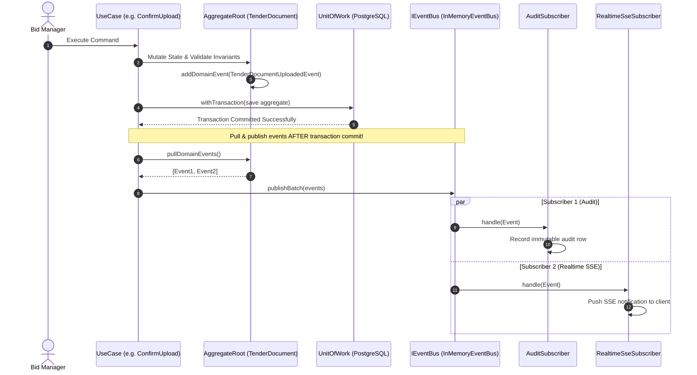

# Domain Events Architecture & Event Catalog: TenderPulse AI

## 1. Architectural Philosophy: Event-Driven Foundations

In accordance with **ADR 0012 (Domain Events & In-Process Event Bus)** and **AGENTS.md**:
As TenderPulse AI grows from a core vertical slice into a multi-step compliance intelligence platform, components must coordinate without tight coupling or fragile synchronous dependency chains.

---

## 2. Core Concepts: Theory & Practice

### 2.1 Command vs. Event: The Fundamental Distinction

| Dimension            | Command                                                                               | Domain Event                                                                        |
| :------------------- | :------------------------------------------------------------------------------------ | :---------------------------------------------------------------------------------- |
| **Semantic Meaning** | An **imperative intent** requesting an action: _"Please do this."_                    | A **factual statement** about the past: _"This has happened."_                      |
| **Grammar / Tense**  | Present / Imperative tense (e.g. `CreateBidCommand`, `ConfirmDocumentUploadCommand`). | Past tense (e.g. `BidProjectCreatedEvent`, `TenderDocumentUploadedEvent`).          |
| **Recipient**        | Exactly **one** intended receiver / handler.                                          | **Zero, one, or many** independent subscribers.                                     |
| **Rejection**        | Can be rejected by validation, domain invariants, or authorization checks.            | **Cannot be rejected**. The state transition has already committed to the database. |
| **Side Effects**     | Initiates state mutation.                                                             | Decouples secondary reactions (audit logs, SSE broadcasts, metrics, notifications). |

### 2.2 Event vs. Queue: Notification vs. Work Distribution

| Dimension               | Queue (Point-to-Point)                                                                         | Event (Pub/Sub / Event Bus)                                                               |
| :---------------------- | :--------------------------------------------------------------------------------------------- | :---------------------------------------------------------------------------------------- |
| **Primary Purpose**     | **Work distribution & load leveling**: Ensure heavy compute is executed by exactly one worker. | **Broadcast notification**: Announce state transitions to any interested observers.       |
| **Consumption**         | **Competing consumers**: 1 message $\rightarrow$ exactly 1 worker claims and deletes it.       | **Multiple subscribers**: 1 event $\rightarrow N$ independent handlers react in parallel. |
| **Lifespan**            | Ephemeral: Removed from queue upon completion (`deleteMessage`).                               | Logged / append-only: Can be archived, audited, or streamed.                              |
| **TenderPulse Example** | AWS SQS: Distributes 150-page PDF OCR extraction to an isolated FastAPI worker instance.       | Domain Event: `ComplianceIngestionCompletedEvent` informs AuditLog and SSE Broadcaster.   |

### 2.3 Producer vs. Consumer

- **Producer**:
  - The aggregate root or application use case where the business state transition occurs.
  - The producer is completely unaware of who (if anyone) is listening to the event.
  - It publishes facts containing immutable state identifiers and non-sensitive metadata.
- **Consumer (Subscriber)**:
  - An independent component that handles the event to perform side effects (e.g., updating an activity feed, broadcasting a WebSocket message, recording an audit entry).
  - Consumers must maintain their own error handling and must never break the producer.

### 2.4 Delivery Semantics

1. **At-Most-Once Delivery**: The event is fired without acknowledgments. If a network blip or consumer crash occurs, the event is permanently lost. Unacceptable for audit trails or financial compliance.
2. **At-Least-Once Delivery**: The event is guaranteed to reach consumers, but transient retries and network partitions can cause duplicate deliveries.
3. **Effectively-Once Delivery**: Achieved in practice by combining **At-Least-Once delivery** with **Idempotent Consumers**.

### 2.5 Replay & Event Sourcing Trade-Offs

- **Event Notification vs. Event Sourcing**:
  - **TenderPulse AI uses Event Notification**: PostgreSQL relational tables remain the ACID transactional source of truth. Events are emitted to notify other subsystems of state changes.
  - **Full Event Sourcing** (storing only event deltas and deriving current state by replaying every event since inception) was **evaluated and rejected**. Replaying thousands of events across 250-page tenders introduces unnecessary complexity for relational foreign keys, schema migrations, and ad-hoc SQL reporting.
- **Replay Scenarios**:
  - If an audit subscriber or analytics pipeline is updated, events can be replayed from the database audit log to backfill projections without modifying transactional tables.

### 2.6 Idempotency & Deduplication

Because events can be redelivered due to network retries or queue re-evaluations:

- Every domain event carries a globally unique `eventId` (UUIDv4).
- Consumers track processed event IDs or execute idempotent upserts:
  ```sql
  INSERT INTO event_deduplication (event_id, processed_at)
  VALUES (:eventId, NOW())
  ON CONFLICT (event_id) DO NOTHING;
  ```
- If a consumer receives an event with an `eventId` that already exists in the deduplication ledger, it acknowledges the event immediately and exits without reprocessing.

### 2.7 Ordering Assumptions & Version Vectors

- **The Fallacy of Global Ordering**: In a distributed cloud environment, assuming total global event ordering across different tenants or aggregates is impossible without introducing severe throughput bottlenecks.
- **TenderPulse Guarantee**: Ordering is guaranteed **per aggregate root** using the aggregate's monotonic `version` counter.
  - If a consumer receives `version 3` before `version 2`, it can detect the out-of-order delivery.
  - Events older than the current entity version in the read model are safely ignored.

---

## 3. Security Rule: Zero Sensitive Document Contents in Broad Events

> [!CAUTION]
> **CRITICAL SECURITY REQUIREMENT**: Do not put sensitive document contents into broad events unless there is a compelling, documented reason.

### The Threat Model

Indian public procurement tenders and contractor bids contain:

1. Confidential pricing matrices and bill-of-quantities (BOQ) markups.
2. Proprietary technical methodologies, joint-venture partner agreements, and executive resumes.
3. Financial bank guarantees, PAN numbers, GST details, and audited turnover certificates.

If an event like `ComplianceIngestionCompletedEvent` broadcasts raw extracted paragraphs or full PDF text:

- Any consumer subscribed to the event bus (e.g. logging agents, third-party webhook dispatchers, telemetry collectors) inadvertently captures and logs confidential commercial data.
- A vulnerability in an auxiliary subscriber (e.g. an unauthenticated internal logging dashboard) exposes the entire tender archive.

### The Zero-Leakage Payload Policy

All domain events adhere to the **Reference-Only Payload Policy**:

- Events carry **only identifiers, tenant scope, state enums, versions, and numeric counts**.
- If a consumer requires document text, it must perform a tenant-authorized lookup against PostgreSQL through a domain repository, verifying permissions before accessing data.

---

## 4. The Genuine Domain Event Catalog

### Summary Matrix

| Event Type                                      | Aggregate Producer            | Primary Consumers                        | Sensitive Payload?                        |
| :---------------------------------------------- | :---------------------------- | :--------------------------------------- | :---------------------------------------- |
| `tenderpulse.bids.project-created.v1`           | `BidProject`                  | AuditLog, ActivityFeed, SSE Gateway      | **NO** (Title, tender #, metadata only)   |
| `tenderpulse.bids.document-uploaded.v1`         | `TenderDocument`              | AuditLog, StorageMetrics, SSE Gateway    | **NO** (Checksum, size, S3 key reference) |
| `tenderpulse.compliance.ingestion-completed.v1` | `IngestionJob` / `BidProject` | Realtime SSE, AuditLog, Notifications    | **NO** (Item count and status only)       |
| `tenderpulse.compliance.item-reviewed.v1`       | `ComplianceItem`              | BidProgressTracker, AuditLog, TeamCollab | **NO** (Status enum, item ID, version)    |

---

### Detailed Event Specifications

#### 1. `BidProjectCreatedEvent`

- **Event Type**: `tenderpulse.bids.project-created.v1`
- **Producer**: `BidProject` Aggregate Root / `CreateBidUseCase`
- **Tenant Scope**: Strictly scoped to `organizationId`.
- **Payload**:
  ```typescript
  {
    eventId: string; // UUIDv4
    eventType: 'tenderpulse.bids.project-created.v1';
    aggregateId: string; // bidId
    organizationId: string; // tenantId
    occurredAt: Date;
    version: 1;
    payload: {
      bidId: string;
      title: string;
      tenderNumber: string;
      tenderingAuthority: string;
      estimatedValueRupees: number;
      submissionDeadline: string; // ISO date
      status: 'DRAFT';
    }
  }
  ```
- **Consumers**:
  - `AuditLogSubscriber`: Appends immutable entry to `audit_logs`.
  - `ActivityFeedSubscriber`: Records activity for the organization dashboard.
  - `RealtimeSseSubscriber`: Broadcasts update to connected client browser sessions in that tenant.
- **Retries & Idempotency**: Consumers key on `eventId`. If duplicate arrives, insert is skipped.
- **Security Implications**: Carries high-level procurement metadata, no confidential bid pricing breakdown.

---

#### 2. `TenderDocumentUploadedEvent`

- **Event Type**: `tenderpulse.bids.document-uploaded.v1`
- **Producer**: `TenderDocument` Aggregate Root / `ConfirmDocumentUploadUseCase`
- **Tenant Scope**: Strictly scoped to `organizationId`.
- **Payload**:
  ```typescript
  {
    eventId: string;
    eventType: 'tenderpulse.bids.document-uploaded.v1';
    aggregateId: string; // documentId
    organizationId: string; // tenantId
    occurredAt: Date;
    version: number;
    payload: {
      documentId: string;
      bidId: string;
      documentType: 'NIT' | 'RFP' | 'BOQ' | 'GCC' | 'SCC';
      fileName: string;
      sizeBytes: number;
      mimeType: string;
      checksumSha256: string;
      status: 'VERIFIED';
    }
  }
  ```
- **Consumers**:
  - `AuditLogSubscriber`: Records SHA-256 integrity verification.
  - `StorageQuotaSubscriber`: Increments tenant's active S3 storage tally.
  - `RealtimeSseSubscriber`: Updates UI checklist indicator from "Pending Upload" to "Uploaded".
- **Retries & Idempotency**: Consumers check `documentId` and `version`.
- **Security Implications**: Contains SHA-256 and file metadata. **Zero PDF bytes or extracted text in payload.**

---

#### 3. `ComplianceIngestionCompletedEvent`

- **Event Type**: `tenderpulse.compliance.ingestion-completed.v1`
- **Producer**: `IngestionWorker` / `IngestionJob`
- **Tenant Scope**: Strictly scoped to `organizationId`.
- **Payload**:
  ```typescript
  {
    eventId: string;
    eventType: 'tenderpulse.compliance.ingestion-completed.v1';
    aggregateId: string; // jobId
    organizationId: string; // tenantId
    occurredAt: Date;
    version: number;
    payload: {
      jobId: string;
      bidId: string;
      documentId: string;
      itemsCount: number;
      newBidStatus: 'REVIEW_READY';
      completedAt: string; // ISO date
    }
  }
  ```
- **Consumers**:
  - `RealtimeSseSubscriber`: Triggers UI alert: _"Tender analysis complete. 24 compliance items ready for review."_
  - `NotificationSubscriber`: Sends Slack / email summary to the Bid Manager.
  - `AuditLogSubscriber`: Records completion of AI extraction.
- **Retries & Idempotency**: Handled via `jobId`. Duplicate events do not trigger repeat email alerts.
- **Security Implications**: Contains item count only. Individual legal requirements, quotes, and execution rules remain safely secured in PostgreSQL.

---

#### 4. `ComplianceItemReviewedEvent`

- **Event Type**: `tenderpulse.compliance.item-reviewed.v1`
- **Producer**: `ComplianceItem` Aggregate Root / `ReviewComplianceItemUseCase`
- **Tenant Scope**: Strictly scoped to `organizationId`.
- **Payload**:
  ```typescript
  {
    eventId: string;
    eventType: 'tenderpulse.compliance.item-reviewed.v1';
    aggregateId: string; // complianceItemId
    organizationId: string; // tenantId
    occurredAt: Date;
    version: number;
    payload: {
      itemId: string;
      bidId: string;
      reviewerUserId: string;
      previousStatus: string;
      newStatus: 'COMPLIANT' | 'FLAGGED' | 'NOT_APPLICABLE';
      reviewedAt: string;
      version: number;
    }
  }
  ```
- **Consumers**:
  - `BidReadinessCalculatorSubscriber`: Recalculates bid completion score (e.g. 85% compliant).
  - `CollaborationSseSubscriber`: Pushes live status change to other team members viewing the compliance matrix.
  - `AuditLogSubscriber`: Records legal sign-off accountability.
- **Retries & Idempotency**: Optimistic locking via `version`. Out-of-order older reviews are ignored.
- **Security Implications**: Reviewer notes are excluded from broad broadcasts; only status transitions are shared.

---

## 5. Implementation Architecture: Dispatch Flow


