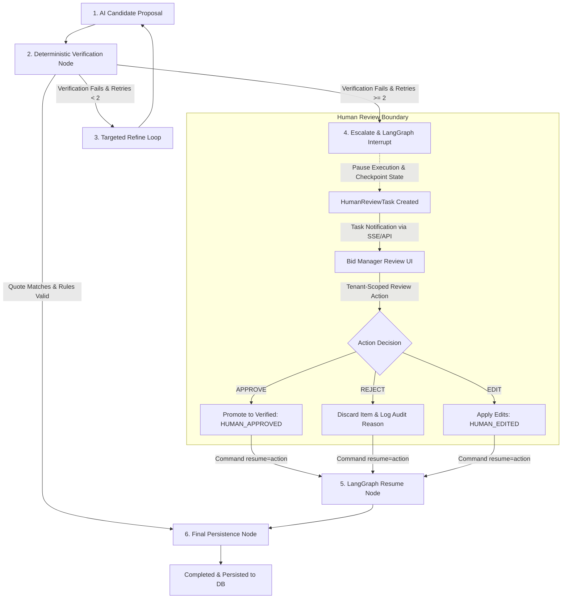

# Human-in-the-Loop (HITL) Architecture: Human Review, Authorization & State Machine Resumption

## 1. Architectural Philosophy: The Need for Human-in-the-Loop

In accordance with **AGENTS.md**:
> **"Deterministic code owns authorization, calculations, validation, and critical state transitions. LLMs are not the source of truth for critical business state."**

In Indian public procurement (e.g. GeM, Indian Railways, NHAI, CPWD, Defence PSUs), tender criteria are legally binding. Missing a ₹100 stamp paper or misinterpreting a Joint Venture equity requirement leads to **immediate procedural disqualification** and forfeiture of Earnest Money Deposits (EMDs) worth lakhs of rupees.

While AI provides high-speed text extraction and semantic understanding, it remains an **untrusted, advisory computation engine**. Fully autonomous decision-making in legal compliance is an unacceptable commercial and legal liability. 

Therefore, TenderPulse AI implements a **Human-in-the-Loop (HITL)** architecture:
- Routine, grounded criteria are verified automatically by deterministic code.
- Ambiguous, ungrounded, or conflicting criteria trigger an immediate execution pause (**LangGraph dynamic interrupt**), creating a tenant-scoped review task for a qualified Bid Manager.
- Execution cannot proceed to final database persistence without an explicit human review decision (**Approve**, **Reject**, or **Edit**).

---

## 2. Decision Classification Matrix

Every decision in the TenderPulse AI pipeline is strictly partitioned into one of four governance tiers:

```
┌────────────────────────────────────────────────────────────────────────┐
│                        DECISION CLASSIFICATION MATRIX                  │
├────┬─────────────────────────────┬────────────────────────────────────┤
│ #  │ Tier                        │ Governing Authority                │
├────┼─────────────────────────────┼────────────────────────────────────┤
│ 1  │ Automatic                   │ Pure deterministic utility code    │
│ 2  │ Validated Automatic         │ AI reasoning + Deterministic guard │
│ 3  │ Human Approval Required     │ Authorized human Bid Manager       │
│ 4  │ Deterministic Only          │ Core application security kernel   │
└────┴─────────────────────────────┴────────────────────────────────────┘
```

### 1. Automatic (Zero Risk, Deterministic Utilities)
- PDF page splitting, layout extraction, token counting, and virus scanning.
- Metadata sanitization (stripping non-printable characters, XML delimiter escaping).
- Deterministic text normalization (lowercasing, whitespace collapsing).

### 2. Validated Automatic (AI Extraction with Deterministic Grounding Proof)
- Extraction of compliance items where:
  1. The LLM extracts the candidate item.
  2. The candidate carries an exact `verbatim_quote`.
  3. Deterministic Python verifier confirms 100% exact substring match on the physical PDF page text.
  4. Execution rules (e.g. stamp paper denomination $> 0$) pass schema invariants.
  5. Confidence score $\ge 0.90$.
- **Result**: System automatically promotes to `VERIFIED` and persists without blocking human workflow.

### 3. Human Approval Required (Ambiguous, High-Risk, or Ungrounded Items)
- **Ungrounded Claims**: Model extracts an item, but the cited quote cannot be found on the physical page after 2 targeted refinement retries.
- **Ambiguous Eligibility**: Clauses presenting discretionary options (e.g. *"Bidder must have completed similar work, or submitted consortium MoU"*).
- **Non-Standard Conditions**: Unprecedented stamp paper values, high penalty clauses, or contradictory corrigenda.
- **Result**: Workflow execution is **suspended** via LangGraph `interrupt()`. A `HumanReviewTask` is created. Bid Manager must **Approve**, **Reject**, or **Edit** the item.

### 4. Deterministic Only (Never Delegated to AI or LLMs)
- Tenant isolation enforcement and anti-IDOR checks.
- Reviewer authentication, RBAC authorization (`compliance:review`), and permission checks.
- Database transactions and state machine transitions (`DRAFT` $\rightarrow$ `SUBMITTED`).
- Mathematical calculations (currency sums, financial shortfall arithmetic).
- Audit trail recording and cryptographic signing.

---

## 3. The 6-Stage Human Review Lifecycle



### Stage 1: AI Candidate Proposal
The `model_extraction` node invokes the structured LLM client, parsing tender chunks delimited by structural XML tags (`<untrusted_document_data>`).

### Stage 2: Deterministic Verification Node
The `deterministic_verification` node evaluates every candidate item:
- Checks `clean_quote in clean_page_text`.
- Validates execution rules (`stamp_paper_denomination_inr`).
- Valid items move to `verified_items`.
- Failing items move to `unverified_items`.

### Stage 3: Targeted Refinement Loop
If unverified items exist and `retry_count < 2`, the workflow loops to `targeted_refine`, providing targeted error feedback (e.g. `"Quote not found on page 14"`) and re-reading the page.

### Stage 4: Escalation & LangGraph Interrupt
If retries are exhausted ($\ge 2$):
1. `escalate_human_review` node updates state (`status: "AWAITING_HUMAN_REVIEW"`, `human_review_required: True`) and records audit event `ESCALATED_TO_HUMAN_REVIEW`.
2. `human_review` node calls LangGraph's dynamic `interrupt(payload)`.
3. **Execution Suspends**: The workflow pauses immediately. State and channel values are saved to the persistent checkpointer under compound key `f"tenant_{tenant_id}:bid_{bid_id}:run_{workflow_run_id}"`.
4. `HumanReviewManager` registers a `HumanReviewTask` assigned to a designated Bid Manager.

### Stage 5: Human Action & Graph Resumption
An authorized reviewer inspects the unverified item alongside the original PDF page in the UI and submits a decision:
- **APPROVE**: Confirms the requirement is valid (e.g. minor OCR artifact), promoting it to `VerifiedComplianceItem` with `verification_method="HUMAN_APPROVED"`.
- **REJECT**: Discards the hallucinated or irrelevant item.
- **EDIT**: Updates stamp paper denomination, verbatim quote, or title, promoting it with `verification_method="HUMAN_EDITED"`.
The reviewer's action payload is dispatched to the workflow engine:
```python
resumed_state = await workflow_graph.ainvoke(
    Command(resume=action_payload.model_dump()),
    config={"configurable": {"thread_id": task.thread_id}}
)
```

### Stage 6: Final Persistence Node
The graph resumes inside `human_review_node`, merges the promoted items, and transitions to `persistence` node, saving the verified compliance records to PostgreSQL within an ACID transaction.

---

## 4. LangGraph Interrupt & Resume Architecture

```
Thread ID: tenant_tata_infra_01:bid_railways_01:run_hitl_001
Checkpointer: PostgresSaver / MemorySaver
                                 
┌─────────────────────────┐
│ scoped_retrieval        │
└────────────┬────────────┘
             ▼
┌─────────────────────────┐
│ model_extraction        │
└────────────┬────────────┘
             ▼
┌─────────────────────────┐
│ deterministic_verif     │
└────────────┬────────────┘
             │ (Unverified & retries >= 2)
             ▼
┌─────────────────────────┐
│ escalate_human_review   │  ──► status = "AWAITING_HUMAN_REVIEW"
└────────────┬────────────┘
             ▼
┌─────────────────────────┐
│ human_review [INTERRUPT]│  ──► PAUSE EXECUTION: Checkpoint saved to DB!
└────────────┬────────────┘
             │
             │ ◄─── Command(resume=HumanReviewActionPayload)
             ▼
┌─────────────────────────┐
│ human_review [RESUMED]  │  ──► Applies APPROVE / REJECT / EDIT
└────────────┬────────────┘
             ▼
┌─────────────────────────┐
│ persistence             │  ──► Commit to PostgreSQL (status = "COMPLETED")
└────────────┬────────────┘
             ▼
           (END)
```

### Dynamic `interrupt()` vs. Static `interrupt_before`
- **Why Dynamic `interrupt()`**: LangGraph 0.2's `interrupt()` allows passing rich contextual data (unverified items, clause text, failure reasons) directly to the pause boundary and receiving the human decision dynamically upon resume via `Command(resume=...)`.
- **Checkpointing**: Every state channel (verified items, unverified items, retry count, audit events) is durably serialized. If the worker crashes or restarts while awaiting human review, the task remains paused in PostgreSQL without data loss.

---

## 5. Security, Governance & Tenant Scoping

AI review workflows operate under strict zero-trust rules:

### 1. Tenant-Scoped Reviewer Access
- Review tasks are strictly partitioned by `tenant_id`.
- If User A from Tenant B attempts to retrieve or review a task belonging to Tenant A, `HumanReviewManager` raises `CrossTenantReviewException`.

### 2. Reviewer Authorization & RBAC
- Reviewers must possess the atomic permission `compliance:review`.
- Users with read-only roles (`VIEWER`, `bids:read`) cannot submit review decisions; attempts raise `UnauthorizedReviewerException`.

### 3. Duplicate Approval Prevention (Idempotency)
- Tasks track a strict state lifecycle: `PENDING` $\rightarrow$ `COMPLETED` | `EXPIRED` | `REASSIGNED`.
- If a review has already been submitted for a task, subsequent submissions fail immediately with `DuplicateReviewException`.

### 4. Task Expiry & SLAs
- Review tasks carry an `expires_at` timestamp (e.g. 24 hours before tender submission deadline).
- If `datetime.now(UTC) > task.expires_at`, review submissions are rejected with `ReviewTaskExpiredException`, and the task transitions to `EXPIRED`.

### 5. Task Reassignment & Audit Trail
- A supervisor can reassign a pending task to another qualified reviewer within the same tenant.
- Reassignment emits an immutable audit record: `HUMAN_REVIEW_TASK_REASSIGNED` capturing `previous_assignee`, `new_assignee`, and `authorizing_user_id`.

### 6. Reference-Only Audit Logging
In compliance with Section 12 of `docs/AI_SECURITY.md`, all human review decisions record reference-only audit events:
```json
{
  "timestamp": "2026-10-02T14:15:00.000Z",
  "action": "HUMAN_REVIEW_APPROVE",
  "tenant_id": "tenant_tata_infra_01",
  "entity_type": "BidProject",
  "entity_id": "bid_railways_77",
  "details": {
    "reviewer_id": "usr_bid_mgr_01",
    "decision": "APPROVE",
    "notes": "Confirmed valid by bid manager despite OCR minor paraphrase.",
    "promoted_count": 1,
    "timestamp": "2026-10-02T14:15:00.000Z"
  }
}
```
No raw prompts or full PDF blobs are stored in audit logs.
