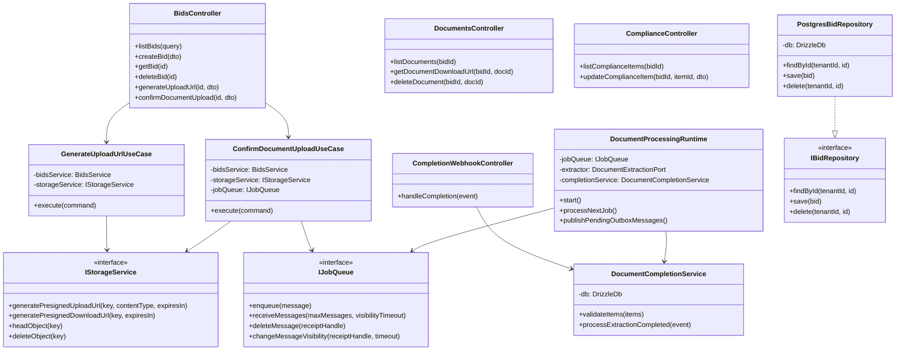
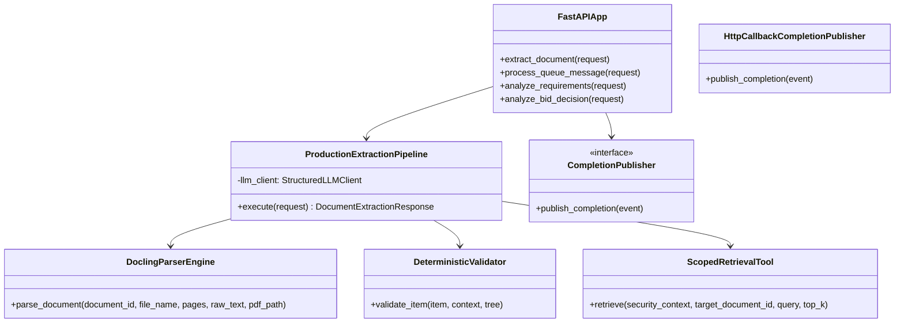
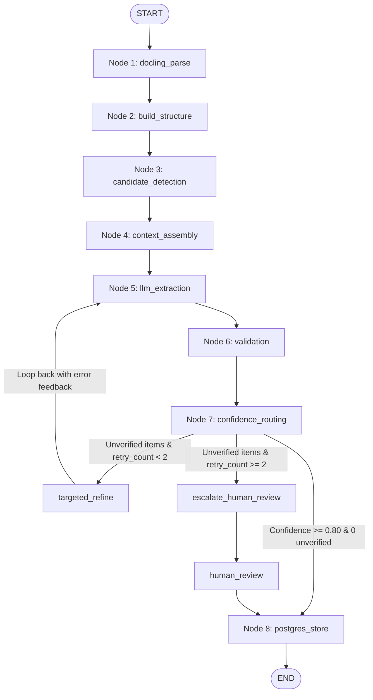
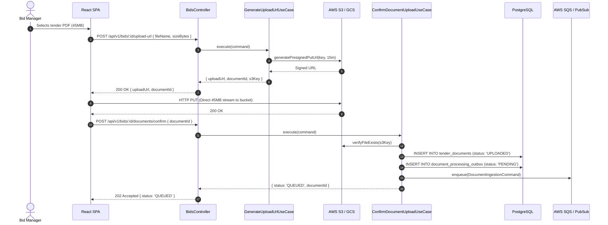
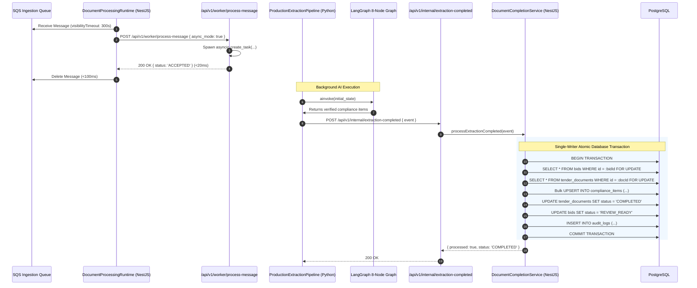
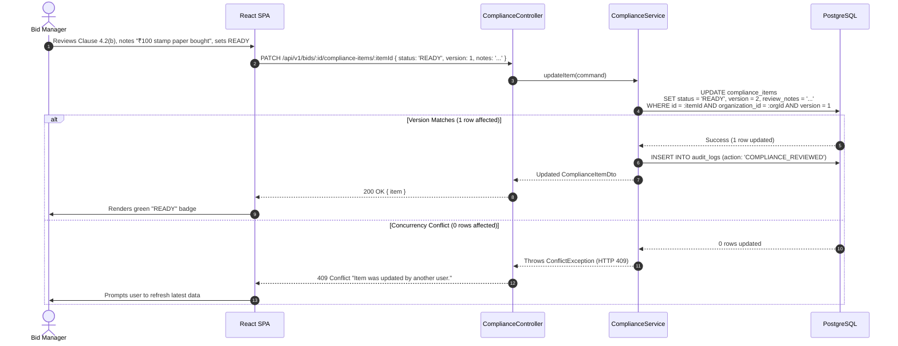
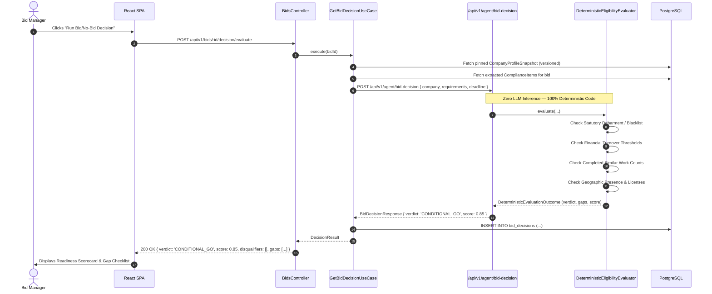
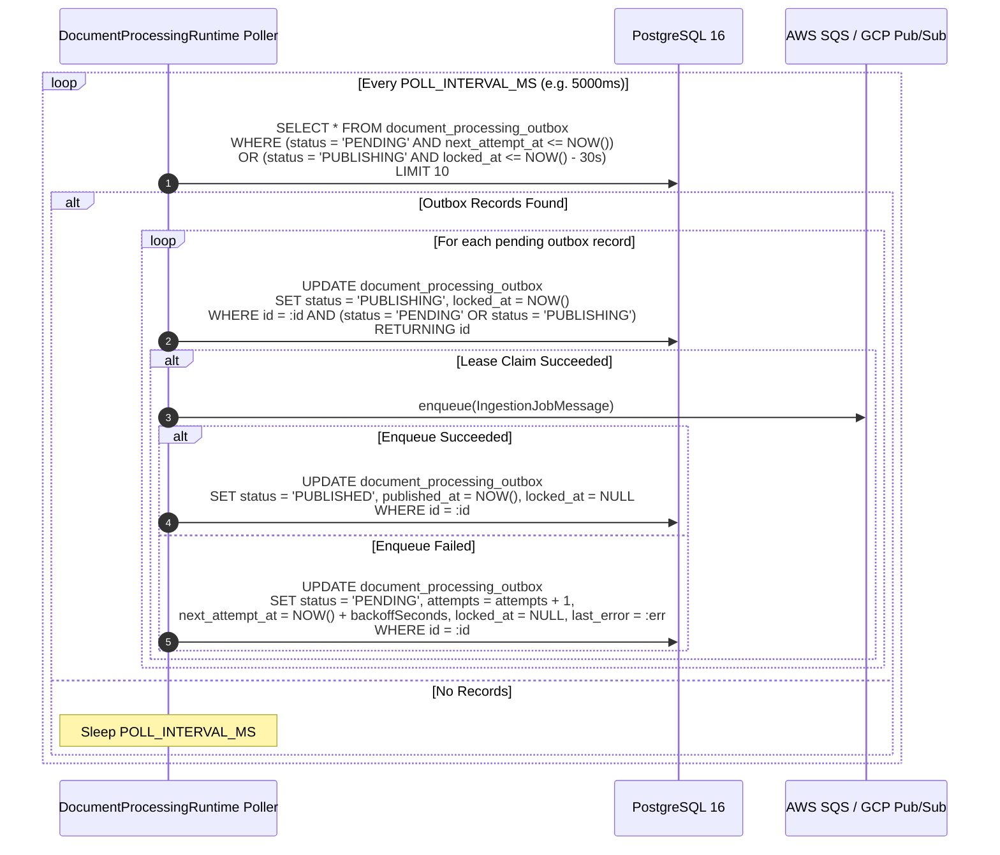

# Low-Level Design (LLD): TenderPulse AI Implementation Blueprint

## 1. Scope & Objective

This document provides the concrete, code-level Low-Level Design (LLD) for the **TenderPulse AI** platform. It details the runtime classes, modules, controllers, use cases, FastAPI endpoints, LangGraph state machines, retrieval components, database models, and sequence diagrams matching the actual implementation across [`apps/api`](file:///Users/belikesaurabh/main/TenderAi/apps/api) and [`apps/ai`](file:///Users/belikesaurabh/main/TenderAi/apps/ai).

---

## 2. Monorepo Package & Service Architecture

The platform is structured as a two-tier monorepo with strict package boundaries:

```
TenderAi/
├── apps/
│   ├── api/                     # NestJS 10 Modular Monolith (TypeScript)
│   │   ├── src/
│   │   │   ├── app.module.ts
│   │   │   ├── common/          # Database, Security, Logging, Filters
│   │   │   ├── infrastructure/  # Storage, Queue, Persistence Adapters
│   │   │   └── modules/         # Bounded Context Modules (bids, documents, compliance, auth...)
│   │   └── Dockerfile
│   ├── ai/                      # FastAPI Worker & Intelligence Engine (Python 3.12+)
│   │   ├── src/tenderpulse_ai/
│   │   │   ├── main.py          # FastAPI application & worker endpoints
│   │   │   ├── agent/           # Requirement analysis agent & schemas
│   │   │   ├── decision/        # Deterministic bid/no-bid eligibility engine
│   │   │   ├── domain/          # Docling parser, structure builder, validator
│   │   │   ├── workflow/        # LangGraph 8-node state machine & nodes
│   │   │   ├── tools/           # Scoped retrieval, page text, network guard
│   │   │   ├── security/        # SecurityContext, secret sanitizer
│   │   │   └── infrastructure/  # Queue completion publishers, LLM client
│   │   └── pyproject.toml
│   └── web/                     # React 18 Single Page Application (TypeScript + Vite)
└── packages/
    ├── shared-types/            # Canonical wire contracts between API and AI worker
    ├── config/                  # Shared linting and TypeScript configurations
    └── ui/                      # Shared React design system tokens & components
```

---

## 3. NestJS Architecture & Core Modules (`apps/api`)

The NestJS backend implements a Domain-Driven Layered Architecture (**ADR 0008**) where application use cases orchestrate domain entities and depend on abstract ports implemented by infrastructure adapters.



### 3.1 `BidsModule`

- **Responsibilities**: Bid project registration, metadata querying, pagination, deletion cascades, direct upload presigned URL generation, and document upload confirmation.
- **Key Classes**:
  - `BidsController`: Exposes `/api/v1/bids` endpoints.
  - `BidsService`: Interacts with Drizzle ORM to perform tenant-scoped CRUD operations with OCC.
  - `GenerateUploadUrlUseCase`: Validates bid ownership, generates deterministic S3/GCS keys (`tenants/{orgId}/bids/{bidId}/raw/{docId}.pdf`), and returns a 15-minute presigned PUT URL.
  - `ConfirmDocumentUploadUseCase`: Verifies file presence in storage, persists the `tender_documents` row, inserts an outbox entry, and enqueues the job to `IJobQueue`.
  - `GetBidDecisionUseCase`: Invokes the deterministic eligibility evaluator in `apps/ai` and returns bid readiness scores and gap analyses.

### 3.2 `DocumentsModule`

- **Responsibilities**: Asynchronous document lifecycle, worker message consumption, and the **Single-Writer Principle** for PostgreSQL persistence.
- **Key Classes**:
  - `DocumentCompletionService`: The central transactional persistence engine for extraction results. Upon receiving a completion event, it opens an atomic database transaction, locks the bid and document records (`.for('update')`), verifies verbatim quote citations, fuses duplicate items across pages, inserts rows into `compliance_items`, transitions the document to `COMPLETED`, updates bid requirement counts, and commits the transaction.
  - `CompletionWebhookController`: Listens on `POST /api/v1/internal/extraction-completed`, protected by `InternalServiceGuard` (`X-Internal-Service-Key`), forwarding payloads to `DocumentCompletionService`.
  - `DocumentProcessingRuntime`: Background queue consumer that polls `IJobQueue`, dispatches jobs to FastAPI asynchronously via `AiDocumentExtractor.dispatchExtraction()`, and acknowledges/deletes the queue message immediately (<100ms).
  - `AiDocumentExtractor`: Implements `DocumentExtractionPort`, dispatching non-blocking HTTP requests to FastAPI (`/api/v1/worker/process-message` with `async_mode: true`).

### 3.3 `ComplianceModule`

- **Responsibilities**: Interactive compliance checklist review, contractor gap analysis, and human overrides.
- **Key Classes**:
  - `ComplianceController`: Exposes `GET /api/v1/bids/:id/compliance-items` and `PATCH /api/v1/bids/:id/compliance-items/:itemId`.
  - `ComplianceService`: Executes atomic updates with Optimistic Concurrency Control (`WHERE id = :id AND version = :expectedVersion`), increments `version`, and logs user review actions to `audit_logs`.

### 3.4 `AuthModule` & Security Infrastructure

- **TokenService**: Implements RFC 7519 HMAC-SHA256 JWT signing and verification. Issues short-lived access tokens (15 minutes) and revocable refresh tokens (7 days).
- **Guards**:
  - `JwtAuthGuard`: Global authentication gate. Parses `Bearer <token>` headers or `?token=` query parameters (for SSE streams), verifies cryptographic signatures, and attaches the payload to `request.user`.
  - `RolesGuard`: Evaluates `@RequirePermission(...)` metadata against user permissions.
  - `InternalServiceGuard`: Verifies `X-Internal-Service-Key` header for inter-service calls.
- **Interceptors**:
  - `TenantContextInterceptor`: Reads `request.user.organizationId` and binds it to Node.js `AsyncLocalStorage` (`TenantContextHolder`), making tenant context ambiently available to all services and repositories.
  - `HttpLoggingInterceptor`: Captures request latencies and emits canonical JSON logs with trace correlation IDs.

---

## 4. FastAPI AI Engine Architecture (`apps/ai`)

The Python AI service in `apps/ai` is built with FastAPI, Pydantic, Docling, and LangGraph. It is designed as a stateless, high-performance compute node with **zero direct database write access**.



### 4.1 FastAPI Endpoints & Dependency Injection

- **`POST /api/v1/worker/process-message`**:
  - Primary entrypoint for asynchronous document extraction jobs.
  - Protected by `verify_internal_key` (`X-Internal-Service-Key`).
  - Accepts `QueueProcessingRequest` (supporting camelCase or snake_case via Pydantic aliases).
  - When `async_mode: true`, it registers a background task via `asyncio.create_task(_execute_and_publish_extraction(...))` and returns `{ status: "ACCEPTED", processed: true }` in under 20ms.
- **`POST /api/v1/agent/bid-decision`**:
  - Evaluates structured `CompanyProfileSnapshot` against extracted `RequirementCandidate` items using `DeterministicEligibilityEvaluator`.
  - Runs 100% deterministically without model inference, calculating readiness scores, disqualifiers, and shortfalls.
- **`POST /api/v1/extract`**:
  - Synchronous extraction endpoint used for testing and deterministic benchmark evaluations.

### 4.2 Completion Publisher Hierarchy

The AI engine uses the Strategy pattern to emit completion events back to the NestJS tier:

- `CompletionPublisher` (Abstract Base Class): `publish_completion(event: DocumentExtractionCompletedEvent)`
- `HttpCallbackCompletionPublisher`: Makes an HTTP POST request to NestJS `POST /api/v1/internal/extraction-completed` with `X-Internal-Service-Key` and forwarded `X-Trace-Id`.
- `AwsSqsCompletionPublisher`: Publishes completion JSON to an SQS completion queue.
- `GcpPubSubCompletionPublisher`: Publishes completion JSON to a Google Cloud Pub/Sub topic.
- `MockCompletionPublisher`: Records emitted events in memory for test verification.

---

## 5. LangGraph 8-Node State Machine Architecture

The core of the document extraction intelligence is an 8-node cyclic computation graph built using **LangGraph** (`apps/ai/src/tenderpulse_ai/workflow/`):



### 5.1 Graph State Schema (`ComplianceWorkflowState`)

The state schema is defined as a strongly typed `TypedDict` where verified outputs use additive reducers (`operator.add`):

```python
class ComplianceWorkflowState(TypedDict, total=False):
    security_context: dict[str, Any]
    bid_id: str
    document_id: str
    file_name: str
    page_number: int
    raw_page_text: str
    pages: list[dict[str, Any]]
    storage_reference: str | None
    
    # Node 1 & 2 outputs
    docling_document: dict[str, Any]
    document_structure: dict[str, Any]
    
    # Node 3 & 4 outputs
    detected_candidates: list[dict[str, Any]]
    assembled_contexts: list[dict[str, Any]]
    
    # Node 5 outputs
    retrieved_chunks: list[dict[str, Any]]
    extracted_candidates: list[CandidateComplianceItem]
    
    # Node 6 & 7 outputs
    validation_reports: list[dict[str, Any]]
    confidence_tier: str  # AUTO_ACCEPT | REVIEWER_VERIFICATION | MANDATORY_HUMAN_REVIEW
    confidence_score: float
    
    # Node 8 outputs & Reducers
    verified_items: Annotated[list[VerifiedComplianceItem], operator.add]
    unverified_items: list[CandidateComplianceItem]
    retry_count: int
    error_feedback: str | None
    status: str
    human_review_required: bool
    audit_events: Annotated[list[dict[str, Any]], operator.add]
```

### 5.2 Deep-Dive into the 8 Nodes

1. **Node 1: `docling_parse`**:
   - Authorizes document access via `PageTextTool` against `SecurityContext`.
   - Runs `DoclingParserEngine` to extract text blocks, tables, and page layout.
2. **Node 2: `build_structure`**:
   - Constructs an Abstract Syntax Tree (AST) of the tender document (`DocumentStructureTree`).
   - Identifies hierarchical clause numbering (e.g., Section 4 -> Clause 4.2 -> Sub-Clause 4.2(a)).
3. **Node 3: `candidate_detection`**:
   - Runs `CandidateDetector` using procurement keyword cues (EMD, turnover, solvency, stamp paper, experience, blacklist).
   - Filters out non-actionable administrative narrative.
4. **Node 4: `context_assembly`**:
   - Assembles contextual windows around candidate clauses, pulling in parent section headers and cross-referenced clauses.
5. **Node 5: `llm_extraction`**:
   - Invokes `StructuredLLMClient` with grammar-constrained schemas or applies deterministic rule extraction.
   - Extracts structured execution rules (stamp paper denomination, notary, UDIN) and exact verbatim quotes.
6. **Node 6: `validation`**:
   - Executes `DeterministicValidator` across five verification checks:
     - **Citation Support**: Verbatim quote must exist in the source clause text.
     - **Clause Existence**: Referenced clause numbers must exist in the document AST.
     - **Number Preservation**: Monetary values and numbers in the quote must match the text.
     - **SHALL/MUST Polarity**: Prohibitions ("shall not") must not be inverted into affirmative obligations.
     - **Exception Retention**: Conditional clauses ("unless", "provided that") must be preserved.
7. **Node 7: `confidence_routing`**:
   - Calculates a normalized score (0.00 to 1.00) and assigns a confidence tier:
     - $\ge 0.95$: `AUTO_ACCEPT`
     - $0.80 - 0.94$: `REVIEWER_VERIFICATION`
     - $< 0.80$: `MANDATORY_HUMAN_REVIEW`
   - Conditional router `route_verification_outcome` directs flow:
     - Clean & score $\ge 0.80 \to$ Node 8 (`postgres_store`)
     - Unverified & `retry_count < 2` $\to$ `targeted_refine` $\to$ loops back to Node 5
     - Unverified & `retry_count >= 2` $\to$ `escalate_human_review` $\to$ `human_review`
8. **Node 8: `postgres_store`**:
   - Formats verified items into API wire DTOs (`ExtractedComplianceItemDto`).
   - Emits structured log telemetry and prepares the output payload for the completion publisher.

---

## 6. RAG & Scoped Retrieval Components

TenderPulse AI implements **Tenant-Scoped Deterministic Retrieval** via `ScopedRetrievalTool` ([`apps/ai/src/tenderpulse_ai/tools/retrieval.py`](file:///Users/belikesaurabh/main/TenderAi/apps/ai/src/tenderpulse_ai/tools/retrieval.py)):

### 6.1 Architectural Invariants

- **Multi-Tenant Partitioning**: Document chunks are stored partitioned strictly by compound key `f"{tenant_id}:{document_id}"`. Cross-tenant chunk retrieval is physically impossible.
- **Anti-IDOR Whitelist Check**: The tool validates that `target_document_id` exists inside `security_context.allowed_document_ids`. Attempting to query an unassigned document raises an immediate `UnauthorizedDocumentAccessException`.
- **Per-Run Rate Limiting**: Maximum 15 retrieval calls permitted per workflow run (`max_calls_per_run = 15`), protecting against runaway LLM agent loops.

---

## 7. Key Sequence Diagrams

### 7.1 Use Case 1: Direct-to-Storage Upload & Enqueueing Handshake



### 7.2 Use Case 2: Asynchronous Event Choreography & Single-Writer Persistence (Design B)



### 7.3 Use Case 3: Interactive Compliance Review & OCC State Mutation



### 7.4 Use Case 4: Deterministic Bid Decision & Eligibility Evaluation



### 7.5 Use Case 5: Transactional Outbox Polling, Lease Recovery & Job Queue Ingestion


