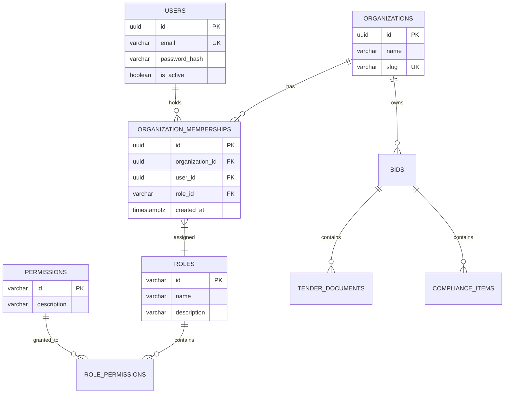
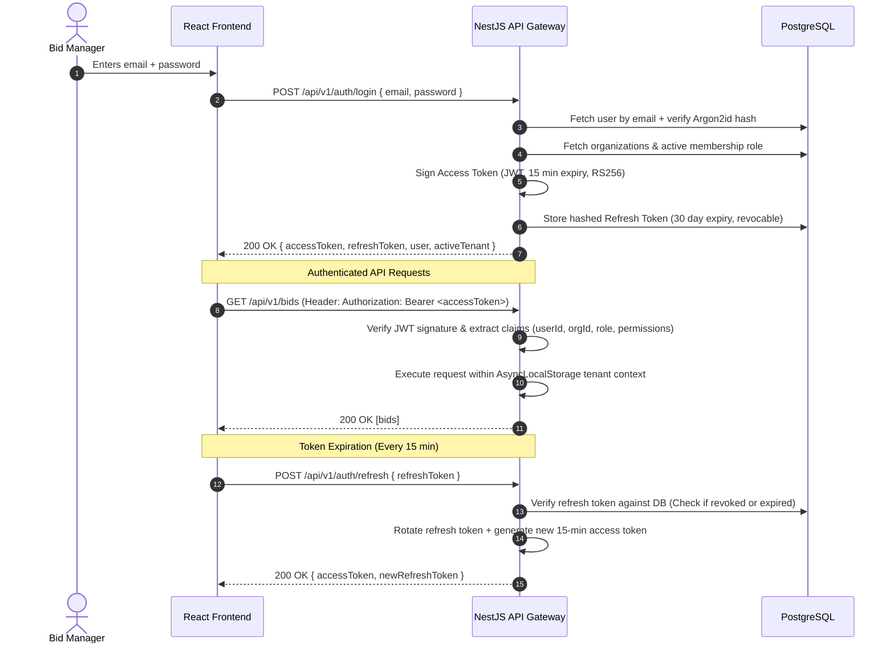
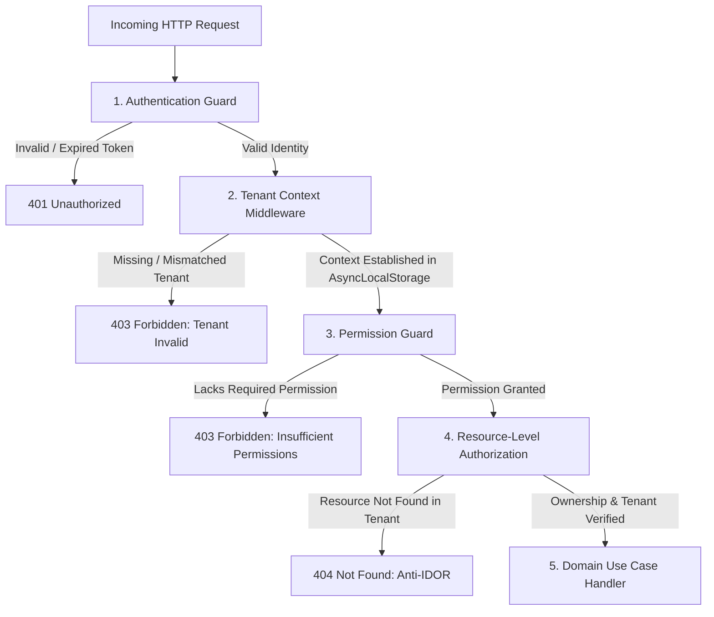

# Multi-Tenant Security & RBAC Model: TenderPulse AI

## 1. Core Security Principles

In accordance with **AGENTS.md** and **ADR 0011 (AI Security & Tenant Isolation)**, TenderPulse AI operates on a **Zero-Trust Security Architecture**.

1. **The Frontend is NOT a Security Boundary**: Client-side routing, hidden UI buttons, and disabled inputs are UX affordances, not security mechanisms. Every backend request must be authenticated, tenant-scoped, and authorized.
2. **Deny by Default**: Any request lacking explicit authentication, tenant context, or required permissions is rejected immediately with `401 Unauthorized` or `403 Forbidden`.
3. **Zero Ambient Authority**: Access to data requires explicit, verifiable tenant context. No global or superuser query may execute without explicit tenant scoping.
4. **IDOR Immunity via Scoped Queries**: Every single database lookup by primary key (`id`) MUST be scoped by the authenticated `organization_id`. Cross-tenant lookups return `404 Not Found` (never `403 Forbidden`) to prevent resource enumeration.
5. **No Static Context Concurrency Leaks**: Tenant context in Node.js must be propagated using `AsyncLocalStorage`, never mutable static properties or global variables.

---

## 2. Authentication vs. Authorization

| Concept                    | Question Answered                                                                      | Mechanism in TenderPulse AI                                                                                       | Failure Outcome                                   |
| :------------------------- | :------------------------------------------------------------------------------------- | :---------------------------------------------------------------------------------------------------------------- | :------------------------------------------------ |
| **Authentication (AuthN)** | _"Who are you?"_                                                                       | Validating cryptographically signed JWTs (access token) or API keys. Resolves `userId` and active account status. | `401 Unauthorized`                                |
| **Authorization (AuthZ)**  | _"What are you allowed to do, in which organization, and on which specific resource?"_ | Evaluating RBAC permissions and verifying that target resource belongs to the user's active `organization_id`.    | `403 Forbidden` or `404 Not Found` (IDOR defense) |

---

## 3. Multi-Tenant RBAC Domain Model



### 3.1 Entities & Boundary Definitions:

1. **User (`users`)**: A distinct human identity. Owns credentials (Argon2id password, email). Orthogonal to organizations (a user can belong to multiple organizations, e.g. an external bid consultant).
2. **Tenant (`organizations`)**: The legal and commercial boundary. Owns bids, documents, compliance matrices, and audit logs.
3. **Membership (`organization_memberships`)**: The bridge between a User and a Tenant. A user holds exactly one Role within a specific Organization.
4. **Role (`roles`)**: A named grouping of permissions.
5. **Permission (`permissions`)**: An atomic authorization capability (e.g. `bids:create`, `compliance:review`).

---

## 4. Roles & Permission Matrix

To prevent **Role Explosion**, code never checks raw role names (`if (role === 'BID_MANAGER')`). Code always checks atomic **Permissions** (`requirePermission('compliance:review')`).

| Permission               | Description                                    | `ADMIN` | `BID_MANAGER` | `REVIEWER` | `VIEWER` | Internal AI Worker |
| :----------------------- | :--------------------------------------------- | :-----: | :-----------: | :--------: | :------: | :----------------: |
| `org:manage`             | Edit organization details, billing, API keys   |   ✅    |      ❌       |     ❌     |    ❌    |         ❌         |
| `org:users:manage`       | Invite, remove, and change user roles          |   ✅    |      ❌       |     ❌     |    ❌    |         ❌         |
| `bids:create`            | Register new tender project                    |   ✅    |      ✅       |     ❌     |    ❌    |         ❌         |
| `bids:read`              | View bids, metadata, and progress              |   ✅    |      ✅       |     ✅     |    ✅    |         ❌         |
| `bids:update`            | Edit bid metadata, finalize bid                |   ✅    |      ✅       |     ❌     |    ❌    |         ❌         |
| `bids:delete`            | Delete draft bid project                       |   ✅    |      ❌       |     ❌     |    ❌    |         ❌         |
| `documents:upload`       | Request presigned S3 upload URLs               |   ✅    |      ✅       |     ❌     |    ❌    |         ❌         |
| `documents:read`         | Read document metadata and view citations      |   ✅    |      ✅       |     ✅     |    ✅    |         ❌         |
| `compliance:review`      | Mark items READY / FLAGGED / WAIVED, add notes |   ✅    |      ✅       |     ✅     |    ❌    |         ❌         |
| `compliance:bulk_ingest` | Machine-to-machine ingest from AI worker       |   ❌    |      ❌       |     ❌     |    ❌    |         ✅         |
| `audit:read`             | View tamper-proof compliance audit history     |   ✅    |      ✅       |     ✅     |    ✅    |         ❌         |

---

## 5. Token & Session Architecture: Short-Lived Access + Revocable Refresh



### Why Stateless JWT Alone is Insufficient:

- If an employee is terminated or their permissions are demoted from `ADMIN` to `VIEWER`, a pure stateless JWT remains valid until expiration.
- **TenderPulse Architecture**:
  - Access Token: 15-minute asymmetric JWT carrying `sub` (userId), `org_id`, `role`, and `permissions`.
  - Refresh Token: Opaque, high-entropy token stored in PostgreSQL. Can be revoked immediately by `ADMIN`.

---

## 6. Request Lifecycle & Enforcement Pipeline

Every incoming request passes through a 5-stage defensive pipeline before touching domain handlers:



### 1. Authentication Guard (`JwtAuthGuard` / `InternalApiKeyGuard`):

- Verifies bearer JWT cryptographic signature, expiration (`exp`), and active user status.
- For internal AI worker traffic: Validates constant-time machine-to-machine key (`INTERNAL_SERVICE_KEY`) and issues internal system context.

### 2. Tenant Context Middleware (`TenantContextMiddleware`):

- Resolves the active `organization_id` from the verified token.
- Initializes Node's `AsyncLocalStorage` for the request scope.
- **Critical Node.js Invariant**: Never store tenant context in static class variables! In an asynchronous event loop, concurrent requests will overwrite static variables, leaking competitor data.

### 3. Permission Guard (`RequirePermissionsGuard`):

- Checks if the user's role contains the required permission for the route.
- Example: `@RequirePermissions('bids:delete')` rejects a `BID_MANAGER` or `VIEWER` with `403 Forbidden`.

### 4. Resource-Level Authorization (Anti-IDOR):

- Verifies that the specific entity requested via URL parameter (`:id`) belongs to the authenticated tenant.
- **Anti-IDOR Pattern**:
  ```typescript
  // SECURE: Enforces tenant boundary directly in query
  const bid = await this.bidRepo.findById(bidId, tenantContext.organizationId);
  if (!bid) {
    // Return 404, NEVER 403, to prevent ID enumeration
    throw new EntityNotFoundException('Bid', bidId);
  }
  ```

### 5. Domain Handler:

- Executes business logic within an isolated database transaction with `SET LOCAL app.current_tenant_id = :tenantId`.

---

## 7. Prevention of Critical Vulnerabilities

### 7.1 Preventing Insecure Direct Object References (IDOR)

- **Threat**: A contractor attempts to view a competitor's tender analysis by changing the URL from `/api/v1/bids/tenant-a-uuid` to `/api/v1/bids/tenant-b-uuid`.
- **Defense**:
  1. No repository method accepts an `id` without also requiring `organizationId`.
  2. Queries execute `WHERE id = :id AND organization_id = :orgId`.
  3. If no record matches, the API returns `404 Not Found`. Returning `403 Forbidden` would confirm to the attacker that the competitor's bid ID exists.

### 7.2 Preventing Privilege Escalation

- **Horizontal Escalation** (Contractor A accessing Contractor B with same role):
  - Prevented by strict tenant context isolation in `AsyncLocalStorage` and repository queries.
- **Vertical Escalation** (Viewer attempting to execute Bid Manager/Admin mutations):
  - Prevented by declarative `@RequirePermissions(...)` guards at the controller boundary.
- **Payload Role Tampering**:
  - Attacker injects `{"role": "ADMIN"}` into a user profile update request.
  - Prevented by strict DTO whitelist validation (`ValidationPipe` with `whitelist: true, forbidNonWhitelisted: true`). Roles can only be updated by verified `ADMIN` users on dedicated administrative endpoints (`PATCH /api/v1/org/members/:id/role`).
