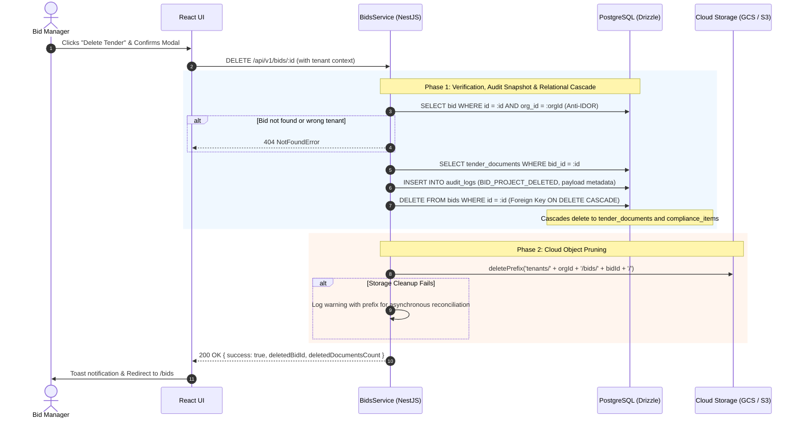

# ADR 0015: Two-Phase Cascade Deletion Across Relational State and Object Storage

## Status

Accepted

## Context

In TenderPulse, a tender bid project (`BidProject`) consists of:
1. Relational data in PostgreSQL: `bids`, child `tender_documents`, child `compliance_items`, and relational metrics.
2. Binary object blobs in Cloud Storage (GCS or AWS S3): original tender notice PDFs, corrigenda, drawings, and annexures located under the tenant-scoped prefix `tenants/{orgId}/bids/{bidId}/`.
3. An immutable audit trail in `audit_logs` tracking project lifecycle actions.

### The Problem

When a user deletes a tender bid project:
1. **Dangling Blobs & Storage Leak**: Deleting only the PostgreSQL row leaves multi-megabyte PDF files permanently abandoned in S3/GCS, accumulating cloud costs indefinitely.
2. **Partial Failure & Inconsistency**: If blob storage deletion happens before the database delete and the database delete fails (or vice versa), the system enters an inconsistent state.
   - If storage is purged first and DB fails $\rightarrow$ DB records point to missing files (HTTP 404 on download/pipeline).
   - If DB is deleted first and storage call fails $\rightarrow$ orphaned files remain in S3/GCS with no database pointer to identify them.
3. **Auditability**: Simply erasing all database records without an audit trail violates procurement compliance and security traceability.
4. **Tenant Isolation (Anti-IDOR)**: The deletion operation must verify that the requesting tenant owns the bid before any destructive action is taken.

## Decision

We implement an explicit **Two-Phase Deletion Flow with Audit Pre-Snapshot**:

### 1. Storage Port Pruning Methods (`IStorageService`)
We add bulk pruning capabilities to the cloud-agnostic storage port:
- `deleteObject(storagePath: string): Promise<void>`
- `deletePrefix(prefix: string): Promise<void>`

Implemented for `GcsStorageService` (`bucket.deleteFiles({ prefix, force: true })`), `AwsS3StorageService` (`ListObjectsV2Command` + `DeleteObjectsCommand`), and `MockStorageService`.

### 2. Deletion Sequence & Invariants

### 3. Rationale for Database First, Storage Second
1. The database transaction is atomic and definitive. Once `bids` is deleted, no user or API request can view, download, or execute AI workflows on the project.
2. Even if the cloud storage API experiences a transient network failure, the user experience is uninterrupted and safe from dangling reference errors.
3. Storage prefixes follow a predictable deterministic structure (`tenants/{orgId}/bids/{bidId}/`), allowing any orphaned storage blobs to be safely cleaned up by background lifecycle rules or S3/GCS bucket expiration policies.

## Consequences

### Positive
- **Zero Storage Leakage**: All uploaded documents, temporary slices, and OCR artifacts under the bid prefix are purged upon project deletion.
- **Audit Compliance**: An immutable audit record preserves the tender number, title, and deleted document manifest before deletion.
- **Tenant Isolation**: Strict `organization_id` matching prevents cross-tenant deletion attacks (Anti-IDOR).
- **Clean Architecture**: `BidsService` communicates through the abstract `IStorageService` port, ensuring identical behavior across GCP, AWS, and local mock testing.

### Trade-offs
- Deletion of cloud storage is asynchronous relative to the database transaction (non-transactional across two disparate storage engines). Handled safely via database-first sequencing with warning logs for reconciliation.
