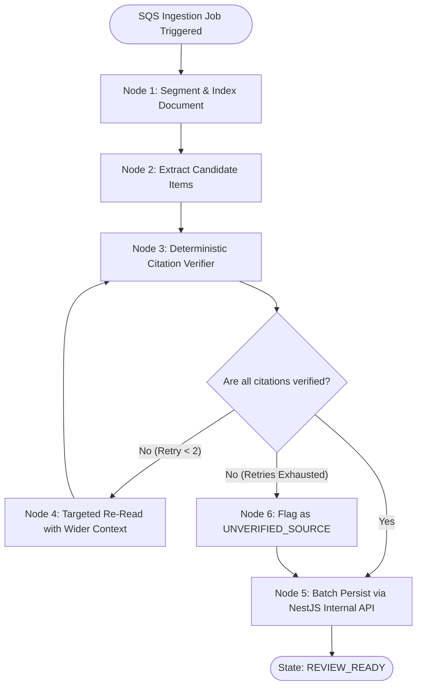

# AI Architecture & Workflow Specification: TenderPulse AI

## 1. Architectural Philosophy & The Core Rule

In TenderPulse AI, our foundational architectural constraint from **AGENTS.md** is:

> **"LLMs must never be the source of truth for critical business state. Deterministic code handles authorization, calculations, validation, and state transitions."**

In government public procurement, a single hallucination (e.g. telling a bidder that a ₹50 stamp paper is sufficient when the tender mandates ₹100) causes immediate disqualification and locks up lakhs of rupees in bid security.

Therefore, our AI engine is designed with **defensive, multi-stage verification**:

- **The AI Engine's Job**: Natural language extraction, unstructured text parsing, semantic classification of requirements, and verbatim quote location.
- **The Deterministic Engine's Job**: Mathematical calculation, string-verification of cited quotes against raw page text, schema validation, optimistic concurrency control, and transactional persistence.

---

## 2. The 4-Stage Evolution of our AI Integration

To understand why our system is designed as a **Stateful LangGraph Workflow**, observe how simpler architectures fail:

```
Stage 1: Raw LLM Call
[User PDF] ──> [Prompt: "Find all annexures"] ──> [LLM] ──> "You need Annexure 1, 2..." (UNSTRUCTURED PROSE, UNPARSABLE)

Stage 2: LLM + Structured Output
[User PDF] ──> [Prompt + JSON Schema] ──> [LLM] ──> { "title": "Affidavit", "stamp_paper": 100 } (STRUCTURED, BUT UNVERIFIED)

Stage 3: Deterministic Pipeline (DAG)
[User PDF] ──> [PyMuPDF Chunks] ──> [LLM Extract] ──> [Validator] ──> (CANNOT RETRY IF CITATION FAILS)

Stage 4: Stateful LangGraph Workflow (OUR ARCHITECTURE)
[User PDF] ──> [Chunk] ──> [LLM Extract] ──> [Deterministic Verifier] ──> [Loop / Refine] ──> [Checkpoint & Persist]
```

---

### Stage 1: The Raw LLM Call (Naive)

- **Mechanism**: Send document text with a natural language prompt.
- **Result**: Markdown prose with conversational fluff.
- **Why it Fails**: Cannot be stored in a relational database, breaks downstream code, and frequently hallucinates clauses.

---

### Stage 2: LLM + Structured Output & Tools

- **Mechanism**: Constrain the model's generation using OpenAI/Anthropic **Tool Calling** or **Structured Outputs** bound to a Pydantic schema.
- **Result**: Clean JSON matching our `ComplianceItem` schema.
- **Why it is Still Insufficient on its Own**: The model can output well-formatted JSON that is completely fabricated (e.g. citing Page 42 for a clause that actually appears on Page 84, or inventing a requirement).

---

### Stage 3: Deterministic Linear Pipeline

- **Mechanism**: Code splits the PDF using PyMuPDF, calls the LLM with structured output, and validates the result.
- **Why it Fails**: A linear pipeline has no feedback loop. If the model cited a wrong page number, the pipeline either crashes or stores unverified data. It cannot pause, recover, or retry selectively.

---

### Stage 4: Stateful LangGraph Workflow (TenderPulse AI Production Engine)

- **Mechanism**: A cyclic state graph with an explicit typed state, a deterministic verification node, automated retry loops, and checkpointing.
- **Result**: No compliance item is committed to PostgreSQL unless a deterministic Python function verifies that the verbatim quote exists on the cited page number.

---

## 3. The LangGraph Compliance Extraction DAG



---

### 3.1 Node-by-Node Specification

#### Node 1: `segment_and_index_node`

- **Execution**: Deterministic Python (PyMuPDF).
- **Responsibility**: Loads the tender PDF from S3. Extracts text per page along with font metadata and bounding coordinates. Detects scanned pages and invokes Tesseract OCR if text density is below threshold.
- **State Mutation**: Populates `state.pages_text: dict[int, str]`.

#### Node 2: `extract_candidates_node`

- **Execution**: LLM call (Claude 3.5 Sonnet / GPT-4o) using **Structured Output**.
- **Responsibility**: Analyzes sections (Eligibility, Annexures, GCC, SCC). Identifies required declarations, stamp paper denominations, and CA certificates.
- **Prompt Guardrail**: Mandatory instruction: _"You MUST provide the exact verbatim quote and the 1-indexed page number for every requirement. If you cannot quote the exact sentence, do NOT extract the item."_
- **State Mutation**: Sets `state.candidate_items: list[CandidateItem]`.

#### Node 3: `deterministic_verifier_node`

- **Execution**: Pure Deterministic Python (Zero LLM inference).
- **Responsibility**: Iterates over every extracted item and runs string matching:
  ```python
  raw_page = state.pages_text[candidate.provenance.page_number]
  is_quote_present = candidate.provenance.verbatim_quote.strip() in raw_page
  ```
  Also checks domain invariants:
  - If `stamp_paper_required == True`, verifies `stamp_paper_denomination_inr > 0`.
- **State Mutation**: Moves verified items to `state.verified_items`; moves failed items to `state.unverified_items`.

#### Node 4: `targeted_refine_node`

- **Execution**: Targeted LLM call with isolated context.
- **Responsibility**: If a quote failed matching (e.g. quote was slightly paraphrased or spans across page boundary), passes pages $P-1, P, P+1$ and instructs model to isolate the exact verbatim substring.
- **State Mutation**: Updates candidate quotes and increments `state.retry_count`.

#### Node 5: `persist_node`

- **Execution**: HTTP Client call to NestJS Internal Gateway.
- **Responsibility**: Calls `POST /internal/v1/bids/:id/compliance-items/batch` with the validated payload and secret key, flipping the bid status to `REVIEW_READY`.

---

## 4. Pydantic Schemas (FastAPI Engine)

These models strictly mirror our TypeScript contracts:

```python
from pydantic import BaseModel, Field
from typing import Optional

class ExecutionRulesSchema(BaseModel):
    stamp_paper_required: bool = Field(description="True if an affidavit or stamp paper is mandatory")
    stamp_paper_denomination_inr: int = Field(default=0, description="Rupee value of stamp paper, e.g. 50, 100, 500")
    notarization_required: bool = Field(description="True if notarization by a notary public or magistrate is required")
    signing_authority_rank: str = Field(default="Authorized Signatory", description="Minimum rank of signatory, e.g. Executive Engineer")
    udin_required: bool = Field(description="True if CA certificate requires ICAI UDIN")

class ProvenanceSchema(BaseModel):
    source_document_id: str
    source_file_name: str
    page_number: int = Field(ge=1, description="1-indexed physical page number in the PDF")
    clause_reference: str = Field(description="Section and clause number, e.g. Section 3, Clause 14.2")
    verbatim_quote: str = Field(min_length=5, description="Exact verbatim text copied directly from the page")
    confidence_score: float = Field(ge=0.0, le=1.0)

class ExtractedComplianceItemSchema(BaseModel):
    category: str = Field(description="ANNEXURE_DECLARATION, FINANCIAL_CRITERIA, TECHNICAL_EXPERIENCE, etc.")
    title: str = Field(description="Short human-friendly title of the requirement")
    description: str = Field(description="Actionable explanation of what contractor must prepare")
    execution_rules: ExecutionRulesSchema
    provenance: ProvenanceSchema

class ExtractionResultBatch(BaseModel):
    items: list[ExtractedComplianceItemSchema]
```

---

## 5. Explicit System Boundaries: AI vs. Deterministic

| Concern                       | Handled by AI (FastAPI + LLM)       | Handled by Deterministic Code (NestJS / Python)  |
| :---------------------------- | :---------------------------------- | :----------------------------------------------- |
| **Reading 300 pages of PDF**  | Parses legalese & isolates clauses  | Extracts raw text & page coordinates (PyMuPDF)   |
| **Extracting requirements**   | Extracts candidate compliance items | Validates items against Pydantic & TS schemas    |
| **Citation accuracy**         | Proposes page number & quote        | **Verifies quote exists in raw page text**       |
| **Turnover & financial math** | Extracts numbers (e.g. ₹4.5 Cr)     | **Calculates shortfall & passes/fails criteria** |
| **State transitions**         | None                                | **Enforces BidStatus & Concurrency Versioning**  |
| **Multi-tenant security**     | None                                | **Enforces TenantGuard & PostgreSQL RLS**        |
