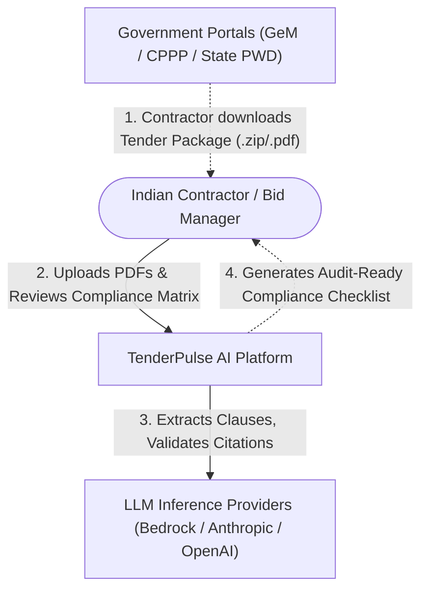
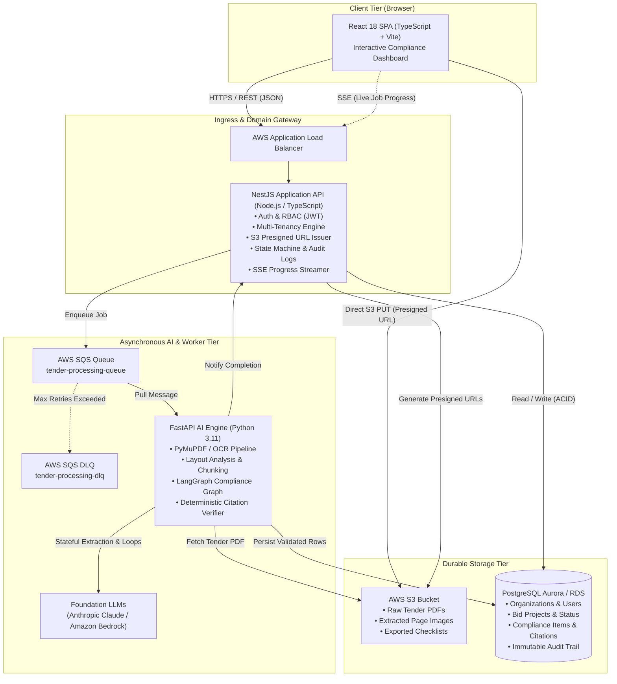
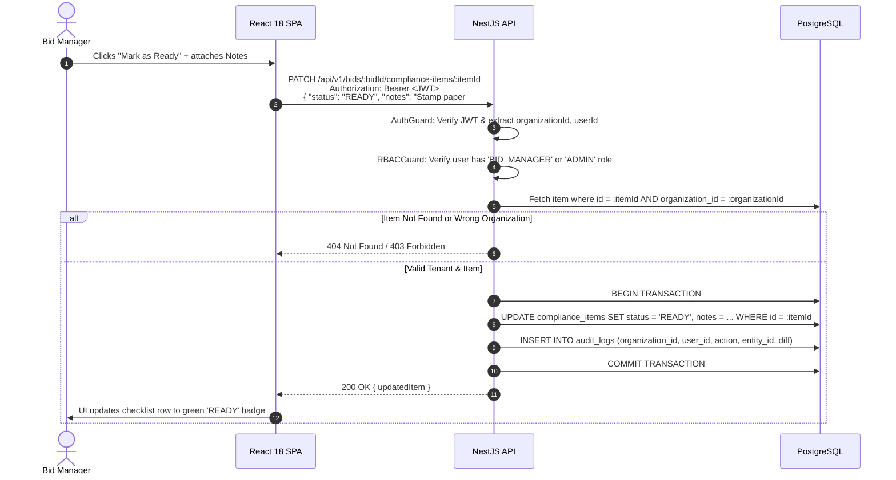
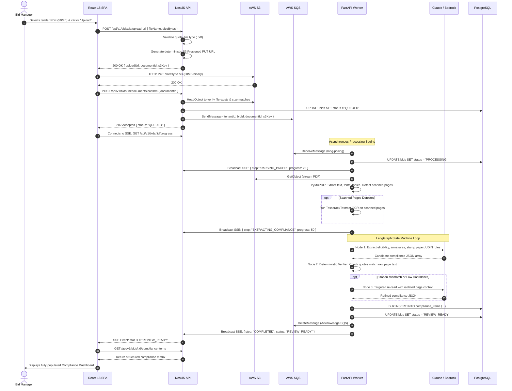

# System Architecture: TenderPulse AI

## 1. Architectural Philosophy: From Business Workflow to System Design

In Phase 1, we established the core business domain: Indian government public procurement is governed by dense 200+ page tenders where a single procedural omission in **Packet 1 (Technical Bid)** leads to immediate disqualification.

To translate this business reality into software architecture, we start from first principles.

### The Naive Architecture (And Why It Fails)

```
[User Browser] ──HTTP POST (50MB PDF)──> [Monolithic Web Server] ──SQL──> [Database]
```

If we built this as a simple 3-tier CRUD application:

1. **HTTP Gateway Timeouts**: A 200-page tender takes 60–180 seconds to extract text, run OCR, and execute LLM reasoning. Standard HTTP reverse proxies (Cloudflare, Nginx, AWS ALB) terminate requests after 30–60 seconds with `504 Gateway Timeout`.
2. **Node.js Event-Loop Starvation & OOM**: Streaming 50MB PDFs and executing heavy PDF layout rendering in Node.js consumes massive memory buffers and blocks the single-threaded event loop, degrading standard user logins and dashboard views.
3. **Ecosystem Mismatch**: Document layout extraction (PyMuPDF, pdfplumber), scanned image pre-processing (OpenCV), and stateful agentic AI graph orchestration (LangGraph) are world-class in **Python**, but immature, wrapper-dependent, or non-existent in Node.js. Conversely, enterprise multi-tenant domain models, compile-time type safety, dependency injection, and audit guards are world-class in **TypeScript (NestJS)**.
4. **Crash Recovery**: If an LLM hits a rate limit or a PDF parser crashes on page 87 of 150, a synchronous request fails completely, wasting all prior computation.

### The Solution: A Decoupled, Asynchronous Two-Tier Architecture

We separate the system into two distinct architectural boundaries:

- **Deterministic Domain Boundary (NestJS + PostgreSQL)**: Transactional source of truth, auth, RBAC, tenant isolation, bid state machine, and audit logs.
- **AI & Document Intelligence Boundary (FastAPI + Python + LangGraph)**: Heavy PDF extraction, OCR, vector chunking, and cyclic compliance extraction state machines running asynchronously behind **AWS SQS**.

---

## 2. Technology Evaluation & Boundary Analysis

We evaluated 12 candidate technologies against the project's engineering rules. Below is the strict justification and boundary analysis for each:

```
┌────────────────────────────────────────────────────────────────────────┐
│                        Technology Evaluation Matrix                    │
├───────────────────┬──────────────┬─────────────────────────────────────┤
│ Technology        │ Status       │ Architectural Role                  │
├───────────────────┼──────────────┼─────────────────────────────────────┤
│ React 18          │ ACCEPTED     │ Web UI, Concurrent Rendering, Table │
│ NestJS            │ ACCEPTED     │ API Gateway, Domain Logic, Auth/RBAC│
│ FastAPI           │ ACCEPTED     │ Python AI & Document Worker Tier    │
│ PostgreSQL        │ ACCEPTED     │ Transactional Source of Truth (ACID)│
│ AWS S3            │ ACCEPTED     │ Durable PDF & Document Blob Storage │
│ AWS SQS + DLQ     │ ACCEPTED     │ Asynchronous Job Queue & Resilience │
│ LangGraph         │ ACCEPTED     │ Stateful Cyclic AI Extraction DAG   │
│ Redis             │ DEFERRED     │ Phase 6/7 for Distributed Locks/Rate│
│ EventBridge       │ DEFERRED     │ Retained for Nightly Cron Schedules │
│ AWS AppSync       │ REJECTED     │ Overkill; Replaced by SSE + Polling │
│ DynamoDB          │ REJECTED     │ Relational Integrity Required       │
│ LangChain Core    │ REJECTED     │ Leaky abstraction; Replaced by Graph│
└───────────────────┴──────────────┴─────────────────────────────────────┘
```

---

### 2.1 React 18 (TypeScript + Vite)

- **Status**: **ACCEPTED**
- **WHY do we need it?**: The daily user (Bid Manager) works with complex, dense, multi-column compliance matrices with 50+ line items, side-by-side PDF previewers, status dropdowns, and live progress indicators.
- **WHAT does it do?**: Provides a reactive, component-based Single Page Application (SPA).
- **HOW will we use it?**: Built with Vite and TypeScript. Renders the interactive Compliance Matrix, the Document Vault, and the side-by-side document citation viewer. Uses native `EventSource` for Server-Sent Events (SSE) to update processing progress in real time.
- **WHY NOT a simpler alternative?**: Server-rendered HTML (e.g. Django templates or NestJS with EJS) lacks the fluid client-side state needed for interactive multi-column checklist editing, modal side-by-side PDF citation viewing, and optimistic UI updates without full-page reloads.
- **WHAT trade-off does it introduce?**: Requires maintaining a separate frontend build pipeline and managing client-side state synchronization.

---

### 2.2 NestJS (TypeScript / Node.js)

- **Status**: **ACCEPTED**
- **WHY do we need it?**: Governs the primary application boundary, multi-tenancy, security, business state machines, and relational data operations.
- **WHAT does it do?**: Enterprise-grade TypeScript framework offering strict modular architecture, Dependency Injection (DI), guards, interceptors, and robust Prisma/TypeORM integration.
- **HOW will we use it?**:
  - Exposes RESTful APIs for the React SPA.
  - Enforces JWT authentication, Organization tenant isolation, and RBAC (`Admin`, `Bid Manager`, `Viewer`).
  - Issues AWS S3 presigned upload URLs (protecting API servers from file bandwidth).
  - Owns the bid state machine (`DRAFT` $\rightarrow$ `QUEUED` $\rightarrow$ `EXTRACTING` $\rightarrow$ `REVIEW_READY` $\rightarrow$ `FINALIZED`).
  - Dispatches extraction jobs to AWS SQS and streams progress via Server-Sent Events (SSE).
- **WHY NOT a simpler alternative (Plain Express / Fastify)?**: Plain Express lacks architectural structure; in team environments, it quickly devolves into spaghetti route handlers without standard validation, dependency injection, or test isolation. NestJS provides strict enterprise patterns out-of-the-box.
- **WHAT trade-off does it introduce?**: Slightly steeper learning curve and boilerplate (modules, controllers, services) compared to minimalist micro-frameworks.

---

### 2.3 FastAPI (Python 3.11+)

- **Status**: **ACCEPTED**
- **WHY do we need it?**: Isolates the heavy document processing and AI intelligence layer inside the rich Python data science ecosystem.
- **WHAT does it do?**: High-performance, asynchronous Python web and worker framework based on Starlette and Pydantic.
- **HOW will we use it?**:
  - Operates as an internal worker service consuming messages from AWS SQS.
  - Ingests PDFs using PyMuPDF and pdfplumber; runs OCR via Tesseract/AWS Textract when scanned pages are detected.
  - Executes LangGraph extraction graphs to extract structured compliance JSON.
  - Exposes internal health and diagnostic endpoints for telemetry.
- **WHY NOT a simpler alternative (Running Python scripts directly via Node `child_process`)?**: Spawning Python subprocesses from Node.js is brittle, fails to maintain long-lived memory models or warm connection pools, has poor error-handling boundaries, and cannot be scaled independently on compute-optimized worker nodes.
- **WHAT trade-off does it introduce?**: Introduces a polyglot architecture (TypeScript + Python) requiring disciplined schema contracts (Pydantic $\leftrightarrow$ TypeScript DTOs).

---

### 2.4 PostgreSQL (AWS RDS / Aurora)

- **Status**: **ACCEPTED**
- **WHY do we need it?**: Serves as the single transactional source of truth for the entire platform.
- **WHAT does it do?**: Relational database providing strict ACID guarantees, foreign key integrity, advanced indexing, and native `JSONB` support.
- **HOW will we use it?**:
  - Stores Organizations, Users, Roles, Audit Logs, Bid Projects, Document Files, and Extracted Compliance Items.
  - Enforces multi-tenancy via foreign keys (`organization_id`) and Row-Level Security (RLS).
  - Uses `JSONB` columns for variable tender metadata (extracted parameters, vendor custom attributes) while maintaining strict relational schemas for foreign keys and compliance item statuses.
- **WHY NOT a simpler alternative (SQLite / MySQL)?**: SQLite cannot handle multi-instance concurrent writes in production cloud environments. PostgreSQL outperforms MySQL in complex joins, JSONB indexing, and advanced concurrency controls (e.g., `FOR UPDATE SKIP LOCKED`).
- **WHAT trade-off does it introduce?**: Requires operational management of connection pooling (PgBouncer) and regular index optimization.

---

### 2.5 AWS S3 (Simple Storage Service)

- **Status**: **ACCEPTED**
- **WHY do we need it?**: Government tenders and contractor evidence repositories consist of large binary PDFs (10MB to 100MB+). Databases and application containers are not designed for large blob storage.
- **WHAT does it do?**: Highly durable (99.999999999%), scalable, encrypted object storage.
- **HOW will we use it?**:
  - Raw uploaded tenders: `s3://tenderpulse-vault/tenants/{tenantId}/bids/{bidId}/raw/{docId}.pdf`
  - Extracted page images / snippets: `.../derived/pages/{pageNumber}.png`
  - Exported compliance packs: `.../exports/{exportId}.xlsx`
  - Client uploads files directly to S3 using **S3 Presigned PUT URLs** generated by NestJS, completely bypassing the API server for file bandwidth.
- **WHY NOT a simpler alternative (Local disk on application server)?**: Container file systems are ephemeral (lost on restart or horizontal autoscale) and cannot be shared across multiple web or worker instances.
- **WHAT trade-off does it introduce?**: Requires handling asynchronous upload confirmation handshakes between browser, S3, and API.

---

### 2.6 AWS SQS (Simple Queue Service) + Dead Letter Queue (DLQ)

- **Status**: **ACCEPTED**
- **WHY do we need it?**: Decouples the synchronous web API from long-running (60–180s) document parsing and AI workflows, ensuring zero dropped jobs under traffic spikes.
- **WHAT does it do?**: Fully managed, distributed message queue with automatic retry policies, visibility timeouts, and poison-pill isolation.
- **HOW will we use it?**:
  - When a tender upload is confirmed, NestJS enqueues `{ tenantId, bidId, documentId }` to `tender-processing-queue`.
  - FastAPI workers pull messages, process them, and acknowledge (delete) upon completion.
  - If a worker crashes or an LLM call fails, the visibility timeout expires, and another worker retries. After 3 failed attempts, the message moves to `tender-processing-dlq` for alerting.
- **WHY NOT a simpler alternative (Synchronous HTTP or In-Memory Node Queue)?**: Synchronous HTTP times out. In-memory queues (like in-process EventEmitter) drop all pending jobs if the server restarts or crashes.
- **WHAT trade-off does it introduce?**: Requires worker polling logic and asynchronous state tracking.

---

### 2.7 LangGraph (Stateful AI Workflow Engine)

- **Status**: **ACCEPTED**
- **WHY do we need it?**: Government tender compliance extraction is an iterative, multi-stage reasoning task with strict verification requirements. It cannot be solved reliably with a single linear prompt.
- **WHAT does it do?**: An agentic state graph library that manages state machines, cyclic workflows, and checkpointing for LLMs.
- **HOW will we use it?**:
  - Defines an explicit, typed state graph:
    1. **Node 1 (Segment & Index)**: Breaks document into logical blocks.
    2. **Node 2 (Extract Candidates)**: LLM extracts required annexures, stamp paper values, and turnover numbers.
    3. **Node 3 (Deterministic Verifier)**: Verifies that every extracted clause exists on the cited page number in the raw text and validates math.
    4. **Node 4 (Conditional Refinement)**: If citation verification fails or confidence is low, routes back to a targeted re-read node before committing.
    5. **Node 5 (Format & Persist)**: Emits validated Pydantic JSON schemas.
- **WHY NOT a simpler alternative (Single LLM prompt / Generic LangChain)?**: Single-shot prompts hallucinate clauses and fail to cite exact page numbers. Generic LangChain linear chains cannot handle cyclic validation or state rollbacks.
- **WHAT trade-off does it introduce?**: Adds framework learning overhead and requires careful state design.

---

### 2.8 Redis

- **Status**: **DEFERRED (Phase 6/7)**
- **WHY NOT now?**:
  - For caching: Read volume on compliance items during MVP is small (tens of queries per hour per active user). PostgreSQL indexes handle this effortlessly.
  - For sessions: We use stateless JWT tokens; no session lookups are needed.
  - For queues: AWS SQS handles durable message queues without the operational burden of managing Redis persistence, failover, or memory sizing.
- **WHEN will we need it?**: In Phase 6/7, for distributed rate-limiting across scaled API gateways and distributed locks (`Redlock`) to prevent concurrent edits to identical tender versions.

---

### 2.9 AWS EventBridge

- **Status**: **DEFERRED / RESTRICTED (Phase 7/11)**
- **WHY NOT for the Core Queue?**: For internal point-to-point worker queues, SQS pull semantics with visibility timeouts and DLQ are simpler, more reliable, and cheaper than EventBridge event buses.
- **WHEN will we use it?**: Strictly for **scheduled cron events** (e.g., nightly job scanning for expiring vendor documents or tender submission deadlines via EventBridge Scheduler).

---

### 2.10 AWS DynamoDB

- **Status**: **REJECTED**
- **WHY is it rejected?**:
  - Public procurement compliance is deeply **relational**: Tenants $\rightarrow$ Users $\rightarrow$ Bid Projects $\rightarrow$ Documents $\rightarrow$ Compliance Items $\rightarrow$ Audit Logs $\rightarrow$ Evidence Files.
  - DynamoDB requires upfront knowledge of all access patterns and forces complex single-table design without foreign key integrity. A small change in how bid managers want to filter compliance items (by status, stamp paper, assignee, or category) requires expensive table scans or proliferating GSIs.
  - PostgreSQL delivers ACID transactions, relational foreign keys, rich queries, and native `JSONB` for unstructured fields.

---

### 2.11 AWS AppSync / WebSockets

- **Status**: **REJECTED (Replaced by Server-Sent Events - SSE + Smart Polling)**
- **WHY is it rejected?**:
  - AWS AppSync introduces heavy GraphQL schemas, VTL/JS resolvers, and expensive managed WebSocket connection fees.
  - The application only requires **one-way server-to-client progress updates** (e.g., job progress: 20% $\rightarrow$ 60% $\rightarrow$ 100%).
  - NestJS provides native **Server-Sent Events (SSE)** over standard HTTP/2, requiring zero external cloud infrastructure. A smart polling fallback (`GET /api/v1/bids/:id/status`) ensures 100% reliability even behind enterprise corporate firewalls.

---

### 2.12 LangChain Core (Linear Chains)

- **Status**: **REJECTED**
- **WHY is it rejected?**:
  - Linear chains (`LLMChain`, `SimpleSequentialChain`) cannot model the cyclic validation loops required to prevent hallucinations in government compliance.
  - LangChain has accumulated extensive leaky abstractions and breaking updates. We use **LangGraph** with direct provider SDKs (OpenAI / Anthropic / Amazon Bedrock) for explicit, debuggable state graphs.

---

## 3. High-Level Architecture Diagrams

### 3.1 System Context Diagram (C4 Level 1)



---

### 3.2 Container Architecture Diagram (C4 Level 2)



---

## 4. End-to-End Workflows

### 4.1 Synchronous Request Walkthrough: Review & Update Compliance Item

_Scenario: A Bid Manager reviews the "Affidavit of Non-Blacklisting" item, confirms the ₹100 stamp paper has been purchased, and marks the item `READY`._



---

### 4.2 Asynchronous Workflow Walkthrough: Ingestion to Compliance Matrix

_Scenario: User uploads a 150-page Indian government tender PDF package._



---

## 5. Failure Scenarios & Resilience Matrix

| Failure Mode                     | Root Cause                                       | Impact                        | Architectural Defense & Recovery                                                                                                                                                                                                                                                                                               |
| :------------------------------- | :----------------------------------------------- | :---------------------------- | :----------------------------------------------------------------------------------------------------------------------------------------------------------------------------------------------------------------------------------------------------------------------------------------------------------------------------- |
| **Direct S3 Upload Drops**       | Unstable client network during 50MB upload.      | Incomplete file in S3.        | Browser retries chunked upload. API never queues job until `POST .../documents/confirm` passes `s3.headObject()` check. Unconfirmed S3 blobs are cleaned up via S3 Lifecycle rule after 24h.                                                                                                                                   |
| **Worker Crashes Mid-Job**       | Out-of-memory or container kill at page 85.      | Job interrupted.              | SQS visibility timeout (e.g., 5 min) expires without `DeleteMessage`. SQS re-delivers message to an alternate worker. LangGraph resumes from last checkpoint or restarts cleanly.                                                                                                                                              |
| **LLM 429 Rate Limit / Outage**  | Provider quota limit exceeded during peak hours. | Transient extraction failure. | LangGraph nodes use tenacity exponential backoff with jitter (1s $\rightarrow$ 2s $\rightarrow$ 4s $\rightarrow$ 8s). If persistent, message stays in SQS for automatic queue-level retry.                                                                                                                                     |
| **Hallucinated Clause Citation** | LLM invents an annexure or wrong page number.    | Erroneous compliance item.    | **Deterministic Verifier Node**: The Python worker programmatically checks if `verbatim_quote` exists as an exact or fuzzy substring on `page_number` in the raw PyMuPDF page text. If citation validation fails, the item is flagged as `UNVERIFIED_SOURCE` and routed for re-read or marked for explicit human confirmation. |
| **Poison-Pill PDF**              | Corrupted PDF header or decompression bomb.      | Worker crash loop.            | PDF is pre-validated with PyMuPDF header check. If unparseable after 3 SQS delivery attempts, message is routed to `tender-processing-dlq`. Bid status updates to `FAILED` with actionable error message: _"Uploaded PDF is corrupted or password-protected"_.                                                                 |

---

## 6. Multi-Tenancy & Data Security

1. **Logical Tenant Isolation**:
   Every database query in NestJS enforces `WHERE organization_id = :currentOrgId`. We will evaluate and implement PostgreSQL **Row-Level Security (RLS)** in Phase 4 for defense-in-depth against application-level authorization bugs.
2. **S3 Object Key Isolation**:
   All S3 keys are strictly partitioned by tenant: `tenants/{organizationId}/bids/{bidId}/...`. Presigned URLs are scoped to exact paths with 15-minute expiration.
3. **No Private Key Custody**:
   The system **never** handles or stores client Class-3 DSC cryptographic private keys.
4. **Data Privacy with LLMs**:
   All LLM API calls explicitly use enterprise endpoints (e.g., AWS Bedrock or zero-data-retention enterprise agreements) ensuring that proprietary contractor tenders and documents are never used for model training.
