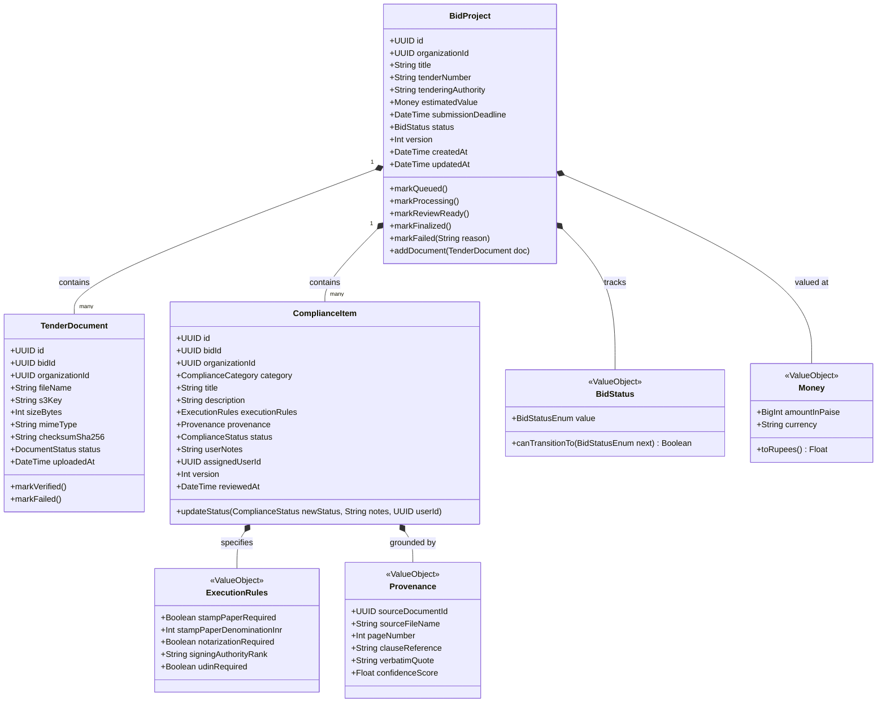
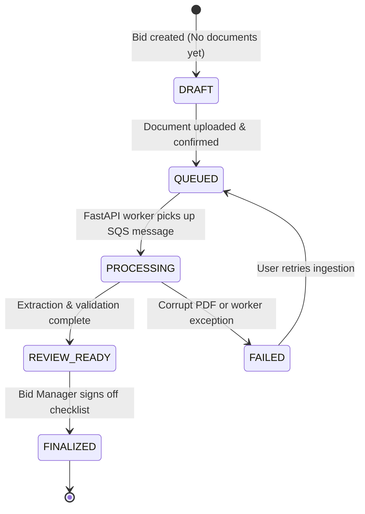
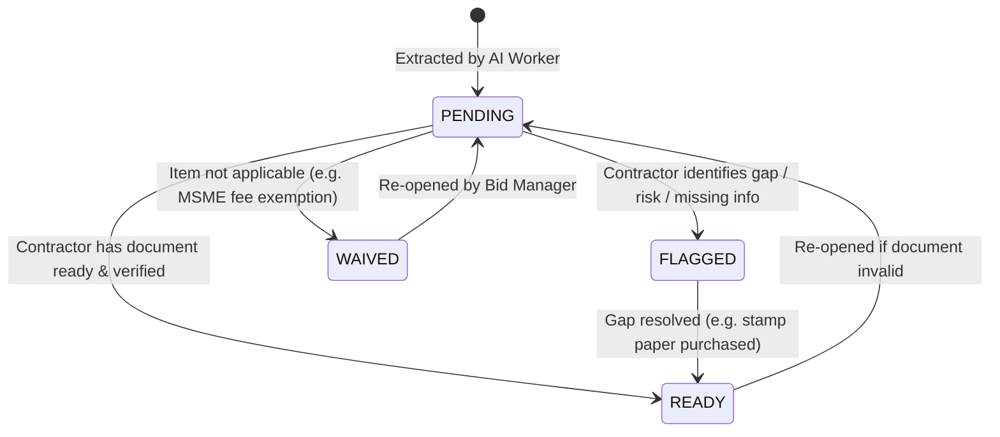
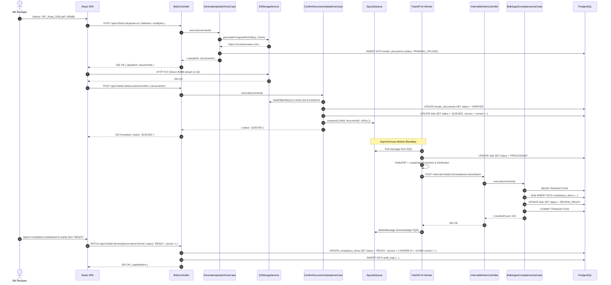
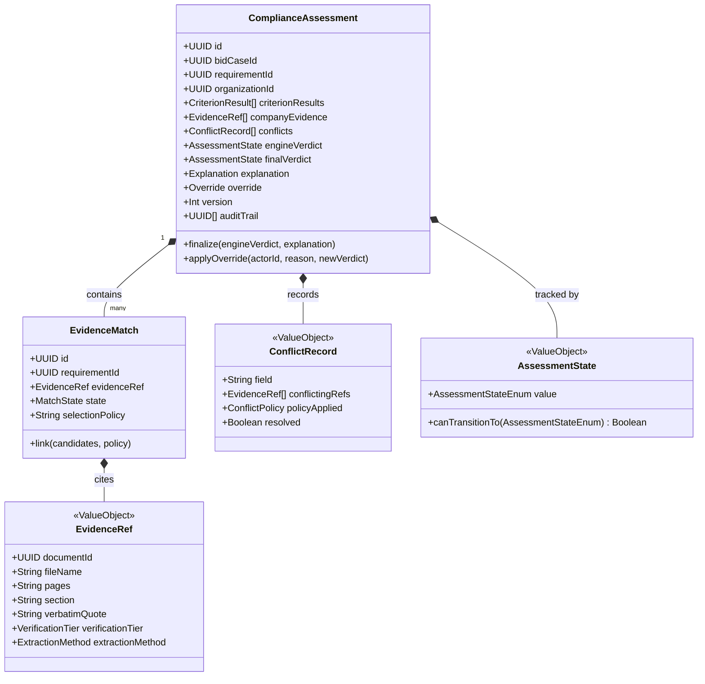
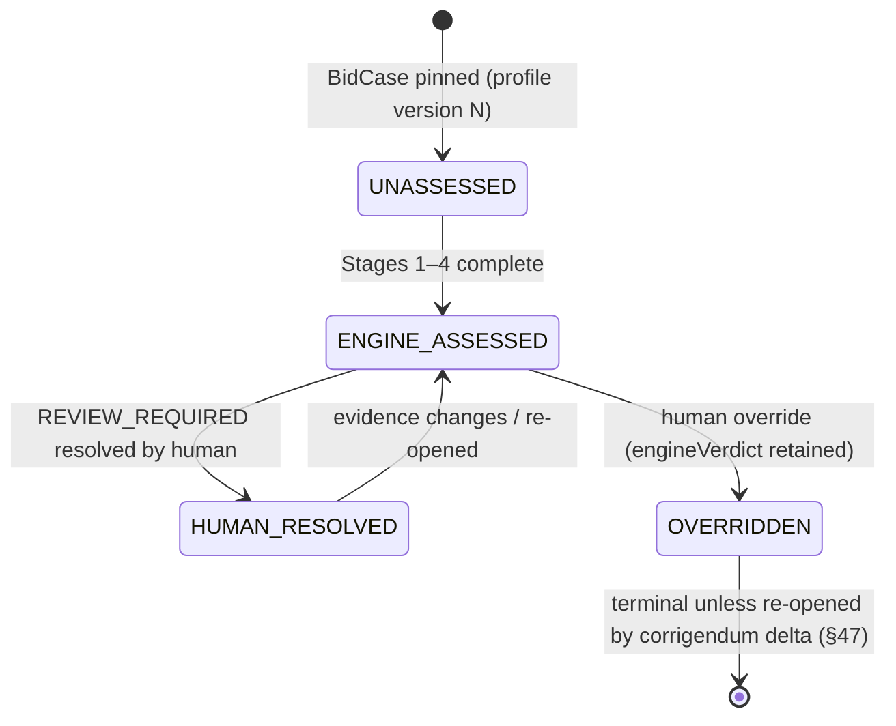
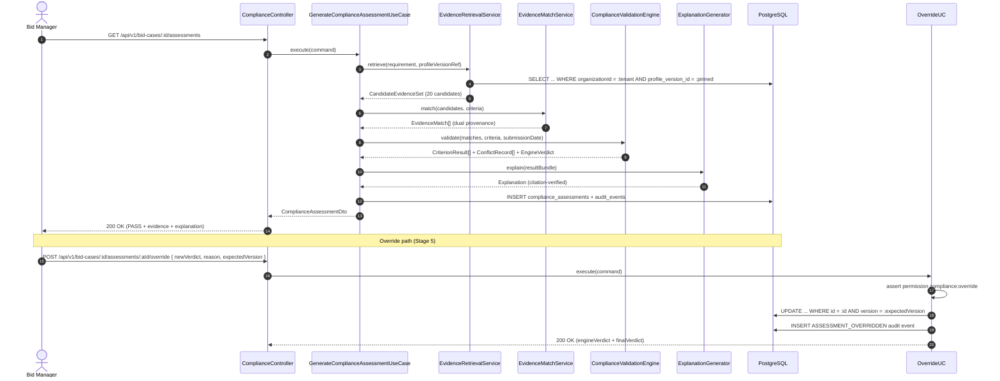

# Low-Level Design (LLD): Tender Ingestion & Bid Compliance Management

## 1. Scope & Objective

This document translates the High-Level Design (HLD) into concrete, production-grade code architecture for the platform's first core workflow: **Tender Ingestion, Asynchronous Processing Dispatch, and Bid Compliance Management**.

### Covered Workflows:

1. **Bid Project Creation & Metadata Registration** (`POST /api/v1/bids`)
2. **Direct-to-S3 Upload Handshake & Verification** (`POST /api/v1/bids/:id/upload-url` and `POST /api/v1/bids/:id/documents/confirm`)
3. **Asynchronous Job Enqueueing** (Dispatching validated documents to AWS SQS)
4. **Internal Worker Compliance Item Ingestion** (`POST /internal/v1/bids/:id/compliance-items/batch`)
5. **Interactive Compliance Review & Audit Trail** (`GET /api/v1/bids/:id/compliance-items` and `PATCH /api/v1/bids/:id/compliance-items/:itemId`)

---

## 2. Package & Directory Structure (Modular Monolith)

Following **ADR 0008 (Domain-Driven Layered Architecture)**, the NestJS application is organized into cohesive modules where domain logic is strictly decoupled from framework and database details:

```
apps/api/src/
├── app.module.ts
├── common/
│   ├── decorators/          # @CurrentUser(), @TenantId()
│   ├── guards/              # JwtAuthGuard, RolesGuard, TenantGuard
│   ├── filters/             # HttpExceptionFilter, DomainExceptionFilter
│   └── interceptors/        # LoggingInterceptor, AuditInterceptor
└── modules/
    ├── bids/
    │   ├── bids.module.ts
    │   ├── domain/
    │   │   ├── entities/            # BidProject.entity.ts, TenderDocument.entity.ts
    │   │   ├── value-objects/       # BidStatus.vo.ts, Money.vo.ts
    │   │   ├── exceptions/          # BidDomainExceptions.ts
    │   │   └── repositories/        # IBidRepository.ts, ITenderDocumentRepository.ts
    │   ├── application/
    │   │   ├── use-cases/           # CreateBid.usecase.ts, ConfirmDocumentUpload.usecase.ts
    │   │   ├── commands/            # CreateBidCommand.ts, ConfirmDocumentUploadCommand.ts
    │   │   └── queries/             # GetBidByIdQuery.ts
    │   ├── infrastructure/
    │   │   ├── persistence/         # PrismaBidRepository.ts, PrismaTenderDocumentRepository.ts
    │   │   ├── storage/             # S3StorageService.ts (implements IStorageService)
    │   │   └── queue/               # SqsJobQueue.ts (implements IJobQueue)
    │   └── presentation/
    │       ├── controllers/         # BidsController.ts, DocumentsController.ts
    │       └── dto/                 # CreateBidDto.ts, GenerateUploadUrlDto.ts, ConfirmUploadDto.ts
    ├── compliance/
    │   ├── compliance.module.ts
    │   ├── domain/
    │   │   ├── entities/            # ComplianceItem.entity.ts
    │   │   ├── value-objects/       # ComplianceStatus.vo.ts, Provenance.vo.ts, ExecutionRules.vo.ts
    │   │   └── repositories/        # IComplianceItemRepository.ts
    │   ├── application/
    │   │   ├── use-cases/           # ReviewComplianceItem.usecase.ts, BulkIngestCompliance.usecase.ts
    │   │   └── queries/             # ListComplianceItemsQuery.ts
    │   ├── infrastructure/
    │   │   └── persistence/         # PrismaComplianceItemRepository.ts
    │   └── presentation/
    │       ├── controllers/         # ComplianceController.ts, InternalWorkerController.ts
    │       └── dto/                 # UpdateComplianceItemDto.ts, BulkIngestComplianceDto.ts
    └── audit/
        ├── audit.module.ts
        ├── domain/                  # AuditLog.entity.ts, IAuditRepository.ts
        └── infrastructure/          # PrismaAuditRepository.ts, AuditLoggerService.ts
```

---

## 3. Domain Model: Entities & Value Objects



---

## 4. State Machines & Invariant Transitions

### 4.1 Bid Project State Machine (`BidStatus`)

Governs the lifecycle of a tender bid project.



#### Valid Transition Matrix:

| Current State  | Permitted Next States    | Guard Invariant                                                         |
| :------------- | :----------------------- | :---------------------------------------------------------------------- |
| `DRAFT`        | `QUEUED`                 | Requires at least one verified `TenderDocument`.                        |
| `QUEUED`       | `PROCESSING`, `FAILED`   | Triggered exclusively by the extraction worker.                         |
| `PROCESSING`   | `REVIEW_READY`, `FAILED` | Transition to `REVIEW_READY` requires $\ge 1$ verified compliance item. |
| `FAILED`       | `QUEUED`                 | Manual retry triggered by user; re-enqueues SQS job.                    |
| `REVIEW_READY` | `FINALIZED`              | Requires zero items in `FLAGGED` status without user notes.             |
| `FINALIZED`    | _(None - Terminal)_      | Immutable archive state. Any mutation rejected.                         |

---

### 4.2 Compliance Item State Machine (`ComplianceStatus`)

Governs the human-in-the-loop review workflow for each extracted requirement.



---

## 5. Detailed Component Specifications

### 5.1 `BidProject` (Aggregate Root)

- **RESPONSIBILITY**: Maintains the lifecycle, metadata, document collection, and state transitions for a tender bid. Protects business invariants (e.g., cannot queue without documents, cannot mutate after finalization).
- **DEPENDENCIES**: `BidStatus`, `Money`, `TenderDocument`, `DomainException`.
- **INPUT**: Title, tendering authority, estimated value, submission deadline, organization ID.
- **OUTPUT**: Validated entity instance; raises domain events on state transitions.
- **FAILURE CASES**:
  - `InvalidStateTransitionException`: Attempting to transition from `DRAFT` directly to `FINALIZED`.
  - `EmptyDocumentCollectionException`: Attempting to transition to `QUEUED` without uploaded files.
- **WHY IT EXISTS**: Without an aggregate root, bid state can be mutated arbitrarily from any controller or background job, causing inconsistent data.

---

### 5.2 `Provenance` (Value Object)

- **RESPONSIBILITY**: Encapsulates the immutable source citation for every extracted compliance requirement (file name, page number, clause reference, verbatim quote, confidence score).
- **DEPENDENCIES**: None (Pure TypeScript).
- **INPUT**: `sourceDocumentId`, `sourceFileName`, `pageNumber`, `clauseReference`, `verbatimQuote`, `confidenceScore`.
- **OUTPUT**: Frozen, immutable Value Object.
- **FAILURE CASES**:
  - `InvalidProvenanceException`: Page number $< 1$, empty verbatim quote, or confidence score outside $[0.0, 1.0]$.
- **WHY IT EXISTS**: Adheres to **ADR 0010**. Prevents ungrounded or hallucinated compliance claims. Ensures every item displayed to the user has verifiable provenance.

---

### 5.3 `GenerateUploadUrlUseCase` (Application Service)

- **RESPONSIBILITY**: Validates upload intent, verifies tenant file quota, creates a pending `TenderDocument` record, and issues an S3 Presigned PUT URL.
- **DEPENDENCIES**: `IBidRepository`, `ITenderDocumentRepository`, `IStorageService`, `ITenantQuotaService`.
- **INPUT**: `GenerateUploadUrlCommand { organizationId, bidId, fileName, sizeBytes, mimeType }`.
- **OUTPUT**: `{ uploadUrl: string, documentId: string, s3Key: string, expiresInSeconds: number }`.
- **FAILURE CASES**:
  - `BidNotFoundException`: Invalid bid ID or tenant mismatch.
  - `UnsupportedFileTypeException`: File extension is not `.pdf` or MIME type is invalid.
  - `QuotaExceededException`: Organization has exceeded monthly storage limit.
- **WHY IT EXISTS**: Enables direct-to-S3 uploads (**ADR 0005**), protecting the API server from receiving heavy 50MB PDF binaries.

---

### 5.4 `ConfirmDocumentUploadUseCase` (Application Service)

- **RESPONSIBILITY**: Verifies that the client actually uploaded the file to S3, updates the document status to `VERIFIED`, transitions the bid to `QUEUED`, and dispatches the SQS ingestion job.
- **DEPENDENCIES**: `IBidRepository`, `ITenderDocumentRepository`, `IStorageService`, `IJobQueue`, `IAuditLogger`.
- **INPUT**: `ConfirmDocumentUploadCommand { organizationId, bidId, documentId }`.
- **OUTPUT**: `{ status: "QUEUED", bidId: string, documentId: string }`.
- **FAILURE CASES**:
  - `FileNotFoundInStorageException`: S3 `HeadObject` returns 404 (client called confirm without uploading).
  - `FileChecksumMismatchException`: Uploaded file size does not match declared size.
- **WHY IT EXISTS**: Bridges the client S3 upload with the background processing pipeline. Ensures no SQS jobs are dispatched for nonexistent or incomplete files.

---

### 5.5 `SqsJobQueue` (Infrastructure Adapter)

- **RESPONSIBILITY**: Publishes serialized job payloads to AWS SQS with message deduplication and error handling.
- **DEPENDENCIES**: AWS SDK (`@aws-sdk/client-sqs`). Implements `IJobQueue`.
- **INPUT**: `IngestionJobPayload { organizationId, bidId, documentId, s3Key, timestamp }`.
- **OUTPUT**: `Promise<void>` (resolves on successful `SendMessageCommand`).
- **FAILURE CASES**:
  - `QueuePublishException`: AWS credentials invalid, queue offline, or payload size exceeds 256KB.
- **WHY IT EXISTS**: Isolates the AWS SQS SDK behind an interface (`IJobQueue`), allowing local development with in-memory or mock queues without changing application logic.

---

### 5.6 `BulkIngestComplianceUseCase` (Application Service)

- **RESPONSIBILITY**: Receives extracted compliance items from the internal FastAPI AI worker, validates each item against domain schemas, and writes them to PostgreSQL in an atomic batch.
- **DEPENDENCIES**: `IBidRepository`, `IComplianceItemRepository`, `IAuditLogger`.
- **INPUT**: `BulkIngestComplianceCommand { bidId, items: Array<ExtractedItemDto> }`.
- **OUTPUT**: `{ insertedCount: number, bidStatus: "REVIEW_READY" }`.
- **FAILURE CASES**:
  - `BidNotFoundException`: Bid does not exist.
  - `InvalidItemSchemaException`: An item has invalid execution rules or ungrounded provenance.
- **WHY IT EXISTS**: Provides a secure internal API boundary (`/internal/v1/...`) for the Python AI engine to store validated extraction results.

---

### 5.7 `ReviewComplianceItemUseCase` (Application Service)

- **RESPONSIBILITY**: Updates the review status (`READY`, `FLAGGED`, `WAIVED`), notes, and assigned user for an extracted requirement. Enforces optimistic concurrency control and records an audit log.
- **DEPENDENCIES**: `IComplianceItemRepository`, `IAuditLogger`.
- **INPUT**: `ReviewComplianceItemCommand { organizationId, bidId, itemId, status, notes, assignedUserId, expectedVersion }`.
- **OUTPUT**: `ComplianceItemDto`.
- **FAILURE CASES**:
  - `ItemNotFoundException`: Item does not belong to the organization.
  - `ConcurrencyConflictException`: `expectedVersion` does not match database version (HTTP 409).
- **WHY IT EXISTS**: Core interactive workflow where the Bid Manager audits requirements, attaches notes (e.g. _"₹100 stamp paper bought"_), and marks items ready.

---

## 6. Sequence Diagram: Core Ingestion & Review Workflow



---

## 7. Simple Implementation vs. Proposed Design: The Engineering Trade-off

To understand why this architecture is engineered this way, let's contrast it with a naive implementation:

| Architectural Concern             | Naive / Simple Implementation                                                          | Proposed Production Design                                                                | Why the Naive Fails in Production                                                                        |
| :-------------------------------- | :------------------------------------------------------------------------------------- | :---------------------------------------------------------------------------------------- | :------------------------------------------------------------------------------------------------------- |
| **File Upload Handling**          | Browser streams multipart file to NestJS controller; NestJS pipes to local disk or S3. | Browser requests presigned URL; uploads directly to S3. NestJS verifies via `headObject`. | 50MB uploads choke the Node.js event loop, exhaust server memory, and hit 30s gateway timeout caps.      |
| **State Transitions**             | Direct SQL: `UPDATE bids SET status = req.body.status`.                                | Domain State Machine (`BidStatus` VO) with invariant checks before persistence.           | Nothing stops bugs from jumping an unparsed bid directly from `DRAFT` to `FINALIZED`.                    |
| **Concurrency & Race Conditions** | Last-write-wins: naive `UPDATE compliance_items SET status = ...`.                     | Optimistic Concurrency Control (`version` column).                                        | If user updates notes while worker completes extraction, user edits overwrite worker data or vice versa. |
| **Source Provenance**             | Loose string fields in database: `source_page: 12`.                                    | Immutable `Provenance` Value Object with page coordinates, clause, and verbatim quote.    | Hallucinated clauses with missing quotes slip into the database, destroying trust.                       |
| **Queue Decoupling**              | Node.js spawns Python script via `child_process.exec()`.                               | Decoupled AWS SQS message queue with visibility timeouts and DLQ.                         | Node child processes crash silently on high memory, have zero retries, and cannot be distributed.        |

---

## 8. Design Patterns Used & Explicitly Justified

In line with our engineering rules (_"Do not introduce design patterns unless they solve a concrete problem"_):

1. **Repository Pattern (`IBidRepository`)**:
   - _Problem Solved_: Decouples domain logic from Prisma ORM. Enables writing pure in-memory unit tests that run in 5ms without starting a PostgreSQL Docker container.
2. **Value Object Pattern (`Provenance`, `Money`, `ExecutionRules`)**:
   - _Problem Solved_: Replaces primitive obsession. Encapsulates business validation rules inside the constructor, ensuring an invalid citation or negative currency amount cannot physically exist in the system.
3. **State Pattern / Transition Matrix (`BidStatus`)**:
   - _Problem Solved_: Eliminates scattered, error-prone `if/else` checks across multiple controllers and services.
4. **Optimistic Offline Lock Pattern (`version` column)**:
   - _Problem Solved_: Prevents lost updates when background workers and web users mutate the same bid aggregate concurrently.

### Patterns Explicitly Rejected:

- **No Event Sourcing**: Full event sourcing (saving every state diff as an immutable event stream) adds massive schema migration complexity. A relational model with a dedicated `audit_logs` table provides identical auditability with 10x less complexity.
- **No Complex CQRS with Separate Read Databases**: A single PostgreSQL instance with optimized indexes and views easily handles our read and write volume. Adding read-replica syncing or separate read models in Phase 1–3 is premature.

---

## 9. Evidence & Compliance Engine (PROMPT 7 — Design Only)

Translates `docs/DOMAIN.md` Part F (§49–60) and ADR 0021 into component architecture. Answers *"For this tender requirement, what evidence does the company have?"* — every assessment carrying tender-side and company-side provenance. Never a bare percentage.

### 9.1 Package Structure Additions (`modules/compliance`)

```
modules/compliance/
├── domain/
│   ├── entities/
│   │   ├── ComplianceItem.entity.ts          # exists today → becomes TenderRequirement (extraction side)
│   │   ├── EvidenceMatch.entity.ts           # NEW: requirement ↔ evidence link (dual-sided provenance)
│   │   └── ComplianceAssessment.entity.ts    # NEW: per-requirement assessment record
│   ├── value-objects/
│   │   ├── AssessmentState.vo.ts             # NEW: PASS | FAIL | MISSING_EVIDENCE | REVIEW_REQUIRED
│   │   ├── EvidenceRef.vo.ts                 # NEW: company-side citation (doc, pages, section, quote, tier)
│   │   └── ConflictRecord.vo.ts              # NEW: value collision + resolution policy outcome
│   ├── services/                             # pure, framework-free (ADR 0019)
│   │   ├── EvidenceRetrievalService.ts       # Stage 1: candidate selection (recall)
│   │   ├── EvidenceMatchService.ts           # Stage 2: deterministic linking
│   │   └── ComplianceValidationEngine.ts     # Stage 3: evaluators + expiry/tier/conflict policy
│   └── repositories/
│       ├── IEvidenceMatchRepository.ts
│       └── IComplianceAssessmentRepository.ts
├── application/
│   ├── use-cases/
│   │   ├── GenerateComplianceAssessment.usecase.ts   # orchestrates stages 1–4, persists Stage-5 record
│   │   └── OverrideAssessment.use-case.ts            # human override (OCC + permission + reason)
│   └── ports/
│       └── IExplanationGenerator.ts          # AI explanation port (implemented in infrastructure/ai)
└── infrastructure/
    ├── persistence/                          # Drizzle repositories (tenant-scoped)
    └── ai/ExplanationGenerator.ts            # IExplanationGenerator adapter (FastAPI AI engine)
```

### 9.2 Domain Model Additions



### 9.3 ComplianceAssessment State Machine



| Current State | Permitted Next States | Guard Invariant |
|:--------------|:----------------------|:----------------|
| `UNASSESSED` | `ENGINE_ASSESSED` | Requires completed validation result with ≥1 criterion result; assessment impossible without evidence evaluation |
| `ENGINE_ASSESSED` | `HUMAN_RESOLVED`, `OVERRIDDEN` | Override requires `compliance:override` permission + non-empty reason + matching `expectedVersion` |
| `HUMAN_RESOLVED` | `ENGINE_ASSESSED` | Re-opened only by evidence mutation or corrigendum delta — never by silent status change |
| `OVERRIDDEN` | _(None — terminal)_ | `engineVerdict` immutable; both verdicts always retrievable |

### 9.4 Component Specifications

**9.4.1 `EvidenceRetrievalService` (Domain Service — Stage 1)**

- **RESPONSIBILITY**: Selects candidate company evidence for a requirement from the **pinned profile version**. Over-retrieves (top-K = 20); never judges.
- **DEPENDENCIES**: `ICompanyProfileRepository` (read, version-pinned), `IEvidenceSearchPort` (full-text + ANN, tenant-filtered).
- **INPUT**: `TenderRequirement` (criteria, requiredDocumentKinds, minimumVerificationTier), `ProfileVersionRef`.
- **OUTPUT**: `CandidateEvidenceSet { candidates: EvidenceRef[], retrievalMethod, queryId }`.
- **FAILURE CASES**: Empty/error retrieval → `MISSING_EVIDENCE` with reason `RETRIEVAL_EMPTY` — never PASS.
- **WHY IT EXISTS**: Recall is measured independently of precision; tenant isolation is enforced at the repository port before any ranking.

**9.4.2 `EvidenceMatchService` (Domain Service — Stage 2)**

- **RESPONSIBILITY**: Deterministically links candidates to the requirement; computes MatchState (Part E §43); applies cross-document dedup (by certificate/work-order number) and best-selection policy.
- **DEPENDENCIES**: `EvidenceRef`, `MatchState`, criterion predicates.
- **INPUT**: `CandidateEvidenceSet`, `TenderRequirement.criteria`.
- **OUTPUT**: `EvidenceMatch[]` with dual-sided provenance (tender anchors §28 + company EvidenceRef).
- **FAILURE CASES**: None — total function; unmatched criteria yield `MatchState = MISSING`.
- **WHY IT EXISTS**: Separates *finding* from *deciding*; many-to-many evidence linking keeps every supporting document auditable.

**9.4.3 `ComplianceValidationEngine` (Pure Domain Service — Stage 3)**

- **RESPONSIBILITY**: Runs Part E §42 evaluators plus the three domain policies: expiry (at submission date), tier sufficiency, conflict resolution (tier → recency → source authority → UNRESOLVED).
- **DEPENDENCIES**: None (pure functions; evaluation date is a parameter).
- **INPUT**: `EvidenceMatch[]`, `criteria`, `evaluationDate`.
- **OUTPUT**: `CriterionResult[]`, `ConflictRecord[]`, `EngineVerdict`.
- **FAILURE CASES**: Total — every input maps to a state; never throws (property-tested).
- **WHY IT EXISTS**: The only stage permitted to produce a verdict (ADR 0019/0021).

**9.4.4 `ExplanationGenerator` (Infrastructure Adapter — Stage 4, port `IExplanationGenerator`)**

- **RESPONSIBILITY**: Generates a grounded narrative from the deterministic result bundle. Output schema contains **no verdict field**; every claim cites a resultId/evidenceRef.
- **DEPENDENCIES**: FastAPI AI engine (`apps/ai`), deterministic citation verifier, template renderer (fallback).
- **INPUT**: Result bundle (criterion results, evidence refs, conflicts, quotes) for authorized requirements only.
- **OUTPUT**: `Explanation { narrative, modelId, modelVersion, claims[], groundingCheck }`.
- **FAILURE CASES**: Citation-verification failure → bounded retry → template fallback. The assessment is never blocked on prose.
- **WHY IT EXISTS**: LLMs are excellent at explanation and unreliable at verdicts — this component confines them to the former.

**9.4.5 `GenerateComplianceAssessmentUseCase` (Application Service)**

- **RESPONSIBILITY**: Orchestrates Stages 1–4 and persists the Stage-5 record; idempotent per (bidCaseId, requirementId, profileVersionId, evaluationDate).
- **DEPENDENCIES**: Stages 1–4 services, `IComplianceAssessmentRepository`, `IAuditLogger`, `IEventBus`.
- **INPUT**: `GenerateComplianceAssessmentCommand { organizationId, bidCaseId, requirementId, evaluationDate }`.
- **OUTPUT**: `ComplianceAssessmentDto` (engineVerdict + evidence + explanation + auditTrail).
- **FAILURE CASES**: `BidCaseNotFoundException` (tenant mismatch), `RequirementNotFoundException`, `ProfileVersionNotFoundException`.
- **WHY IT EXISTS**: One transaction boundary for the pipeline; emits `RETRIEVAL_EXECUTED → EVIDENCE_MATCHED → VALIDATION_COMPLETED → EXPLANATION_GENERATED → ASSESSMENT_FINALIZED` audit events.

**9.4.6 `OverrideAssessmentUseCase` (Application Service — Stage 5)**

- **RESPONSIBILITY**: Applies a human override with permission check, mandatory reason, and OCC; preserves `engineVerdict` immutably.
- **DEPENDENCIES**: `IComplianceAssessmentRepository`, `IPermissionService`, `IAuditLogger`.
- **INPUT**: `OverrideAssessmentCommand { organizationId, assessmentId, newVerdict, reason, actorId, expectedVersion }`.
- **OUTPUT**: `ComplianceAssessmentDto` (both verdicts).
- **FAILURE CASES**: `ForbiddenException` (no `compliance:override`), `ConcurrencyConflictException` (HTTP 409), `EmptyReasonException`.
- **WHY IT EXISTS**: Humans own decisions; the engine owns facts. The override contract makes the disagreement explicit and auditable.

### 9.5 Sequence Diagram: Assessment Pipeline



### 9.6 API Endpoints (New)

| Method & Path | Purpose |
|:--------------|:--------|
| `GET /api/v1/bid-cases/:id/assessments` | List per-requirement assessments (evidence-carrying) |
| `GET /api/v1/bid-cases/:id/assessments/:assessmentId` | Single assessment with full evidence trail |
| `POST /api/v1/bid-cases/:id/assessments/:assessmentId/override` | Human override (permission + reason + OCC) |
| `POST /internal/v1/bid-cases/:id/assessments/rerun` | Worker-triggered re-evaluation (corrigendum delta, §47) |

### 9.7 Design Patterns Used & Explicitly Justified

1. **Strategy Pattern (conflict/tier/expiry policies)**: _Problem Solved_: policies are pure, swappable, and individually unit-testable; adding a new conflict rule (e.g., department-specific precedence) never touches evaluators.
2. **Ports & Adapters (`IExplanationGenerator`)**: _Problem Solved_: the AI engine is replaceable (Bedrock/GCP/regression mock) without touching domain orchestration (ADR 0014).
3. **Template Renderer (explanation fallback)**: _Problem Solved_: deterministic prose from the same result bundle guarantees availability when the model is unreachable or fails citation checks.

### Patterns Explicitly Rejected:

- **No LLM-in-retrieval (v1)**: semantic ranking is advisory only; deterministic retrieval keeps recall measurable and tenant isolation airtight (ADR 0019).
- **No verdict field in the explanation schema**: enforced at the Pydantic contract boundary — the AI physically cannot emit an assessment.
- **No soft-delete on overrides**: the engine verdict is never mutated or deleted; override history is append-only.
