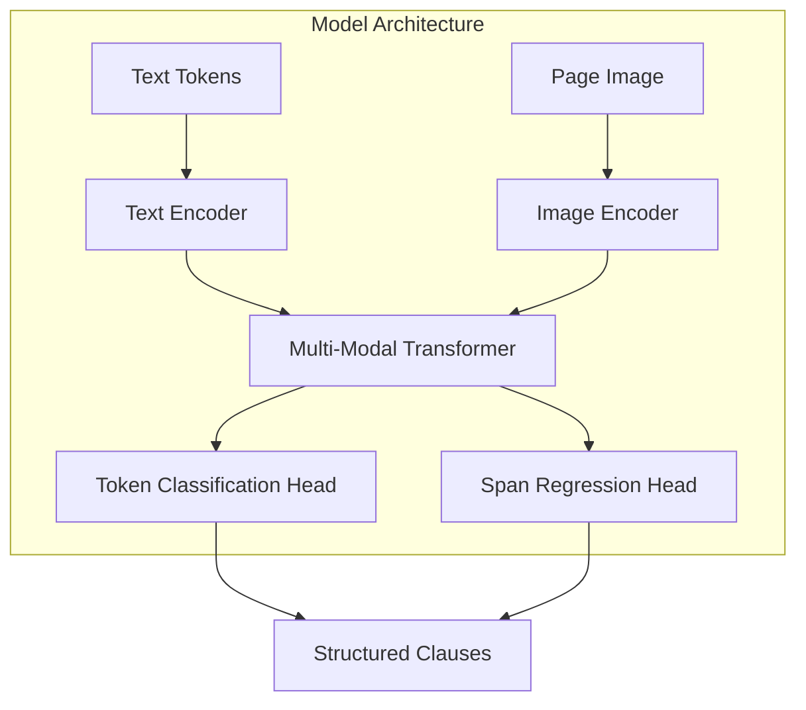

# Executive Summary  
Tender documents often contain lengthy, inconsistent prose with complex layouts (multi‐column text, tables, footers) and scanning noise, making manual extraction of requirements slow and error-prone. We propose **TenderPulse AI**, a hybrid pipeline that uses advanced document‐AI to automatically extract compliance clauses (e.g. deadlines, certifications) from PDFs into structured form, linking each clause to its source citation. Our approach combines robust OCR (e.g. Tesseract or cloud Vision) with a layout‐aware transformer model (e.g. LayoutLMv3 or TILT) fine-tuned for clause extraction.  The model leverages text embeddings, positional/layout encodings, and visual features to handle variable fonts, images, and tables.  Extracted clauses are output with metadata (page, bounding box) and a confidence score, enabling human review and iterative improvement. This system addresses the key challenges of tender parsing (OCR errors, vague language, heterogeneous structure) by learning context rather than relying on brittle regex rules.  

## Recommended Architecture and Rationale  
We recommend a **multimodal Transformer‐based architecture** that jointly encodes text, layout and image features. Specifically, a model like *LayoutLMv3* or *TILT* can serve as the backbone, as these have demonstrated state-of-the-art performance on form and key-information extraction tasks. For example, LayoutLMv3 pre-trains on unified text+image masking to align text and layout information and achieves SOTA on form-understanding benchmarks (e.g. FUNSD). TILT employs an encoder-decoder Transformer that encodes text, visual and spatial layout jointly, achieving SOTA on layout-aware extraction (DocVQA, CORD).  

The system pipeline is as follows (see diagram below): first, each PDF page is rendered to an image (e.g. 300 DPI) and passed through OCR. We may use open-source OCR (Tesseract) or cloud APIs (Google Vision/AWS Textract) for text and layout detection. Next, text tokens are combined with normalized bounding-box coordinates and, if available, image features (e.g. page snapshot or text-encoded patches) to form multimodal embeddings. These embeddings feed into the Transformer model, which outputs either token labels (sequence labeling) or extracted spans. A **token-classification head** tags each word/segment (e.g. B-CLAUSE, I-CLAUSE, B-DEADLINE, etc.), while a **span-based head** can directly predict clause boundaries or yield slot values. The output is post-processed into a structured set of clauses with entities (e.g. “Requirement: ISO9001”, “Deadline: 2025-06-30”) and relations (e.g. this clause *requires* that evidence). Finally, a confidence score from the model is attached, and clauses are linked back to PDF coordinates for source citation.  

```mermaid
flowchart LR
    subgraph Pipeline
    A[PDF Documents] --> B[OCR & Preprocessing]
    B --> C[Layout Segmentation \n& Cleaning]
    C --> D[Feature Extraction \n(text + layout + image)]
    D --> E[Contextual Model (LayoutLMv3/TILT)]
    E --> F[Clause Extraction Output]
    F --> G[Post-processing & Validation]
    end
```



**Key Components and Rationale:** 
- **OCR and Preprocessing:** Convert each PDF page to an image (Tesseract requires rasterization) and run OCR to get text, word boxes and optionally hyphenation. We deskew and normalize layout (e.g. separate columns, remove headers/footers) to simplify input. Google Vision/Document AI or AWS Textract can alternatively be used to obtain JSON with word-level bounding boxes.  
- **Layout-Aware Transformer:** Use a model that ingests both text and layout. For example, LayoutLMv3 uses unified masking to align image patches with text, capturing font and geometry. TILT similarly uses attention biases for layout. These models capture context beyond bag-of-words: e.g., they know that columns are separate zones, and can relate a clause’s text to its visual style (font size, boldness) and nearby header.  
- **Entity/Clause Output:** We consider two extraction paradigms. A **sequence labeling** approach tags each token (e.g. using BIO tags for clause boundaries or entity types). A **span extraction** approach directly predicts spans (start/end indices) of clauses and key-values. Optionally, an **encoder-decoder (generative)** approach can be used: e.g., fine-tuning a T5/Donut-style model to output a JSON list of clauses from the image (similar to DONUT). However, tagging is more interpretable and easier to train with limited data.  
- **Features:** Besides standard word embeddings, we incorporate *positional/layout features* (normalized (x,y) coordinates, page number) and *style cues* (font size/bold as features or separate embeddings). Prior work has shown that including layout coordinates significantly aids extraction. If the PDF has vector text, we retain exact characters; if scanned, OCR output may err, so we allow tolerances. We may also include *semantic embeddings* (contextual BERT-like embeddings) for token context, which the Transformer naturally provides. If tables or images appear, the model can learn to ignore them or treat them as context blocks.  

**Configuration Options:** We may start with a pre-trained LayoutLMv3 or LayoutXLM (for multilingual cases) and fine-tune it. For multi-language support, LayoutXLM pre-trains a layout model on 7+ languages and could be adapted. If GPU resources are constrained, smaller models (LayoutLMv2) or encoder-only approaches (e.g. HanLP LayoutXLM on open source) could be used, potentially with LoRA adapters for efficiency.  

## Data & Annotation Plan  

**Data Collection:** We will gather a broad corpus of tender documents (RFIs, RFPs, contracts) in PDF form. This should include both *born-digital* PDFs and *scanned* images with noise, in (initially) English; if multilingual tenders are needed later, we may extend to other languages. Documents should cover diverse formats: single vs multi-page, single vs multi-column, with tables, figures, and various fonts/headers. A target scale might be on the order of 500–1000 documents (10k+ pages) to start.  

**Annotation Schema:** Each document will be annotated at the clause level. Annotations include: 
- **Clause span:** The text region (start/end page and coordinates) containing a compliance requirement or deadline.  
- **Entities:** Key pieces within each clause, such as *RequirementType* (e.g. "Certification", "Deliverable", "Deadline"), *Entity* (e.g. "ISO9001", "project plan"), *Date*, *Action*, etc.  
- **Relations:** If applicable, link entities (e.g. this clause *imposes* that requirement, or *references* another clause).  
- **Metadata:** A confidence tag (high/medium/low) reflecting annotator certainty or clause ambiguity; and any clause numbering.  

We will define a controlled vocabulary for entity types (e.g. “Certification”, “Document”, “Date”, “Person”, “Location”, etc.). Relations might include “requires”, “by-deadline”, or “evidence-of”.  

**Example Annotation Table:** For illustration, an annotated clause might look like:  

| DocID | Clause Text                                        | Entities (Type:Value)                                         | Relation         | Confidence |  
|-------|----------------------------------------------------|---------------------------------------------------------------|------------------|------------|  
| D1    | “The bidder must hold valid ISO9001 certification.” | Requirement: "Certification"; Value: ISO9001                 | (bidder requires) | High       |  
| D2    | “Submit the environmental report by 30 June 2027.”  | Action: “Submit”; Document: “Environmental report”; Deadline: “2027-06-30” | (action-deadline) | Medium     |  
| D3    | “Maintain public liability insurance throughout contract term.” | Requirement: “Insurance”; Type: “Public liability” | (coverage period) | High       |  

Each row corresponds to one identified clause, with its key entities. Annotators highlight clause spans and tag the entities and relations. This bottom-up annotation (akin to FUNSD) ensures each clause is linked to semantic labels. An annotation tool (e.g. Label Studio) will record coordinates, text, and tags.  

**Volume & Tools:** We plan to annotate a few thousand clauses initially. For quality, each clause is reviewed by two annotators (to compute inter-annotator agreement). We may also leverage weak supervision: for example, automatically pre-label obvious patterns (dates, compliance keywords) and have humans correct them. To augment data, a synthetic generator (as in Donut’s SynthDoG) could create fake tender snippets (swapping names, dates) to expand coverage.  

## Training and Evaluation Plan  

**Training Strategy:** We will start with a pre-trained layout model (LayoutLMv3 or similar) and fine-tune on our labeled data (supervised learning). Fine-tuning updates all parameters for best accuracy. To save compute, we may explore **LoRA adapters** (Low-Rank Adaptation), which freeze the base model and train small additional matrices; this often reduces GPU requirements. We will use stratified train/validation splits of documents. If labeled data is scarce, we can use active learning: periodically train the model, identify clauses with low confidence, and have annotators review them, iterating to improve model confidence. Transfer learning from related tasks (e.g. KIE on contracts or forms) may also help.  

**Evaluation Metrics:** We will evaluate at both the **entity/slot level** and the **clause level**. Key metrics include: 
- *Precision/Recall/F1* for clause detection (treat each correctly-extracted clause as a true positive) and for each entity type. For span extraction, we may use **span-level F1/IoU**: a predicted clause span is correct if it overlaps the true span by ≥50% (IoU threshold) or fully matches. Domain studies report *Span-F1* for clause extraction (e.g. ~0.748 for a law-trained model).  
- *Exact Match* rate: fraction of clauses where all entities are correctly labeled.  
- *Clause-level accuracy*: fraction of required clauses identified at all (important if missing requirements is costly).  
- *Calibration*: since we output confidences, we will measure reliability (e.g. expected calibration error) to ensure the model’s probabilities are meaningful.  

We will set up a held-out **test set** of tender documents (not seen in training) to compute final metrics. Ideally this includes documents from different sources (e.g. various agencies) to test generalization. We will also simulate OCR errors (e.g. downsample fonts, add noise) to stress-test robustness.  

**Sample Test Cases:** For sanity-checking, we define illustrative scenarios. For example:  

- *Case 1:* Clause: “All bidders must have current ISO9001 certification.”  
  *Expected Extraction:* Entities: {Certification: ISO9001}; Phrase type: Requirement.  
- *Case 2:* Clause: “Delivery deadline is 31 December 2026.”  
  *Expected:* {Action: Delivery; Deadline: 2026-12-31}.  
- *Case 3:* Clause: “Vendor shall maintain public liability insurance for at least $5M.”  
  *Expected:* {RequirementType: Insurance; Value: 5M USD}.  

We will compare model outputs against these gold annotations, measuring F1 and IoU. Across many such cases, we ensure coverage of features like multi-column context, tables, and footnotes.  

## Deployment Pipeline and API Spec  

The extraction model will be integrated into a scalable processing pipeline. This pipeline will handle incoming PDFs, run OCR, apply the model, and return results. An example mermaid diagram of the deployment pipeline:  

```mermaid
flowchart LR
    subgraph Deployment Pipeline
    PDFClient[User PDF Input] --> Upload[Upload Service]
    Upload --> OCRService[OCR (Tesseract/Cloud)]
    OCRService --> PreprocService[Preprocessing & Segmentation]
    PreprocService --> ModelService[Extraction Model (Transformer)]
    ModelService --> Postproc[Post-processing & Citation Linking]
    Postproc --> OutputService[API Response / Review Dashboard]
    end
```

- **OCR Service:** Runs the OCR engine on each page. For Tesseract, we will rasterize at ~300 DPI as recommended. If using Google Vision API, we call its async PDF/TIFF endpoint and retrieve structured JSON (with text blocks and confidence).  
- **Preprocessing:** Combines OCR results into a unified text/layout grid. Detect and split columns or tables if needed (e.g. using layout analysis heuristics).  
- **Model Inference:** The Transformer model processes the preprocessed document. We will containerize the model (e.g. using TorchServe or TensorFlow Serving) to allow batch or real-time inference. Latency targets might be on the order of a few seconds per page, so we provision GPU or CPU accordingly.  
- **Output & Confidence:** The model outputs clause texts, page numbers, and bounding boxes. We convert these to a JSON schema such as:  

```
{
  "document_id": "Tender123",
  "clauses": [
    {
      "text": "All bidders must have ISO9001 certification.",
      "page": 3,
      "bbox": [100, 150, 400, 180],
      "entities": [{"type": "Certification", "text": "ISO9001"}],
      "confidence": 0.92
    },
    ...
  ]
}
```  

- **Human-in-the-Loop (HITL):** Low-confidence clauses (< threshold) are flagged for review in a dashboard. Reviewers can correct or confirm them; the corrections are logged for retraining (incremental learning).  

**API Specification:** The system exposes REST endpoints for integration:  

| Endpoint         | Method | Input                          | Output                             |
|------------------|--------|--------------------------------|------------------------------------|
| **/extract**     | POST   | Multi-part form with PDF file  | JSON {clauses: [...]} as above     |
| **/feedback**    | POST   | {clause_id, corrections, user} | {status: success}                  |
| **/health**      | GET    | –                              | {status: “ok”, version: “1.0”}      |

Clients (e.g. TenderPulse UI) will call **/extract** with a tender PDF. They get a JSON listing each extracted clause with its entities and confidence. For example, if the model outputs a clause incorrectly, the user can call **/feedback** to send the corrected clause text or labels; the system then updates its records. Internally, the pipeline may also batch-process documents (e.g. queue PDFs, fetch results).  

## Risks, Mitigation, and Resource Estimates  

**Key Risks:**  

- *OCR Failures:* Poor scans or unusual fonts may cause text recognition errors, which propagate to extraction. **Mitigation:** Use image pre-processing (denoise, binarize) and/or multiple OCR engines. Empirically, Tesseract is robust if DPI≥300; for critical cases, fallback to human review. We will flag low-text-confidence pages for manual OCR correction.  

- *Vague/Wrong Labels:* Regulatory language can be ambiguous (e.g. “shall” vs “should”). The model might misclassify or miss nuances. **Mitigation:** Include domain-specific keywords in feature engineering (e.g. “shall”, “must” as strong indicators), and require human validation of all extractions. Continuous feedback and active learning will help the model learn subtle patterns over time.  

- *Layout Complexity:* Multi-column text and overlapping tables/charts can confuse segmentation. **Mitigation:** Employ pre-processing to detect columns (e.g. by large vertical whitespace) and heuristics for table regions. If the model extracts a clause that spans a table boundary, the pipeline should reconcile it or flag for review. We may include training examples with such layouts.  

- *Model Overfitting:* If our annotated data is limited or biased (e.g. only certain agencies), the model may not generalize. **Mitigation:** Use data augmentation (synthesizing variations), cross-validation, and possibly domain-adaptive pretraining. We will monitor validation metrics to detect overfitting.  

- *Deployment Costs:* Running OCR and large transformers at scale can be expensive. **Mitigation:** We will benchmark and possibly use cheaper options (e.g. open-source OCR on-premise, smaller models, or use spot instances). Implement caching for repeated documents.  

**Resource Estimates:** (initial prototype phase)  

- *Data Annotation:* Assuming we annotate ~1,000 clauses with two annotators, at ~1 minute/clause, that’s ~33 work-hours per annotator, plus review. Cost ~$2K (at $30/hr).  
- *Model Training:* Fine-tuning a LayoutLM-size model (~100M params) for 10–20 epochs might take 1–2 days on a single GPU. Using cloud GPUs (e.g. AWS p3.2x) costs ~$3–6 per hour, so ~$200. LoRA adapters can reduce this.  
- *Infrastructure:* A single GPU-enabled inference server (for prototyping) may cost ~$1K/mo, or we can use cloud serverless (e.g. AWS Lambda for OCR, ECS for model) with pay-per-use.  
- *Personnel:* A small team (1-2 ML engineers, 1 data engineer, 1 annotator) over 6–9 months. Total engineering effort ~6 man-months.  

**Timeline & Phases:** 

| Phase                        | Duration   | Deliverables                              | Team/Resources          |
|------------------------------|------------|-------------------------------------------|-------------------------|
| Requirements Analysis        | 2 weeks    | Finalized spec, sample docs collected     | 1 PM + 1 BA             |
| Data Collection & Cleaning   | 4 weeks    | 500+ tender PDFs gathered, preprocessed   | 1 Data Engineer         |
| Annotation & Schema Design   | 8 weeks    | 2,000+ clauses labeled, schema finalized  | 2 Annotators + 1 Lead   |
| Model Prototyping            | 6 weeks    | Fine-tuned model, initial metrics         | 2 ML Engineers, GPU     |
| Evaluation & Iteration       | 4 weeks    | Test results, error analysis report       | 1 ML Eng, 1 Reviewer    |
| Integration & API Development| 6 weeks    | API endpoints, pipeline deployment        | 1 SW Engineer, 1 DevOps |
| User Testing & Refinement    | 4 weeks    | Feedback incorporated, performance tuned  | Team review             |
| **Total**                    | **~7 months** | Full demo-ready system                  | ~4 personnel            |

During each phase we will monitor progress with key milestones. For example, after prototyping we expect a baseline F1>0.7 on held-out clauses; if not met, we analyze errors and adjust the model (e.g. more data, new features).  

**Citations:** Our design is informed by recent advances in document AI and best practices in OCR. For example, LayoutLMv3 and TILT architectures have shown that combining text and layout information is critical for form/contract understanding. The FUNSD dataset literature emphasizes the challenge of noisy, varied form layouts. We will follow evaluation strategies from legal-AI research (measuring span-F1 for clause extraction) and adapt learning techniques (like LoRA for efficient fine-tuning) that have proved effective in related settings. 

