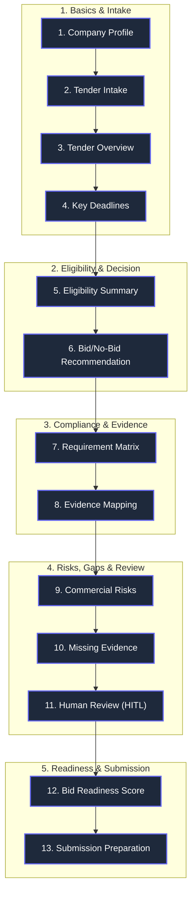
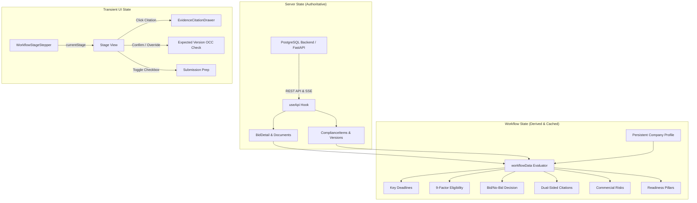

# TenderPulse AI — Frontend & Product UX Architecture

## 1. Product Philosophy & The MSME Contractor Persona

TenderPulse AI is **not just a PDF upload portal or a generic AI chatbot**. It is an **end-to-end Tender Intelligence & Bid Readiness Platform designed specifically for Indian MSMEs, contractors, and infrastructure service providers**.

### 1.1 The Target User Persona
* **Name:** Ramesh Sharma, Managing Director, Apex Infra Projects Pvt. Ltd. (Nagpur, Maharashtra).
* **Firm Profile:** 18 employees, ₹ 18.5 Cr annual turnover, registered as an Indian MSME Small Enterprise under UDYAM.
* **Bidding Domain:** Indian public procurement on IREPS (Indian Railways), CPPP (Central Public Procurement Portal), GeM (Government e-Marketplace), NHAI, and State PWDs.
* **Core Pain Points:**
  1. **Clerical Disqualifications:** Losing tenders not because of price or engineering capability, but due to technicalities (missing CA UDIN, wrong stamp paper denomination, unnotarized affidavits, expired ISO certificates).
  2. **Wasted Capital & Working Capital Lock-in:** Spending ₹ 50,000 to ₹ 2 Lakhs on non-refundable tender fees and locking up to 10% in Earnest Money Deposits (EMD) and Performance Bank Guarantees (PBG) on bids they were never qualified to win.
  3. **Cognitive Overload & Corrigenda Fatigue:** Sifting through 200+ page NIT and GCC documents where crucial disqualification criteria are buried in footnotes or modified by corrigenda days before the deadline.

### 1.2 The Zero-Jargon Mandate
Contractors and tender managers do not understand—and should never have to encounter—probabilistic AI terminology. TenderPulse enforces a strict user-facing vocabulary:

| Probabilistic / AI Term (Forbidden in UI) | Contractor-Friendly Ubiquitous Language (Mandatory in UI) |
| :--- | :--- |
| *RAG / Vector Retrieval* | **Verified Evidence Match / Document Search** |
| *LLM Confidence Score / Temperature* | **Eligibility Probability / Recommendation Score** |
| *Hallucination Guard / Verification* | **Verbatim Clause Citation / Page Reference** |
| *Prompt Engineering / Model Output* | **AI Extraction / System Analysis** |
| *Entity Extraction* | **Statutory & Technical Requirements** |
| *Uncertain Prediction* | **Ambiguous Clause / Needs Clarification in Pre-Bid** |

---

## 2. The 13-Stage Bidding Workflow

Rather than dumping unstructured dashboards with vanity charts, TenderPulse structures the user journey around the **actual sequential decisions** an Indian contractor must make:



### Stage Walkthrough:
1. **Company Profile (`company-profile`):**
   * The persistent capability repository. Holds GSTIN, PAN, UDYAM registration (Micro/Small/Medium tier), 3-year audited financial turnover with Chartered Accountant UDIN verification status, past railway/highway work order records with completion certificates, ISO certifications, and authorized signatories with Digital Signature Certificate (DSC Class 3) token metadata.
2. **Tender Intake (`tender-intake`):**
   * Multi-file uploader for the complete tender package: Notice Inviting Tender (NIT), Bill of Quantities (BOQ), Technical Specifications, General Conditions of Contract (GCC), Special Conditions of Contract (SCC), and Corrigenda. Presigned S3 upload with SHA-256 integrity and MIME validation.
3. **Tender Overview (`tender-overview`):**
   * Clean commercial card displaying Tendering Authority (e.g. Western Railway), Tender Reference, Estimated Contract Value (₹ formatted in Lakhs/Crores), EMD amount, and MSME exemption applicability.
4. **Key Deadlines (`key-deadlines`):**
   * Point-in-time countdowns for Document Download End, Pre-Bid Meeting & Clarification Deadline (critical for submitting queries), Bid Submission Deadline (with red urgency warning if <72 hours), and Technical Bid Opening Date.
5. **Eligibility Summary (`eligibility-summary`):**
   * 9-Factor traffic-light scorecard comparing tender requirements against verified company capabilities:
     1. Statutory Registration & Debarment
     2. Annual Financial Turnover (3-year average vs threshold)
     3. 7-Year Past Experience (Similar work rule: single work >= 80%, two works >= 50%, or three works >= 40%)
     4. Geographic Presence (Operating state/zone)
     5. Certifications (ISO 9001/14001 active on submission date)
     6. OEM Authorization (Manufacturer Authorization Form - MAF)
     7. Key Technical Personnel & Engineers
     8. Essential Plant, Machinery & Equipment
     9. Bid Security / EMD Exemption
6. **Bid/No-Bid Recommendation (`bid-decision`):**
   * Clear verdict card (`GO`, `CONDITIONAL_GO`, `NO_GO`, `REVIEW_REQUIRED`), confidence percentage, commercial reasons to pursue, disqualifiers/shortfalls, and actionable next steps before bidding.
7. **Requirement Matrix (`requirement-matrix`):**
   * Filterable compliance table categorizing extracted requirements into Financial, Technical, Statutory, Execution, and Legal. Exposes Indian execution rules (stamp paper denomination e.g. ₹100, notarization, signing rank, and CA UDIN requirement).
8. **Evidence Mapping (`evidence-mapping`):**
   * Interactive dual-sided verification connecting tender clauses with corporate proof files. Clicking any row opens the **Evidence Citation Drawer**.
9. **Commercial Risks (`commercial-risks`):**
   * Commercial risk radar highlighting Liquidated Damages (LD) penalty caps (e.g. 0.5%/week up to 10%), Working Capital lock-in (EMD + PBG), absence of Price Variation Clause (PVC), and Defect Liability Period (DLP) retention.
10. **Missing Evidence (`missing-evidence`):**
    * Actionable acquisition checklist tracking missing certificates, issuing parties (e.g. practicing CA, OEM distributor), and estimated turnaround lead times.
11. **Human Review (`human-review`):**
    * First-class Human-in-the-Loop review card supporting 5 reviewer roles (`BID_MANAGER`, `LEGAL_COUNSEL`, `FINANCIAL_CONTROLLER`, `TECHNICAL_LEAD`, `BID_DIRECTOR`), OCC versioning (`version: int`), threaded audit comments, and the ability to Confirm or Override AI recommendations with mandatory justification.
12. **Bid Readiness (`bid-readiness`):**
    * 4-Pillar weighted mathematical rollup (50% Evidence Completeness, 20% Commercial Risk Clearance, 15% Deadlines Feasibility, 15% Financial Affordability) giving a composite readiness percentage (0-100%) and sign-off readiness verdict.
13. **Submission Preparation (`submission-prep`):**
    * Two-Cover procedural checklist separating Cover 1 (Fee & Technical Bid: EMD, PoA on ₹100 stamp paper, CA turnover with UDIN, Integrity Pact) from Cover 2 (Financial Price BOQ Excel sheet). Features a high-visibility warning that price disclosure in Cover 1 causes automatic disqualification.

---

## 3. Component Boundaries & Hierarchy

The application follows strict modular boundaries in `apps/web/src/`:

```
apps/web/src/
├── components/
│   ├── layout/
│   │   ├── AppShell.tsx               # Top-level shell with responsive layout
│   │   ├── Header.tsx                 # Tenant branding & user profile
│   │   └── Sidebar.tsx                # Sticky navigation (Bids, New Bid, Company Profile)
│   ├── common/
│   │   ├── Button.tsx                 # Primary, secondary, danger, ghost variants
│   │   ├── Modal.tsx                  # Accessible backdrop modal
│   │   ├── StatusBadge.tsx            # Standardized status chips
│   │   ├── ErrorBanner.tsx            # Error alert with retry/dismiss
│   │   ├── LoadingSkeleton.tsx        # Skeleton loaders
│   │   └── EmptyState.tsx             # Zero-data fallback screens
│   ├── bid/
│   │   ├── BidCard.tsx                # Dashboard summary card
│   │   ├── BidStatusBadge.tsx         # DRAFT, ANALYZING, REVIEW_READY, etc.
│   │   └── DocumentUploader.tsx       # Presigned S3 direct multipart uploader
│   ├── progress/
│   │   └── ExtractionProgress.tsx     # SSE real-time step streaming bar
│   ├── compliance/
│   │   ├── ComplianceTable.tsx        # Filterable requirement matrix
│   │   ├── ComplianceRow.tsx          # Expandable row with execution rules & citations
│   │   ├── ExecutionRulesCard.tsx     # Stamp paper, Notary, UDIN, Signing rank card
│   │   ├── ProvenanceCard.tsx         # Verbatim quote & source document card
│   │   └── ReviewActions.tsx          # Approve / Flag / Waive action buttons
│   └── workflow/                      # [NEW] 13-Stage Workflow Components
│       ├── WorkflowStageStepper.tsx   # Interactive 13-stage milestone stepper
│       ├── CompanyProfileSection.tsx  # MSME Capability Profile viewer & editor
│       ├── TenderOverviewHeader.tsx   # Commercial overview & authority card
│       ├── KeyDeadlinesCard.tsx       # Timeline, pre-bid meeting & countdown
│       ├── EligibilitySummaryCards.tsx# 9-Factor traffic-light scorecard
│       ├── BidDecisionBanner.tsx      # Verdict card with plain reasons & action items
│       ├── EvidenceCitationDrawer.tsx # Side-by-side verbatim citation inspector
│       ├── RiskRadarCard.tsx          # LD caps, working capital lock-in, PVC
│       ├── MissingEvidenceSection.tsx # Acquisition checklist with lead times
│       ├── HumanReviewTaskCard.tsx    # HITL task, roles, OCC, confirm vs override
│       ├── BidReadinessGauge.tsx      # 4-Pillar weighted readiness score
│       └── SubmissionPrepChecklist.tsx# Two-Cover packager & final submission checks
├── pages/
│   ├── BidDetailPage.tsx              # Central workspace orchestrating all 13 stages
│   ├── CompanyProfilePage.tsx         # Dedicated profile management page
│   ├── DashboardPage.tsx              # Multi-tender overview dashboard
│   ├── CreateBidPage.tsx              # New tender intake form
│   ├── ComplianceReviewPage.tsx       # Deep-dive item review screen
│   ├── AuditHistoryPage.tsx           # Immutable audit log timeline
│   └── LoginPage.tsx                  # Secure authentication portal
└── utils/
    ├── workflowData.ts                # Deterministic evaluators & profile data
    ├── formatCurrency.ts              # ₹ INR Lakhs/Crores formatter
    ├── formatDate.ts                  # IST date/time formatters
    └── formatFileSize.ts              # File size formatter (B, KB, MB, GB)
```

---

## 4. State Management Architecture

State management separates **Server State**, **Workflow Progression State**, and **Transient UI State**:



### 4.1 Server State & Caching
* **`useApi<T>` Hook:** Handles fetch lifecycles, error states, and background refetching.
* **Real-time SSE:** Server-Sent Events (`/api/v1/bids/:id/extraction-progress`) push ingestion phases (`PARSING_PAGES`, `EXTRACTING_COMPLIANCE`, `VERIFYING_CITATIONS`, `COMPLETED`), triggering automatic UI re-fetch without manual polling.

### 4.2 Optimistic Concurrency Control (OCC)
* Every compliance item and human review task carries an integer `version` field.
* Review submissions send `{ expectedVersion: item.version }`.
* If a concurrent review or backend corrigendum re-evaluation increments the version, the update is rejected with an explicit HTTP 409 Conflict, preventing lost updates.

---

## 5. Evidence & Source Citation Inspection Model

The most critical UX requirement for contractor trust is **grounded traceability**:

```
+-----------------------------------------------------------------------------------+
| EVIDENCE CITATION INSPECTOR                                                   [X] |
+------------------------------------------+----------------------------------------+
| TENDER CLAUSE (Notice Inviting Tender)   | COMPANY CAPABILITY PROOF               |
|                                          |                                        |
| Document: Tender_Document_Vol_1.pdf      | Proof File: CA_Audited_Turnover_FY24   |
| Clause: Section III, Clause 2.1          | Verification: [✓ VERIFIED]             |
| Page Number: Page 14                     | CA UDIN: 24089123AAAAA1234             |
|                                          |                                        |
| Verbatim Tender Quote:                   | Match Analysis:                        |
| "The average annual turnover of the      | Company 3-year average turnover of     |
| tenderer during the last 3 financial     | ₹ 18.50 Cr exceeds the required        |
| years must not be less than 50% of the   | ₹ 12.25 Cr threshold by 21%. Fully     |
| advertised tender value."                | certified by practicing CA with UDIN.  |
+------------------------------------------+----------------------------------------+
| 🔒 Audit Grounding: Quote verified against parsed PDF. Zero hallucination.        |
+-----------------------------------------------------------------------------------+
```

* **Instant Access:** Clicking any requirement row in Stage 7, any factor in Stage 5, or any citation in Stage 8 slides open the `EvidenceCitationDrawer`.
* **Keyboard / Carousel Navigation:** Built-in Previous/Next controls allow the contractor to cycle through all citations in the tender.

---

## 6. Indian Public Procurement Invariants Enforced

The frontend embeds specific safeguards for Indian public procurement portals (CPPP, GeM, IREPS):
1. **The Two-Cover Rule:** Explicit separation between *Cover 1 (Technical & Statutory)* and *Cover 2 (Financial BOQ)*. Prominent banner warning preventing disqualification due to premature price disclosure.
2. **Stamp Paper Rules:** Flags whether an undertaking must be executed on Non-Judicial Stamp Paper (e.g. ₹ 100 denomination) and whether Notary Public attestation is mandatory.
3. **CA UDIN Verification:** Prominently highlights the 18-digit Chartered Accountant Unique Document Identification Number (UDIN) on all turnover and net worth certificates, protecting contractors from rejection under ICAI guidelines.
4. **Digital Signature Token (DSC):** Reminds the contractor to plug in their DSC Class 3 cryptographic USB token with active drivers before submission.

---

## 7. Architectural Decisions (ADR Summary)

* **WHY workflow-first instead of dashboard-first?** Indian contractors do not need decorative charts. They need a sequential, step-by-step checklist answering: *"Am I qualified? What must I submit? What are the financial traps?"*
* **WHAT was added?** 13 distinct workflow stages grouped into 5 intuitive milestones, side-by-side evidence inspection drawer, persistent capability profile, and Two-Cover submission packager.
* **HOW is state coordinated?** Pure TypeScript evaluation functions in `workflowData.ts` evaluate the bid and compliance items against the persistent company profile, with OCC versioning protecting against concurrent updates.
* **WHY NOT external UI libraries (Tailwind, Material UI)?** Adheres to repository rules: clean vanilla CSS custom properties in `index.css` maintaining full theme control and zero bundle bloat.
* **FAILURE MODES:** Network loss during review displays an `ErrorBanner` with instant retry. Version conflicts trigger safe refetch without data loss.
* **SECURITY:** No AI-generated or client-side authorization. Tenant scoping and document access are strictly enforced by backend session and DB security context.
