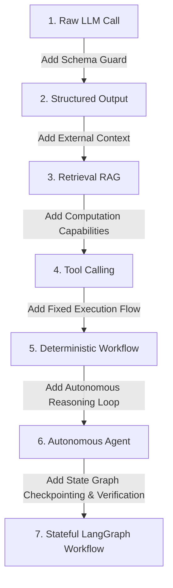

# AI Systems Engineering: From First Principles to Stateful Workflows

This educational guide teaches the foundational concepts of modern Artificial Intelligence and Agentic Systems, using **TenderPulse AI** (Indian public procurement compliance) as the concrete reference product.

---

## Part 1: The 12 Foundational Pillars

### 1. Large Language Models (LLMs)

- **Mathematical Reality**: An LLM (e.g. Anthropic Claude 3.5 Sonnet, OpenAI GPT-4o, Google Gemini 1.5 Pro) is an **autoregressive statistical next-token predictor**:
  $$\text{Next Token} \sim P(w_t \mid w_1, w_2, \dots, w_{t-1})$$
  It is an enormous neural network with hundreds of billions of weights optimized to minimize cross-entropy loss over internet-scale text. It does **not** have conscious understanding, legal comprehension, or a relational database of facts.
- **Why it matters in TenderPulse AI**:
  - **Superpower**: Parsing dense, bureaucratic Indian procurement prose (e.g., untangling a multi-paragraph clause combining General Conditions of Contract [GCC] and Special Conditions of Contract [SCC] regarding joint-venture eligibility).
  - **Critical Weakness**: It cannot perform exact math, cannot enforce authorization, and cannot guarantee factual truth without external grounding.

---

### 2. Tokens and Context Windows

- **Subword Tokenization**: Neural networks do not take strings or raw characters as inputs. A tokenizer converts text into chunks of subwords mapped to discrete integer IDs (e.g., using Byte-Pair Encoding [BPE]). On average, 1 token $\approx$ 0.75 English words.
- **Context Window**: The maximum sequence length ($N$ tokens) a Transformer's attention mechanism can ingest in a single forward pass (e.g. 128k or 200k tokens).
- **The "Lost in the Middle" Vulnerability**: While modern models accept large context windows, self-attention retrieval is non-uniform. Information placed at the absolute beginning (primacy effect) or end (recency effect) of the context window is recalled with high fidelity, while clauses buried in the middle (e.g. on page 142 of a 250-page prompt) suffer severe recall degradation.
- **Latency & Economics**: Stuffing an entire 200-page tender (150,000 tokens) into every prompt incurs 30–60 second latency and costs $1.50–$3.00 per inference call.

---

### 3. System, User, and Tool Messages (Role Framing)

Chat APIs enforce strict conversational roles to distinguish trusted instructions from untrusted data:

- **System Message (`system`)**: The highest-priority framing established by the application developer. Defines the model's persona, operational constraints, output rules, and anti-injection instructions.
- **User Message (`user`)**: The input provided by the end user or injected document chunks. Must always be treated as untrusted data.
- **Assistant Message (`assistant`)**: The generation produced by the model (text prose or structured tool calls).
- **Tool Message (`tool`)**: The deterministic execution result returned to the model after a tool call.

---

### 4. Structured Output (Constrained Decoding)

- **The Problem**: By default, LLMs output unconstrained natural language strings. Prompts asking for JSON can fail if the model adds conversational pleasantries, markdown backticks, or trailing commas.
- **The Solution**: **Grammar-Constrained Decoding**. During token generation, the inference engine applies a context-free grammar or JSON Schema mask. Tokens that would violate the schema syntax have their sampling probabilities set to zero ($P = 0$).
- **In TenderPulse AI**: Guarantees that every extracted requirement perfectly conforms to our `ComplianceItem` schema with strictly typed execution rules and provenance metadata.

---

### 5. Hallucinations

- **The Mechanism**: When the probability distribution over the next token is relatively flat (uncertainty), the model samples tokens that are statistically fluent and syntactically convincing, but factually fabricated.
- **Failure Modes in Tenders**:
  1. _Fabricated Requirements_: Hallucinating a requirement for an ISO 27001 certificate because similar IT tenders usually mandate it.
  2. _Citation Drift_: Extracting a legitimate clause but citing Page 14 instead of Page 88.
  3. _Numeric Inversion_: Reporting ₹5,00,000 when the tender mandates ₹50,00,000.
- **Deterministic Defense**: Zero ungrounded claims. Every extracted item must carry a verbatim string quote that is verified against the source PDF page text via deterministic Python string matching before persistence.

---

### 6. Embeddings

- **First Principles**: An embedding model transforms a string of text into a high-dimensional vector of real numbers ($\mathbb{R}^D$, typically 1,536 or 3,072 dimensions):
  $$f(\text{"Earnest Money Deposit"}) = [0.0142, -0.0891, \dots, 0.0412]$$
- **Semantic Proximity**: The angular distance (cosine similarity) between vectors measures conceptual similarity.
  $$\cos(\theta) = \frac{\mathbf{u} \cdot \mathbf{v}}{\|\mathbf{u}\| \|\mathbf{v}\|}$$
  Concepts with identical meaning but different vocabularies (e.g. "Bid Security" and "EMD Bank Guarantee") yield high cosine similarity ($> 0.85$).
- **Limitation**: Embeddings capture conceptual gist, but fail at exact token matching (e.g., finding tender number `"NHAI/DEL/2026/04"` or checking a specific section number).

---

### 7. Vector Search & ANN Indexing

- **The Scaling Problem**: Comparing a query vector against 1,000,000 document vectors using brute-force cosine distance requires $O(N)$ dot products, taking hundreds of milliseconds.
- **Approximate Nearest Neighbors (ANN)**: Algorithms like **HNSW** (Hierarchical Navigable Small World) construct multi-layer geometric graphs, reducing search complexity to $O(\log N)$ with sub-5ms retrieval.
- **In PostgreSQL**: Powered by `pgvector` with HNSW indexes scoped to `organization_id`.

---

### 8. Retrieval-Augmented Generation (RAG)

- **The 4-Step Pipeline**:
  1. _Ingest & Chunk_: Split tender PDFs into semantically coherent passages (500–1,000 tokens) with 10% overlap.
  2. _Embed & Index_: Generate vectors and store them in PostgreSQL with strict metadata (`organization_id`, `bid_id`, `document_id`, `page_number`).
  3. _Retrieve_: When analyzing eligibility, retrieve the top 5–8 most relevant chunks using cosine similarity.
  4. _Augment & Generate_: Inject the retrieved chunks into the LLM prompt inside `<untrusted_document_data>` tags to ground its reasoning.

---

### 9. Tool Calling (Function Calling)

- **The Handshake Protocol**:
  1. Application registers tool definitions (e.g., `calculate_turnover_gap`, `verify_citation`) with JSON schemas.
  2. The LLM evaluates user prompt + context and decides it needs an external capability.
  3. The LLM pauses generation and outputs a structured `tool_call` request.
  4. Application intercepts the tool call, executes verified deterministic code, and returns the result in a `tool` message.
  5. The LLM resumes generation incorporating the verified tool output.

---

### 10. AI Workflow vs. Autonomous Agent

| Feature                  | AI Workflow (Orchestrated DAG)                                              | Autonomous Agent (Self-Directed Loop)                                                             |
| :----------------------- | :-------------------------------------------------------------------------- | :------------------------------------------------------------------------------------------------ |
| **Control Flow**         | **Deterministic**: Code dictates sequence, branching, and termination.      | **Probabilistic**: The LLM decides what step to take next, which tools to call, and when to stop. |
| **SLA & Predictability** | **High**: Execution time, cost, and steps are bounded.                      | **Low**: Risk of infinite loops, wandering, or invoking 30 unnecessary tools.                     |
| **Failure Recovery**     | **Predictable**: Retry logic, timeouts, and fallback branches are explicit. | **Uncertain**: May attempt the same broken action repeatedly without human intervention.          |
| **TenderPulse Role**     | **Production Core**: Tender ingestion, extraction, and validation.          | **Ad-hoc Q&A Only**: Interactive contract exploration.                                            |

---

### 11. Stateless vs. Stateful AI

- **Stateless AI**: Single-shot HTTP REST calls (`POST /v1/chat/completions`). The model retains zero memory between calls; every interaction must re-transmit full context.
- **Stateful AI**: Multi-step graph execution where state is persisted across transitions. If step 4 fails or needs human review, the workflow pauses, persists its state to a database checkpoint, and resumes later without re-running steps 1 through 3.

---

### 12. Deterministic Code vs. Model Reasoning: The Hard Boundary

| Concern                           | Owner              | Rationale                                                        |
| :-------------------------------- | :----------------- | :--------------------------------------------------------------- |
| **Tenant Isolation & Security**   | Deterministic Code | LLMs cannot enforce authorization boundaries.                    |
| **Arithmetic & Calculations**     | Deterministic Code | LLMs fail at reliable arithmetic; code is 100% exact.            |
| **Unstructured Text Parsing**     | Model Reasoning    | Code cannot anticipate every bureaucratic clause syntax.         |
| **Quote & Citation Verification** | Deterministic Code | Exact substring verification guarantees zero hallucination.      |
| **Database State Mutations**      | Deterministic Code | Relational constraints and ACID transactions govern persistence. |

---

## Part 2: The 7-Stage Architectural Progression

---

### Stage 1: The Raw LLM Call

- **What it does**: Direct natural language prompt $\rightarrow$ LLM $\rightarrow$ freeform Markdown prose.
- **When to use**: Creative writing, open-ended ideation, conversational summaries.
- **When NOT to use**: **Any enterprise application.** Raw prose cannot be saved to relational databases, breaks downstream backend code, and provides zero validation guarantees.

---

### Stage 2: Structured Output

- **What it does**: Enforces JSON Schema compliance on token generation via grammar-constrained decoding.
- **When to use**: Extracting structured DTOs from small texts that fit comfortably inside the context window.
- **When NOT to use**:
  - When the source document exceeds the context window (requires retrieval).
  - When output fields require arithmetic verification (the model can generate valid JSON containing completely fabricated numbers).

---

### Stage 3: Retrieval-Augmented Generation (RAG)

- **What it does**: Slices large documents into chunks, performs semantic vector search, and injects relevant passages into the prompt.
- **When to use**: Large document collections (250-page tenders, policy manuals) where queries target localized clauses.
- **When NOT to use**:
  - Small documents that fit entirely inside context with low cost (< 15 pages; direct context stuffing is superior to vector search).
  - Tasks requiring global aggregation (e.g., "Sum the values across all 40 annexures"). Standard RAG retrieves top-5 chunks and misses 35 annexures.

---

### Stage 4: Tool Calling (Function Calling)

- **What it does**: Allows the model to pause generation and request execution of external functions (calculators, scrapers, database queries).
- **When to use**: When the task requires exact calculations, external API data, or deterministic validation checks.
- **When NOT to use**:
  - When the next action is completely predetermined (do not ask the LLM if it wants to run a validator; just run the validator in code!).
  - Giving models open-ended, dangerous tools (e.g. unrestricted `run_sql_query` or `shell_exec`).

---

### Stage 5: Deterministic Workflow (Code Pipeline / DAG)

- **What it does**: Hardcoded sequential code flow: Step A $\rightarrow$ Step B $\rightarrow$ Step C.
- **When to use**: Standard predictable business logic (e.g. upload file $\rightarrow$ verify checksum $\rightarrow$ queue job).
- **When NOT to use**: Complex problem-solving where the number of attempts or refinement steps cannot be hardcoded in a simple linear pipeline.

---

### Stage 6: Autonomous Agent (ReAct Loop)

- **What it does**: A while-loop where the LLM decides its own sequence: Thought $\rightarrow$ Action (Tool) $\rightarrow$ Observation $\rightarrow$ Repeat until model decides it is done.
- **When to use**: Unbounded exploratory research, open-ended coding assistants, interactive triage.
- **When NOT to use**: **Core business workflows and compliance extraction.** Autonomous agents get stuck in loops, rack up unexpected cloud bills, exhibit non-deterministic behavior, and cannot guarantee SLA execution times.

---

### Stage 7: Stateful LangGraph Workflow (TenderPulse AI Production Engine)

- **What it does**: A cyclic, directed state graph combining the predictability of workflows with the reasoning of LLMs:
  - Strongly typed state object.
  - Deterministic Python verification nodes.
  - Controlled cyclic loops (retry up to $N$ times if citation check fails).
  - Durable checkpointing to PostgreSQL.
  - Human-in-the-loop pause and resume capabilities.
- **When to use**: Complex, mission-critical multi-step AI business processes (e.g., legal compliance verification, contract audit).
- **When NOT to use**: Simple CRUD endpoints, single-prompt summarization tasks, or purely linear pipelines where zero feedback loops exist.
