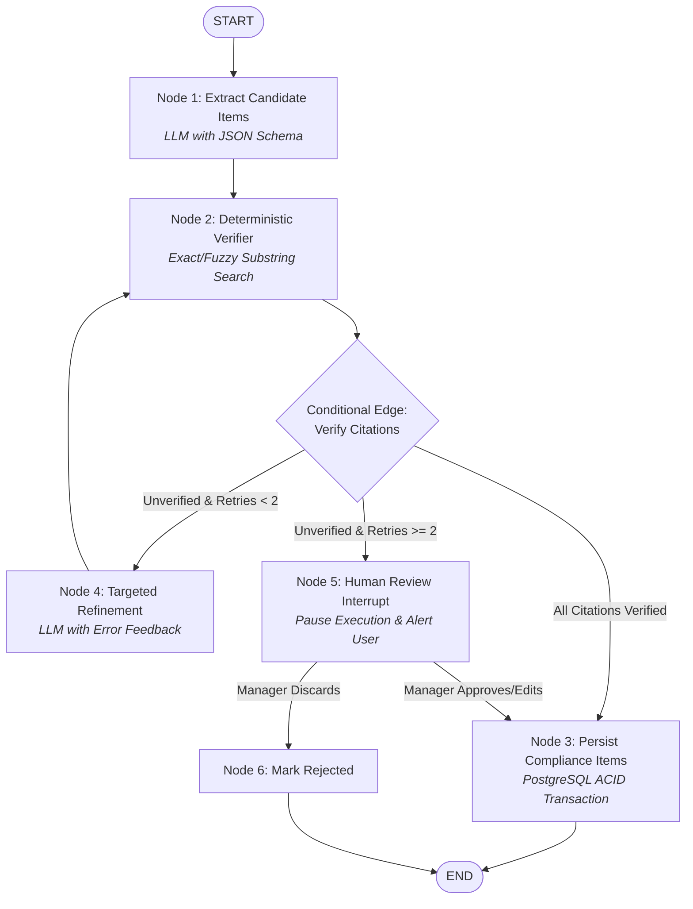

# LangChain, LangGraph, and Stateful AI Workflows: First Principles

## 1. Architectural Foundation & First Principles

In public procurement compliance (TenderPulse AI), a single unverified claim can disqualify a contractor, forfeit Earnest Money Deposits (EMDs) worth crores of rupees, and lead to blacklisting.

Traditional single-shot LLM prompts or naive linear chains fail because they treat intelligence as a **one-way, unrecoverable feed-forward pipe**. If a model misreads a clause on Page 42, a linear pipeline either persists a hallucinated requirement or crashes the entire job.

To achieve production-grade reliability, we adopt **Stateful Cyclic Computation Graphs** using **LangGraph**.

---

## 2. The 13 Core Primitives Explained

```
┌────────────────────────────────────────────────────────────────────────┐
│                      LANGGRAPH RUNTIME PRIMITIVES                      │
├─────────────────┬──────────────────────────────────────────────────────┤
│ Primitive       │ Architectural Role                                   │
├─────────────────┼──────────────────────────────────────────────────────┤
│ 1. LangChain    │ Foundational ecosystem: prompt templates, schemas    │
│ 2. LangGraph    │ Orchestration engine: cyclic state machine graphs    │
│ 3. State        │ Central, typed data schema flowing through all nodes │
│ 4. Nodes        │ Units of execution (LLM reasoning or Python logic)   │
│ 5. Edges        │ Deterministic fixed connections between nodes        │
│ 6. Cond. Edges  │ Dynamic routing functions based on state conditions  │
│ 7. Tools        │ Validated external capabilities invoked by nodes     │
│ 8. Checkpoints  │ Durable snapshots of state saved at node boundaries  │
│ 9. Persistence  │ Checkpointer database backend (e.g. PostgreSQL)      │
│ 10. Retries     │ Graph-level cyclic feedback loops with error context │
│ 11. Interrupts  │ Native pause mechanism halting execution for review  │
│ 12. Human Appr. │ Human-in-the-loop inspection and state modification  │
│ 13. Resumability│ Re-hydrating graph execution from durable storage    │
└─────────────────┴──────────────────────────────────────────────────────┘
```

### 1. LangChain

- **What it is**: A foundational library providing standard abstractions for model I/O: prompt templates, model provider wrappers (Bedrock, OpenAI), output parsers, and the LangChain Expression Language (LCEL).
- **Core Limitation**: LCEL builds **Directed Acyclic Graphs (DAGs)**. It assumes execution flows in a single direction from input to output:
  $$\text{Prompt} \to \text{LLM} \to \text{Parser}$$
  It provides no native state persistence, cannot easily loop backwards upon validation failure, and struggles with multi-actor coordination.

### 2. LangGraph

- **What it is**: An orchestration framework built on top of LangChain that models AI workflows as **State Machines** and **Cyclic Directed Graphs**.
- **First Principles**:
  $$G = (V, E, S)$$
  Where $V$ represents Nodes (computational steps), $E$ represents Edges (transitions), and $S$ represents State (a shared typed context mutated by nodes).

### 3. State

- **What it is**: A strongly typed schema (`TypedDict` or Pydantic `BaseModel`) that represents the memory of the graph at any given tick.
- **Reducers**: State channels can use reducers (e.g., `operator.add` or custom functions) to append items or merge dictionaries rather than overwriting the entire object.
- **Immutability**: Nodes do not mutate state in-place; they return a dictionary of fields to update.

### 4. Nodes

- **What it is**: Python functions or runnables that accept the current `State` (and optional configuration) and return partial state updates:
  $$f: S \to \Delta S$$
- **In TenderPulse AI**: We strictly bifurcate nodes into:
  1. **Reasoning Nodes**: Invoke LLMs with constrained decoding (e.g., extracting eligibility clauses).
  2. **Deterministic Verification Nodes**: Pure Python code performing exact string matching, math calculations, and schema checks.

### 5. Edges

- **What it is**: Deterministic transitions that route execution from one node directly to the next:
  `workflow.add_edge("extract_clauses", "verify_citations")`

### 6. Conditional Edges

- **What it is**: Dynamic routing functions that inspect the current state and return the name of the next node to visit:
  ```python
  def route_after_verification(state: ComplianceState) -> str:
      if state["all_citations_valid"]:
          return "persist_items"
      elif state["retry_count"] < 2:
          return "refine_extraction"
      else:
          return "flag_for_human_review"
  ```

### 7. Tools

- **What it is**: Narrow, deterministic functions exposed to models via structured schemas.
- **Execution**: The model outputs a structured tool invocation request; the runtime executes the Python function under strict security guards (timeouts, rate limits, anti-IDOR validation) and injects the result back as a tool message.

### 8. Checkpoints

- **What it is**: A complete, serialized snapshot of the state object, channel values, and next scheduled nodes captured at the exact boundary between node executions.
- **Identifiers**: Each checkpoint is indexed by a compound key:
  `{thread_id, checkpoint_ns, checkpoint_id}`

### 9. Persistence

- **What it is**: The checkpointer storage engine (`PostgresSaver`) that writes state snapshots to durable disk/database storage.
- **ACID Reliability**: Intermediate AI progress is committed to PostgreSQL. If a container crashes, runs out of memory, or experiences an AWS spot termination, zero progress is lost.

### 10. Retries

- **Two Distinct Tiers of Retries**:
  1. **Transient API Retries**: Exponential backoff on HTTP 429 / 503 from the LLM provider.
  2. **Semantic / Graph Retries (Cyclic Feedback)**: When deterministic verification fails (e.g., citation not found on Page 42), the graph routes back to the extraction node with explicit feedback in state:
     `state["error_feedback"] = "Quote '₹500 stamp paper' was not found on Page 42. Search pages 40-44."`

### 11. Interrupts

- **What it is**: A native LangGraph mechanism (`interrupt()`) that suspends graph execution and saves state to the checkpointer before or after a node runs.
- **Mechanism**: The execution thread terminates safely without blocking server threads or database connections.

### 12. Human Approval (Human-in-the-Loop)

- **What it is**: Routing ambiguous, high-risk, or failed extractions to a human compliance officer.
- **In TenderPulse AI**: If an eligibility clause requires joint-venture turnover and the tender is ambiguous, the graph interrupts, alerts the Bid Manager, awaits an explicit human decision, and incorporates that decision into the resumed state.

### 13. Resumability & Time Travel

- **What it is**: The ability to reload a graph from any prior checkpoint by providing its `thread_id` and optional `checkpoint_id`.
- **Fault Recovery**: Resumes execution from the exact failed node without re-running costly upstream nodes.
- **Time-Travel Auditing**: Allows engineers to replay and inspect the exact prompt, raw output, and state transition that occurred at any historical page of a tender document.

---

## 3. Comparison of the 5 Execution Paradigms

```
┌──────────────────────────────────────────────────────────────────────────────────────────────────┐
│                                 AI PARADIGM COMPARISON MATRIX                                    │
├───────────────┬───────────────────┬──────────────┬──────────────┬───────────────┬────────────────┤
│ Dimension     │ 1. Plain Function │ 2. Chain     │ 3. Det. Flow │ 4. Auton. Agt │ 5. LangGraph   │
├───────────────┼───────────────────┼──────────────┼──────────────┼───────────────┼────────────────┤
│ Control Flow  │ Linear/Branching  │ Linear DAG   │ Fixed DAG    │ Dynamic Loop  │ Cyclic State   │
│ Intelligence  │ Deterministic     │ Single Prompt│ None         │ LLM Governs   │ Mixed (Guarded)│
│ State Memory  │ Local variables   │ Ephemeral    │ DB / Context │ Context window│ Typed Checkpnt │
│ Persistence   │ None              │ None         │ DB rows      │ Ephemeral     │ Native ACID DB │
│ Cycles/Loops  │ Code loops        │ None         │ None         │ Unbounded     │ Bounded & Safe │
│ Human-in-Loop │ Polling/blocking  │ Impossible   │ Async jobs   │ Difficult     │ Native Pause   │
│ Predictability│ 100% Deterministic│ Medium       │ 100% Det.    │ Low (Drifts)  │ Extremely High │
└───────────────┴───────────────────┴──────────────┴──────────────┴───────────────┴────────────────┘
```

### Detailed Evaluation & "When NOT to Use"

#### 1. Plain Function

- **What it is**: Standard synchronous or asynchronous code (`def calculate_emd(tender_value: float) -> float`).
- **When to use**: Pure calculations, authorization guards, data transformations, exact validations.
- **When NOT to use**: Parsing unstructured, messy natural language text from government tenders.

#### 2. Linear Chain (e.g., LCEL / Sequential Chain)

- **What it is**: Single-pass sequence: Input $\to$ Prompt $\to$ LLM $\to$ JSON Output.
- **When to use**: Simple, one-shot, low-risk summarizations or translation tasks that fit in one context window.
- **When NOT to use**: **Multi-page legal document compliance.** If any step fails, the entire pipeline fails. No checkpointing, no cyclic verification.

#### 3. Deterministic Workflow (Code Pipeline / Orchestrator)

- **What it is**: Hardcoded DAG (e.g. AWS Step Functions, Temporal, Celery canvas) connecting deterministic services.
- **When to use**: High-volume, predictable business processes (e.g., S3 upload $\to$ Antivirus scan $\to$ DB record creation).
- **When NOT to use**: Complex tasks requiring contextual reasoning, self-correction, or iterative text refinement.

#### 4. Autonomous Agent (ReAct Loop)

- **What it is**: A while-loop where the LLM decides its own next steps: Thought $\to$ Action $\to$ Observation $\to$ Repeat.
- **When to use**: Open-ended research assistants, interactive exploratory coding tools.
- **When NOT to use**: **Core enterprise compliance.** Agents get caught in infinite loops, suffer non-deterministic tool drift, incur massive cloud bills, and cannot guarantee SLA execution bounds.

#### 5. LangGraph Workflow (TenderPulse AI Engine)

- **What it is**: A state machine combining deterministic software guards, cyclic LLM reasoning, durable checkpointing, and human approval interrupts.
- **When to use**: High-stakes, multi-step enterprise workflows where accuracy is mandatory, verification is required, and humans must oversee critical transitions.
- **When NOT to use**: Simple CRUD endpoints, basic text reformatting, or purely linear tasks with zero feedback loops.

---

## 4. Multi-Tenant Isolation in LangGraph

In accordance with [AGENTS.md](file:///Users/belikesaurabh/main/TenderAi/AGENTS.md) and [docs/AI_SECURITY.md](file:///Users/belikesaurabh/main/TenderAi/docs/AI_SECURITY.md), **the model is never an authorization engine**. Multi-tenancy must be mathematically and structurally enforced across every LangGraph subsystem:

```
┌────────────────────────────────────────────────────────────────────────┐
│                     LANGGRAPH TENANT ISOLATION                         │
├─────────────────┬──────────────────────────────────────────────────────┤
│ Graph Subsystem │ Technical Enforcement Mechanism                      │
├─────────────────┼──────────────────────────────────────────────────────┤
│ State Schema    │ Immutable `SecurityContext` passed in all state ticks│
│ Checkpoints     │ Compound thread_id: `{tenant_id}:{bid_id}:{run_id}`  │
│ Tool Execution  │ Tools validate `document_id in allowed_document_ids` │
│ Retrieval (RAG) │ SQL filter: `WHERE organization_id = :tenant_id`     │
│ Checkpoint DB   │ PostgreSQL RLS enforced on checkpointer tables       │
└─────────────────┴──────────────────────────────────────────────────────┘
```

### 1. Mandatory Graph State Security Context

Every graph state must embed an immutable `SecurityContext`:

```python
class SecurityContext(BaseModel):
    tenant_id: str = Field(..., frozen=True)
    user_id: str = Field(..., frozen=True)
    workflow_run_id: str = Field(..., frozen=True)
    allowed_document_ids: list[str] = Field(..., frozen=True)
    allowed_source_ids: list[str] = Field(default_factory=list, frozen=True)
    purpose: str = Field(default="COMPLIANCE_EXTRACTION", frozen=True)

    class Config:
        frozen = True
```

### 2. Tenant-Scoped Checkpointing

When configuring `PostgresSaver`, the `thread_id` is never an arbitrary UUID. It is strictly partitioned:

```python
thread_id = f"tenant_{context.tenant_id}:bid_{bid_id}:run_{context.workflow_run_id}"
config = {"configurable": {"thread_id": thread_id}}
```

Checkpointer queries enforce `WHERE organization_id = :tenant_id` at the database level. A worker operating on Tenant B has no mathematical access to Tenant A's state snapshots.

### 3. Tenant-Scoped Tools & Retrieval

When a node invokes a tool (e.g. `fetch_page_text` or `vector_search`), the tool receives `SecurityContext`. It executes:

```sql
SELECT chunk_text FROM tender_document_chunks
WHERE organization_id = :tenant_id
  AND document_id = ANY(:allowed_document_ids)
ORDER BY embedding <=> :query_vector LIMIT 5;
```

If an injected prompt attempts to query Document C (not in `allowed_document_ids`), the tool immediately raises `SecurityViolationException`.

---

## 5. Concrete Product Example: Tender Compliance Extraction Loop

Below is the production design for TenderPulse AI's **Compliance Extraction & Verification Loop**:

### Mermaid Workflow Graph:



### Python Implementation (`apps/ai` Design):

```python
from typing import Annotated, List, Optional, TypedDict
from pydantic import BaseModel, Field
import operator
from langgraph.graph import StateGraph, START, END
from langgraph.checkpoint.postgres import PostgresSaver

# 1. State Definition
class CandidateItem(BaseModel):
    category: str
    requirement_summary: str
    verbatim_quote: str
    page_number: int
    is_verified: bool = False

class ComplianceGraphState(TypedDict):
    security_context: dict
    bid_id: str
    document_id: str
    current_page: int
    raw_page_text: str
    candidates: List[CandidateItem]
    verified_items: Annotated[List[CandidateItem], operator.add]
    error_feedback: Optional[str]
    retry_count: int
    status: str

# 2. Node Implementations
def extract_candidates_node(state: ComplianceGraphState) -> dict:
    """Invokes LLM via Bedrock to extract clauses using structured output."""
    context = state["security_context"]
    # LLM extraction call using XML framing
    # (Simulated for architecture design)
    return {
        "candidates": [
            CandidateItem(
                category="EMD",
                requirement_summary="₹5,00,000 EMD via Bank Guarantee",
                verbatim_quote="Bidder shall submit EMD of Rs 5,00,000",
                page_number=state["current_page"]
            )
        ],
        "status": "EXTRACTED"
    }

def deterministic_verifier_node(state: ComplianceGraphState) -> dict:
    """Pure deterministic Python code verifying verbatim substring existence."""
    raw_text = state["raw_page_text"].lower()
    verified = []
    unverified = []

    for item in state["candidates"]:
        clean_quote = " ".join(item.verbatim_quote.lower().split())
        clean_page = " ".join(raw_text.split())

        if clean_quote in clean_page:
            item.is_verified = True
            verified.append(item)
        else:
            item.is_verified = False
            unverified.append(item)

    return {
        "verified_items": verified,
        "candidates": unverified,
        "status": "VERIFIED" if not unverified else "VERIFICATION_FAILED"
    }

def targeted_refinement_node(state: ComplianceGraphState) -> dict:
    """Feedback loop: Re-prompts the model with explicit citation failure data."""
    failed_items = state["candidates"]
    feedback = f"Verification failed: Quote for {failed_items[0].requirement_summary} not found on page {state['current_page']}."
    return {
        "retry_count": state["retry_count"] + 1,
        "error_feedback": feedback,
        "status": "RETRYING"
    }

def human_review_interrupt_node(state: ComplianceGraphState) -> dict:
    """Pauses graph execution for human-in-the-loop compliance review."""
    # Native LangGraph interrupt: pauses engine until external review payload is sent
    return {"status": "AWAITING_HUMAN_REVIEW"}

def persist_compliance_node(state: ComplianceGraphState) -> dict:
    """Persists verified items to PostgreSQL with tenant boundary."""
    # Write verified items to PostgreSQL within transaction
    return {"status": "COMPLETED"}

# 3. Conditional Edge Routing Function
def route_verification_outcome(state: ComplianceGraphState) -> str:
    if len(state["candidates"]) == 0:
        return "persist_items"
    elif state["retry_count"] < 2:
        return "refine_extraction"
    else:
        return "human_review"

# 4. Graph Construction
def build_compliance_graph(checkpointer: PostgresSaver):
    workflow = StateGraph(ComplianceGraphState)

    workflow.add_node("extract_candidates", extract_candidates_node)
    workflow.add_node("verify_citations", deterministic_verifier_node)
    workflow.add_node("refine_extraction", targeted_refinement_node)
    workflow.add_node("human_review", human_review_interrupt_node)
    workflow.add_node("persist_items", persist_compliance_node)

    workflow.add_edge(START, "extract_candidates")
    workflow.add_edge("extract_candidates", "verify_citations")

    workflow.add_conditional_edges(
        "verify_citations",
        route_verification_outcome,
        {
            "persist_items": "persist_items",
            "refine_extraction": "refine_extraction",
            "human_review": "human_review"
        }
    )

    workflow.add_edge("refine_extraction", "verify_citations")
    workflow.add_edge("human_review", "persist_items")
    workflow.add_edge("persist_items", END)

    # Compile with durable PostgreSQL checkpointer and interrupt boundary
    return workflow.compile(
        checkpointer=checkpointer,
        interrupt_before=["human_review"]
    )
```

---

## 6. Failure Recovery & Operational Lifecycle

```
[Worker Starts Job on Page 42]
          │
          ▼
[Checkpoint Saved: Node 1 Extracted]
          │
          ▼
[Worker Crash / OOM / AWS Spot Terminated]
          │
          ▼
[New Worker Replaces Pod]
          │
          ▼
[Load Checkpoint by Thread ID: 'tenant_A:bid_101:run_42']
          │
          ▼
[Resume at Node 2: Verifier Node without Re-running Node 1]
```

1. **Zero Repeated LLM Invocations**: Because every state transition is snapshotted to PostgreSQL, crashed workers resume at the failed node, saving cloud inference costs.
2. **Deterministic Auditability**: Regulators or customers requesting proof of why a clause was flagged can view the exact checkpoint state and verification logs.
3. **Graceful Human Oversight**: Complex clauses do not crash the pipeline; they transition to `AWAITING_HUMAN_REVIEW`, allowing the rest of the 200-page document to continue processing concurrently.

---

## 7. LangGraph Through the Tender Workflow — The Critical Determination

> **The rule:** LangGraph is a tool with a specific job description, not a default. If a step has no model, no cycle, and no mid-run human pause, LangGraph adds cost and complexity with zero benefit. The product workflow below is **not one LangGraph graph** — it is an orchestration of services, and LangGraph powers only the sub-workflows that earn it.

### 7.1 The 8-Step Product Workflow: Who Executes Each Step?

| # | Product Step | Substrate | Why |
|:--|:-------------|:----------|:----|
| 1 | Load Tender Context | **Plain service** (NestJS worker) | DB reads only. No model, no cycle, no interruption. A LangGraph node would checkpoint-serialize state for nothing. |
| 2 | Extract Requirements | **LangGraph** ✅ | LLM extraction → deterministic verification → **feedback retry cycle** → human escalation. The cycle is the justification. |
| 3 | Retrieve Company Evidence | **Plain deterministic service** | Per ADR 0019/0021: retrieval is deterministic, tenant-scoped, pinned-profile. No LLM ⇒ no graph. |
| 4 | Analyze Match | **Pure functions** (EligibilityEngine) | ADR 0019: pure evaluators. No state, no cycles, no AI. |
| 5 | Deterministic Validation | **Pure functions** | Expiry/tier/conflict policies are total functions — unit-tested directly, no graph harness needed. |
| 6 | Risk Analysis | **Split**: extraction sub-graph (LangGraph) + evaluation (pure functions) | Only the text-understanding part needs the model; LD%/DLP/EMD-affordability math is deterministic. |
| 7 | Human Review | **LangGraph** (with a caveat ⚠️) | `interrupt()`/`Command(resume=...)` earns its place when in-flight graph state (retrieved chunks, retry history) must survive a multi-day wait, or when the human's edit must re-enter model reasoning. A *terminal* decision (approve → persist) can alternatively be a plain async `ReviewTask` + `PATCH` API — see §7.4. |
| 8 | Final Assessment | **Deterministic rollup** (plain code) | ADR 0021: the assessment is engine-computed; the AI explanation is a single guarded call, not a graph. |

**The three conditions that justify LangGraph** (any one suffices):

1. **Cycles with feedback** — the model's output is verified by deterministic code and fed back for targeted re-prompting. A plain DAG cannot loop.
2. **Durable mid-run resumption** — a workflow that pauses for hours/days must not re-run expensive upstream nodes (every LLM call costs money and latency).
3. **Human-in-the-loop inside reasoning** — the human decision merges back into graph state and flows into subsequent nodes.

If none apply → a plain service or SQS-driven `WorkflowRun` (ADR 0018) is simpler, cheaper, and more testable. **Do not use LangGraph merely because it is in the technology stack.**

### 7.2 The 11 Concepts, Taught on the Real Workflow

The production implementation lives in `apps/ai/src/tenderpulse_ai/workflow/` (`state.py`, `nodes.py`, `graph.py`). Each concept below is the abstract primitive → its tender meaning → the real code.

**1. Graph** — the workflow definition: a typed state schema + nodes + edges, compiled into an executable.
*Tender:* `build_compliance_workflow_graph(ctx)` builds the **Tender Compliance Extraction & Verification Loop**. The graph is the *definition*; compiling it (`workflow.compile(checkpointer=...)`) produces the runnable. One graph = one bounded workflow (per document), never the whole product.

**2. Nodes** — units of execution, `f: S → ΔS` (state in, partial state update out). Two kinds, strictly bifurcated:
- **Reasoning nodes** (invoke the LLM): `model_extraction`
- **Deterministic nodes** (pure code): `scoped_retrieval`, `deterministic_verification`, `targeted_refine`, `persistence`
- **Boundary nodes**: `escalate_human_review`, `human_review`

*Tender example:* `deterministic_verification_node` normalizes the page text and checks every candidate's verbatim quote as an exact substring — zero AI, running *inside* the graph because it must gate the cycle.

**3. Edges** — fixed, deterministic transitions:
```
START → scoped_retrieval → model_extraction → deterministic_verification
targeted_refine → model_extraction          ← the cycle
escalate_human_review → human_review → persistence → END
```

**4. State** — the typed shared context (`ComplianceWorkflowState`, a `TypedDict`). Nodes never mutate in place; they return partial updates. **Reducers** control merge semantics: `verified_items: Annotated[list, operator.add]` *appends* across loop iterations (so retry-round verified items accumulate), while plain fields like `retry_count` *overwrite*.
*Tender fields:* `security_context` (frozen tenant boundary), `raw_page_text`, `extracted_candidates`, `verified_items`, `unverified_items`, `retry_count`, `error_feedback`, `audit_events` (also a reducer — the audit trail accumulates across the whole run).

**5. Checkpoints** — full state snapshots at every node boundary, keyed by `thread_id`.
*Tender:* `thread_id = f"tenant_{tenant_id}:bid_{bid_id}:run_{workflow_run_id}"` — tenant-partitioned by construction. Dev/tests use `MemorySaver`; production uses `PostgresSaver` (PostgreSQL, RLS-enforced).

**6. Branching** — conditional edges: `route_verification_outcome(state)` inspects state and returns the next node:
```python
if len(unverified) == 0:        return "persistence"
elif retry_count < 2:           return "targeted_refine"
else:                           return "escalate_human_review"
```
Routing is a **pure function of state** — deterministic, unit-testable, never model-governed.

**7. Retries** — two distinct tiers:
- **Transient retries**: HTTP 429/503 from the LLM provider → exponential backoff inside `StructuredLLMClient`.
- **Semantic retries** (the graph cycle): verification fails → `targeted_refine` increments `retry_count` and records `error_feedback` ("Quote '₹500 stamp paper' not found on page 42") → the cycle re-enters `model_extraction`, which injects the feedback into the prompt ("PRIOR VERIFICATION FEEDBACK (CORRECT THIS): …"). **Bounded: `retry_count < 2`.** Unbounded loops are the classic agent failure mode; the bound is what makes this a workflow, not an agent.

**8. Persistence** — two meanings, both real:
- **Checkpoint persistence**: `PostgresSaver` writes state snapshots (crash recovery, resumption).
- **Business persistence**: the `persistence` node pushes `VerifiedComplianceItem`s to the API persistence sink → NestJS `BulkIngestComplianceUseCase` → PostgreSQL `compliance_items` in one ACID transaction.

**9. Human interruption** — the dynamic `interrupt(payload)` inside `human_review_node`:
```python
interrupt_payload = {
    "thread_id": ..., "tenant_id": ..., "bid_id": ..., "document_id": ...,
    "unverified_items": [...], "failure_reasons": state["error_feedback"],
}
raw_review_response = interrupt(interrupt_payload)   # execution pauses HERE
```
The caller receives `__interrupt__` with the payload; a `HumanReviewTask` is created; the worker thread is released (no blocked connections). State is durably checkpointed at the pause boundary.

**10. Resuming workflows** — days later, the reviewer's decision resumes the *same* thread:
```python
resumed = await graph.ainvoke(Command(resume=action_payload.model_dump()), config=config)
```
Execution continues *inside* `human_review_node`, immediately after the `interrupt()` call. The node then: (a) validates `review_action.tenant_id == security_context.tenant_id` else raises `CrossTenantReviewException`; (b) applies the decision — APPROVE promotes unverified items as `HUMAN_APPROVED`, EDIT promotes the corrected item as `HUMAN_EDITED`, REJECT discards; (c) flows the merged `verified_items` into `persistence`. No upstream node re-runs — zero repeated LLM cost.

**11. Failure handling** — four layers:
- **Per-document isolation**: one corrupt/encrypted PDF fails only its graph run; the package completes with per-document statuses (ADR 0018).
- **Bounded semantic retries** (§7) then escalation — a hard clause becomes a human task, never a crash.
- **WorkflowRun state machine + DLQ**: poison-pill runs (repeated worker crashes) route to the dead-letter queue with lease locks and visibility timeouts — the outer orchestration, not the graph, owns retry-of-the-whole-run.
- **Honest zero-extraction**: an empty document yields zero items, never fabricated mock data.

### 7.3 The First LangGraph Workflow: Conceptual Design

**TenderRequirementExtractionWorkflow** — runs once per (BidCase, TenderDocument) after upload confirmation, triggered by the SQS ingestion job:

```
 START
   │
   ▼
[scoped_retrieval]   deterministic: tenant-scoped chunks + physical page text
   │                   (tools validate document_id ∈ allowed_document_ids)
   ▼
[model_extraction]   LLM, structured output schema; error_feedback injected on re-entry
   │
   ▼
[deterministic_verification]   pure code: exact-substring grounding + execution-rule invariants
   │
   ▼
 ┌──────────────────────────────┐
 │ route_verification_outcome   │   (pure function of state)
 └──────────────────────────────┘
   │ all verified            │ unverified & retry < 2      │ unverified & retry ≥ 2
   ▼                         ▼ (cycle back)                ▼
[persistence]        [targeted_refine] → model_extraction  [escalate_human_review]
   │                                                        │
   │                                                        ▼
   │                                            [human_review] ← interrupt(payload)
   │                                                        │ Command(resume=decision)
   ▼                                                        ▼
 END ◄────────────────────────────────────────────── [persistence] → END
```

**State schema** (what flows): security context (frozen), document coordinates, raw page text, retrieved chunks, extracted candidates, verified items (append-reducer), unverified items, retry counter, error feedback, accumulated audit events.

**Invariants:**
- The model's output schema **cannot express a verdict or a computation** (ADR 0019) — it emits candidates only.
- Every persisted item carries a verbatim quote that survived exact-substring verification, or a `HUMAN_APPROVED`/`HUMAN_EDITED` provenance trail.
- Routing is deterministic code; the model never chooses the next node.
- `thread_id` embeds tenant + bid + run: checkpoints are tenant-isolated by construction.

### 7.4 Why a Normal Service Suffices for the Rest — The Trade-off Table

| Concern | Everything in LangGraph | Deterministic steps as plain services/pure functions (our choice) |
|:--------|:------------------------|:-------------------------------------------------------------------|
| Checkpoint cost | Every step serialized, even trivial DB reads | Only AI-bearing runs checkpoint |
| Testability | Every step needs a graph harness | Pure functions unit-tested in milliseconds |
| Blast radius | Routing bug can loop or stall the whole 8 steps | Bug contained to its layer |
| Tenant isolation | Company financials would flow through the AI service graph — violates ADR 0011/0013/0019/0021 | Match/validation run in the NestJS worker; company data never enters the AI boundary |
| Ops complexity | One graph to debug, version, and replay | Deterministic core replayable without a checkpointer |
| Human review | `interrupt()` always available | `interrupt()` reserved for pauses that genuinely need mid-run state; terminal decisions use the plain async `ReviewTask` + `PATCH` API (`ReviewComplianceItemUseCase`) |

**The honest caveat on Human Review:** our current `human_review` node uses `interrupt()` because the wait can be multi-day and the in-flight state (retrieved chunks, retry history, unverified items) is expensive to reconstruct. If a future review decision is purely terminal (approve/reject → persist, no re-entry into model reasoning), the simpler substrate — async task + API patch + event — is sufficient and preferred. LangGraph earns the pause only when the pause must preserve reasoning context.

*Note: §5 above is the original first-principles design sketch; the production implementation it describes now lives in `apps/ai/src/tenderpulse_ai/workflow/` with the same node names and routing logic.*
